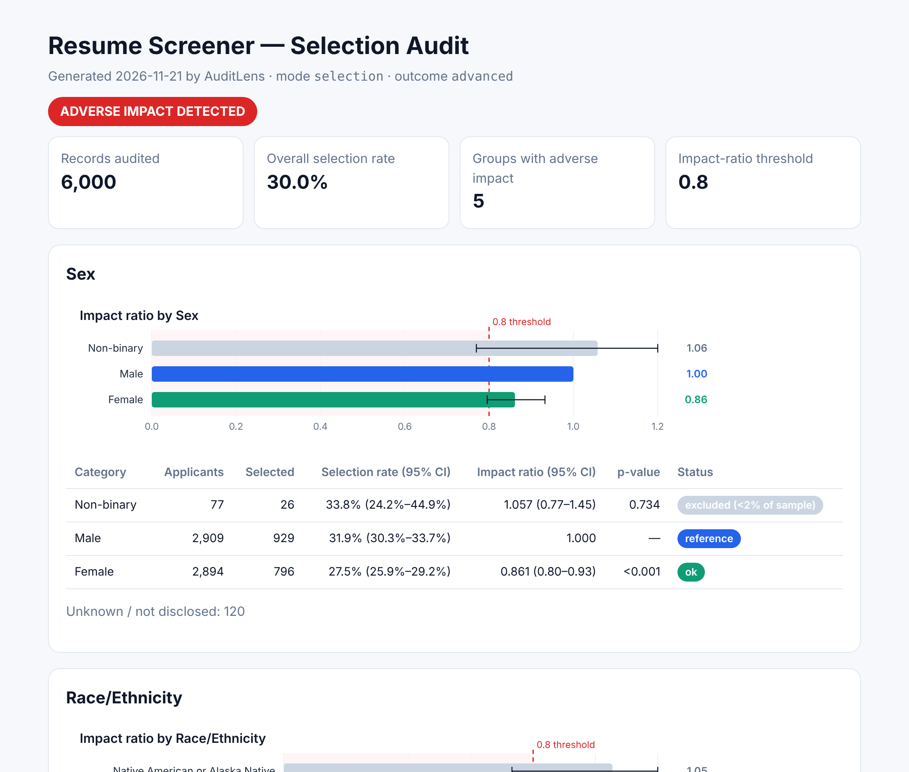
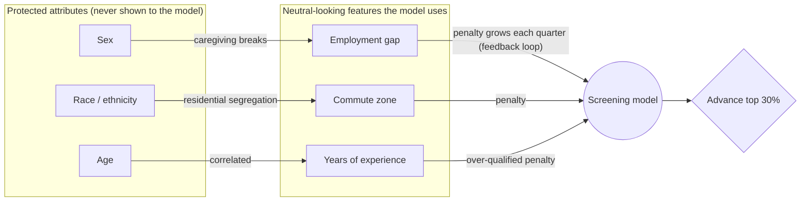
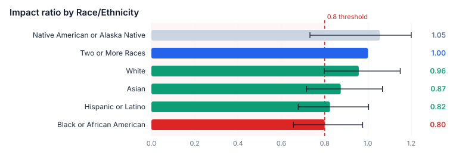
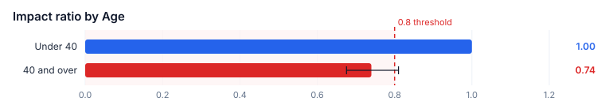
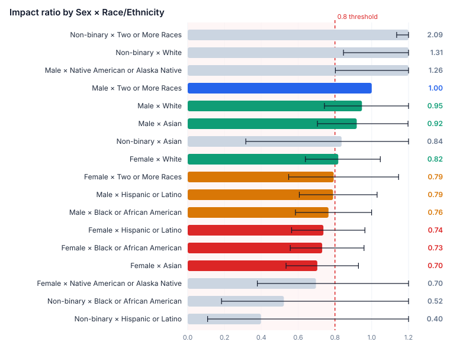
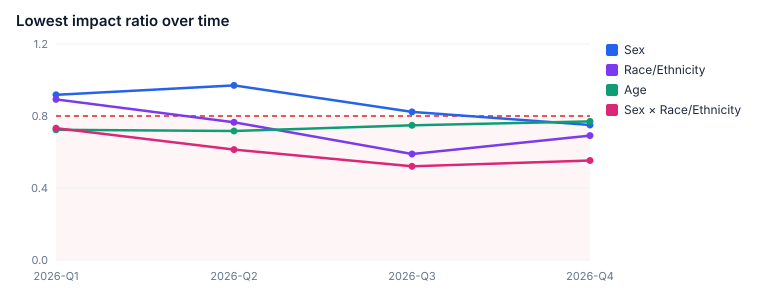
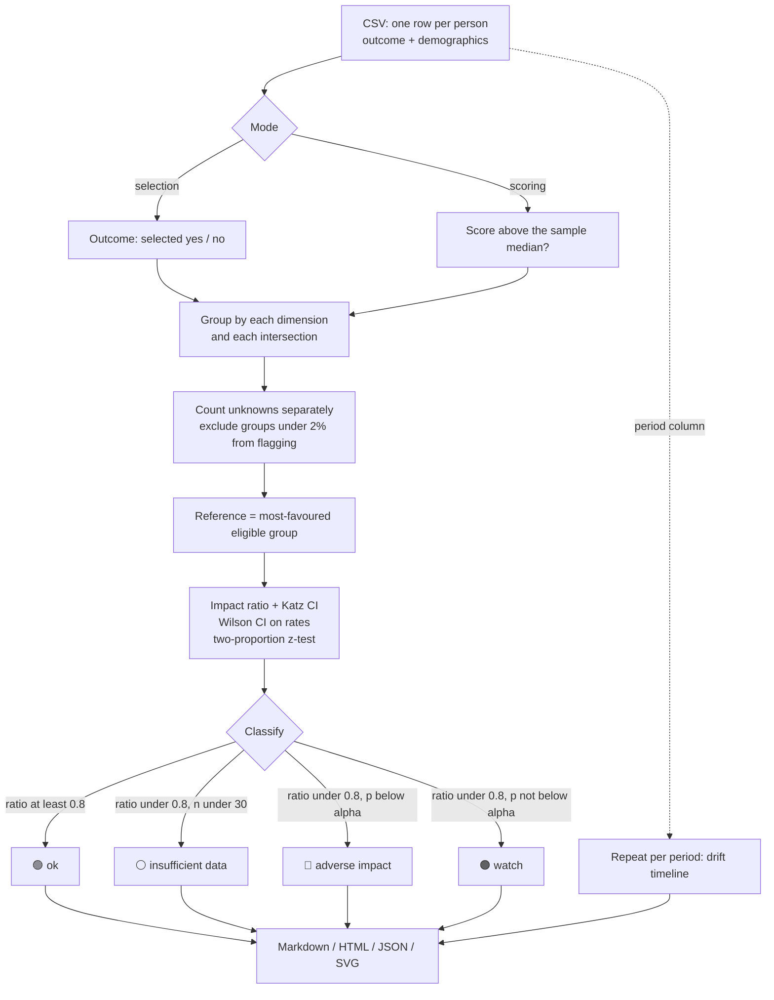

<div align="center">

# 🔍 AuditLens

**Open, explainable bias audits for automated hiring tools.**

Find out whether your résumé screener, assessment, or ranking model treats people differently by sex, race/ethnicity, age, and their intersections. Get results you can defend in plain language and publish, with no data leaving your machine.




</div>

---

## Table of contents

- [The problem](#the-problem)
- [What AuditLens does](#what-auditlens-does)
- [Quick start](#quick-start)
- [Case study: the bias nobody programmed](#case-study-the-bias-nobody-programmed)
- [How it works](#how-it-works)
- [Using it on your own data](#using-it-on-your-own-data)
- [Reading the results](#reading-the-results)
- [Continuous monitoring in CI](#continuous-monitoring-in-ci)
- [Design principles & ethics](#design-principles--ethics)
- [Limitations](#limitations)
- [Project structure](#project-structure)
- [Roadmap](#roadmap)

---

## The problem

Automated tools now sit between millions of job seekers and their next job. They parse résumés, score video interviews, and rank candidates before any human looks. When one of these tools is biased, it isn't one bad interviewer. It repeats the same unfair decision **at scale, without anyone noticing, on every applicant**.

The canonical example: in 2018 Reuters reported that Amazon scrapped an experimental recruiting model after finding it **penalised résumés containing the word "women's"** (as in "women's chess club captain"). No one told the model to do that. It learned from a decade of historical hiring data.

Regulators are responding:

| Rule | What it asks for |
|---|---|
| **EEOC Uniform Guidelines (1978)**, 29 CFR §1607.4(D) | The *four-fifths rule*: a selection rate for any group below 80% of the highest group's rate is generally treated as evidence of adverse impact. |
| **NYC Local Law 144** (enforced since July 2023) | Employers using an Automated Employment Decision Tool must have an annual **bias audit** that reports selection/scoring rates and **impact ratios** by sex, race/ethnicity, and their **intersection**, and must publish a summary. |
| **EU AI Act** | Classifies AI used in recruitment and worker management as **high-risk**, which brings requirements for risk management, data governance and monitoring. |
| **US state laws** (e.g. Colorado SB 24-205, Illinois HB 3773) | Duties to prevent algorithmic discrimination in consequential decisions such as employment. |

**The gap:** most organisations, especially small employers, non-profits, public agencies, and the people auditing them (journalists, researchers, advocates), lack an accessible, transparent tool for doing this analysis well. Spreadsheets compute a ratio but say nothing about uncertainty. Commercial audit platforms are expensive black boxes, which is a strange way to check another black box. Meanwhile the legal minimum is easy to meet in a way that **misses real harm**:

- 📉 **One annual snapshot hides drift.** A model retrained on its own decisions can get steadily worse in between audits.
- 🧩 **Single-axis checks hide intersectional harm.** A tool can look fine for "women" and fine for "Black applicants" and still badly disadvantage Black women.
- 🎲 **Raw ratios ignore noise.** A ratio of 0.75 on 12 people is noise, while 0.85 on 3,000 people with a tight confidence interval is a real, consistent gap.

## What AuditLens does

AuditLens is a small, auditable Python toolkit and CLI that turns a CSV of decisions into a rigorous, plain-language bias audit.

| | Feature | Why it matters |
|---|---|---|
| ⚖️ | **LL144-style impact ratios** for selection (pass/fail) *and* scoring (numeric score vs. sample median) tools | Covers the standard methodology regulators and auditors already use |
| 🧩 | **Intersectional analysis** of any combination of attributes | Catches harm that single-axis checks structurally can't see |
| 📈 | **Drift tracking** across periods (months, quarters, model versions) | Turns a one-off compliance exercise into ongoing monitoring |
| 🎯 | **Wilson & Katz confidence intervals, two-proportion z-tests** | Separates real disparities from small-sample noise |
| 🚦 | **Four-level status**: adverse impact · watch · insufficient data · ok | Avoids both false alarms and false reassurance |
| 🕳️ | **Missing-data accounting** with warnings when non-disclosure is high | Missing demographics can *hide* bias, so they are reported, not dropped silently |
| 🔒 | **Small-cell suppression** (`--suppress-below 5`) | Lets you publish summaries without re-identifying individuals |
| 🧾 | **Markdown, self-contained HTML (inline SVG charts) and JSON** outputs | For humans, for public posting, and for downstream systems |
| 🚨 | **`--fail-on-adverse` exit code** | Gate model deployments in CI the same way you gate failing tests |
| 📦 | **Zero dependencies**, pure standard-library Python | Runs in locked-down HR/IT environments, and every line can be read and checked |

## Quick start

```bash
git clone https://github.com/kareemrt/EthicalAI.git
cd EthicalAI/AuditLens

# Generate a synthetic applicant pool with a hidden bias and audit it
python -m auditlens demo --out examples

# Open the report
open examples/selection_audit.html      # macOS  (xdg-open on Linux)
```

Or install it as a command:

```bash
pip install -e .
auditlens --help
```

## Case study: the bias nobody programmed

The `demo` command simulates 6,000 applicants to a résumé screener across four quarters of 2026 ([`auditlens/synth.py`](auditlens/synth.py)). The simulated model **never sees sex, race or age**. It penalises three features that *look* neutral:



This is the "fairness through unawareness" trap: deleting the sensitive columns doesn't remove the bias, it only stops you from seeing it. AuditLens finds it:

```text
Resume Screener — Selection Audit: ADVERSE IMPACT DETECTED
  6,000 records · overall rate 30.0%
  Sex                              min impact ratio 0.86
  Race/Ethnicity                   min impact ratio 0.80  ⚠ Black or African American
  Age                              min impact ratio 0.74  ⚠ 40 and over
  Sex × Race/Ethnicity             min impact ratio 0.70  ⚠ Female × Hispanic or Latino, Female × Black or African American, Female × Asian
```

### Finding 1: Race-proxy and age bias are clear





Bars show impact ratios, whiskers show 95% confidence intervals, and the shaded region is below the four-fifths threshold. Grey bars are groups under 2% of the sample. They are shown for transparency but excluded from flagging, as LL144 permits.

Applicants aged 40 and over advance at **74%** of the rate of younger applicants (95% CI 0.68–0.81, p < 0.001), even though the model never saw age. Black applicants are at **0.80**, a statistically significant gap.

> 💡 Notice that the reference group for race is *Two or More Races*, a small group (257 people) whose rate is noisy. LL144's "compare to the highest group" method is sensitive to this. The confidence intervals make it visible, so an auditor can tell when a conclusion depends on one noisy group.

### Finding 2: The intersectional view surfaces harm the single-axis view hides

On sex alone, women pass with an impact ratio of 0.86. Crossed with race, Hispanic, Black and Asian women all fall significantly below the line, at 0.70–0.74:



### Finding 3: An annual audit would have missed the trend

Taken over the whole year, the sex dimension passes (0.86). The drift view shows it falling quarter by quarter as the employment-gap penalty grows, until it **crosses the 0.8 line in Q4**:



| Dimension | 2026-Q1 | 2026-Q2 | 2026-Q3 | 2026-Q4 |
|---|---:|---:|---:|---:|
| Sex | 0.918 | 0.970 | 0.823 | **0.750 ⚠️** |
| Race/Ethnicity | 0.892 | 0.765 ⚠️ | 0.589 ⚠️ | 0.691 ⚠️ |
| Age | 0.723 ⚠️ | 0.717 ⚠️ | 0.748 ⚠️ | 0.770 ⚠️ |
| Sex × Race/Ethnicity | 0.732 ⚠️ | 0.614 ⚠️ | 0.520 ⚠️ | 0.553 ⚠️ |

> Per-period figures use smaller samples, so treat them as an early-warning signal and confirm with the full-period tables, which include significance tests.

The full outputs are in [`examples/`](examples/): [`selection_audit.md`](examples/selection_audit.md), [`selection_audit.html`](examples/selection_audit.html), [`selection_audit.json`](examples/selection_audit.json) and [`scoring_audit.md`](examples/scoring_audit.md).

## How it works



**Definitions**

- **Selection rate** = selected ÷ total in category.
- **Scoring rate** = share of a category scoring *above the median* of the whole sample (the LL144 definition for tools that output scores).
- **Impact ratio** = category rate ÷ rate of the most-favoured category.
- **Rate CI**: Wilson score interval, which stays reliable for small groups and extreme rates.
- **Impact-ratio CI**: Katz log method for a ratio of two proportions.
- **Significance**: pooled two-proportion z-test against the reference group.

## Using it on your own data

Your CSV needs one row per person, an outcome column, and one column per demographic attribute:

```csv
applicant_id,quarter,sex,race_ethnicity,age_band,advanced
A00001,2026-Q1,Female,Black or African American,Under 40,1
A00002,2026-Q1,Male,White,40 and over,0
A00003,2026-Q1,,Asian,Under 40,0
```

```bash
python -m auditlens audit decisions.csv \
  --outcome advanced \
  --attr "Sex=sex" \
  --attr "Race/Ethnicity=race_ethnicity" \
  --attr "Age=age_band" \
  --intersect "Sex,Race/Ethnicity" \
  --period quarter \
  --title "Q4 Screener Audit" \
  --md report.md --html report.html --json report.json --charts charts/ \
  --suppress-below 5
```

For tools that output a **score** rather than a decision, use `--mode scoring --outcome score`.

Outcome values such as `1/0`, `yes/no`, `true/false`, `selected`, `hired` and `advanced` are recognised. Blank, `unknown`, `declined`, `prefer not to say` and similar demographic values are counted as **unknown** and reported separately.

<details>
<summary><b>All options</b></summary>

| Option | Default | Description |
|---|---|---|
| `--outcome COL` | *required* | Decision column (selection) or numeric score column (scoring) |
| `--mode` | `selection` | `selection` or `scoring` |
| `--attr NAME=COL` | *required* | Demographic dimension; repeatable |
| `--intersect A,B` | – | Cross two or more dimensions; repeatable |
| `--period COL` | – | Column used for drift tracking |
| `--threshold` | `0.8` | Impact-ratio threshold |
| `--alpha` | `0.05` | Significance level |
| `--min-share` | `0.02` | Groups below this share of the sample are excluded from flagging |
| `--min-group-size` | `30` | Groups smaller than this are marked *insufficient data* |
| `--suppress-below N` | `0` | Mask counts below N in Markdown/HTML reports |
| `--md / --html / --json` | – | Output paths |
| `--charts DIR` | – | Write standalone SVG charts |
| `--fail-on-adverse` | off | Exit with status 2 if adverse impact is found |

</details>

### Python API

```python
from auditlens import audit, load_csv, to_html

rows = load_csv("decisions.csv")
result = audit(
    rows,
    outcome="advanced",
    attributes={"Sex": "sex", "Race/Ethnicity": "race_ethnicity"},
    intersections=[("Sex", "Race/Ethnicity")],
    period="quarter",
)

print(result.verdict)                     # "ADVERSE IMPACT DETECTED"
for dim in result.dimensions:
    for g in dim.flagged:
        print(dim.name, g.category, round(g.impact_ratio, 2), g.impact_ratio_ci)

open("report.html", "w").write(to_html(result, suppress_below=5))
```

## Reading the results

| Status | Meaning | Suggested action |
|---|---|---|
| 🔵 **reference** | The most-favoured eligible group; every other group is compared to it | – |
| 🟢 **ok** | Impact ratio ≥ threshold | Keep monitoring; check intersections and drift |
| 🟠 **watch** | Below threshold but not statistically significant | Collect more data and investigate early, since it may be real |
| 🔴 **adverse impact** | Below threshold **and** statistically significant | Investigate the features driving it, consider pausing the tool, consult counsel |
| ⚪ **insufficient data / excluded** | Too few records to judge | Don't read "no flag" as "no problem" |

**Overall verdict:** `ADVERSE IMPACT DETECTED` if any group is red, `REVIEW RECOMMENDED` if any is orange, otherwise `NO ADVERSE IMPACT DETECTED`.

## Continuous monitoring in CI

Treat fairness regressions like failing tests. AuditLens exits with status `2` when adverse impact is found:

```yaml
# .github/workflows/fairness.yml
- name: Bias audit of latest model decisions
  run: |
    python -m auditlens audit data/holdout_decisions.csv \
      --outcome advanced --attr "Sex=sex" --attr "Race=race" \
      --intersect "Sex,Race" --html fairness_report.html --fail-on-adverse
- uses: actions/upload-artifact@v4
  if: always()
  with: { name: fairness-report, path: fairness_report.html }
```

This repository's own workflow ([`.github/workflows/auditlens.yml`](../.github/workflows/auditlens.yml)) runs the test suite and the demo audit on every push.

## Design principles & ethics

1. **Local-first and private by default.** Demographic data is among the most sensitive data an organisation holds. AuditLens makes no network calls and has no dependencies, and small-cell suppression protects individuals in published reports.
2. **Transparent over clever.** Every statistic is a few readable lines of standard-library Python ([`auditlens/stats.py`](auditlens/stats.py)). A fairness tool that is itself a black box defeats the purpose.
3. **Honest about uncertainty.** Confidence intervals, significance tests and an explicit *insufficient data* state stop small groups from being either falsely accused or falsely cleared.
4. **Beyond the legal minimum.** Intersectionality, drift and missing-data warnings are included because that is where harm hides, even where the law doesn't yet require them.
5. **Accessible.** Built for small employers, public agencies, journalists, researchers and worker advocates, not only for companies with a data-science team.

## Limitations

AuditLens is a measurement tool. It is **not legal advice**, and running it does not make a tool compliant.

- **Independence is required.** LL144 requires the audit to be performed by an *independent auditor*. AuditLens can be that auditor's tool, but it can't be the auditor.
- **Impact ratios measure outcomes, not causes.** A disparity is a signal to investigate job-relatedness and less-discriminatory alternatives, not a verdict on intent.
- **A clean audit is necessary, not sufficient.** It doesn't cover accessibility (e.g. for disabled candidates), the validity of the tool for the job, explanation and appeal rights, or harms to people the tool never scored.
- **Statistics:** the z-test is a large-sample approximation. For very small groups, use an exact test, or better, collect more data. Running many comparisons inflates false positives, so treat marginal p-values with care.
- **Demographic data quality:** self-reported categories can be coarse, missing, or collected without meaningful consent. Collect it ethically, store it separately from decision-making systems, and never feed it back into the model.
- **Synthetic demo:** the case-study data is simulated to illustrate realistic mechanisms. It is not a measurement of any real product.

## Project structure

```
AuditLens/
├── auditlens/
│   ├── audit.py        # core engine: rates, impact ratios, intersections, drift
│   ├── stats.py        # Wilson / Katz intervals, z-test, median (stdlib only)
│   ├── report.py       # Markdown, HTML + inline SVG charts, JSON
│   ├── synth.py        # synthetic applicant generator with hidden proxy bias
│   └── cli.py          # `auditlens audit` and `auditlens demo`
├── tests/              # 20 unit + end-to-end tests (unittest / pytest)
├── examples/           # generated demo data and reports
├── docs/img/           # README visuals
└── pyproject.toml
```

Run the tests:

```bash
python -m unittest discover -s tests     # or: pytest
```

## Roadmap

- [ ] Optional *pooled* or *largest-group* reference to reduce sensitivity to small, noisy reference groups
- [ ] Exact (Fisher / Barnard) tests for small groups, and multiple-comparison correction
- [ ] **Proxy detector:** rank input features by how strongly they predict protected attributes, to show *why* a disparity exists
- [ ] Additional fairness metrics where ground truth is available (equal opportunity, calibration by group)
- [ ] LL144 public-summary template export
- [ ] Browser-only version (Pyodide) so non-technical users can audit a CSV without installing anything
- [ ] Support for disability and veteran-status self-identification categories

## Contributing

Issues and pull requests are welcome, particularly from HR practitioners, employment lawyers, auditors, and people affected by automated hiring. Please include tests for any statistical change.

## License

MIT
