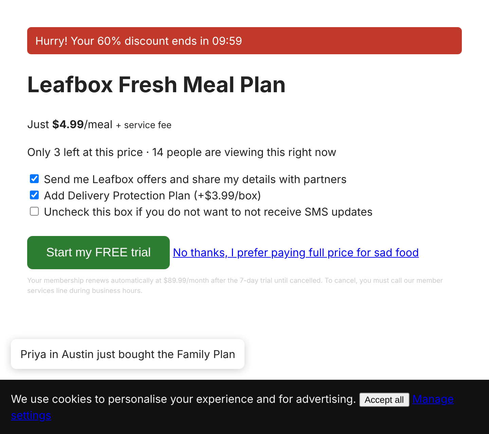
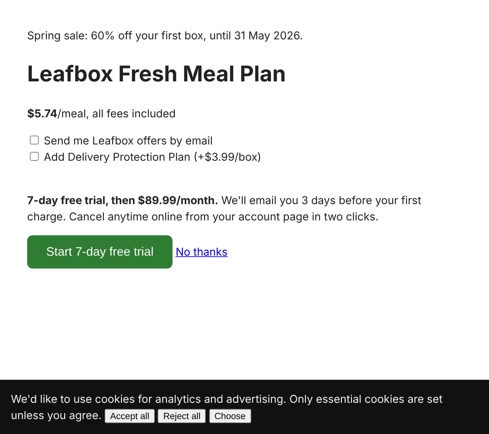
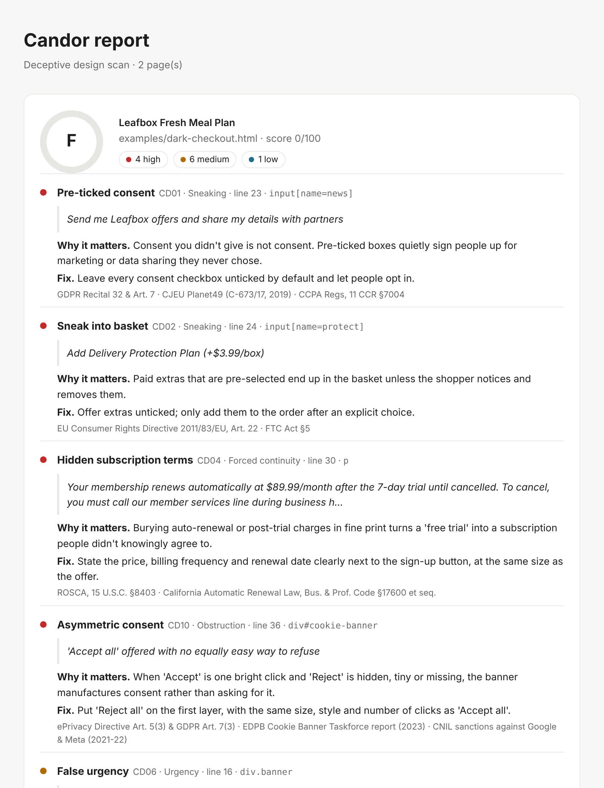
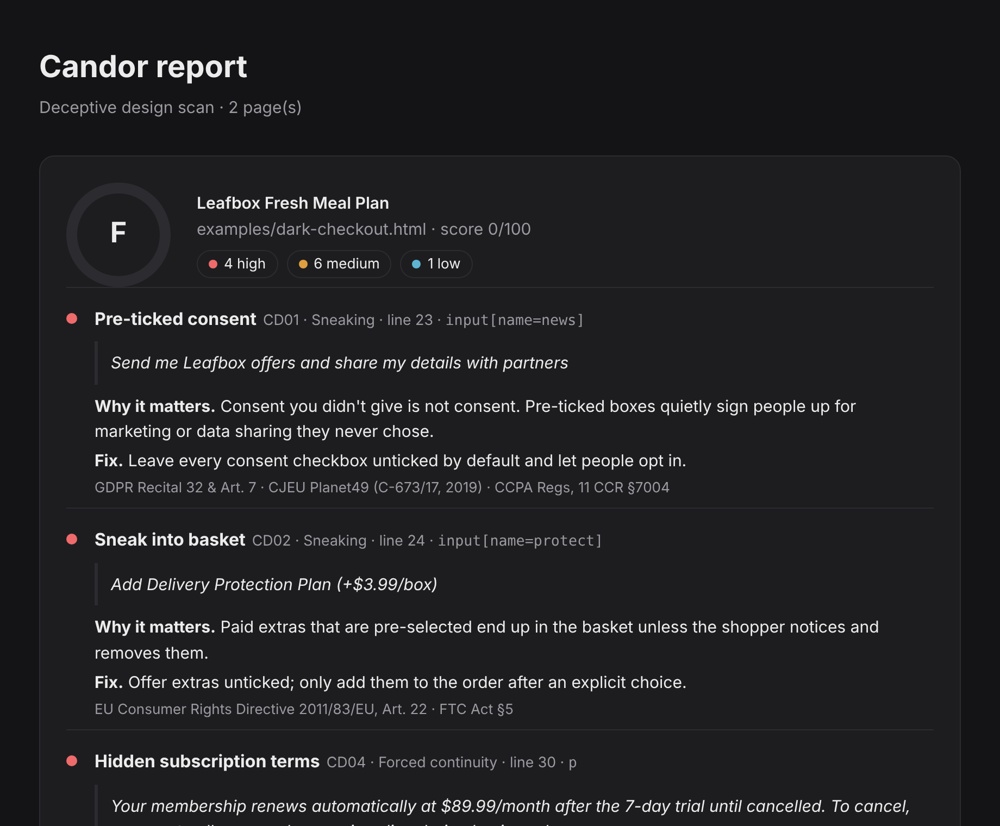
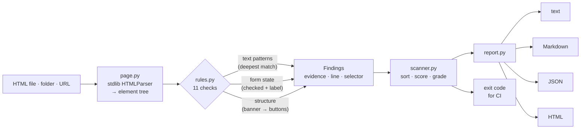
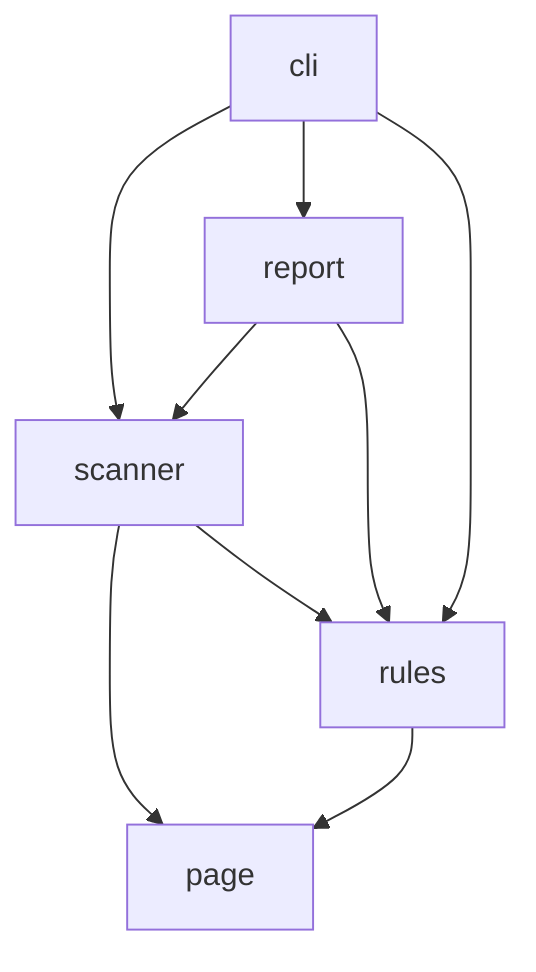

<div align="center">

# 🔦 Candor

**A linter for deceptive design.**
Candor scans web pages for *dark patterns* (pre-ticked consent, fake countdowns, hidden subscriptions, one-sided cookie banners) and explains each one: why it harms people, how to fix it, and which law or regulator guidance it runs into.

`zero dependencies` · `Python 3.9+` · `~700 lines` · `11 explainable rules` · `CI-ready exit codes`

</div>

---

## Contents

- [Why this matters](#why-this-matters)
- [What it looks like](#what-it-looks-like)
- [Quick start](#quick-start)
- [The rules](#the-rules)
- [How it works](#how-it-works)
- [Codebase structure](#codebase-structure)
- [Use it in CI](#use-it-in-ci)
- [Scoring](#scoring)
- [Limitations and responsible use](#limitations-and-responsible-use)
- [Adding a rule](#adding-a-rule)

---

## Why this matters

Dark patterns are interface tricks that steer people into choices they wouldn't otherwise make: buying extras, sharing data, staying subscribed. They are common and they cost people money:

| Finding | Source |
|---|---|
| **1,818** dark-pattern instances on **1,254** of ~11,000 shopping sites | Mathur et al., *Dark Patterns at Scale*, CSCW 2019 |
| **148 of 399** EU online shops used fake timers, hidden information or manipulative interfaces | European Commission consumer sweep, 2022 |
| **76%** of 642 sites and apps used at least one possible dark pattern | ICPEN / GPEN review, coordinated with the FTC, 2024 |

Regulators are acting on this: the EU Digital Services Act (Art. 25), GDPR consent rules, the FTC's fee rule and ROSCA enforcement, California's auto-renewal and honest-pricing laws. Enforcement only happens *after* people have been harmed, though. Most of these patterns ship because nobody on the team flagged them during review.

**Candor moves the check earlier.** It runs like a linter: in a pull request, on a staging build, or against a live URL. It names the pattern in plain language, so designers, engineers, product managers, journalists and regulators can all read the same report.

> **Who it's for:** product teams who want honest UX by default · accessibility and trust & safety reviewers · consumer advocates and researchers auditing sites at scale · students learning what deceptive design looks like.

---

## What it looks like

The same checkout, built two ways. Both pages are in [`examples/`](examples/).

| ❌ `dark-checkout.html` (score **0 · F**) | ✅ `fair-checkout.html` (score **100 · A**) |
|---|---|
|  |  |

The offer is identical: 60% off, a 7-day trial, then $89.99/month. The honest version states the full price, leaves boxes unticked, puts the renewal terms at full size and gives the cookie banner a real **Reject all** button.

### HTML report (light and dark)

<p align="center">
  
  
</p>

### Terminal

```text
$ candor examples/dark-checkout.html --only CD01,CD09,CD10
examples/dark-checkout.html  score 62/100 (C)  2 high · 1 medium · 0 low
  ● CD01 Pre-ticked consent  line 23 · input[name=news]
      “Send me Leafbox offers and share my details with partners”
      fix: Leave every consent checkbox unticked by default and let people opt in.
  ● CD10 Asymmetric consent  line 36 · div#cookie-banner
      “'Accept all' offered with no equally easy way to refuse”
      fix: Put 'Reject all' on the first layer, with the same size, style and number of clicks as 'Accept all'.
  ◐ CD09 Confirmshaming  line 28 · a.decline
      “No thanks, I prefer paying full price for sad food”
      fix: Use neutral labels for every choice, e.g. 'No thanks'.
```

Full sample outputs: [HTML](docs/sample-report.html) · [Markdown](docs/sample-report.md) · [JSON](docs/sample-report.json)

---

## Quick start

No install is needed. Clone the repo and run:

```bash
cd Candor
python -m candor examples/                      # scan a folder of .html files
python -m candor https://example.com            # scan a live URL
python -m candor page.html -f html -o report.html
python -m candor --rules                        # list every rule
```

Or install the `candor` command:

```bash
pip install ./Candor
candor build/ --fail-on medium
```

| Option | Meaning |
|---|---|
| `targets…` | HTML files, folders (searched recursively) or `http(s)://` URLs |
| `-f, --format` | `text` (default, coloured in a TTY), `md`, `json`, `html` |
| `-o, --output` | Write the report to a file |
| `--fail-on` | Exit `1` if a finding is at least `high` (default), `medium` or `low`; `never` always exits `0` |
| `--only` | Run a subset of rules, e.g. `--only CD01,CD10` |

Exit codes: `0` clean · `1` findings at or above the threshold · `2` input error.

As a library:

```python
from candor import scan

report = scan(html, source="checkout.html")
print(report.score, report.grade)
for f in report.findings:
    print(f.rule.id, f.rule.name, f.line, f.evidence)
```

---

## The rules

Each rule is one small function with its explanation, fix and references stored next to it.

| ID | Pattern | Severity | Detects | Grounding |
|---|---|:-:|---|---|
| CD01 | **Pre-ticked consent** | 🔴 high | Checked boxes for marketing, newsletters, data sharing | GDPR Recital 32; CJEU *Planet49* |
| CD02 | **Sneak into basket** | 🔴 high | Pre-selected paid extras: insurance, protection plans, donations | EU Consumer Rights Directive Art. 22 |
| CD03 | **Drip pricing** | 🟠 medium | "Fees calculated at checkout", "+ service fee" | FTC fee rule (16 CFR 464); CA SB 478 |
| CD04 | **Hidden subscription terms** | 🔴 high | Auto-renewal or post-trial billing in fine print, faint or hidden text | ROSCA; CA Auto-Renewal Law |
| CD05 | **Obstructed cancellation** | 🟠 medium | "To cancel, call…", cancellation by post or in person only | ROSCA §8403(3); CA ARL §17602 |
| CD06 | **False urgency** | 🟠 medium | Countdown timers, "offer ends in", "hurry", "last chance" | EU UCPD Annex I §7 |
| CD07 | **Scarcity pressure** | 🔵 low | "Only 3 left", "14 people are viewing this" | EU UCPD Art. 6 |
| CD08 | **Activity notifications** | 🟠 medium | "Priya in Austin just bought…" pop-ups | EU UCPD Art. 6 |
| CD09 | **Confirmshaming** | 🟠 medium | Decline buttons that insult the user ("No, I hate saving money") | FTC 2022 report; DSA Art. 25 |
| CD10 | **Asymmetric consent** | 🔴 high | Cookie banners with "Accept" but no "Reject", or a reject that is a tiny link | EDPB Cookie Banner Taskforce; CNIL sanctions |
| CD11 | **Trick question** | 🟠 medium | Double negatives: "Untick if you do not want to not receive…" | CCPA Regs §7004 |

Taxonomy follows Mathur et al. (2019) and the FTC staff report *Bringing Dark Patterns to Light* (2022).

### Designed to avoid false positives

Each rule is tested against honest look-alikes that must **not** fire. For example:

| Fires | Does not fire |
|---|---|
| `☑ Email me special deals` | `☐ Email me special deals`, `☑ Remember me` |
| `<small>Then automatically billed $20/month</small>` | The same sentence at normal size |
| `<div class="countdown">04:59</div>` | `<p class="time">Opening hours 09:00</p>` |
| `No thanks, I hate saving money` | `No thanks`, `No, cancel` |
| Cookie banner with only **Accept** | **Accept all** + **Reject all** as equal buttons |

---

## How it works



**1. Parse (`page.py`).** A ~180-line wrapper around Python's built-in `HTMLParser` builds a light element tree. Each element knows its text, line number, parent, and two inherited flags:
- **`hidden`**: `hidden`, `aria-hidden="true"`, `display:none`, `visibility:hidden`
- **`fine`**: `<small>`, font size ≤ 11px, faint light-grey text, or `fine-print`/`disclaimer` classes

`<script>`, `<style>`, `<svg>` and `<head>` are skipped. Unclosed `<p>` and `<li>` tags are closed automatically.

**2. Detect (`rules.py`).** Rules use three kinds of evidence:
- **Text**: a regex over element text. `Page.deepest()` returns the *innermost* matching element, so one sentence gives one finding (not one per ancestor `div`). A child's text is always part of its parent's, so the search only enters subtrees that match. That keeps scans roughly linear.
- **Form state**: checked checkboxes plus their resolved label (`<label for>`, a wrapping `<label>`, or the parent).
- **Structure**: for CD10, find the container around an *Accept* button that mentions cookies, then check whether a *Reject* option exists inside it and whether it is equally prominent.

Fine print matters: renewal terms at normal size are honest disclosure, and the same words at 10px light grey are a CD04 finding.

**3. Report (`scanner.py`, `report.py`).** Findings are sorted by severity, then by line. They are scored, then rendered. The HTML report is a single self-contained file with automatic light and dark themes.

**Performance:** a 600 KB page with 21,000 elements scans in about 0.4 s, and most of that is the standard-library parser.

---

## Codebase structure

```text
Candor/
├── candor/                  # the package: stdlib only
│   ├── __init__.py          # public API: scan(), Report, __version__
│   ├── __main__.py          # enables `python -m candor`
│   ├── page.py              # HTML → element tree with hidden/fine-print flags, label lookup, deepest-match search
│   ├── rules.py             # the rulebook: @rule registry, 11 detectors, why/fix/refs for each
│   ├── scanner.py           # runs rules → Finding/Report, scoring and grading
│   ├── report.py            # renderers: text (ANSI), Markdown, JSON, standalone HTML
│   └── cli.py               # argument parsing, file/folder/URL loading, exit codes
├── tests/
│   └── test_candor.py       # parser, a positive and negative case for every rule, examples, CLI
├── examples/
│   ├── dark-checkout.html   # one page that triggers all 11 rules
│   └── fair-checkout.html   # the same offer presented honestly: 0 findings
├── docs/                    # screenshots + sample reports in every format
├── pyproject.toml           # optional install → `candor` command
└── LICENSE                  # MIT
```

How the modules depend on each other (no cycles; `page.py` imports nothing from the package):



| Module | Main names | Responsibility |
|---|---|---|
| `page.py` | `Page`, `Element`, `Page.deepest()`, `Page.label_for()` | Parsing and querying; no detection logic |
| `rules.py` | `Rule`, `RULES`, `@rule`, `text_rule()` | What counts as deceptive, and why |
| `scanner.py` | `scan()`, `Report`, `Finding` | Orchestration and scoring |
| `report.py` | `FORMATS` | Presentation only |
| `cli.py` | `main()` | I/O and process exit codes |

---

## Use it in CI

Fail a pull request when someone adds a pre-ticked consent box:

```yaml
# .github/workflows/honest-ux.yml
name: Honest UX
on: [pull_request]
jobs:
  candor:
    runs-on: ubuntu-latest
    steps:
      - uses: actions/checkout@v4
      - uses: actions/setup-python@v5
        with: { python-version: "3.12" }
      - run: pip install ./Candor        # or vendor the 7 files
      - run: npm ci && npm run build      # produce static HTML
      - run: candor dist/ --fail-on high -f md -o candor.md
      - if: always()
        run: cat candor.md >> "$GITHUB_STEP_SUMMARY"
```

This repository runs its own tests the same way: [`.github/workflows/candor.yml`](../.github/workflows/candor.yml).

**Single-page apps:** Candor reads HTML, not JavaScript. For client-rendered pages, save the rendered DOM first (for example with Playwright, `page.content()`), then scan that file.

---

## Scoring

```
score = 100 − Σ penalty      high 15 · medium 8 · low 3   (at most 2 counted per rule)
grade = A ≥ 90 · B ≥ 75 · C ≥ 60 · D ≥ 40 · F
```

The per-rule cap stops one repeated pattern, such as a product grid with "only 2 left" on every card, from dominating the score. Every finding is still listed in the report.

---

## Limitations and responsible use

- **Heuristic, not a verdict.** A "low stock" message is legal if the stock really is low, and Candor can't see your inventory. Treat findings as **review prompts**, not proof of wrongdoing.
- **Not legal advice.** References show where a pattern has drawn regulatory attention. Whether a specific page breaks a specific law depends on jurisdiction and context.
- **English only, static HTML only.** Rules match English phrasing. Patterns that exist only in JavaScript behaviour (timers that reset, nagging modals, multi-step cancellation flows) need a rendered DOM or are out of scope for now.
- **Visual prominence is approximated** from inline styles, `<small>` and class names. Candor does not compute rendered CSS, so a reject button made tiny by an external stylesheet will be missed.

If you use Candor to audit third-party sites, report findings fairly: quote the evidence and the context, and give the operator a chance to respond.

---

## Adding a rule

1. Write a detector in `candor/rules.py`. For phrase-based patterns, one call is enough:

   ```python
   rule("CD12", "Nagging", "Interface interference", "low",
        why="Repeated prompts wear people down until they give in.",
        fix="Ask once; respect 'not now' for a meaningful period.",
        refs=("FTC, Bringing Dark Patterns to Light (2022)",),
        )(text_rule(rx(r"remind me (later|tomorrow)|ask me again")))
   ```

2. Add a positive example and at least one honest look-alike to `RuleTest.cases` in `tests/test_candor.py`. The test suite fails if any rule is missing cases.
3. Run `python -m unittest discover -s tests`.

---

<div align="center">
<sub>MIT licensed · part of <a href="../">EthicalAI</a> · built so the honest version is the easy version</sub>
</div>
