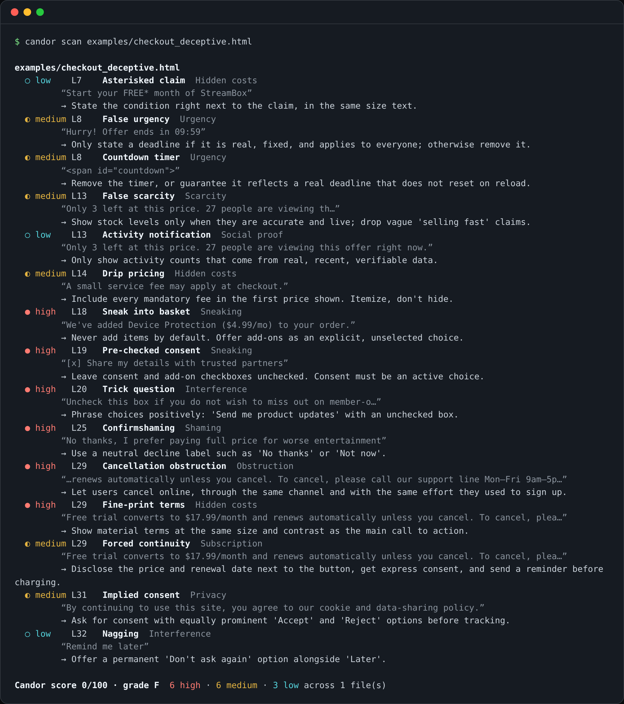
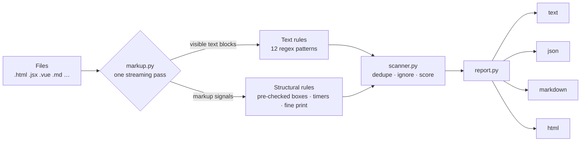
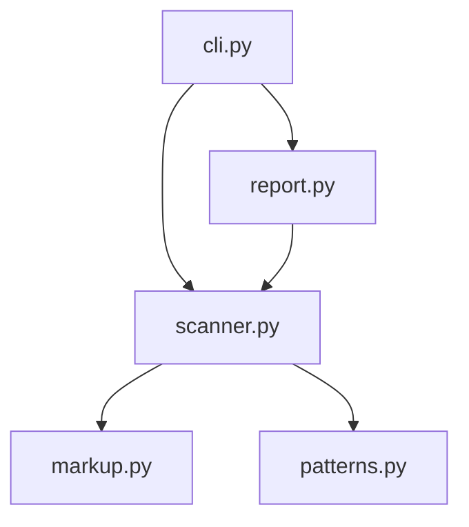

<div align="center">

# Candor

**A linter for deceptive design.**
Catch dark patterns in your UI before your users (or regulators) do.

`zero dependencies` · `pure Python 3.9+` · `~600 lines` · `CI-ready`

</div>

---

## Why this exists

Deceptive design (“dark patterns”) is interface design that tricks people into choices they didn’t mean to make: subscriptions they can’t cancel, add-ons they never picked, consent they never gave.

- A Princeton crawl of **~11,000 shopping sites** found dark patterns on **more than 1 in 10**, with many driven by off-the-shelf third-party scripts ([Mathur et al., 2019](https://arxiv.org/abs/1907.07032)).
- The FTC’s 2022 staff report [*Bringing Dark Patterns to Light*](https://www.ftc.gov/reports/bringing-dark-patterns-light) catalogs these tactics, and regulators now enforce against them: the **EU Digital Services Act (Art. 25)** bans them outright, and **GDPR** consent rules (see CJEU *Planet49*) make pre-ticked boxes invalid.
- AI-generated UI copy and “growth-optimized” templates reproduce these patterns at scale, often without anyone deciding to.

Most teams don’t *intend* to deceive. They copy a template, A/B test a headline, or ship a growth experiment. **Candor puts a check in the pipeline**, the same way ESLint catches bugs and axe catches accessibility issues, so deception gets spotted in code review instead of in a lawsuit.

## What it looks like

<p align="center"></p>

Every finding tells you **what** it found, **where** (file and line), **why** it harms users, **how** to fix it, and **which** regulation or research it maps to.

<p align="center">
  
  
</p>
<p align="center"><sub>The standalone HTML report (<code>-f html</code>), in light and dark mode.</sub></p>

## Quick start

```bash
cd candor
python -m candor scan examples/            # no install needed
pip install .                              # or install the `candor` command
candor scan src/templates --fail-under 90  # fail CI if any page scores below 90
```

Try the included before/after pair. It’s the same checkout page, built two ways:

| File | Score | Findings |
|---|:---:|---|
| [`examples/checkout_deceptive.html`](examples/checkout_deceptive.html) | **0 / F** | 6 high · 6 medium · 3 low |
| [`examples/checkout_honest.html`](examples/checkout_honest.html) | **100 / A** | none |
| [`examples/winback_email.md`](examples/winback_email.md) | **40 / D** | 2 high · 1 medium |

## How it works



1. **Extract.** A single pass with Python’s built-in `HTMLParser` (no DOM, no browser) turns markup into blocks of *visible* text tagged with line numbers. Scripts and styles are skipped.
2. **Inspect markup.** In that same pass it spots patterns that live in the HTML itself: **pre-checked** consent or add-on checkboxes, **countdown** elements, and material terms (prices, renewals, cancellation) set in **tiny or faded** text.
3. **Match copy.** Precompiled, case-insensitive rules look for manipulative language: confirmshaming, false urgency, obstruction, and the rest.
4. **Score.** Each page starts at 100. High findings cost 25 points, medium 10, low 3. The overall score is your **lowest page**, because a product is only as honest as its worst screen.

## What it detects

| Severity | Pattern | Example it catches | Grounded in |
|:---:|---|---|---|
| 🔴 | **Confirmshaming** | “No thanks, I prefer paying full price” | FTC 2022 · DSA Art. 25 |
| 🔴 | **Sneak into basket** | “We’ve added Device Protection to your order” | FTC 2022 · DSA Art. 25 |
| 🔴 | **Pre-checked consent** | `<input type=checkbox checked>` Share with partners | GDPR Art. 7 · *Planet49* |
| 🔴 | **Trick question** | “Uncheck this box if you do not wish to…” | FTC 2022 · CCPA §7004 |
| 🔴 | **Cancellation obstruction** | “To cancel, please call our support line” | ROSCA · FTC 2022 |
| 🔴 | **Fine-print terms** | Renewal price in 9px, light-grey text | ROSCA · DSA Art. 25 |
| 🟠 | **False urgency** | “Hurry! Offer ends in 09:59” | FTC 2022 · EU UCPD Annex I |
| 🟠 | **Countdown timer** | `<span id="countdown">` | FTC 2022 · EU UCPD Annex I |
| 🟠 | **False scarcity** | “Only 3 left at this price” | FTC 2022 · Mathur 2019 |
| 🟠 | **Drip pricing** | “A small service fee may apply at checkout” | FTC Fees Rule (16 CFR 464) |
| 🟠 | **Forced continuity** | “Converts to $17.99/mo unless you cancel” | ROSCA |
| 🟠 | **Implied consent** | “By continuing to use this site, you agree…” | GDPR · CCPA §7004 |
| 🔵 | **Activity notification** | “27 people are viewing this right now” | FTC 2022 · Mathur 2019 |
| 🔵 | **Nagging** | “Remind me later” with no “never” | FTC 2022 |
| 🔵 | **Asterisked claim** | “FREE*” | FTC 2022 |

Run `candor rules` for the full list with explanations. Every rule lives as plain data in [`candor/patterns.py`](candor/patterns.py), so adding one is a few lines.

## Usage

```text
candor scan PATH [PATH ...] [options]     # files, folders, or '-' for stdin
candor rules                              # list every pattern

  -f, --format {text,json,md,html}   output format (default: text)
  -o, --output FILE                  write the report to a file
  --min-severity {high,medium,low}   hide findings below a level
  --fail-under N                     exit 1 if the score is below N
  --no-color                         plain output (NO_COLOR is honored too)
```

**Scanned by default:** `.html .htm .xhtml .vue .svelte .jsx .tsx .astro .hbs .erb .jinja .j2` as markup, and `.txt .md .markdown` as copy (emails, CMS exports, i18n strings). `node_modules`, `dist`, `build`, and `.git` are skipped.

**Suppressing a reviewed finding.** If a deadline is real and audited, say so in the source:

```html
<!-- candor-ignore: Black Friday ends 2026-11-30 23:59 UTC for everyone -->
<p>Sale ends tonight</p>
```

A `candor-ignore` marker silences findings on its own line and the next. The reason stays in your code for reviewers.

### In CI (GitHub Actions)

```yaml
- uses: actions/setup-python@v5
  with: { python-version: "3.12" }
- run: pip install ./candor
- run: candor scan src/ --fail-under 90 -f md -o candor.md
- if: always()
  run: cat candor.md >> "$GITHUB_STEP_SUMMARY"
```

### As a library

```python
from candor import scan_text, scan_paths

result = scan_text('<button>No thanks, I hate saving money</button>')
for f in result.findings:
    print(f.pattern.name, f.line, f.pattern.fix)

report = scan_paths(["templates/"])
print(report.score, report.grade, report.to_dict())
```

## Codebase structure

```text
candor/
├── candor/
│   ├── __init__.py     Public API: scan_text, scan_paths, Report, Finding, PATTERNS
│   ├── __main__.py     Enables `python -m candor`
│   ├── patterns.py     The taxonomy as data: id, severity, why, fix, legal refs, regexes
│   ├── markup.py       Streaming HTML → (line, text) blocks + structural signals
│   ├── scanner.py      Engine: file discovery, rule matching, ignores, dedupe, scoring
│   ├── report.py       Renderers: ANSI text, JSON, Markdown table, standalone HTML
│   └── cli.py          argparse front end: `scan` and `rules`, CI exit codes
├── examples/
│   ├── checkout_deceptive.html   One page with 15 planted dark patterns
│   ├── checkout_honest.html      The same checkout done right (scores 100)
│   └── winback_email.md          Deceptive retention email copy
├── tests/test_candor.py  16 stdlib unittest cases: every rule, false positives, CLI
├── docs/                 README screenshots
└── pyproject.toml        Packaging; installs the `candor` command
```



**Design choices**

- **Zero dependencies.** Standard library only, so it installs anywhere, audits in minutes, and runs on air-gapped CI.
- **Explainable over clever.** Every finding traces back to a readable rule and a citation. No opaque model decides what counts as deceptive, which matters when the output feeds compliance decisions.
- **Data-driven rules.** Patterns are declarations, not code. Reviewing the taxonomy means reading one file.
- **Fast.** A single streaming pass with precompiled regexes handles ~2 MB of HTML per second on one core.

## Testing

```bash
cd candor && python -m unittest -v
```

The suite checks every text rule has a positive case, guards against known false positives (“No thanks”, “Cancel anytime in Settings”, “No service fees”, a clear price next to the trial button), verifies the structural detectors, and confirms `--fail-under` gates CI.

## Limitations & honest caveats

- **Candor flags risk; it doesn’t render verdicts.** “Only 3 left” is fine if it’s true. Treat medium and low findings as review prompts.
- **Static analysis only.** It reads source, not rendered pages. Content injected at runtime by JavaScript or A/B tools won’t be seen. Point it at server-rendered HTML or saved snapshots to cover those.
- **English only** for now. Rules are data, so contributions for other languages are welcome.
- **Visual tricks** such as a giant “Accept” next to a tiny grey “Reject” are only partly covered (via inline styles and fine-print class names). Full visual-hierarchy checks would need a rendering engine.
- **Not legal advice.** The citations show where each pattern is discussed or regulated, not whether your specific page violates a law.

## Roadmap

- Rendered-page mode (optional Playwright) for JS-injected content and visual asymmetry
- Cookie-banner checks: a Reject option as prominent as Accept
- Localized rule packs (ES, DE, FR, PT)
- SARIF output for GitHub code-scanning annotations

## References

- Mathur, A. et al. (2019). *Dark Patterns at Scale: Findings from a Crawl of 11K Shopping Websites.* CSCW. [arXiv:1907.07032](https://arxiv.org/abs/1907.07032)
- U.S. Federal Trade Commission (2022). [*Bringing Dark Patterns to Light*](https://www.ftc.gov/reports/bringing-dark-patterns-light).
- Regulation (EU) 2022/2065, Digital Services Act, Article 25.
- CJEU, Case C-673/17 *Planet49* (2019): pre-ticked boxes are not valid consent.
- Restore Online Shoppers’ Confidence Act, 15 U.S.C. §§ 8401–8405.
- FTC Rule on Unfair or Deceptive Fees, 16 CFR Part 464.
- California CCPA Regulations, 11 CCR § 7004.
- [deceptive.design](https://www.deceptive.design/) by Harry Brignull: the original pattern catalog.

## License

MIT
