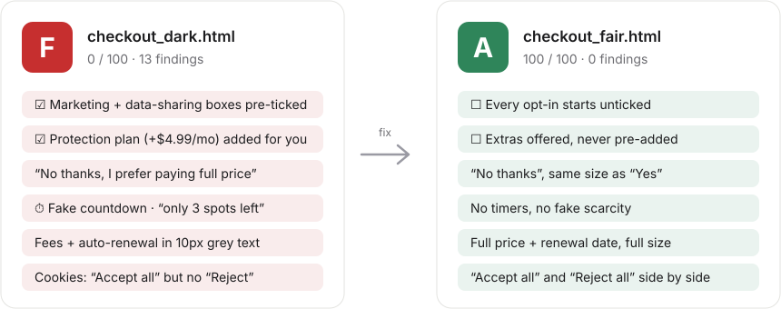
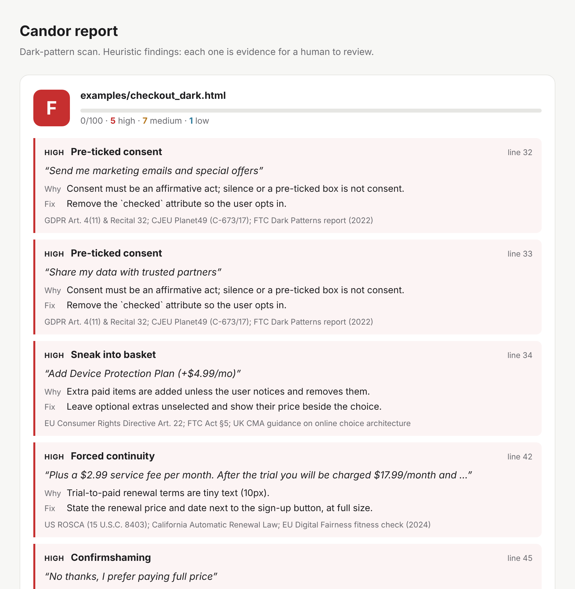
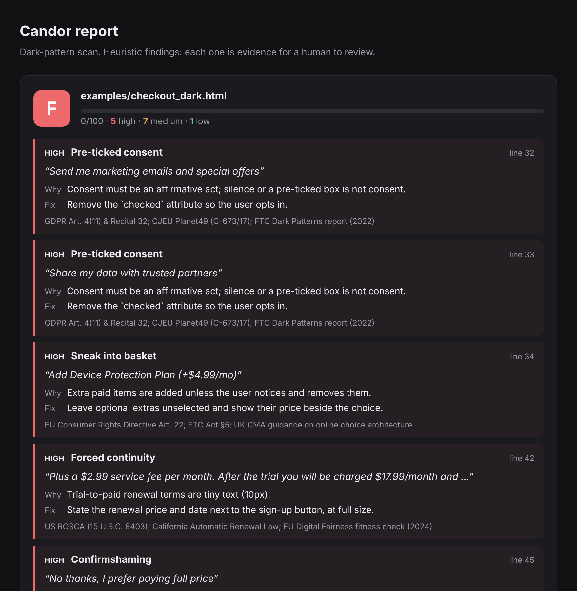
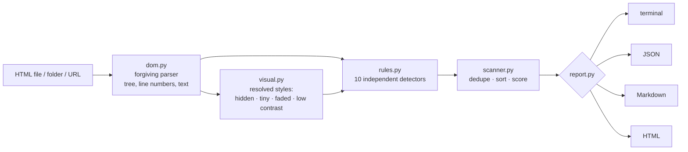

<div align="center">

# Candor

**Find manipulative design ("dark patterns") in web pages before your users do.**

Zero dependencies · explainable findings · built for CI · ~800 lines of plain Python



</div>

---

## Why this exists

Dark patterns are interface tricks that push people into choices they didn't mean to make: a newsletter box that's already ticked, a "No thanks, I prefer paying full price" link, a countdown that resets on every reload, a $2.99 fee in 10px grey text.

They're **common** and they **cost people money and privacy**:

- In a **2024 review of 642 websites and apps by the FTC and international partners (ICPEN/GPEN)**, **76%** used at least one possible dark pattern, and nearly **67%** used several.
- A **2022 European Commission sweep** found manipulative practices on **148 of 399** online shops checked.
- An academic crawl of **~11,000 shopping sites** (Mathur et al., Princeton, 2019) found **1,818** dark-pattern instances.

Regulators are now acting on this: **EU Digital Services Act Art. 25**, **GDPR** consent rules (CJEU *Planet49*), the **EU Consumer Rights Directive**, **US ROSCA**, **FTC Act §5** and state auto-renewal laws. Most teams don't ship dark patterns on purpose. They come from an A/B test, a copied template, or a growth target. What's missing is a **cheap, automatic check at review time**, like a linter or an accessibility audit.

**Candor is that check.** Point it at a page, a folder of templates or a URL. It tells you **what** it found, **where** (line number), **why** it's harmful and **how** to fix it, with the legal or regulatory reference.

## What it catches

| Pattern | Severity | Example it flags | Reference |
|---|:---:|---|---|
| **Pre-ticked consent** | 🔴 high | `<input type=checkbox checked>` Send me marketing emails | GDPR Recital 32 · CJEU *Planet49* |
| **Sneak into basket** | 🔴 high | Protection plan (+$4.99/mo) pre-selected | EU CRD Art. 22 · FTC Act §5 |
| **Confirmshaming** | 🔴 high | "No thanks, I'd rather stay uninformed" | FTC Dark Patterns report (2022) · DSA Art. 25 |
| **Forced continuity** | 🔴 high | "Free trial", then auto-renew terms in fine print, no way to cancel | US ROSCA · CA Automatic Renewal Law |
| **False urgency & scarcity** | 🟠 medium | Countdown timers, "Only 3 left", "27 people are viewing" | EU UCPD Annex I #7 · UK CMA |
| **Hidden costs** | 🟠 medium | "Service fee" in `<small>`, faded or low-contrast text | EU CRD Art. 6(1)(e) · FTC fees rule |
| **Trick question** | 🟠 medium | "Uncheck if you do not want to not receive…" | EDPB Guidelines 03/2022 |
| **Asymmetric choice** | 🟠 medium | Big "Accept" button next to a tiny, faded "Decline" link | EDPB 03/2022 · CNIL |
| **No real choice on cookies** | 🟠 medium | "Accept all" with no "Reject all" on the first layer | GDPR Art. 7(3) · EDPB Cookie Taskforce |
| **Disguised advertising** | 🔵 low | `class="sponsored"` content with no visible "Ad" label | FTC native-ad guidance · DSA Art. 26 |

Run `candor --list-rules` for the full list with references.

## Quick start

```bash
cd candor
python -m candor examples/                    # scan a folder (no install needed)

pip install -e .                              # or install the `candor` command
candor templates/checkout.html                # a file
candor https://example.com                    # a URL (static HTML)
candor site/ --format html -o report.html     # shareable HTML report
```

Requires Python ≥ 3.9. **No third-party packages.**

### Terminal output


### HTML report

`--format html` writes one self-contained page (light and dark mode) that you can attach to a PR or send to a designer. See [`examples/report.html`](examples/report.html).

<p>
  
  
</p>

Other formats: `--format json` (machine-readable, see [`examples/report.json`](examples/report.json)) and `--format md` (paste into an issue or PR, see [`examples/report.md`](examples/report.md)).

## Use it in CI

`--fail-on LEVEL` exits with status `1` when any finding is at least that severe, so a manipulative change fails the build the same way a broken test does.

```yaml
# .github/workflows/candor.yml
name: dark-pattern check
on: [pull_request]
jobs:
  candor:
    runs-on: ubuntu-latest
    steps:
      - uses: actions/checkout@v4
      - uses: actions/setup-python@v5
        with: { python-version: "3.12" }
      - run: pip install ./candor
      - run: candor build/ --fail-on high --format md -o candor-report.md
      - if: always()
        run: cat candor-report.md >> "$GITHUB_STEP_SUMMARY"
```

| Exit code | Meaning |
|:---:|---|
| `0` | No findings at or above `--fail-on` (or `--fail-on` not set) |
| `1` | At least one finding at or above `--fail-on` |
| `2` | A file or URL could not be read |

## Python API

```python
from candor import scan_html

report = scan_html(open("checkout.html").read(), source="checkout.html")
print(report.grade, report.score)          # 'F' 0
for f in report.findings:
    print(f.severity, f.rule, f.line, f.evidence, f.fix)
report.to_dict()                           # JSON-ready
```

## How it works



1. **Parse.** `dom.py` builds a small tree on top of the standard-library `html.parser`. It tolerates unclosed tags, keeps source line numbers and ignores `<script>` text.
2. **Understand presentation.** Many dark patterns are about *how* something is shown, not just *what* it says. `visual.py` resolves inline styles and simple `tag` / `.class` / `#id` rules from `<style>` blocks, follows inheritance, and reports when text is hidden, tiny (≤ 11px), faded (opacity ≤ 0.5), set in `<small>` / fine print, or below a 3:1 contrast ratio (WCAG luminance formula).
3. **Detect.** Each rule in `rules.py` is a small function combining *wording* (regex vocabularies for consent, add-ons, decline, shame, urgency, fees) with *structure* (checked inputs, labels, nearby buttons) and *presentation*. Example: a decline link only counts as **asymmetric** when a nearby "yes" action is *not* de-emphasized. A banner hidden in full until JavaScript shows it is fair to both choices.
4. **Score.** Each finding costs points (high 20, medium 10, low 4), starting from 100. Grades: **A** ≥ 95 · **B** ≥ 80 · **C** ≥ 65 · **D** ≥ 50 · **F** below 50. The score is for tracking progress. The findings are what matter.

### Field check

Before release, Candor was run against real, mostly static public pages (Wikipedia, GOV.UK, docs.python.org, BBC News, The Guardian). All of them came out **A, with zero findings**. That run also exposed two false-positive sources, which are now fixed and covered by tests: cookie banners hidden until JavaScript runs, and empty JS-filled ad slots.

## Codebase structure

```
candor/
├── candor/                 the package (stdlib only)
│   ├── __init__.py         public API: scan_html, Report
│   ├── __main__.py         enables `python -m candor`
│   ├── cli.py              argument parsing, formats, exit codes
│   ├── dom.py              tiny HTML tree: Node, Document, CSS resolution
│   ├── visual.py           colour parsing, WCAG contrast, font sizes, de-emphasis
│   ├── rules.py            Finding/Rule types + the 10 detectors (@rule registry)
│   ├── scanner.py          runs rules, dedupes, scores, loads files/URLs
│   └── report.py           text, JSON, Markdown and HTML renderers
├── examples/
│   ├── checkout_dark.html  fictional checkout with every pattern (scores F)
│   ├── checkout_fair.html  same page, honest redesign (scores A)
│   └── report.{html,md,json}  generated sample reports
├── tests/test_candor.py    unit + regression tests (python -m unittest)
├── docs/                   README images
└── pyproject.toml          packaging; installs the `candor` command
```

| Module | Lines | Responsibility | Depends on |
|---|---:|---|---|
| `dom.py` | ~180 | Parse HTML into a tree; text, hints, own/inherited style | stdlib |
| `visual.py` | ~80 | "Is this element visually suppressed, and how?" | `dom` |
| `rules.py` | ~300 | Every detector, with evidence, rationale, fix and legal reference | `dom`, `visual` |
| `scanner.py` | ~70 | Orchestrate rules → `Report` (score, grade, counts) | `rules` |
| `report.py` | ~130 | Render reports for people (text/HTML/MD) and machines (JSON) | `scanner` |
| `cli.py` | ~55 | Command line and CI exit codes | all |

Data flows one way (`dom → visual → rules → scanner → report → cli`), with no global state and no I/O below `scanner.py`, so every layer can be tested on its own.

### Adding a rule

A rule is a decorated generator. It is registered on import and shows up in `--list-rules`, every report format and the `--rules` filter.

```python
@rule("nagging", "Nagging", "low",
      "Repeated prompts that interrupt the task.",
      "EDPB Guidelines 03/2022 §'Overloading'")
def nagging(doc):
    for n in doc.find("div"):
        if "newsletter-popup" in n.hint():
            yield Finding("nagging", "low", n.line, n.snippet(),
                          "Interrupts the user to ask again.", "Ask once, remember the answer.")
```

Then add a positive and a negative case to `tests/test_candor.py`. The example test checks that `checkout_dark.html` triggers **every** registered rule, so extend that page too.

## Tests

```bash
python -m unittest discover -s tests      # 23 tests, ~20 ms
```

They cover each rule (positive and negative cases), visual heuristics, malformed HTML, false-positive guards (skip links, hidden banners, "Remember me", empty ad slots, scripts) and CLI exit codes.

## Limitations (read these)

- **Heuristic, not a verdict.** Candor finds *evidence* for a person to review. It will miss cleverly worded patterns and can flag legitimate ones (a real, verifiable sale deadline, for example). It is **not legal advice**.
- **Static HTML only.** It doesn't run JavaScript. Pages built client-side (many big e-commerce sites) look almost empty to it. Scan your server-rendered templates or build output, or save the rendered DOM from a browser first.
- **English wording.** The vocabularies are English. The structural checks (pre-ticked boxes, hidden fees, asymmetric styling) partly work in other languages.
- **Simple CSS.** It handles inline styles and single `tag` / `.class` / `#id` selectors, not external stylesheets, combinators or media queries.
- **Some patterns need behaviour, not markup:** roach motels (hard-to-cancel flows), timers that reset on reload, nagging over time. Those need a crawler and are on the roadmap.

## Roadmap

- [ ] Optional headless-browser mode (rendered DOM + computed styles)
- [ ] Multi-step flow checks: compare sign-up vs. cancellation effort
- [ ] Localized vocabularies (DE, FR, ES, PT, NL)
- [ ] SARIF output for GitHub code scanning annotations
- [ ] `<!-- candor-ignore rule-id: reason -->` inline suppressions with a required reason

## References

- FTC, *Bringing Dark Patterns to Light*, staff report (Sept 2022)
- FTC / ICPEN / GPEN, review of subscription and privacy dark patterns (July 2024)
- European Commission, sweep of online shops for dark patterns (2022) and *Digital Fairness* fitness check (2024)
- EDPB, *Guidelines 03/2022 on deceptive design patterns in social media platform interfaces*
- EDPB, *Report of the Cookie Banner Taskforce* (Jan 2023)
- UK CMA, *Online Choice Architecture: How digital design can harm competition and consumers* (2022)
- Mathur et al., *Dark Patterns at Scale: Findings from a Crawl of 11K Shopping Websites*, CSCW 2019
- Brignull, *Deceptive Patterns* (deceptive.design): the original taxonomy

## License

MIT. See [LICENSE](LICENSE).
