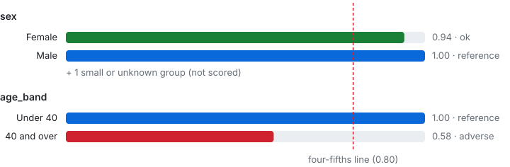
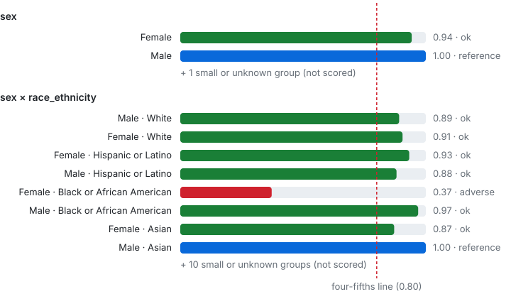
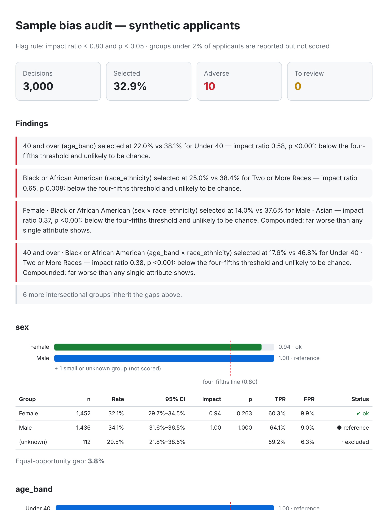
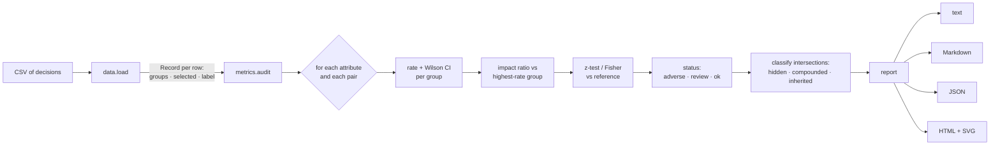

# equitas

**A tiny, dependency-free bias audit for automated hiring and lending decisions.**

Point it at a CSV of decisions, name the protected attributes, and get an audit in seconds: selection rates, impact ratios, significance tests, intersectional groups and error-rate gaps. Output comes as a terminal table, Markdown, JSON for CI, or a single self-contained HTML report.

```bash
python -m equitas applicants.csv --outcome advanced --attrs sex age_band race_ethnicity
```

<p align="center"></p>

---

## Why this exists

Algorithms now screen résumés, rank candidates, approve loans and set credit limits, usually without anyone checking whether they treat groups fairly. Regulators have started to require those checks:

| Rule | What it asks for |
|---|---|
| **NYC Local Law 144** (in force 2023) | Annual independent *bias audit* of automated employment decision tools: selection or scoring rates and impact ratios by sex, race/ethnicity and their intersection |
| **EEOC Uniform Guidelines**, 29 CFR §1607.4(D) | The *four-fifths rule*: a selection rate under 80% of the highest group's rate is evidence of adverse impact |
| **EU AI Act**, Annex III | Hiring and credit scoring are *high-risk*: providers must examine data and outputs for possible bias |
| **Colorado AI Act** (SB 24-205) | Deployers of high-risk AI must take reasonable care against algorithmic discrimination |

Commercial audits cost thousands of dollars, and the open-source fairness toolkits are heavyweight ML libraries built for data scientists. Most of the people who need an answer (an HR team, a small lender, a journalist, a regulator, an applicant advocate) just have a spreadsheet.

**equitas is for them.** It installs nothing, runs anywhere Python 3.9+ runs, and gives each finding as a plain-English sentence.

## What makes it different

- **It doesn't cry wolf.** A naive four-fifths check flags small groups all the time on noise alone. equitas flags a group as **adverse** only when the impact ratio is below 0.8 *and* the gap is statistically significant. If only one of the two holds, the group is marked **review**.
- **It finds hidden bias.** Each pair of attributes is checked as an intersection, and every flagged intersection is put in one of three classes:
  - **hidden**: no single attribute shows the gap
  - **compounded**: far worse than its single-attribute parent
  - **inherited**: already explained by the parent, so it is summarised in one line instead of repeated
- **It respects small numbers.** Wilson confidence intervals, and Fisher's exact test when expected counts are small. Groups under 2% of applicants, and unknown values, are reported but not scored, as LL144 permits.
- **It measures more than outcomes.** Give it a ground-truth column (`--label qualified`) and it also reports true and false positive rates per group and the *equal-opportunity gap*: are qualified people in one group advanced less often?
- **It fits in CI.** `--strict` exits with code `2` when any group is flagged adverse, so a model retrain can't ship a regression unnoticed.

## Quick start

```bash
git clone https://github.com/kareemrt/EthicalAI && cd EthicalAI/equitas

# Run on the bundled synthetic dataset (3,000 applicants with planted bias)
python -m equitas examples/applicants.csv -y advanced -a sex age_band --label qualified --no-intersect
```

```text
equitas · 3,000 decisions · 32.9% selected
flag rule: impact ratio < 0.80 and p < 0.05

sex   equal-opportunity gap 3.8%
  group              n    rate  impact                  p  status
  Female         1,452   32.1%  ███████████░ 0.94   0.263  ✔ ok
  Male           1,436   34.1%  ████████████ 1.00   1.000  ● reference
  (unknown)        112   29.5%  ────────────    —       —  · excluded

age_band   equal-opportunity gap 26.3%
  group              n    rate  impact                  p  status
  Under 40       2,038   38.1%  ████████████ 1.00   1.000  ● reference
  40 and over      962   22.0%  ███████░░░░░ 0.58  <0.001  ✖ adverse

1 adverse · 0 to review
  ✖ 40 and over (age_band) selected at 22.0% vs 38.1% for Under 40 — impact ratio 0.58, p <0.001: below the four-fifths threshold and unlikely to be chance.
```

Optionally install it as a command (still zero dependencies):

```bash
pip install .
equitas applicants.csv -y hired -a sex race -f html -o report.html
```

## The intersectional story

Looking at sex alone, the sample screening model seems fair: women advance at 94% of men's rate. Split by sex × race and a very different picture appears:

<p align="center"></p>

Black women advance at **0.37×** the rate of the highest group. Black men show no gap at all, and the race-level gap for Black applicants (0.65) is almost entirely carried by the women. An audit of single attributes would never find this. equitas puts it at the top of the findings as **compounded**.

## The HTML report

`-f html` writes one self-contained file with no external assets, so you can email it, attach it to a ticket or archive it with the model version. It adapts to light and dark mode and is readable on a phone.

<p align="center"></p>

See the full examples: [`docs/sample-report.html`](docs/sample-report.html) · [`docs/sample-report.md`](docs/sample-report.md)

## How it works



### The decision rule

| Impact ratio < 0.8 | Gap significant (p < α) | Status |
|:-:|:-:|---|
| ✔ | ✔ | **✖ adverse**: strong evidence of disparate impact |
| ✔ | ✘ | **▲ review**: big gap, but too little data to rule out chance |
| ✘ | ✔ | **▲ review**: real but modest gap; worth a look in large datasets |
| ✘ | ✘ | **✔ ok** |

*Impact ratio* = a group's selection rate ÷ the highest group's rate (the LL144 definition). The significance test compares each group with that reference group: a pooled two-proportion z-test, or Fisher's exact test when any expected cell count is under 5.

## Usage

```text
equitas CSV (-y OUTCOME | -s SCORE) -a ATTR [ATTR ...] [options]
```

| Option | Default | Meaning |
|---|---|---|
| `-y, --outcome` | | Yes/no decision column. Treated as *selected*: `1 true yes hired selected pass approved …` |
| `-s, --score` | | Numeric score column instead; *selected* = above `--threshold` |
| `--threshold` | median | Score cut-off. The median default matches LL144's *scoring rate* |
| `--positive` | | Exact value that means selected, if not one of the defaults |
| `-a, --attrs` | | Protected-attribute columns. Blank, `unknown`, `prefer not to say` etc. become `(unknown)` |
| `--label` | | Ground-truth column (e.g. `qualified`, `repaid`) to add TPR, FPR and the equal-opportunity gap |
| `--ratio` | `0.8` | Impact-ratio threshold |
| `--alpha` | `0.05` | Significance level |
| `--min-share` | `0.02` | Groups smaller than this share are reported but not scored |
| `--no-intersect` | | Skip pairwise intersections |
| `-f, --format` | `text` | `text`, `md`, `json` or `html` |
| `-o, --out` | stdout | Write the report to a file |
| `--strict` | | Exit code `2` if anything is adverse |

**Exit codes:** `0` ran fine · `1` bad input (missing column, empty file) · `2` adverse impact found under `--strict`.

### In CI

```yaml
# .github/workflows/fairness.yml (fail the build if the new model's decisions show adverse impact)
- run: python -m equitas predictions.csv -y approved -a sex age_band --strict -f md -o audit.md
- uses: actions/upload-artifact@v4
  if: always()
  with: { name: bias-audit, path: audit.md }
```

### As a library

```python
from equitas import load, audit
from equitas.report import to_html

records = load("decisions.csv", ["sex", "race"], outcome="hired", label="qualified")
result = audit(records, ["sex", "race"])

for attr, group in result.headline():          # adverse findings worth reading first
    print(attr.name, group.category, round(group.impact_ratio, 2), result.kind(attr, group))

open("report.html", "w").write(to_html(result))
```

## Codebase structure

```text
equitas/
├── equitas/                 the package (~580 lines, standard library only)
│   ├── __init__.py          public API: load, audit, Audit, Record
│   ├── __main__.py          enables `python -m equitas`
│   ├── cli.py               argparse front end, exit codes, output routing
│   ├── data.py              CSV → Record list; outcome/score/label parsing, missing-value handling
│   ├── stats.py             Wilson interval, two-proportion z-test, Fisher exact test
│   ├── metrics.py           the audit: groups, impact ratios, statuses, intersection classes
│   └── report.py            renderers: text · Markdown · JSON · HTML, plus the SVG chart
├── tests/
│   └── test_equitas.py      19 unittest cases: stats against textbook values, rules, CLI, sample data
├── examples/
│   ├── make_sample.py       reproducible synthetic applicants with *documented* planted bias
│   └── applicants.csv       its output (3,000 rows)
├── docs/
│   ├── build.py             regenerates every visual in this README from the sample
│   ├── impact-ratios.svg    ┐
│   ├── intersection.svg     │ generated by equitas itself
│   ├── sample-report.html   │
│   ├── sample-report.md     ┘
│   └── report-screenshot.png
├── LICENSE                  MIT
└── pyproject.toml           optional install; zero runtime dependencies
```

**Design principles**

1. **One direction of data flow.** `data` → `metrics` → `report`. Each module only imports from the ones before it, so each layer can be read and tested on its own.
2. **Plain data structures.** `Record`, `Group`, `Attribute` and `Audit` are dataclasses. `Audit.to_dict()` is the JSON output, so nothing is hidden.
3. **Statistics you can check by hand.** Every function in `stats.py` works on raw counts and is tested against published values.
4. **No dependencies.** No numpy, no pandas. It runs on a locked-down government laptop, in a CI container or in a notebook.

## Development

```bash
python -m unittest discover tests      # 19 tests, < 0.1 s
python examples/make_sample.py > examples/applicants.csv
python docs/build.py                   # refresh the README visuals
```

## Limitations and responsible use

- **A screen, not a verdict.** A flag means a gap is large and unlikely to be chance. It doesn't prove discrimination, and the absence of a flag doesn't prove fairness. Legal analysis also considers business necessity and less discriminatory alternatives.
- **The reference group can be small.** Following LL144, impact ratios are relative to the highest-rate group, which may be a small group with a noisy rate. The significance test guards against this; check the confidence intervals too.
- **Pairwise intersections only.** Three-way intersections quickly become too sparse to test meaningfully.
- **Your labels inherit history.** `--label` metrics are only as fair as the ground truth. "Qualified" judged by a biased past process will hide bias.
- **Self-reported demographics are incomplete.** Unknowns are counted and shown, never silently dropped. If many values are unknown, treat the results with care.
- **Handle the data carefully.** Demographic data is sensitive. equitas runs entirely locally and sends nothing anywhere.

## License

MIT
