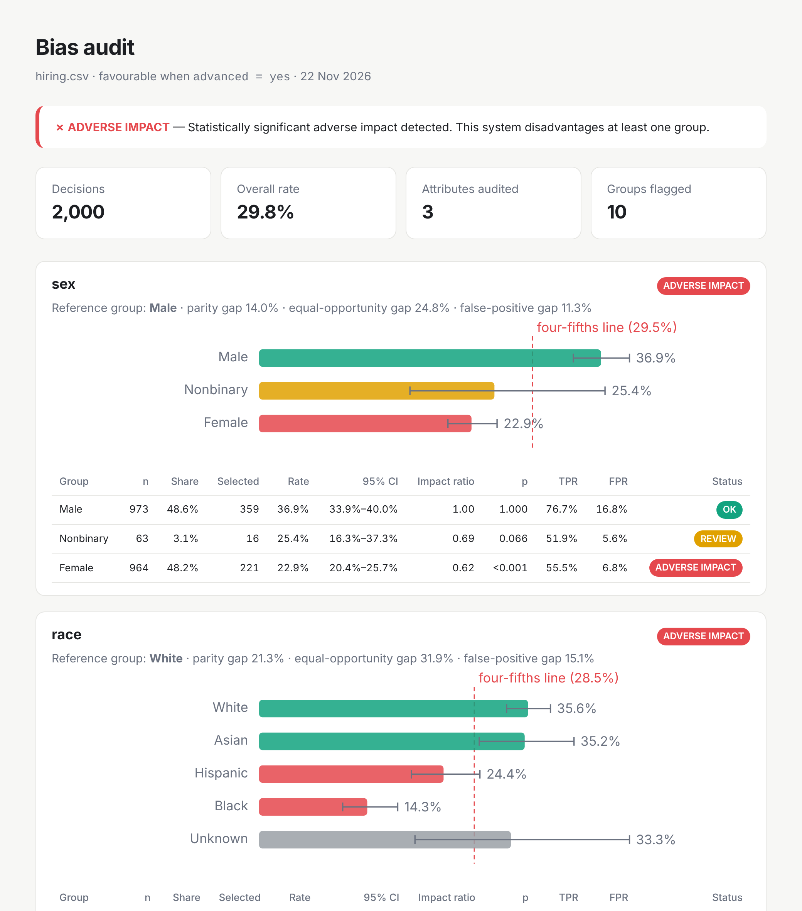
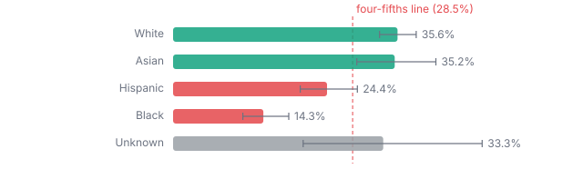
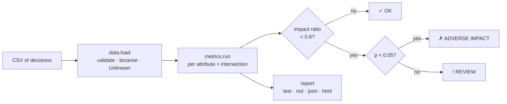

<div align="center">

# ⚖️ Equitas

**A zero-dependency bias audit for automated decisions.**
Point it at a CSV of hiring, lending or admissions decisions and get a clear, defensible answer to one question:
*does this system treat groups of people differently?*

   

<picture>
  <source media="(prefers-color-scheme: dark)" srcset="docs/report-dark.png">
  
</picture>

</div>

---

## Why this exists

Algorithms now screen résumés, score loan applicants, rank tenants and flag welfare claims. When they are biased, the harm is quiet: thousands of people are rejected and nobody can see the pattern.

- **The law is catching up.** [NYC Local Law 144](https://www.nyc.gov/site/dca/about/automated-employment-decision-tools.page) requires an annual independent *bias audit* of automated hiring tools, reporting selection rates and impact ratios by sex, race/ethnicity and their intersection. The **EU AI Act** classifies hiring, credit and education systems as *high-risk* and requires bias monitoring. In the US, the EEOC's **four-fifths rule** has been the yardstick for adverse impact since 1978.
- **The tooling is not.** Existing fairness libraries are powerful but heavy (NumPy, pandas, scikit-learn, notebooks) and aimed at ML researchers. The people who most need an answer — an HR team, a small lender, a city council, a journalist with a FOIA'd spreadsheet, a nonprofit — often can't use them.

**Equitas closes that gap.** One command, any CSV, no installs, no data leaves your machine. The output is a report a non-specialist can read and a compliance officer can file.

## What it does

| | |
|---|---|
| 📊 **Selection rates** per group with 95% Wilson confidence intervals | 🧮 **Impact ratios** vs. the most-favoured group (four-fifths rule / LL144) |
| 🔬 **Significance testing** so small-sample noise is flagged *REVIEW*, not *FAIL* | 🔀 **Intersectional audit** (e.g. *Female × Black*) automatically |
| 🎯 **Error-rate fairness** (equal opportunity, equalized odds) when ground truth is available | 🧾 **Reports** as terminal table, Markdown, JSON or a self-contained HTML page |
| 🚦 **CI gate**: `--strict` exits non-zero on adverse impact | 🧪 **Synthetic data** with known bias for demos, training and tests |

## Quick start

```bash
cd equitas
python -m equitas sample -o hiring.csv          # synthetic data with injected bias
python -m equitas audit hiring.csv --groups sex race --outcome advanced --label qualified
```

No install needed — just Python 3.9+. Or `pip install .` to get an `equitas` command.

```text
▌ race  (reference: White)
Group        n  Share  Selected   Rate       95% CI  Impact ratio       p    TPR    FPR            Status
────────  ────  ─────  ────────  ─────  ───────────  ────────────  ──────  ─────  ─────  ────────────────
White     1042  52.1%       371  35.6%  32.8%–38.6%          1.00   1.000  72.4%  15.7%              ✓ OK
Asian      219  10.9%        77  35.2%  29.1%–41.7%          0.99   0.901  71.8%  17.6%              ✓ OK
Hispanic   344  17.2%        84  24.4%  20.2%–29.2%          0.69  <0.001  63.1%   6.0%  ✗ ADVERSE IMPACT
Black      356  17.8%        51  14.3%  11.1%–18.3%          0.40  <0.001  40.5%   2.4%  ✗ ADVERSE IMPACT
Unknown     39   1.9%        13  33.3%  20.6%–49.0%             —       —  76.9%  11.5%        · EXCLUDED
  parity gap 21.3% · equal-opportunity gap 31.9% · false-positive gap 15.1%

✗ ADVERSE IMPACT: Statistically significant adverse impact detected. This system disadvantages at least one group.
```

Read the last column of TPR: among applicants who were **genuinely qualified**, the model advanced 72% of White candidates but only 41% of Black candidates. That is the kind of finding Equitas is built to surface.

<p align="center"></p>

## Usage

```text
equitas audit CSV --groups COL [COL ...] (--outcome COL | --score COL [--threshold X])
              [--label COL] [--ratio 0.8] [--alpha 0.05] [--min-share 0.02]
              [--no-intersections] [-f text|md|json|html] [-o FILE] [--strict]

equitas sample [-n 2000] [--seed 7] [--fair] [-o FILE]
```

| Option | Meaning |
|---|---|
| `--groups` | Protected-attribute columns (sex, race, age band, disability…). Several → each audited plus their intersection. |
| `--outcome` | Yes/no column: was the decision favourable? Accepts `1/0`, `true/false`, `yes/no`, `hired/rejected`, `approved/denied`… |
| `--score` | Numeric column instead of a decision. Favourable when ≥ `--threshold`; defaults to the median (LL144's *scoring rate*). |
| `--label` | Optional ground truth (was the person actually qualified / did they repay?). Unlocks TPR/FPR fairness metrics. |
| `--ratio` / `--alpha` | Impact-ratio threshold and significance level. |
| `--min-share` | Groups smaller than this share are reported but excluded from ratios (LL144 permits excluding < 2%). |
| `-o` | Output file; the format is inferred from the extension (`.html`, `.md`, `.json`). |
| `--strict` | Exit code `1` if adverse impact is found — drop it into CI to block a biased model from shipping. |

### Recipes

```bash
# Self-contained HTML report to share with a team or regulator
equitas audit decisions.csv -g gender ethnicity --outcome approved -o audit.html

# Audit a scoring model at a specific cut-off
equitas audit scores.csv -g age_band --score risk_score --threshold 0.7

# Machine-readable output for dashboards or monitoring
equitas audit decisions.csv -g gender --outcome approved -f json | jq '.audits[].groups[] | {name, impact_ratio, status}'

# Fairness gate in CI: fail the build if the candidate model is biased
equitas audit predictions.csv -g sex race --outcome pred --strict
```

### As a library

```python
from equitas import load, run
from equitas.report import to_markdown

records, outcome = load("decisions.csv", ["sex", "race"], outcome="hired", label="qualified")
report = run(records, ["sex", "race"], outcome, source="Q3 hiring")
print(report.status)                    # "ok" | "warn" | "fail"
print(to_markdown(report))
```

## How it works



### Methodology

| Metric | Definition | Why it matters |
|---|---|---|
| **Selection rate** | favourable ÷ total, per group, with a 95% Wilson interval | The raw outcome each group experiences. Wilson behaves well for small groups and extreme rates. |
| **Impact ratio** | group rate ÷ highest group rate | The four-fifths rule (EEOC Uniform Guidelines, 1978) and the metric NYC LL144 requires. < 0.8 = potential adverse impact. |
| **p-value** | two-sided pooled two-proportion z-test vs. the reference group | Separates real disparities from noise. The EEOC itself notes the 4/5 rule misleads on small samples. |
| **Parity gap** | max − min selection rate | Demographic parity difference. |
| **TPR gap** | spread of P(selected \| qualified) | *Equal opportunity*: are qualified people treated the same regardless of group? |
| **FPR gap** | spread of P(selected \| unqualified) | With TPR gap, *equalized odds*: do errors fall evenly? |

**Status logic.** `OK` when the impact ratio is ≥ 0.8. Below it, `ADVERSE IMPACT` if the gap is statistically significant, otherwise `REVIEW` — a signal that needs a human and possibly more data. Groups under `--min-share`, and records with a missing category, are shown as `EXCLUDED` so they are never silently dropped.

### Limits — read before relying on it

- **A pass is evidence, not proof.** Fairness criteria can conflict; no single number captures justice. Use Equitas alongside domain review and the people affected.
- **Garbage in, garbage out.** Biased ground-truth labels (e.g. past hiring decisions used as "qualified") will hide bias in TPR/FPR. Prefer independent outcome measures.
- **It is not legal advice**, and LL144 requires the audit to be performed by an *independent* auditor. Equitas computes the required numbers; it doesn't replace that independence.
- **Protected data is sensitive.** Everything runs locally and nothing is sent anywhere — keep it that way when you store reports.

## Codebase structure

```text
equitas/
├── equitas/                 # the package — stdlib only
│   ├── __init__.py          # public API: load, run, Config, Report
│   ├── __main__.py          # enables `python -m equitas`
│   ├── cli.py               # argparse front-end: `audit` and `sample` subcommands
│   ├── data.py              # CSV → Record list; yes/no parsing, score thresholds, Unknown handling
│   ├── stats.py             # Wilson interval, two-proportion z-test (pure math)
│   ├── metrics.py           # the audit: groups, impact ratios, significance, error-rate gaps, statuses
│   ├── report.py            # renderers: text table, Markdown, JSON, HTML + inline SVG chart
│   └── sample.py            # synthetic hiring data with tunable injected bias
├── tests/test_equitas.py    # unittest suite: stats, metrics, loading, CLI end-to-end
├── examples/
│   ├── hiring.csv           # 2,000 synthetic applicants (generated, seed 7)
│   ├── report.html          # the HTML report shown above
│   └── report.md            # the same audit as Markdown
├── docs/                    # README images (generated by Equitas itself)
└── pyproject.toml           # packaging; installs the `equitas` command
```

Data flows one way: **`data` → `metrics` → `report`**, with `cli` wiring them together. Each module has a single job and can be read top-to-bottom in a few minutes:

| Module | Key items | Depends on |
|---|---|---|
| `stats.py` | `wilson()`, `two_proportion_p()`, `ratio()` | `math` |
| `data.py` | `Record`, `load()`, `to_binary()` | `csv`, `statistics` |
| `metrics.py` | `Config`, `Group`, `AttributeAudit`, `Report`, `run()` | `data`, `stats` |
| `report.py` | `to_text/markdown/json/html()`, `svg_chart()`, `RENDERERS` | `metrics` |
| `sample.py` | `generate()`, `write()` | `random`, `csv` |
| `cli.py` | `main()` | all of the above |

## Development

```bash
python -m unittest discover -s tests -v                      # 15 tests, < 1 s
python -m equitas sample --fair | python -m equitas audit /dev/stdin -g sex race --outcome advanced   # ✓ OK baseline
```

CI (`.github/workflows/equitas.yml`) runs the suite on Python 3.9 and 3.13 and checks that an unbiased baseline passes the strict gate.

**Ideas for contributions:** age-band bucketing for numeric columns · calibration-by-group for scored models · multi-period drift tracking · a LL144-formatted summary table export.

## License

MIT. Built for the people on the other side of the algorithm.
