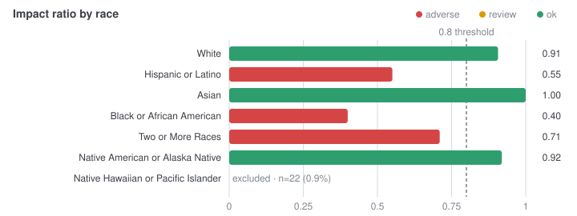
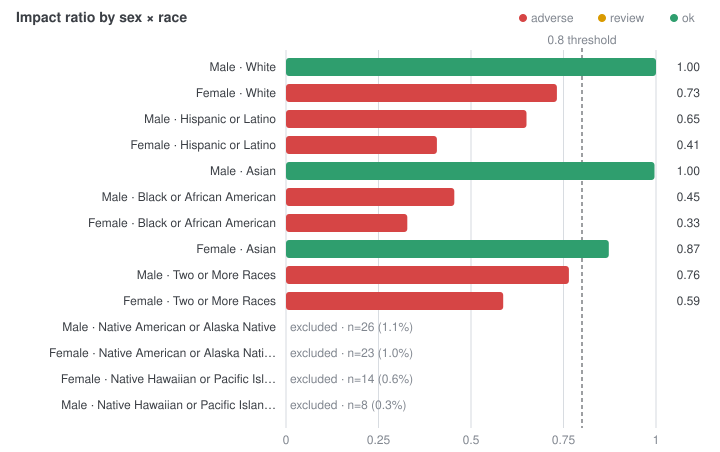
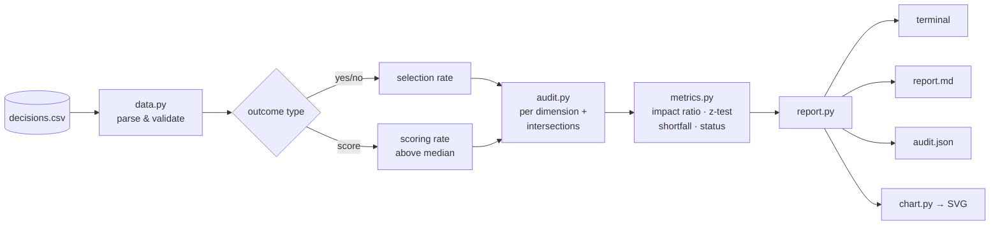
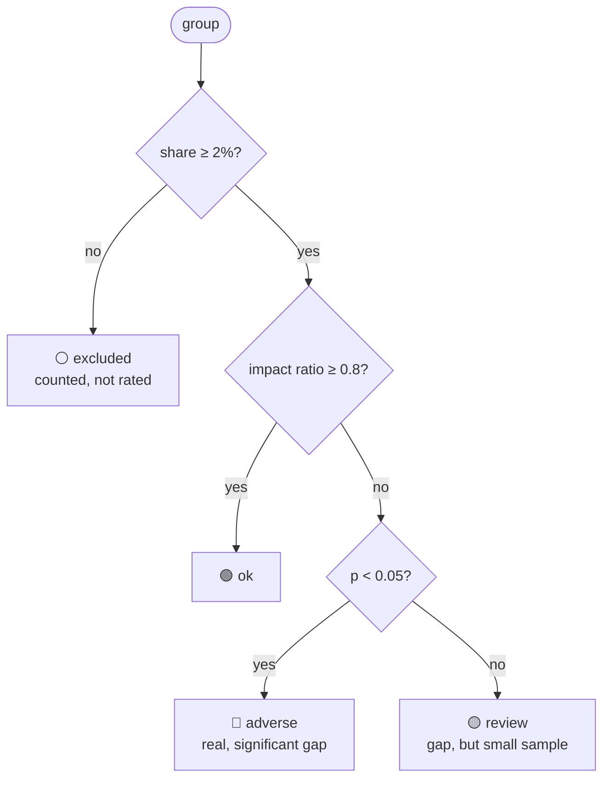

<div align="center">

# ⚖️ Equitas

**Bias audits for automated decisions, run in one command.**

Hand it a CSV of decisions and get back a clear, evidence-based report on whether your
hiring, lending or admissions system treats demographic groups unequally.

`pure Python` · `zero dependencies` · `~540 lines` · `NYC LL144-style` · `EEOC four-fifths rule`

</div>

---

## Why this exists

Automated tools now make or shape decisions about who gets an interview, a loan or a lease.
Most of them are never checked for disparate impact, and when they *are* checked, the
check is often a one-off spreadsheet or an expensive black-box vendor report.

The law is catching up:

| Rule | What it requires |
|---|---|
| **NYC Local Law 144** (in force since 2023) | Annual independent *bias audit* of automated employment decision tools, with selection or scoring rates and **impact ratios** by sex, race/ethnicity **and their intersection**, published before use. |
| **EEOC Uniform Guidelines, four-fifths rule** | A selection rate below **80 %** of the highest group's rate is generally treated as evidence of adverse impact. |
| **EU AI Act**, Colorado AI Act, and others | Hiring and credit systems are classed as *high-risk*, so bias testing and documentation are expected. |

Equitas puts the core statistics of those audits into a small, readable, open tool that teams can
**run on every model release, not once a year**. It is a screening tool: it tells you
early, and cheaply, where to look.

> [!IMPORTANT]
> Equitas is a statistical screen, **not legal advice** and not a substitute for an
> independent auditor where the law requires one. It gives you the numbers early so
> fixes happen *before* harm, not after.

---

## What you get

```text
$ equitas audit examples/hiring.csv --outcome advanced --groups sex race

Equitas · hiring.csv · 2,400 people · selection rate 43.3%

sex
  Male    n=1243  rate= 49.6%  IR=1.000  OK
  Female  n=1088  rate= 36.4%  IR=0.733  ADVERSE  needs +37

race
  White                                n=1133  rate= 50.3%  IR=0.907  OK
  Hispanic or Latino                   n=416   rate= 30.5%  IR=0.550  ADVERSE  needs +58
  Asian                                n=328   rate= 55.5%  IR=1.000  OK
  Black or African American            n=320   rate= 22.2%  IR=0.400  ADVERSE  needs +72
  Two or More Races                    n=132   rate= 39.4%  IR=0.710  ADVERSE  needs +7
  Native American or Alaska Native     n=49    rate= 51.0%  IR=0.919  OK
  Native Hawaiian or Pacific Islander  n=22    rate= 59.1%  IR=  —     EXCLUDED

sex × race
  ...

Overall: ADVERSE
```

Add `--out report/` and you also get a shareable Markdown report with charts
([see the full example](examples/report/report.md)):

<p align="center">
  <br>
  
</p>

> The example data is **synthetic**: a fictional resume screener with a hidden penalty
> deliberately built into [`make_hiring_data.py`](examples/make_hiring_data.py). Equitas
> finds that penalty without being told about it.

---

## Quick start

```bash
cd equitas
python -m equitas audit examples/hiring.csv -o advanced -g sex race --out report/
```

That's it. Python 3.10+ and nothing else. To install the `equitas` command:

```bash
pip install -e equitas/
equitas audit decisions.csv -o hired -g gender ethnicity age_band
```

### Input format

One row per person. One outcome column and any number of demographic columns:

```csv
applicant_id,sex,race,score,advanced
A00001,Male,White,59,no
A00002,Female,White,54,no
A00003,,Asian,71,yes
```

- **Outcome**: `yes/no`, `1/0`, `true/false`, `hired`, `approved` … or a numeric score with `--score`.
- **Groups**: any text. Blank, `unknown`, `n/a`, `prefer not to say` count as *undisclosed*:
  they are counted and reported, but left out of the rate calculations.

### Options

| Flag | Default | Meaning |
|---|---|---|
| `-o, --outcome COL` | *required* | Outcome column |
| `-g, --groups COL…` | *required* | Demographic columns to audit |
| `--score` | off | Outcome is a score: use the LL144 **scoring rate** (share above the sample median) |
| `--no-intersect` | off | Skip intersectional categories (e.g. `Female · Black`) |
| `--threshold` | `0.8` | Impact-ratio flag line (four-fifths rule) |
| `--min-share` | `0.02` | Groups under this share are reported but not rated |
| `--alpha` | `0.05` | Significance level for the z-test |
| `--out DIR` | — | Write `report.md`, `audit.json` and `charts/*.svg` |
| `--format` | `text` | Print `text`, `markdown` or `json` to stdout |
| `--strict` | off | Exit non-zero on `review` as well as `adverse` |

**Exit codes:** `0` ok · `1` adverse impact found · `2` input error. These are easy to use in CI.

---

## How it works



For every demographic dimension (and their intersection), each group gets four numbers:

| Metric | Formula | Why it matters |
|---|---|---|
| **Rate** | selected ÷ group size | The raw outcome |
| **Impact ratio** | group rate ÷ highest group rate | The LL144 / EEOC headline number |
| **p-value** | two-proportion z-test vs. the highest-rate group | Separates real gaps from noise |
| **Shortfall** | ⌈threshold × top rate × n⌉ − selected | *How big* the gap is, in people |

Then each group gets a **status**. Two questions decide it:



This two-step check matters. The four-fifths rule on its own is known to raise false alarms on
small groups and to miss real gaps in large ones. Pairing it with a significance test is
standard practice in adverse-impact analysis.

The **shortfall** turns an abstract ratio into something you can act on: *"37 more women would
have needed to advance to clear the 0.8 line."*

---

## Use it as a fairness gate in CI

Retrain a screening model and the audit runs automatically. Adverse impact fails the build:

```yaml
# .github/workflows/fairness.yml
- name: Bias audit on holdout decisions
  run: |
    python model/predict.py holdout.csv > decisions.csv
    python -m equitas audit decisions.csv -o predicted -g sex race --out audit/
- uses: actions/upload-artifact@v4
  if: always()
  with: { name: bias-audit, path: audit/ }
```

Or call it from Python:

```python
from equitas import run_audit

audit = run_audit("decisions.csv", "hired", ["sex", "race"])
for dim in audit.dimensions:
    for g in dim.groups:
        if g.status == "adverse":
            print(f"{dim.name}: {g.group} IR={g.impact_ratio:.2f}, needs +{g.shortfall}")
```

---

## Codebase structure

```text
equitas/
├── equitas/                 # the package — read top to bottom in ~10 minutes
│   ├── metrics.py           # ⚙️  core math: impact ratio, z-test, shortfall, status (pure functions)
│   ├── data.py              # 📥 CSV loading, yes/no + score parsing, unknown-value handling
│   ├── audit.py             # 🧭 orchestration: rows → Dimensions → Audit (dataclasses)
│   ├── report.py            # 📝 renderers: terminal, Markdown, JSON
│   ├── chart.py             # 📊 dependency-free SVG bar charts (light/dark aware)
│   ├── cli.py               # ⌨️  argparse front end and exit codes
│   ├── __init__.py          # public API: run_audit, audit_groups, Audit, GroupStat
│   └── __main__.py          # enables `python -m equitas`
├── examples/
│   ├── make_hiring_data.py  # seeded synthetic screener with an injected bias
│   ├── hiring.csv           # its output (2,400 applicants)
│   └── report/              # generated report.md, audit.json, charts/
├── tests/
│   ├── test_metrics.py      # math: ratios, edge cases, known p-values
│   └── test_cli.py          # end-to-end: parsing, reports, exit codes, errors
└── pyproject.toml           # zero runtime dependencies
```

**Design principles**

- **Layered and one-way.** `metrics` knows nothing about files. `audit` knows nothing about
  output formats. `report` and `chart` only read an `Audit`. Each layer can be tested on its own.
- **Standard library only.** `csv`, `math`, `statistics`, `dataclasses`, `argparse`. Nothing to
  install or pin, and nothing to audit in the supply chain of a tool whose job is auditing.
- **Fail loudly on ambiguity.** An outcome value like `"maybe"` stops the run and names the
  line. It is never guessed at.
- **Report what's excluded.** Undisclosed and small groups are always shown with their counts.
  Leaving them out silently would hide exactly the people most at risk.

## Development

```bash
cd equitas
python -m unittest discover -s tests -v     # 17 tests, < 0.1 s
python examples/make_hiring_data.py > examples/hiring.csv
python -m equitas audit examples/hiring.csv -o advanced -g sex race --out examples/report
```

## Limitations and roadmap

- Impact ratios measure **outcome parity**. They don't measure accuracy parity
  (equalized odds), which needs ground-truth labels. *Planned: `--truth COL` for per-group
  TPR/FPR.*
- The z-test assumes reasonably sized groups. For very small cells, Fisher's exact test would be
  more precise. *Planned.*
- Demographic data is often self-reported and incomplete. Equitas reports how much is missing,
  but it can't correct for who chose not to disclose.
- A passing audit is **not** proof of fairness. It means this one disparity measure didn't fire.

---

<div align="center">
<sub>Part of <a href="../README.md">EthicalAI</a>: projects using AI and data for ethics-focused goals.</sub>
</div>
