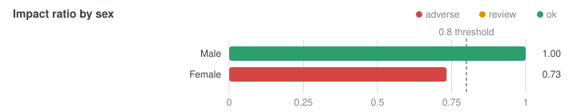
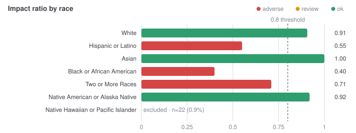
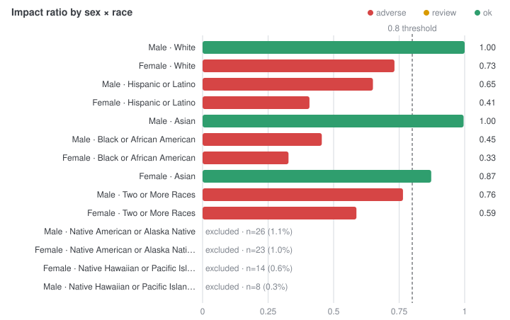

# Bias audit — `hiring.csv`

> **Overall: 🔴 adverse** — At least one group falls below the threshold **and** the gap is statistically significant. This is evidence of adverse impact.

| | |
|---|---|
| Population | 2,400 |
| Outcome | `advanced` (selection) |
| Overall positive rate | 43.3% |
| Impact-ratio threshold | 0.8 |
| Small-group exclusion | < 2% of population |
| Significance level | α = 0.05 |

## Sex — 🔴 adverse

| Group | n | Share | Selected | Selection rate | Impact ratio | p-value | Shortfall | Status |
|---|--:|--:|--:|--:|--:|--:|--:|---|
| Male | 1243 | 53.3% | 617 | 49.6% | 1.000 | ref |  | 🟢 ok |
| Female | 1088 | 46.7% | 396 | 36.4% | 0.733 | 1.24e-10 | 37 | 🔴 adverse |

_69 people with an unknown or undisclosed sex were not included in this table._

## Race — 🔴 adverse

| Group | n | Share | Selected | Selection rate | Impact ratio | p-value | Shortfall | Status |
|---|--:|--:|--:|--:|--:|--:|--:|---|
| White | 1133 | 47.2% | 570 | 50.3% | 0.907 | 0.0984 |  | 🟢 ok |
| Hispanic or Latino | 416 | 17.3% | 127 | 30.5% | 0.550 | 6.93e-12 | 58 | 🔴 adverse |
| Asian | 328 | 13.7% | 182 | 55.5% | 1.000 | ref |  | 🟢 ok |
| Black or African American | 320 | 13.3% | 71 | 22.2% | 0.400 | 3.71e-18 | 72 | 🔴 adverse |
| Two or More Races | 132 | 5.5% | 52 | 39.4% | 0.710 | 0.00179 | 7 | 🔴 adverse |
| Native American or Alaska Native | 49 | 2.0% | 25 | 51.0% | 0.919 | 0.558 |  | 🟢 ok |
| Native Hawaiian or Pacific Islander | 22 | 0.9% | 13 | 59.1% | — | — |  | ⚪ excluded |

## Sex × Race — 🔴 adverse

| Group | n | Share | Selected | Selection rate | Impact ratio | p-value | Shortfall | Status |
|---|--:|--:|--:|--:|--:|--:|--:|---|
| Male · White | 591 | 25.4% | 341 | 57.7% | 1.000 | ref |  | 🟢 ok |
| Female · White | 509 | 21.8% | 215 | 42.2% | 0.732 | 3.17e-07 | 20 | 🔴 adverse |
| Male · Hispanic or Latino | 216 | 9.3% | 81 | 37.5% | 0.650 | 3.65e-07 | 19 | 🔴 adverse |
| Female · Hispanic or Latino | 187 | 8.0% | 44 | 23.5% | 0.408 | 3.78e-16 | 43 | 🔴 adverse |
| Male · Asian | 174 | 7.5% | 100 | 57.5% | 0.996 | 0.957 |  | 🟢 ok |
| Male · Black or African American | 160 | 6.9% | 42 | 26.2% | 0.455 | 1.67e-12 | 32 | 🔴 adverse |
| Female · Black or African American | 148 | 6.3% | 28 | 18.9% | 0.328 | 3.23e-17 | 41 | 🔴 adverse |
| Female · Asian | 145 | 6.2% | 73 | 50.3% | 0.873 | 0.11 |  | 🟢 ok |
| Male · Two or More Races | 68 | 2.9% | 30 | 44.1% | 0.765 | 0.0325 | 2 | 🔴 adverse |
| Female · Two or More Races | 62 | 2.7% | 21 | 33.9% | 0.587 | 0.000329 | 8 | 🔴 adverse |
| Male · Native American or Alaska Native | 26 | 1.1% | 18 | 69.2% | — | — |  | ⚪ excluded |
| Female · Native American or Alaska Native | 23 | 1.0% | 7 | 30.4% | — | — |  | ⚪ excluded |
| Female · Native Hawaiian or Pacific Islander | 14 | 0.6% | 8 | 57.1% | — | — |  | ⚪ excluded |
| Male · Native Hawaiian or Pacific Islander | 8 | 0.3% | 5 | 62.5% | — | — |  | ⚪ excluded |

_69 people with an unknown or undisclosed sex × race were not included in this table._

## How to read this report

- **Impact ratio** — a group's rate divided by the rate of the most-favoured group. Below the threshold (default 0.8, the EEOC four-fifths rule) indicates potential adverse impact.
- **p-value** — two-proportion z-test against the most-favoured group (`ref`). Small values mean the gap is unlikely to be chance.
- **Shortfall** — how many more people in the group would need a positive outcome to reach the threshold. A concrete size for the gap.
- **Status** — 🔴 below threshold and significant · 🟡 below threshold, not significant · 🟢 at or above threshold · ⚪ too small to rate (still reported, as LL144 requires).

_Generated by [Equitas](https://github.com/kareemrt/EthicalAI/tree/main/equitas). A statistical screen, not legal advice — pair it with an independent auditor where the law requires one._
