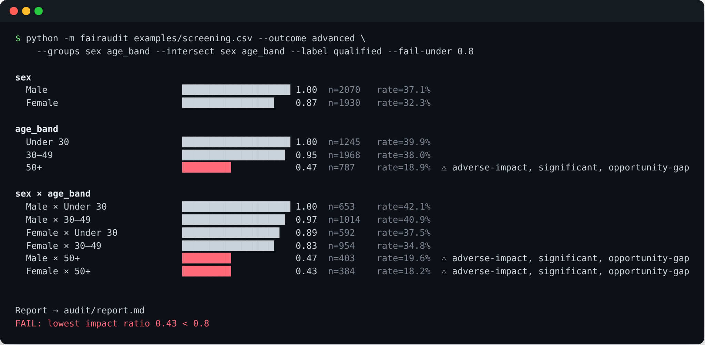
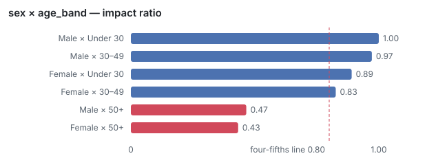
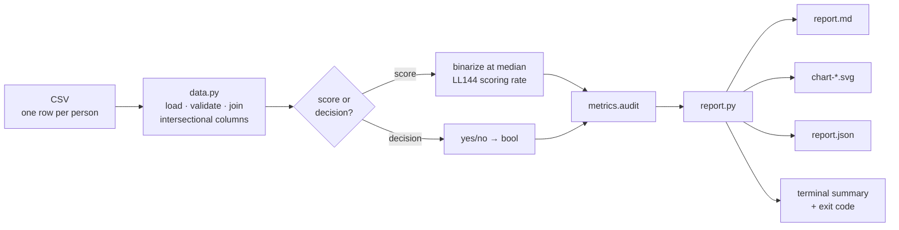

<div align="center">

# ⚖️ fairaudit

**A bias audit for automated hiring and decision tools. No dependencies, about 300 lines.**

Give it a CSV of the tool's decisions. It tells you which groups the tool disadvantages, how badly,
and whether the gap could just be chance. You get a report ready to publish.

   



</div>

---

## The problem

Automated tools already screen most job applications. Most Fortune 500 companies use an applicant tracking
system, and résumé-ranking and video-interview models are becoming standard. These tools can **quietly
learn historical bias**. A well-known example is the résumé screener that learned to downgrade CVs
containing the word *"women's"*.

Regulators have started to act:

| Rule | What it requires |
|---|---|
| **NYC Local Law 144** (in force since 2023) | A yearly *independent bias audit* of any automated employment decision tool, publishing **selection rates and impact ratios** by sex, race/ethnicity **and their intersections** |
| **EEOC four-fifths rule** (29 CFR 1607) | A group selected at **< 80 %** of the rate of the most-selected group is evidence of adverse impact |
| **EU AI Act** (Annex III) | Hiring AI is *high-risk*: providers must examine training data and outputs for bias |
| **Colorado AI Act**, Illinois HB 3773 | Duty of care against algorithmic discrimination in employment |

The audits themselves are often **expensive, opaque, and done once a year**. Small employers, non-profits,
journalists and job-seekers' advocates usually can't check a tool themselves.

**fairaudit makes the core LL144-style audit free, transparent and fast enough to run on every model
release.**

## What it does

```
decisions.csv  ─▶  selection rate · impact ratio · significance · equal opportunity  ─▶  report.md + charts + JSON
```

- 📊 **Selection rates and impact ratios** per category, the numbers LL144 requires you to publish
- 🔀 **Intersectional analysis** (e.g. `sex × race`). Single-axis audits miss these gaps (see below)
- 🧪 **Significance testing** (two-proportion z-test), so you can separate real gaps from noise
- 🎯 **Equal opportunity**: if you have ground truth, it checks whether *qualified* people are selected at equal rates
- 🔢 **Scored tools**: binarises scores at the median (LL144's "scoring rate") or at your own cut-off
- 🚦 **CI gate**: `--fail-under 0.8` exits non-zero, so a biased model can't ship unnoticed
- 📝 **Human-readable output**: Markdown tables, SVG charts (light/dark aware), a plain-English guide, and JSON for machines
- 🪶 **Pure standard library**: runs anywhere Python runs, including air-gapped HR systems where data can't leave

## Quick start

```bash
git clone https://github.com/kareemrt/EthicalAI && cd EthicalAI/fairaudit

# audit the bundled synthetic screening data
python -m fairaudit examples/screening.csv \
    --outcome advanced \
    --groups sex race age_band \
    --intersect sex age_band \
    --label qualified \
    --out audit/
```

Optionally, `pip install .` gives you a `fairaudit` command.

### Example output

The bundled dataset (`examples/make_sample.py`) simulates a résumé screener with a **hidden bias**: it
penalises applicants aged 50+, and it penalises career gaps, which in the simulation are more common for women.

<p align="center"></p>

The audit finds:

| Finding | What it means |
|---|---|
| **50+ → impact ratio 0.47**, p ≈ 10⁻²³ | Older applicants advance at under half the rate of under-30s. Clear adverse impact. |
| **Female → 0.87**, p = 0.001 | Passes the four-fifths rule, but the gap is *statistically real*, and qualified women are selected at 61 % vs 72 % for men. An audit that only checks "≥ 0.8?" misses this. |
| **Race → no flags** | Correct: no race bias was planted. Two categories under 2 % of the data are shown but marked `small-sample`. |

📄 Full generated report: [`examples/report/report.md`](examples/report/report.md)

## How it works



For each category *g*:

| Metric | Formula | Flag |
|---|---|---|
| Selection rate | `selected_g / n_g` | n/a |
| Impact ratio | `rate_g / rate_ref`, where *ref* is the most-selected category with ≥ 2 % of the data | `adverse-impact` if < 0.80 |
| p-value | pooled two-proportion z-test, *g* vs *ref* | `significant` if adverse **and** p < 0.05 |
| True-positive rate | `selected & qualified / qualified` | `opportunity-gap` if < 0.80 × best TPR |
| Sample share | `n_g / N` | `small-sample` if < 2 % (reported, never used as reference) |

## Input format

One row per person. Column names are up to you:

```csv
applicant_id,sex,race,age_band,qualified,score,advanced
A00000,Female,White,30–49,yes,75.9,yes
A00001,Male,Asian,Under 30,no,58.2,no
```

- **Decisions** accept `yes/no`, `1/0`, `true/false`, `selected`, `hired`, `pass`, `advance`
- **Scores** need `--score`, with an optional `--threshold 70`
- Blank demographic cells are grouped as `Unknown`. LL144 asks you to report how many there are, not to drop them.

## CLI reference

| Flag | Purpose |
|---|---|
| `csv` | input file |
| `--outcome COL` | decision (or score) column. **Required** |
| `--groups COL…` | demographic columns to audit one at a time. **Required** |
| `--intersect COL…` | columns to combine into one intersectional dimension |
| `--score` / `--threshold X` | treat the outcome as numeric and binarise it |
| `--label COL` | ground-truth "qualified" column, which turns on the equal-opportunity check |
| `--out DIR` | output directory (default `./audit`) |
| `--fail-under R` | exit `1` if any (non-small) category's impact ratio is below `R` |

Exit codes: `0` passed · `1` failed `--fail-under` · `2` bad input.

### Use it as a CI gate

```yaml
# .github/workflows/bias-audit.yml
- run: python -m fairaudit predictions.csv --outcome shortlisted --groups sex race --intersect sex race --fail-under 0.8
- uses: actions/upload-artifact@v4
  with: { name: bias-audit, path: audit/ }
```

### Use it as a library

```python
from fairaudit import audit

stats = audit(groups=["A", "A", "B", "B"], selected=[True, True, True, False])
for s in stats:
    print(s.group, round(s.impact_ratio, 2), s.flags)
```

## Codebase structure

```
fairaudit/
├── fairaudit/
│   ├── __init__.py      # public API: audit(), GroupStat, two_proportion_p()
│   ├── __main__.py      # CLI: argument parsing, wiring, exit codes          (~60 lines)
│   ├── data.py          # CSV loading, validation, bool/float parsing,
│   │                    #   intersectional column joining                    (~40 lines)
│   ├── metrics.py       # PURE functions: selection rates, impact ratios,
│   │                    #   z-test, median binarisation, flagging            (~90 lines)
│   └── report.py        # renderers: Markdown, SVG chart, JSON, terminal    (~115 lines)
├── examples/
│   ├── make_sample.py   # seeded generator for a synthetic biased screener
│   ├── screening.csv    # 4,000 synthetic applicants (no real people)
│   └── report/          # the audit generated from screening.csv
├── tests/
│   └── test_fairaudit.py  # metric edge cases + end-to-end CLI tests
├── docs/terminal.png    # README screenshot
├── LICENSE              # MIT
└── pyproject.toml       # zero runtime dependencies
```

**Design principles**

- **`metrics.py` has no I/O.** Every number in the report comes from one small, testable function you can read in five minutes. Auditors need to be able to check the auditor.
- **Data in, files out.** No servers or telemetry, so sensitive demographic data never leaves your machine.
- **Readable output first.** The Markdown report is meant for HR, legal and the people affected, not only data scientists.

## Run the tests

```bash
python -m unittest discover -s tests -v
```

## Limitations and responsible use

- An impact ratio **is a screening signal, not a legal finding**. Flagged gaps need investigation with domain experts and the affected communities.
- Passing the four-fifths rule **does not mean the tool is fair**, as the `Female 0.87` example shows. Look at p-values and TPRs too.
- Equal-opportunity metrics are only as good as your "qualified" label, which may itself encode bias.
- The z-test is approximate for very small groups. Treat `small-sample` rows as qualitative.
- Collecting demographic data carries its own risks. Store it separately, aggregate early, and follow local law (GDPR Art. 9, etc.).
- fairaudit covers the *statistical* core of an LL144 audit. A compliant audit also needs an independent auditor, a historical-data period and public posting.

## Roadmap

- [ ] Fisher's exact test for small samples
- [ ] Confidence intervals on impact ratios (bootstrap)
- [ ] Calibration-by-group for scored tools
- [ ] Single-file HTML report
- [ ] LL144 summary-page template

## References

- NYC DCWP, *Rules on Automated Employment Decision Tools* (6 RCNY §5-300)
- EEOC, *Uniform Guidelines on Employee Selection Procedures*, 29 CFR §1607.4(D)
- EEOC, *Assessing Adverse Impact in Software, Algorithms, and AI used in Employment Selection* (2023)
- Hardt, Price & Srebro, *Equality of Opportunity in Supervised Learning*, NeurIPS 2016
- Buolamwini & Gebru, *Gender Shades*, FAT* 2018 (the case for intersectional evaluation)

---

<sub>MIT licensed. The sample data is synthetic. Part of <a href="../README.md">EthicalAI</a>.</sub>
