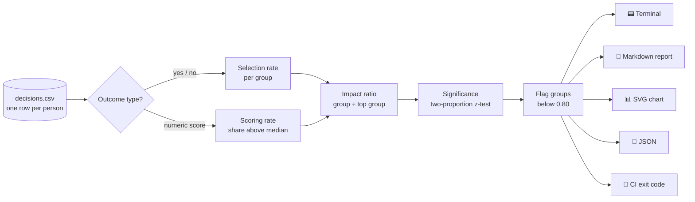
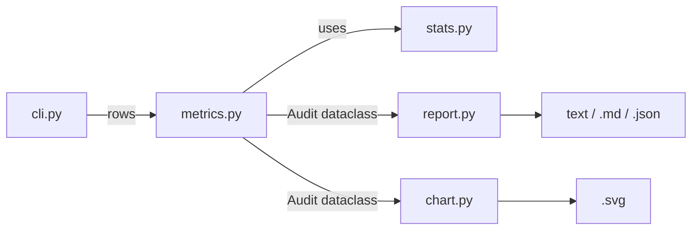

<div align="center">

# ⚖️ fairaudit

**A zero-dependency bias audit for automated decisions.**
Point it at a CSV of outcomes. Learn in one second whether your hiring, lending or admissions model treats groups unequally.

`Python ≥ 3.9` · `0 dependencies` · `~400 lines` · `MIT`

</div>

---

## Why this exists

Algorithms now screen résumés, approve loans, rank tenants and triage patients. When they
learn from biased history, they repeat it, quietly and at scale. One well-known example: an
experimental résumé screener that learned to downgrade CVs containing the word *"women's"*.

Regulators have caught up:

| Rule | What it requires |
|---|---|
| **EEOC four-fifths rule** (US, 29 CFR 1607.4) | A group's selection rate under 80% of the top group's rate is evidence of adverse impact |
| **NYC Local Law 144** (in force since 2023) | Employers using automated hiring tools must publish an annual **bias audit** with impact ratios by sex, race/ethnicity and their **intersections** |
| **EU AI Act** (high-risk systems) | Hiring and credit-scoring systems must be checked for bias in their data and outcomes |

But the tools that compute these numbers tend to be heavyweight ML frameworks, paid
consultancies, or spreadsheets that someone rebuilds every year. Small HR teams, NGOs,
journalists, and engineers who want a quick check before a release have little to choose from.

**fairaudit is the small, honest tool for that gap.** One command, readable output, a report
you can publish, and an exit code you can put in CI.

## What it does



- **Four-fifths rule and LL144 impact ratios**, computed per attribute.
- **Intersectional by default.** `sex × race` is reported automatically, because bias often hides
  where categories overlap. In the demo below, sex alone and race alone each look bad,
  and *Female × Black* applicants advance at **0.27×** the rate of the top group.
- **Handles yes/no decisions and raw scores.** Scores become LL144 "scoring rates" (share above the overall median).
- **Separates signal from noise.** Each gap gets a p-value, so a 0.78 ratio on 9 people isn't treated like a 0.78 ratio on 900.
- **Small-group handling.** `--min-share 0.02` excludes tiny groups from flagging (an option LL144 allows) while still listing them.
- **Counts missing data.** Blank demographic values are counted and excluded instead of silently dropped.
- **Publishable output.** Markdown report plus a self-contained SVG chart, ready for a public audit page.
- **CI gate.** `--check` exits `1` when any group is flagged, so a model retrain can't ship a regression unnoticed.

## Quick start

```bash
git clone https://github.com/kareemrt/EthicalAI.git
cd EthicalAI/fairaudit

# no install needed: standard library only
python -m fairaudit examples/hiring.csv --outcome advanced --attr sex --attr race --min-share 0.02
```

Or install the `fairaudit` command:

```bash
pip install .
fairaudit your_data.csv -o hired -a gender -a ethnicity
```

## Demo: auditing a synthetic AI résumé screener

[`examples/hiring.csv`](examples/hiring.csv) holds 1,500 **synthetic** applicants. In the
generator, skill is distributed identically across every group, but the simulated "AI
screener" picked up small penalties through proxy features. Can fairaudit find them?

```console
$ fairaudit examples/hiring.csv -o advanced -a sex -a race --min-share 0.02

fairaudit · outcome 'advanced' · 1,500 records · selection mode

sex
  group        n    rate  impact       p                        status
  Male       733   40.2%    1.00       —  ████████████████████  reference
  Female     742   27.1%    0.67  <0.001  █████████████░░░░░░░  ADVERSE*
  (25 records with unknown sex excluded)

race
  group                    n    rate  impact       p                        status
  White                  693   38.8%    1.00       —  ████████████████████  reference
  Asian                  220   36.4%    0.94   0.514  ███████████████████░  ok
  Hispanic or Latino     274   29.6%    0.76   0.007  ███████████████░░░░░  ADVERSE*
  Black                  251   21.9%    0.56  <0.001  ███████████░░░░░░░░░  ADVERSE*
  Native American         21   38.1%       —       —    too small
  (41 records with unknown race excluded)

sex × race
  group                             n    rate  impact       p                        status
  Male × White                    332   44.6%    1.00       —  ████████████████████  reference
  ...
  Female × Hispanic or Latino     130   20.0%    0.45  <0.001  █████████░░░░░░░░░░░  ADVERSE*
  Female × Black                  125   12.0%    0.27  <0.001  █████░░░░░░░░░░░░░░░  ADVERSE*

FAIL — 8 group(s) below the 80% impact-ratio threshold.
* gap is statistically significant (p < 0.05) versus the reference group
```

Add `--svg` and `--md` to get a shareable chart and report
([see the full generated report →](examples/report.md)):

<p align="center">
  
</p>

The same data audited by **raw score** instead of the yes/no decision (`-o ai_score`)
switches to scoring-rate mode automatically, and still flags the Female and Black groups.

## Usage

```text
fairaudit CSV -o OUTCOME -a ATTR [-a ATTR ...] [options]

  -o, --outcome COLUMN   decision column (yes/no, 1/0, hired/rejected…) or numeric score
  -a, --attr COLUMN      demographic column to audit (repeat for several)
  --threshold 0.8        impact-ratio flag threshold
  --min-share FRACTION   exclude groups below this share of records (e.g. 0.02)
  --mode MODE            auto | selection | scoring
  --no-intersect         skip the A × B intersectional breakdown
  --md PATH              write a Markdown report
  --svg PATH             write an SVG chart
  --json PATH            write machine-readable results
  --check                exit 1 if any group is flagged (CI mode)
  --no-color             plain output (also respects NO_COLOR)
```

**Exit codes:** `0` audit ran (and passed, under `--check`) · `1` adverse impact found under `--check` · `2` bad input.

### As a library

```python
from fairaudit import audit, load_csv

result = audit(load_csv("decisions.csv"), outcome="approved", attributes=["sex", "age_band"])

for attribute, group in result.flagged():
    print(f"{attribute}: {group.group} impact ratio {group.impact_ratio:.2f} (p={group.p_value:.3f})")
```

### As a CI fairness gate

Fail the build when a retrained model starts treating a group unequally:

```yaml
# .github/workflows/fairness.yml
name: fairness
on: [pull_request]
jobs:
  audit:
    runs-on: ubuntu-latest
    steps:
      - uses: actions/checkout@v4
      - uses: actions/setup-python@v5
        with: { python-version: "3.12" }
      - run: python model/score_holdout.py > predictions.csv   # your model's decisions on a holdout set
      - run: pip install ./fairaudit
      - run: fairaudit predictions.csv -o approved -a sex -a race --min-share 0.02 --check --md audit.md
```

## How it works

For each attribute (and their intersection):

```
selection rate_g = selected_g / n_g
impact ratio_g   = selection rate_g / max(selection rate over eligible groups)
flag             = impact ratio_g < threshold          (default 0.80)
p-value_g        = two-proportion z-test(g vs. reference group)
```

- **Reference group:** the eligible group with the highest rate (ties go to the larger group).
- **Scoring mode:** a person "is selected" when their score is strictly above the overall median.
- **Eligible:** groups at or above `--min-share` of all records. Smaller groups are shown but never flagged.
- **Unknowns:** rows with a blank value are counted and excluded from that attribute's rates.

## Codebase structure

```
fairaudit/
├── fairaudit/                  # the package: standard library only
│   ├── __init__.py             # public API: audit(), load_csv(), result types
│   ├── __main__.py             # enables `python -m fairaudit`
│   ├── cli.py                  # argument parsing, file outputs, exit codes
│   ├── metrics.py              # core logic: outcome parsing, rates, impact ratios, flags
│   ├── stats.py                # two-proportion z-test (math.erfc, no SciPy)
│   ├── report.py               # renderers: terminal table, Markdown, JSON
│   └── chart.py                # renderer: self-contained SVG bar chart
├── examples/
│   ├── generate_hiring_data.py # reproducible synthetic dataset with injected proxy bias
│   ├── hiring.csv              # 1,500 synthetic applicants (generated, seed 7)
│   ├── report.md               # sample generated report
│   └── report.json             # sample machine-readable output
├── docs/
│   └── impact-ratios.svg       # sample generated chart (used above)
├── tests/
│   └── test_fairaudit.py       # unittest suite: stats, parsing, audit rules, CLI end to end
├── pyproject.toml              # packaging + `fairaudit` console script
└── LICENSE
```

Data flows one way through the modules:



`metrics.py` holds all the domain logic and returns plain dataclasses (`Audit` →
`AttributeResult` → `GroupResult`). The renderers only format; they never compute. To add an
output format, write one function that takes an `Audit`.

## Development

```bash
python -m unittest -v                       # 14 tests, < 0.1 s
python examples/generate_hiring_data.py     # regenerate the demo dataset
```

## Limitations and responsible use

- **A screening signal, not a verdict.** An impact ratio below 0.80 calls for investigation. It does not
  prove discrimination, and a ratio above 0.80 does not prove fairness. Context, job-relatedness and
  legal advice still matter.
- **Outcome parity is one lens of several.** fairaudit measures disparate impact in *outcomes*. It does not
  measure error-rate parity (e.g. equalized odds), which needs ground-truth labels.
- **Demographic data is sensitive.** Collect it with consent, store it separately from decision features,
  and keep audit files out of public repos unless they are aggregated, like the generated report.
- **The demo data is synthetic.** The bias in `hiring.csv` was injected on purpose. It does not depict any
  real employer, product or person.

## Roadmap

- [ ] Error-rate metrics (false-negative-rate parity) when ground-truth labels are available
- [ ] Bootstrap confidence intervals on impact ratios
- [ ] Year-over-year diff between two audits
- [ ] LL144-formatted public summary template

<div align="center">
<sub>Part of <a href="../README.md">EthicalAI</a>, a collection of small projects using software for ethical goals.</sub>
</div>
