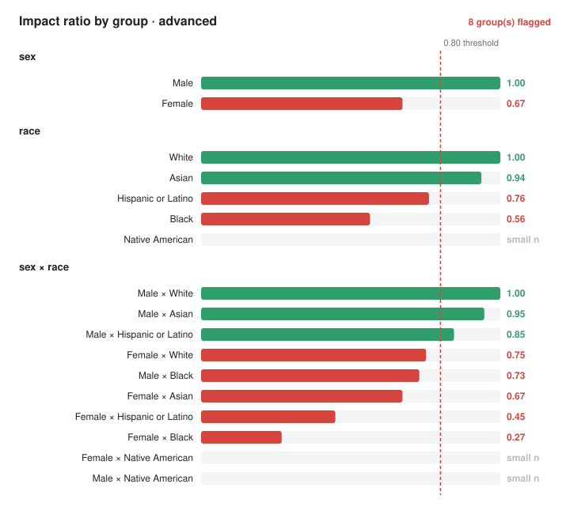

# Bias Audit Report

**Outcome:** `advanced` · **Records:** 1,500 · **Mode:** selection · **Threshold:** 0.80 · **Min group share:** 2%

> **FAIL — 8 group(s) below the 80% impact-ratio threshold.**

## sex

| Group | Applicants | Selected | Selection rate | Impact ratio | p-value | Status |
|---|---:|---:|---:|---:|---:|---|
| Male | 733 | 295 | 40.2% | 1.00 | — | ⭐ reference |
| Female | 742 | 201 | 27.1% | 0.67 | <0.001 | 🔴 adverse* |

_25 records with unknown sex were excluded._

## race

| Group | Applicants | Selected | Selection rate | Impact ratio | p-value | Status |
|---|---:|---:|---:|---:|---:|---|
| White | 693 | 269 | 38.8% | 1.00 | — | ⭐ reference |
| Asian | 220 | 80 | 36.4% | 0.94 | 0.514 | ✅ ok |
| Hispanic or Latino | 274 | 81 | 29.6% | 0.76 | 0.007 | 🔴 adverse* |
| Black | 251 | 55 | 21.9% | 0.56 | <0.001 | 🔴 adverse* |
| Native American | 21 | 8 | 38.1% | — | — | ⚪ too small |

_41 records with unknown race were excluded._

## sex × race

| Group | Applicants | Selected | Selection rate | Impact ratio | p-value | Status |
|---|---:|---:|---:|---:|---:|---|
| Male × White | 332 | 148 | 44.6% | 1.00 | — | ⭐ reference |
| Male × Asian | 109 | 46 | 42.2% | 0.95 | 0.665 | ✅ ok |
| Male × Hispanic or Latino | 138 | 52 | 37.7% | 0.85 | 0.168 | ✅ ok |
| Female × White | 349 | 117 | 33.5% | 0.75 | 0.003 | 🔴 adverse* |
| Male × Black | 120 | 39 | 32.5% | 0.73 | 0.021 | 🔴 adverse* |
| Female × Asian | 110 | 33 | 30.0% | 0.67 | 0.007 | 🔴 adverse* |
| Female × Hispanic or Latino | 130 | 26 | 20.0% | 0.45 | <0.001 | 🔴 adverse* |
| Female × Black | 125 | 15 | 12.0% | 0.27 | <0.001 | 🔴 adverse* |
| Female × Native American | 10 | 4 | 40.0% | — | — | ⚪ too small |
| Male × Native American | 11 | 4 | 36.4% | — | — | ⚪ too small |

_66 records with unknown sex × race were excluded._

---

**How to read this.** *Impact ratio* = group rate ÷ rate of the most-selected group. Below **0.80** indicates potential adverse impact under the EEOC four-fifths rule. *p-value* comes from a two-proportion z-test against the reference group; `*` marks gaps unlikely to be chance (p < 0.05). This report is a screening signal, not a legal determination.
