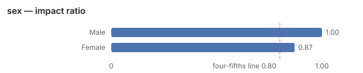
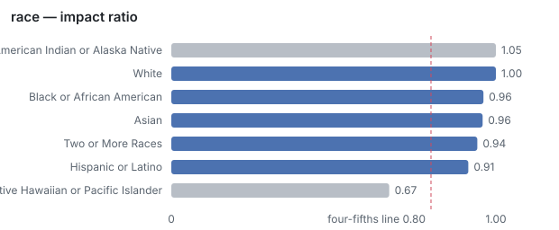
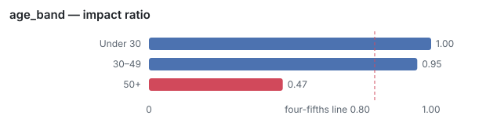
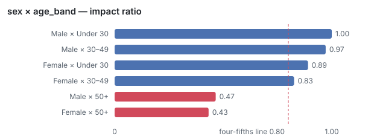

# Bias audit — `examples/screening.csv`

Outcome audited: **advanced**.

## Summary

**3 categories fall below the four-fifths threshold.**

- age_band: **50+** — impact ratio 0.47 (p = 4.31e-23)
- sex × age_band: **Male × 50+** — impact ratio 0.47 (p = 5.17e-14)
- sex × age_band: **Female × 50+** — impact ratio 0.43 (p = 3.21e-15)

## sex

| Category | N | Selected | Selection rate | Impact ratio | p-value | TPR | Flags |
|---|--:|--:|--:|--:|--:|--:|---|
| Male | 2,070 | 769 | 37.1% | **1.00** | 1 | 72.2% | ✅ |
| Female | 1,930 | 624 | 32.3% | **0.87** | 0.00139 | 61.4% | ✅ |

## race

| Category | N | Selected | Selection rate | Impact ratio | p-value | TPR | Flags |
|---|--:|--:|--:|--:|--:|--:|---|
| American Indian or Alaska Native | 40 | 15 | 37.5% | **1.05** | 0.818 | 61.9% | · <2% sample |
| White | 2,325 | 831 | 35.7% | **1.00** | 1 | 68.6% | ✅ |
| Black or African American | 448 | 154 | 34.4% | **0.96** | 0.58 | 66.3% | ✅ |
| Asian | 385 | 132 | 34.3% | **0.96** | 0.58 | 67.1% | ✅ |
| Two or More Races | 92 | 31 | 33.7% | **0.94** | 0.688 | 57.4% | ✅ |
| Hispanic or Latino | 685 | 224 | 32.7% | **0.91** | 0.143 | 64.2% | ✅ |
| Native Hawaiian or Pacific Islander | 25 | 6 | 24.0% | **0.67** | 0.223 | 55.6% | · <2% sample |

## age_band

| Category | N | Selected | Selection rate | Impact ratio | p-value | TPR | Flags |
|---|--:|--:|--:|--:|--:|--:|---|
| Under 30 | 1,245 | 497 | 39.9% | **1.00** | 1 | 74.1% | ✅ |
| 30–49 | 1,968 | 747 | 38.0% | **0.95** | 0.266 | 74.3% | ✅ |
| 50+ | 787 | 149 | 18.9% | **0.47** | 4.31e-23 | 39.1% | ⚠️ adverse impact, 📉 significant, 🎯 opportunity gap |

## sex × age_band

| Category | N | Selected | Selection rate | Impact ratio | p-value | TPR | Flags |
|---|--:|--:|--:|--:|--:|--:|---|
| Male × Under 30 | 653 | 275 | 42.1% | **1.00** | 1 | 79.2% | ✅ |
| Male × 30–49 | 1,014 | 415 | 40.9% | **0.97** | 0.631 | 79.2% | ✅ |
| Female × Under 30 | 592 | 222 | 37.5% | **0.89** | 0.0969 | 68.6% | ✅ |
| Female × 30–49 | 954 | 332 | 34.8% | **0.83** | 0.00298 | 68.8% | ✅ |
| Male × 50+ | 403 | 79 | 19.6% | **0.47** | 5.17e-14 | 42.6% | ⚠️ adverse impact, 📉 significant, 🎯 opportunity gap |
| Female × 50+ | 384 | 70 | 18.2% | **0.43** | 3.21e-15 | 35.8% | ⚠️ adverse impact, 📉 significant, 🎯 opportunity gap |

## How to read this

- **Selection rate** — share of the category the tool selected (or scored above the overall median).
- **Impact ratio** — selection rate ÷ the most-selected category's rate. Below **0.80** is evidence of adverse impact under the EEOC four-fifths rule; NYC Local Law 144 requires publishing this number.
- **p-value** — two-proportion z-test vs. the most-selected category. Small p means the gap is unlikely to be chance.
- **TPR** — selection rate among people who were actually qualified (equal opportunity).
- Categories under 2% of the data are shown but not used as the reference, as LL144 permits.

> An impact ratio is a screening signal, not a legal conclusion. Investigate flagged gaps with domain experts and the people affected.
