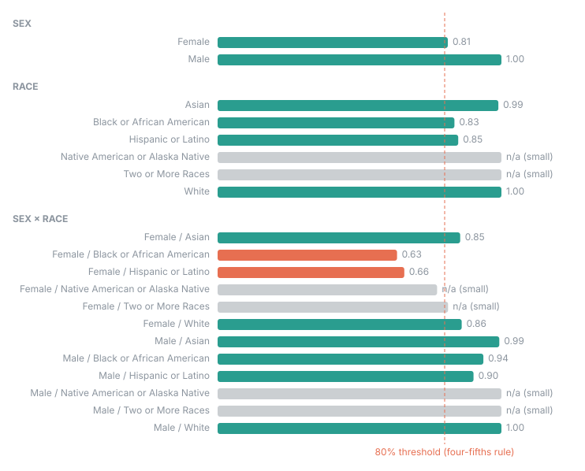
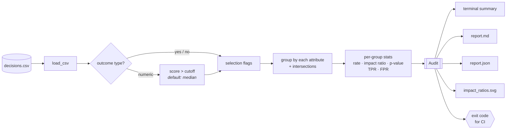
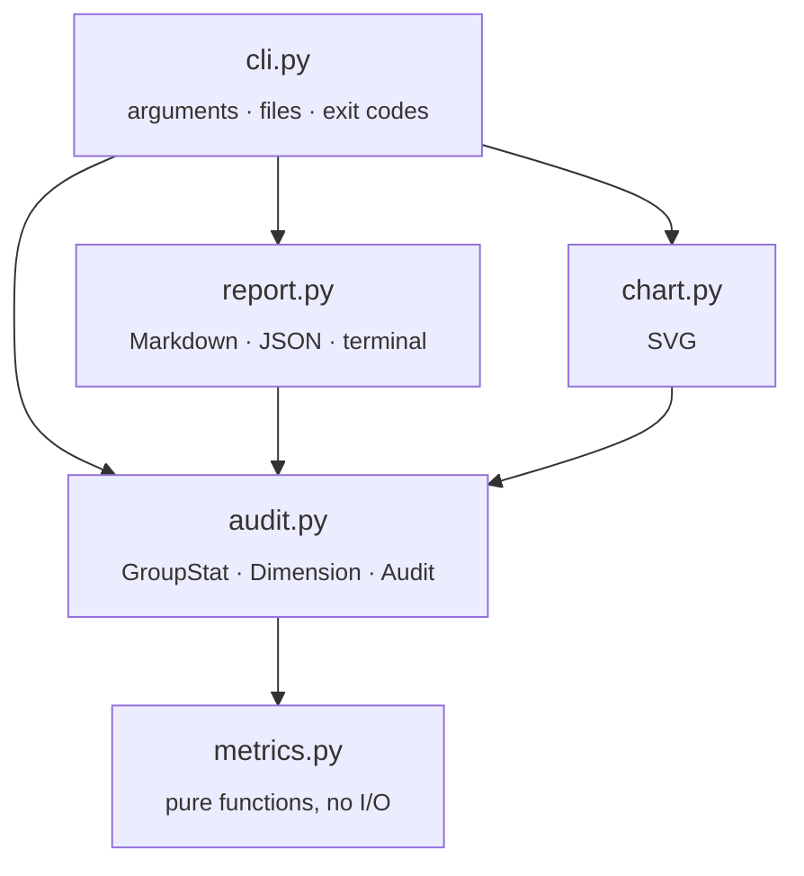

<div align="center">

# ⚖️ FairCheck

**Find out whether your hiring algorithm discriminates before your applicants do.**

A zero-dependency bias audit for automated decision systems.<br>
Point it at a CSV of decisions and it tells you who is being left behind, how much, and whether the gap is likely real.


</div>

---

## The problem

Automated tools now screen résumés, rank applicants, set credit limits and flag benefit claims. Most of them never see race or sex. **They discriminate anyway**, through *proxies*: a gap in employment history, a zip code, the name of a university.

Rules are catching up. **NYC Local Law 144** requires an annual independent bias audit for any automated employment decision tool used on NYC candidates. The **EU AI Act** lists hiring systems as *high-risk*. **Colorado's AI Act** and the **EEOC** have followed. The method behind these audits is not complicated, yet the tooling is either buried in heavy ML frameworks or sold as a consulting engagement.

FairCheck is the small, readable middle ground:

| | |
|---|---|
| 🧮 **Standard metrics** | Selection-rate **impact ratios** (EEOC four-fifths rule / LL144), **two-proportion significance tests**, and **equal-opportunity** (TPR/FPR) gaps when ground truth is available |
| 🔀 **Intersectional by default** | Audits `sex × race` combinations, not just each axis on its own. Bias often hides there (see below) |
| 🎯 **Scores or decisions** | Works on yes/no outcomes *or* raw model scores, using LL144's "scoring rate" (share above the median) |
| 🛡️ **Honest about small samples** | Groups under 2% of the data are reported but not judged, so a handful of people can't produce a false alarm |
| 🚦 **CI-ready** | Exits non-zero on adverse impact, so you can block a model release the same way you block a failing test |
| 📄 **Shareable output** | Markdown report, machine-readable JSON and an SVG chart, all from one command |
| 🪶 **Zero dependencies** | Python standard library only. Easy to read in an afternoon, so you can actually trust it |

---

## The intersectional blind spot: a worked example

`examples/make_sample.py` generates 3,000 synthetic applicants scored by a fictional résumé screener. The screener **never sees sex or race**. It docks points for career gaps (which in the data skew female, mirroring caregiving patterns) and adds points for "target schools" (which skew by race, mirroring unequal access). Underlying skill is identically distributed across every group.

```bash
python -m faircheck examples/screening_sample.csv \
    --outcome advanced --attr sex --attr race --label qualified \
    --out docs/sample-report
```

<p align="center">
  
</p>

**Audited one attribute at a time, the tool passes.** Women come in at 0.81, Black applicants at 0.83 and Hispanic applicants at 0.85, all above the four-fifths line.

**Audited at the intersection, it fails clearly:**

| Group | Selection rate | Impact ratio | p-value | Qualified & advanced (TPR) |
|---|---:|---:|---:|---:|
| Male / White *(reference)* | 30.8% | 1.000 | — | 79.9% |
| Female / Black or African American | 19.5% | **0.632** | 0.002 | **53.8%** |
| Female / Hispanic or Latino | 20.3% | **0.658** | 0.001 | 65.6% |

A qualified Black woman is about **26 points less likely** to advance than an equally qualified white man. The two proxies stack, and a single-axis audit cannot see it. This is why LL144 asks for intersectional categories, and why FairCheck computes them by default.

→ Full generated report: [`docs/sample-report/report.md`](docs/sample-report/report.md)

---

## Quick start

```bash
cd faircheck
python examples/make_sample.py            # optional: create the demo dataset
python -m faircheck examples/screening_sample.csv --outcome advanced --attr sex --attr race
```

Nothing to install. To get a `faircheck` command on your PATH, run `pip install -e .`

```text
FairCheck · advanced · 3,000 records

sex
  Female                                    ████████████████      0.81  ok
  Male                                      ████████████████████  1.00  ok
...
sex × race
  Female / Black or African American        █████████████         0.63  adverse*
  Female / Hispanic or Latino               █████████████         0.66  adverse*
...
Verdict: ADVERSE IMPACT (statistically significant)
```

### Your data

One row per person, with any extra columns you like:

| Column | Required | Example values |
|---|---|---|
| outcome (`--outcome`) | ✅ | `yes`/`no`, `1`/`0`, `true`/`false`, `hired`/`rejected` **or** a numeric score |
| attributes (`--attr`, repeatable) | ✅ | `Female`, `Black or African American`, `40+`, … |
| ground truth (`--label`) | optional | `yes`/`no`: was this person actually qualified / did they succeed? |

### Options

| Flag | Default | Meaning |
|---|---|---|
| `--cutoff N` | median | Score threshold when the outcome is numeric |
| `--threshold R` | `0.8` | Impact ratio below which a group is flagged |
| `--min-share S` | `0.02` | Groups smaller than this share are reported but not judged |
| `--alpha A` | `0.05` | Significance level |
| `--no-intersections` | off | Only audit each attribute on its own |
| `--out DIR` | — | Write `report.md`, `report.json` and `impact_ratios.svg` |
| `--fail-on` | `significant` | When to exit with `1`: `adverse`, `significant`, or `never` |

---

## How it works



### The metrics, in plain language

| Metric | Question it answers | Formula |
|---|---|---|
| **Selection rate** | What share of this group got the positive outcome? | `selected ÷ group size` |
| **Impact ratio** | How does this group fare compared with the best-treated group? | `group rate ÷ highest rate` |
| **Four-fifths rule** | Is the gap large enough to matter? | flagged if impact ratio `< 0.8` |
| **p-value** | Could a gap this large be chance? | pooled two-proportion z-test against the reference group |
| **TPR** (equal opportunity) | Of the *qualified* people in this group, how many were selected? | `selected & qualified ÷ qualified` |
| **FPR** | Of the *unqualified* people, how many slipped through? | `selected & unqualified ÷ unqualified` |

**Status labels:** `ok` · `adverse` (below threshold, but the sample is too small to rule out chance) · `adverse*` (below threshold **and** statistically significant) · `excluded` (group too small to judge).

---

## Use it as a release gate

Treat fairness like any other test. If a retrained model introduces significant adverse impact, the pipeline stops:

```yaml
# .github/workflows/model-fairness.yml
- name: Bias audit on holdout predictions
  run: |
    python -m faircheck predictions.csv \
      --outcome predicted_hire --attr sex --attr race_ethnicity \
      --label actual_success --out audit/
- uses: actions/upload-artifact@v4
  if: always()
  with: { name: bias-audit, path: audit/ }
```

| Exit code | Meaning |
|:-:|---|
| `0` | No adverse impact at the chosen `--fail-on` level |
| `1` | Adverse impact found |
| `2` | Bad input (missing file or column, unreadable values) |

## Use it from Python

```python
from faircheck import load_csv, run_audit
from faircheck.report import to_markdown

audit = run_audit(load_csv("decisions.csv"), outcome="approved", attributes=["sex", "age_band"])

for dimension, group in audit.adverse(significant_only=True):
    print(f"{dimension}: {group.group} impact ratio {group.impact_ratio:.2f} (p={group.p_value:.3g})")

open("audit.md", "w").write(to_markdown(audit))
```

---

## Codebase structure

```text
faircheck/
├── faircheck/                 # the package: ~430 lines, standard library only
│   ├── __init__.py            # public API: run_audit, load_csv, Audit, Dimension, GroupStat
│   ├── __main__.py            # enables `python -m faircheck`
│   ├── metrics.py             # pure math: rate, impact ratios, z-test p-value, median
│   ├── audit.py               # core: parse outcomes, bucket groups, compute GroupStat/Dimension/Audit
│   ├── report.py              # renderers: Markdown report, JSON, terminal summary, verdict
│   ├── chart.py               # hand-built SVG bar chart (no plotting library)
│   └── cli.py                 # argparse front end, file output, CI exit codes
├── examples/
│   ├── make_sample.py         # deterministic synthetic dataset with hidden proxy bias
│   └── screening_sample.csv   # its output (3,000 rows)
├── docs/
│   └── sample-report/         # real FairCheck output: report.md · report.json · impact_ratios.svg
├── tests/
│   └── test_faircheck.py      # unit + end-to-end tests (python -m unittest discover tests)
└── pyproject.toml             # optional install; exposes the `faircheck` command
```

**Data flow and layering.** Each module depends only on the ones above it, so any layer can be reused alone:



| Type | What it holds |
|---|---|
| `GroupStat` | One group: size, selections, rate, share, impact ratio, p-value, TPR/FPR, excluded flag |
| `Dimension` | One way of slicing the data (`sex`, `race`, `sex × race`), its groups, and the reference group |
| `Audit` | All dimensions, settings and warnings, plus `status(group)` and `adverse()` helpers |

### Running the tests

```bash
python -m unittest discover tests -v
```

The suite covers the statistics, the four-fifths logic, the intersectional blind spot, small-group exclusion, score mode, ground-truth rates, report rendering and CLI exit codes. It runs in under 50 ms.

---

## Design principles

- **Readable over clever.** An audit tool nobody can inspect just moves the trust problem somewhere else. Every formula is a few lines you can check against the regulation.
- **Standard library only.** It runs on locked-down machines, in CI and in air-gapped HR environments with no `pip install`.
- **Conservative by default.** CI fails on *significant* adverse impact, small groups are never judged on noise, and every report states its own limits.
- **Signals, not verdicts.** The output is a reason to investigate, written so non-technical reviewers can follow it.

## Limitations & responsible use

- **This is a screening tool, not a legal opinion.** The four-fifths rule is a rule of thumb. Courts and regulators also weigh practical significance, job-relatedness and less-discriminatory alternatives.
- **Ground truth carries its own bias.** "Qualified" or "successful" labels often come from past human decisions. TPR/FPR gaps are only as fair as those labels.
- **Demographic data must be handled with care.** Collect it voluntarily, store it apart from decision inputs, and never feed it into the model being audited.
- **Passing is not proof of fairness.** A tool can meet the four-fifths rule and still be inaccurate, inaccessible or unfair in ways rates can't capture.
- **Bring in the people affected.** Statistics show *where* to look. Talking to the people affected shows *why*.

## Roadmap

- [ ] Fisher's exact test for very small groups
- [ ] Confidence intervals on impact ratios (bootstrap)
- [ ] Calibration-by-group for score outputs
- [ ] One-page HTML report for non-technical stakeholders
- [ ] Proxy finder: rank input features by how well they predict protected attributes

---

<sub>All data in this repository is synthetic. FairCheck is MIT-licensed. References: EEOC Uniform Guidelines on Employee Selection Procedures (29 CFR §1607.4(D)); NYC Local Law 144 of 2021 and DCWP rules (6 RCNY §5-300); EU AI Act, Annex III(4).</sub>
