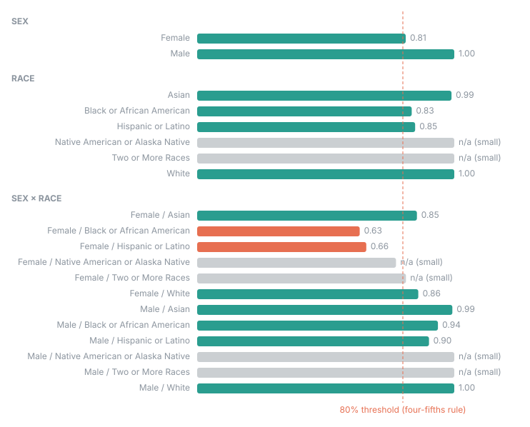

# Bias audit — `advanced`

**Verdict: ADVERSE IMPACT (statistically significant)**

- Date: 2026-11-22
- Records audited: 3,000
- Metric: selection rate
- Adverse-impact threshold: impact ratio < 0.8; significance level α = 0.05

## sex

Reference group (highest rate): **Male**

| Group | N | Share | Selected | Rate | Impact ratio | p-value | Status | TPR | FPR |
|---|---:|---:|---:|---:|---:|---:|---|---:|---:|
| Female | 1,461 | 48.7% | 358 | 24.5% | 0.811 | 0.000458 | ok | 67.2% | 6.3% |
| Male | 1,539 | 51.3% | 465 | 30.2% | 1.000 | 1 | ok | 76.0% | 8.5% |

Equal-opportunity gap (max − min TPR among qualified candidates): **8.8%**

## race

Reference group (highest rate): **White**

| Group | N | Share | Selected | Rate | Impact ratio | p-value | Status | TPR | FPR |
|---|---:|---:|---:|---:|---:|---:|---|---:|---:|
| Asian | 222 | 7.4% | 63 | 28.4% | 0.989 | 0.923 | ok | 68.1% | 10.5% |
| Black or African American | 355 | 11.8% | 85 | 23.9% | 0.835 | 0.0683 | ok | 61.5% | 7.3% |
| Hispanic or Latino | 518 | 17.3% | 126 | 24.3% | 0.848 | 0.0503 | ok | 64.9% | 7.1% |
| Native American or Alaska Native | 38 | 1.3% | 11 | 28.9% | 1.009 | 0.972 | excluded | 84.6% | 0.0% |
| Two or More Races | 58 | 1.9% | 19 | 32.8% | 1.142 | 0.501 | excluded | 84.2% | 7.7% |
| White | 1,809 | 60.3% | 519 | 28.7% | 1.000 | 1 | ok | 75.5% | 7.3% |

Equal-opportunity gap (max − min TPR among qualified candidates): **14.0%**

## sex × race

Reference group (highest rate): **Male / White**

| Group | N | Share | Selected | Rate | Impact ratio | p-value | Status | TPR | FPR |
|---|---:|---:|---:|---:|---:|---:|---|---:|---:|
| Female / Asian | 114 | 3.8% | 30 | 26.3% | 0.855 | 0.327 | ok | 57.6% | 13.6% |
| Female / Black or African American | 185 | 6.2% | 36 | 19.5% | 0.632 | 0.00191 | adverse* | 53.8% | 6.0% |
| Female / Hispanic or Latino | 237 | 7.9% | 48 | 20.3% | 0.658 | 0.00137 | adverse* | 65.6% | 3.5% |
| Female / Native American or Alaska Native | 21 | 0.7% | 5 | 23.8% | 0.773 | 0.493 | excluded | 71.4% | 0.0% |
| Female / Two or More Races | 24 | 0.8% | 6 | 25.0% | 0.812 | 0.544 | excluded | 85.7% | 0.0% |
| Female / White | 880 | 29.3% | 233 | 26.5% | 0.860 | 0.0429 | ok | 70.7% | 6.6% |
| Male / Asian | 108 | 3.6% | 33 | 30.6% | 0.993 | 0.961 | ok | 77.8% | 6.9% |
| Male / Black or African American | 170 | 5.7% | 49 | 28.8% | 0.936 | 0.609 | ok | 68.4% | 8.8% |
| Male / Hispanic or Latino | 281 | 9.4% | 78 | 27.8% | 0.902 | 0.332 | ok | 64.4% | 10.5% |
| Male / Native American or Alaska Native | 17 | 0.6% | 6 | 35.3% | 1.146 | 0.69 | excluded | 100.0% | 0.0% |
| Male / Two or More Races | 34 | 1.1% | 13 | 38.2% | 1.242 | 0.356 | excluded | 83.3% | 13.6% |
| Male / White | 929 | 31.0% | 286 | 30.8% | 1.000 | 1 | ok | 79.9% | 8.0% |

Equal-opportunity gap (max − min TPR among qualified candidates): **26.1%**

## Warnings

- [race] 2 group(s) under 2% of the sample were not judged: Native American or Alaska Native, Two or More Races. Report them separately; they are too small for reliable ratios.
- [sex × race] 4 group(s) under 2% of the sample were not judged: Female / Native American or Alaska Native, Female / Two or More Races, Male / Native American or Alaska Native, Male / Two or More Races. Report them separately; they are too small for reliable ratios.

## How to read this

- **Impact ratio** = group rate ÷ reference group rate. Below 0.8 fails the EEOC four-fifths rule of thumb and is the figure NYC Local Law 144 requires in published audits.
- **p-value** tests whether the gap could be chance (two-proportion z-test vs. the reference group). `adverse*` = below threshold *and* significant.
- **TPR / FPR** (only with ground truth): among truly qualified people, how often each group was selected — and among unqualified, how often they slipped through.

> This report is a screening tool, not a legal determination. A low ratio is a signal to investigate features, data, and process — not proof of intent. Consult counsel for compliance.
