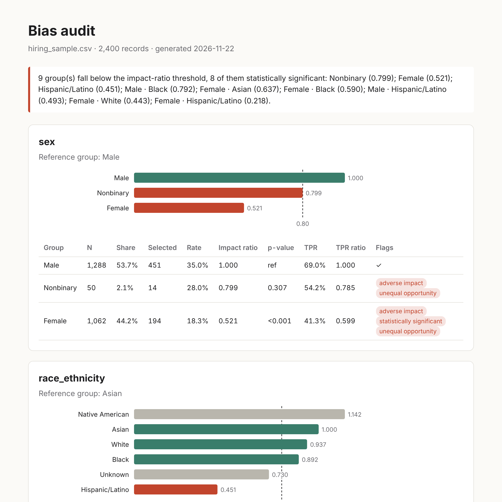
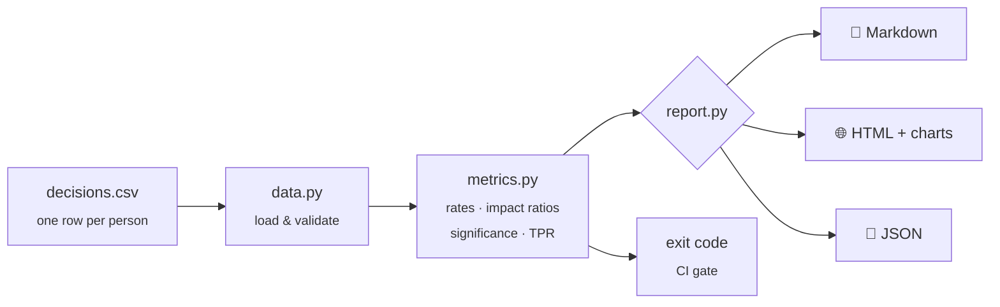

<div align="center">

# ⚖️ fairgauge

**Find out if your hiring algorithm is biased before your applicants do.**

A zero-dependency bias audit for automated decision tools (résumé screeners, loan models, admissions filters).
Point it at a CSV and get a clear, defensible report in seconds.

`Python 3.9+` · `0 dependencies` · `~450 lines` · `MIT`

<picture>
  <source media="(prefers-color-scheme: dark)" srcset="docs/report-dark.png">
  
</picture>

</div>

---

## The problem

Algorithms now screen most job applications before a human sees them. Many also decide loans, tenancy, and
admissions. When one of these models learns a historical bias, it applies that bias to thousands of people at once,
and none of them get told why.

Regulators have caught up:

| Rule | What it asks for |
|---|---|
| **EEOC Uniform Guidelines** (US, 1978) | The *four-fifths rule*: a group selected at under 80% of the top group's rate is evidence of adverse impact. |
| **NYC Local Law 144** (2023) | Employers using automated employment decision tools must publish an annual bias audit with **impact ratios** by sex, race/ethnicity, and their intersection. |
| **EU AI Act** | Classifies AI used in recruitment and worker management as **high-risk**, which brings bias monitoring and documentation duties. |

The math behind these audits is simple, but in practice it gets locked inside consultancies, spreadsheets, and
heavyweight ML toolkits. Small employers, HR teams, journalists, and advocates often can't check a tool themselves.

**fairgauge makes the check free, fast, and transparent.** Every number in its report is basic arithmetic on
counts, so a non-specialist can verify it by hand.

## What it does



- **Impact ratios** per group, using the four-fifths rule (the threshold is configurable).
- **Selection rate or scoring rate.** Pass a yes/no column, or a numeric score. With a score, a person counts as selected when they score above the sample median, which is the LL144 definition.
- **Statistical significance.** Every group is compared with the reference group: Fisher's exact test for small cells, a two-proportion z-test otherwise. This separates real disparities from noise.
- **Intersectional audit** (`-x`). Bias often hides in combinations: a tool can look fair by sex and fair by race and still be unfair to Hispanic women.
- **Equal opportunity** (`--outcome`). Given ground truth, it checks whether *qualified* people are selected at equal rates (true-positive-rate ratio).
- **Honest about small samples.** Groups under 2% of the data, and unknown categories, are reported but never flagged and never used as the reference.
- **CI-ready.** `--fail-on-flag` exits with code 1, so a model retrain can't ship if it introduces adverse impact.

## Quick start

```bash
git clone <this repo> && cd EthicalAI/fairgauge

# Run on the bundled synthetic hiring data (no install needed)
python -m fairgauge examples/hiring_sample.csv \
    --attr sex --attr race_ethnicity \
    --selected advanced --outcome qualified \
    --intersectional -o report.html
```

Or install the `fairgauge` command with `pip install .`.

### Your own data

All you need is a CSV with one row per person:

```csv
applicant_id,sex,race_ethnicity,score,advanced,qualified
A00001,Male,White,55.4,no,no
A00002,Female,White,69.9,yes,yes
```

| Flag | Meaning |
|---|---|
| `-a, --attr COL` | Demographic column to audit. Repeat it for several. |
| `-s, --selected COL` | Yes/no outcome from the tool (`yes/no`, `1/0`, `true/false`, `hired`, `approved`…). |
| `--score COL` | Numeric score instead; selected = above the sample median. |
| `--outcome COL` | *Optional* ground truth, which turns on the equal-opportunity check. |
| `-x, --intersectional` | Also audit every combination of the attributes. |
| `-t, --threshold N` | Impact-ratio threshold (default `0.8`). |
| `-o FILE` / `-f md\|html\|json` | Output file; the format is inferred from the extension. |
| `--fail-on-flag` | Exit 1 if any group shows adverse impact. |

Exit codes: `0` ok · `1` adverse impact found (only with `--fail-on-flag`) · `2` bad input.

### As a library

```python
from fairgauge import load, run

records = load("decisions.csv", ["sex"], selected="hired")
for audit in run(records, ["sex"]):
    for g in audit.flagged:
        print(f"{g.name}: impact ratio {g.impact_ratio:.2f}, p={g.p_value:.3g}")
```

## Example output

The bundled dataset (`examples/generate_sample.py`) has a **deliberately planted bias**: the simulated screener
docks points from women and Hispanic/Latino applicants, although real qualification is independent of
demographics. fairgauge finds it:

| Group | N | Rate | Impact ratio | p-value | TPR ratio | Flags |
|---|---|---|---|---|---|---|
| Male | 1,288 | 35.0% | 1.000 | ref | 1.000 | ✓ |
| Nonbinary | 50 | 28.0% | 0.799 | 0.307 | 0.785 | adverse impact, unequal opportunity |
| Female | 1,062 | 18.3% | **0.521** | <0.001 | 0.599 | adverse impact, statistically significant, unequal opportunity |

How to read it:

- Women are advanced at roughly half the rate of men, and the p-value says this is not chance.
- The TPR ratio says that *qualified* women are advanced at 60% of the rate of qualified men, so the tool is unfair on merit too, not only on raw rates.
- Nonbinary applicants fall just under the threshold, but with only 50 people the gap is not significant. That calls for more data, not a conclusion.
- The intersectional table shows **Female · Hispanic/Latino** applicants at an impact ratio of **0.218**, much worse than either attribute shows alone.

Full reports: [`sample_report.md`](examples/sample_report.md) · [`sample_report.html`](examples/sample_report.html)

## How the numbers are computed

| Metric | Formula | Flag when |
|---|---|---|
| Selection rate | selected ÷ total in group | — |
| Impact ratio | group rate ÷ reference rate | `< threshold` (0.8) |
| Reference group | highest-rate group with ≥ 2% share and known category | — |
| p-value | Fisher's exact test (any cell < 5) or two-proportion z-test, vs. reference | `< 0.05` (and below threshold) |
| TPR | selected ÷ total, among people with `outcome = yes` | — |
| TPR ratio | group TPR ÷ best TPR | `< threshold` |

Impact ratios are **truncated** to three decimals for display, never rounded up, so a failing 0.7996 can't appear as a passing 0.800.

## Codebase structure

```
fairgauge/
├── fairgauge/               # the package (stdlib only)
│   ├── __init__.py          # public API: load, run, audit, Record, Audit, GroupStat
│   ├── __main__.py          # CLI: argument parsing, output routing, exit codes
│   ├── data.py              # CSV → list[Record]; yes/no parsing; median-score rule
│   ├── metrics.py           # selection rates, impact ratios, Fisher / z-tests, TPR, flags
│   └── report.py            # Markdown, JSON, and self-contained HTML (inline SVG charts)
├── tests/
│   └── test_fairgauge.py    # stats vs. reference values, metrics, loading, CLI, rendering
├── examples/
│   ├── generate_sample.py   # reproducible synthetic hiring data with planted bias
│   ├── hiring_sample.csv    # 2,400 generated applicants
│   ├── sample_report.md     # example Markdown output
│   └── sample_report.html   # example HTML output
├── docs/                    # README screenshots
└── pyproject.toml           # packaging + `fairgauge` console script
```

**Design principles**

1. **Data flows one way.** `data` → `metrics` → `report`. Each module depends only on the ones before it.
2. **Dataclasses, not frameworks.** `Record`, `GroupStat`, and `Audit` are plain dataclasses, which makes JSON output a single `asdict` call.
3. **Auditable over clever.** No pandas or numpy. Every statistic is a few lines you can read and check against a textbook.
4. **Private by default.** Everything runs locally and nothing leaves the machine, which matters when the input is applicant demographics.

## Development

```bash
python -m unittest discover tests     # 14 tests, < 1s
python examples/generate_sample.py > examples/hiring_sample.csv
```

### Use it as a CI gate

```yaml
# .github/workflows/bias-audit.yml
- run: python -m fairgauge predictions.csv -a sex -a race -s hired -x --fail-on-flag -o audit.html
- uses: actions/upload-artifact@v4
  with: { name: bias-audit, path: audit.html }
```

## Limitations and responsible use

- **A flag is evidence, not a verdict.** The four-fifths rule is a screening heuristic. A flagged result calls for investigation of job-relatedness and less discriminatory alternatives. It is not proof of illegal discrimination, and a clean report is not proof of fairness.
- **It audits outcomes, not causes.** fairgauge tells you *that* a disparity exists, not *why*. Pair it with a review of features and training data.
- **Demographic data must be handled lawfully.** Collect it voluntarily, store it separately from decision-making, and follow your jurisdiction's rules.
- **It does not replace a formal audit.** Where the law requires an *independent* auditor (e.g. NYC LL144), fairgauge can prepare you for that audit but cannot stand in for it.

## Roadmap

- [ ] Confidence intervals for impact ratios (Wilson / Katz log method)
- [ ] Trend mode: compare audits across model versions
- [ ] Regression-tool support (mean score ratios)
- [ ] Optional LL144-formatted summary table export

## License

MIT
