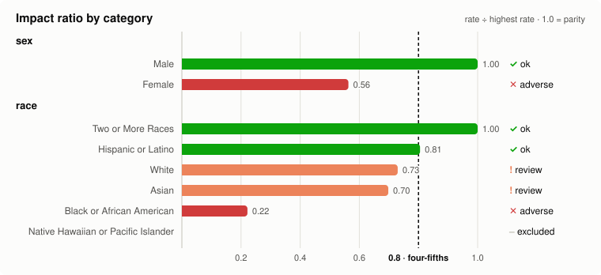
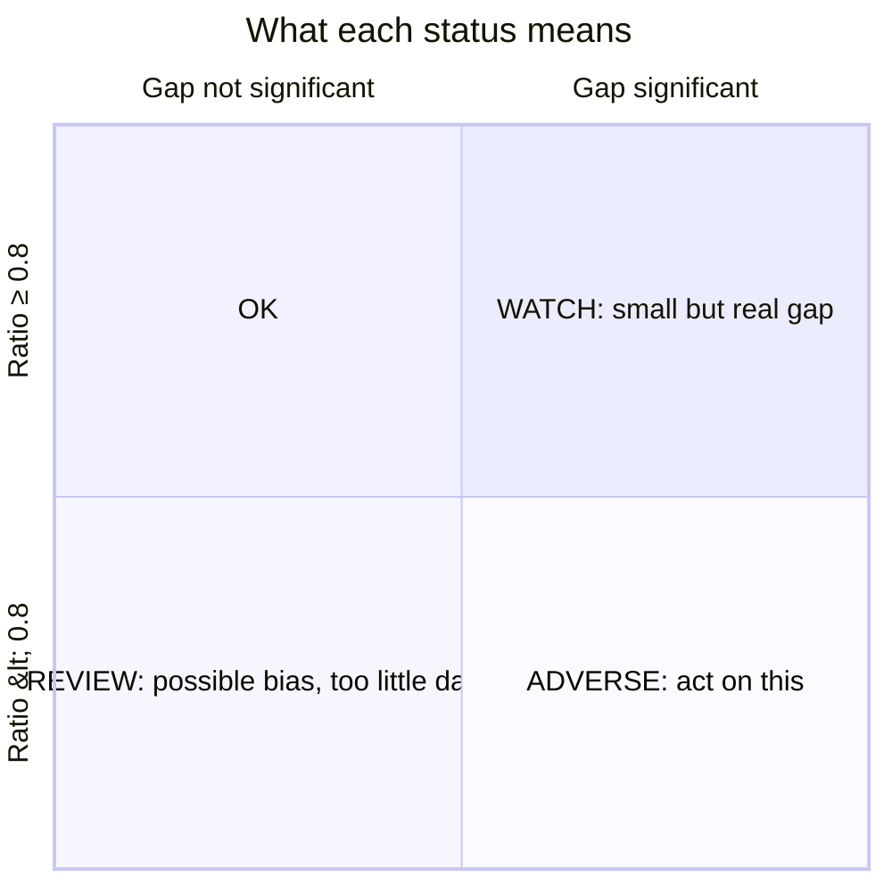
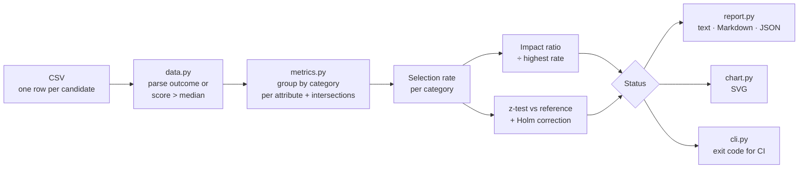

<div align="center">

# ⚖️ fairhire

**Find out whether your hiring algorithm treats people unfairly, before the people it screens pay for it.**

A small, dependency-free bias-audit tool for automated hiring decisions. It reports
selection rates, impact ratios, the four-fifths rule, statistical significance and intersectional breakdowns,
and fits in a CI pipeline.

`Python ≥ 3.9` · `0 dependencies` · `~420 lines` · `MIT`



</div>

---

## Why this exists

Most large employers now use software to screen candidates: résumé rankers, assessment scorers,
interview analysers. These systems learn from past decisions, and past decisions carry past bias. Amazon
[dropped an internal résumé-ranking model in 2018](https://www.reuters.com/article/us-amazon-com-jobs-automation-insight-idUSKCN1MK08G)
after it learned to downgrade résumés that mentioned the word *"women's"*.

Regulators have responded:

| Rule | What it asks for |
|---|---|
| **EEOC Uniform Guidelines (1978)**, *four-fifths rule* | A selection rate for any group below 80% of the highest group's rate is evidence of adverse impact. |
| **NYC Local Law 144** (enforced since July 2023) | Automated employment decision tools must have an annual **bias audit** that publishes selection or scoring rates and **impact ratios** by sex, race/ethnicity, *and their intersections*. |
| **EU AI Act** (Annex III) | Classes AI used in recruitment as *high-risk*, which brings duties to manage risk, govern data and examine it for bias. |

The maths is simple. In practice, though, teams either pay for a consultant or skip the check.
`fairhire` makes the check something you **run on every model release**, the same way you run unit tests.

### What it adds beyond the raw four-fifths rule

The four-fifths rule on its own is easy to fool in both directions. With small groups it flags noise.
With huge groups it ignores real gaps. `fairhire` pairs every impact ratio with a significance test,
corrected for multiple comparisons, so each finding falls into one of four buckets you can act on:



| Status | Impact ratio | Significant? | Meaning |
|:--|:--:|:--:|:--|
| ✓ `ok` | ≥ 0.8 | no | No evidence of adverse impact. |
| ◐ `watch` | ≥ 0.8 | yes | Passes the rule, but the gap is real (common with very large samples). |
| ! `review` | < 0.8 | no | Fails the rule, but the sample can't rule out chance. Collect more data or investigate. |
| ✕ `adverse` | < 0.8 | yes | Adverse impact. Fix the system before it makes more decisions. |
| – `excluded` | n/a | n/a | Category is below the minimum share (default 2%, the LL144 allowance). Counted and shown, but not rated. |

---

## Quick start

```bash
git clone https://github.com/kareemrt/EthicalAI && cd EthicalAI/fairhire

# Run on the bundled synthetic dataset (no install needed)
python -m fairhire examples/applicants.csv --outcome advanced --attrs sex race
```

```text
▌ sex  ·  selection rate of 'advanced'  ·  2000 rows, 62 unknown
Category     N  Share   Rate  Impact ratio  p-value      Status
────────  ────  ─────  ─────  ────────────  ───────  ──────────
Male      1076  55.5%  38.9%         1.000    1.000  ✓ ok (ref)
Female     862  44.5%  21.9%         0.563   <0.001   ✕ adverse
→ Adverse impact: at least one category falls below the threshold with a statistically significant gap.

▌ race  ·  selection rate of 'advanced'  ·  2000 rows, 10 unknown
Category                                N  Share   Rate  Impact ratio  p-value      Status
───────────────────────────────────  ────  ─────  ─────  ────────────  ───────  ──────────
Two or More Races                      83   4.2%  47.0%         1.000    1.000  ✓ ok (ref)
Hispanic or Latino                    333  16.7%  37.8%         0.805    0.127        ✓ ok
White                                1012  50.9%  34.3%         0.730    0.060    ! review
Asian                                 247  12.4%  32.8%         0.698    0.060    ! review
Black or African American             288  14.5%  10.4%         0.222   <0.001   ✕ adverse
Native Hawaiian or Pacific Islander    27   1.4%  25.9%             —        —  – excluded
→ Adverse impact: at least one category falls below the threshold with a statistically significant gap.
```

The sample data has two **planted** biases, against women and against Black applicants. `fairhire` flags both as
`adverse`. White and Asian applicants were *not* penalised in the data. They only look worse because a
small reference group (n=83) happened to score high, so they land in `review` rather than being falsely accused.
A bare four-fifths check would have flagged all four.

Install it as a command if you prefer:

```bash
pip install ./fairhire      # puts `fairhire` on your PATH
```

## Usage

```bash
fairhire DATA.csv (--outcome COL | --score COL) --attrs COL [COL ...] [options]
```

| Option | Default | Description |
|---|---|---|
| `--outcome COL` | | Decision column. Accepts `yes/no`, `1/0`, `true/false`, `hired`, `advanced`, `rejected`, … |
| `--score COL` | | Numeric score column. A candidate counts as selected when their score is above the sample median (LL144 *scoring rate*). |
| `--attrs A B …` | | Demographic columns to audit. Blank cells count as *unknown*: reported, but kept out of the ratios. |
| `--intersect` | off | Also audit every combination, e.g. `sex × race`. |
| `--threshold` | `0.8` | Impact-ratio threshold. |
| `--alpha` | `0.05` | Significance level. |
| `--min-share` | `0.02` | Categories below this share of the data are excluded from rating. |
| `--no-correction` | off | Turn off the Holm–Bonferroni correction. |
| `--format` | `text` | `text`, `md` (Markdown report) or `json`. |
| `-o, --out` | stdout | Write the report to a file. |
| `--svg FILE` | | Also write the impact-ratio chart. |
| `--strict` | off | Exit with code **1** if anything is `adverse`. Use it to gate CI. |

**Your data** needs one row per candidate, a decision or score column, and one or more demographic columns:

```csv
applicant_id,sex,race,score,advanced
A00001,Male,White,56.0,no
A00002,Female,White,69.0,yes
```

### Full report (Markdown + chart)

```bash
fairhire examples/applicants.csv --outcome advanced --attrs sex race --intersect \
         --format md -o examples/report.md --svg examples/impact_ratios.svg
```

See the output in [`examples/report.md`](examples/report.md).

### As a bias gate in CI

```yaml
# .github/workflows/bias-audit.yml
- name: Bias audit of screening model
  run: |
    python model/predict.py --holdout data/holdout.csv > decisions.csv
    fairhire decisions.csv --outcome selected --attrs sex race --intersect \
             --strict --format md -o bias-report.md
```

A model that creates adverse impact fails the build, and the report is attached to the run.

### From Python

```python
from fairhire import audit, load_csv

rows = load_csv("decisions.csv")
result = audit(rows, ["sex", "race"], outcome="selected")   # intersection of the two
for g in result.groups:
    print(g.name, g.impact_ratio, g.status.value)
```

---

## How it works



For each dimension (one attribute, or an intersection of several):

1. **Rate.** `selected ÷ n` for each category. Unknown categories are counted separately and
   categories below `--min-share` are excluded from rating.
2. **Reference.** The rated category with the highest rate. This follows LL144, which defines the impact ratio against the most-selected category.
3. **Impact ratio.** `rate ÷ reference rate`.
4. **Significance.** A two-sided pooled two-proportion z-test of each category against the reference.
   The p-values are then Holm–Bonferroni-adjusted within the table, because testing nine
   intersectional groups at α = 0.05 would otherwise turn up roughly one false alarm in three runs.
5. **Status.** Combines the two, as in the table above.

## Codebase structure

```text
fairhire/
├── fairhire/                 # the package (standard library only)
│   ├── __init__.py           # public API: audit, load_csv, Audit, GroupResult, Status
│   ├── __main__.py           # enables `python -m fairhire`
│   ├── data.py               # CSV loading, outcome parsing, score→median binarisation, category labels
│   ├── metrics.py            # selection rates, impact ratios, z-test, Holm correction, status logic
│   ├── report.py             # terminal table, Markdown report, JSON export
│   ├── chart.py              # self-contained SVG bar chart (light + dark mode)
│   └── cli.py                # argument parsing, intersections, --strict exit code
├── tests/
│   └── test_fairhire.py      # unit + CLI tests (python -m unittest)
├── examples/
│   ├── generate_sample.py    # synthetic applicants with a known, planted bias
│   ├── applicants.csv        # 2,000 generated rows (no real people)
│   ├── report.md             # sample Markdown report
│   └── impact_ratios.svg     # sample chart incl. intersections
├── docs/
│   └── impact_ratios.svg     # chart used in this README
└── pyproject.toml            # packaging; installs the `fairhire` command
```

Data moves in one direction: `data` → `metrics` → (`report` | `chart`), with `cli` connecting them.
Every module can be read in a few minutes.

## Development

```bash
python -m unittest discover -s tests -v                      # 13 tests, <0.1s
python examples/generate_sample.py > examples/applicants.csv # regenerate sample data
```

## Limits and responsible use

- **It's a screen, not a verdict.** A flag means *look closer*. It is not a legal finding. LL144 audits must be
  carried out by an **independent auditor**. `fairhire` helps you prepare and keep watch between audits, but it does not replace one.
- **Outcome parity isn't the only kind of fairness.** Impact ratios measure *who gets selected*. They do not check
  whether the model is equally *accurate* for each group, for example equal false-negative rates. If you have ground-truth
  outcomes, check those as well.
- **Self-reported demographics are incomplete.** Unknowns are reported so you can see how much is missing.
  If a large share is unknown, treat every ratio with caution.
- **Handle demographic data with care.** Keep it apart from the decision pipeline. Use it to audit decisions, never to make them.

## License

MIT
