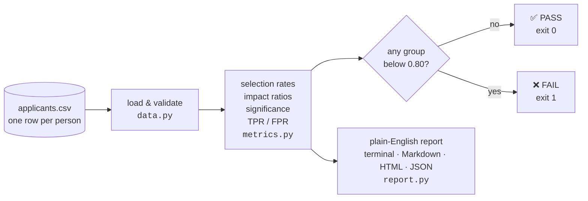
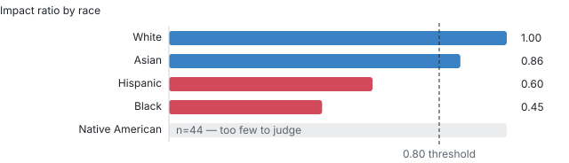
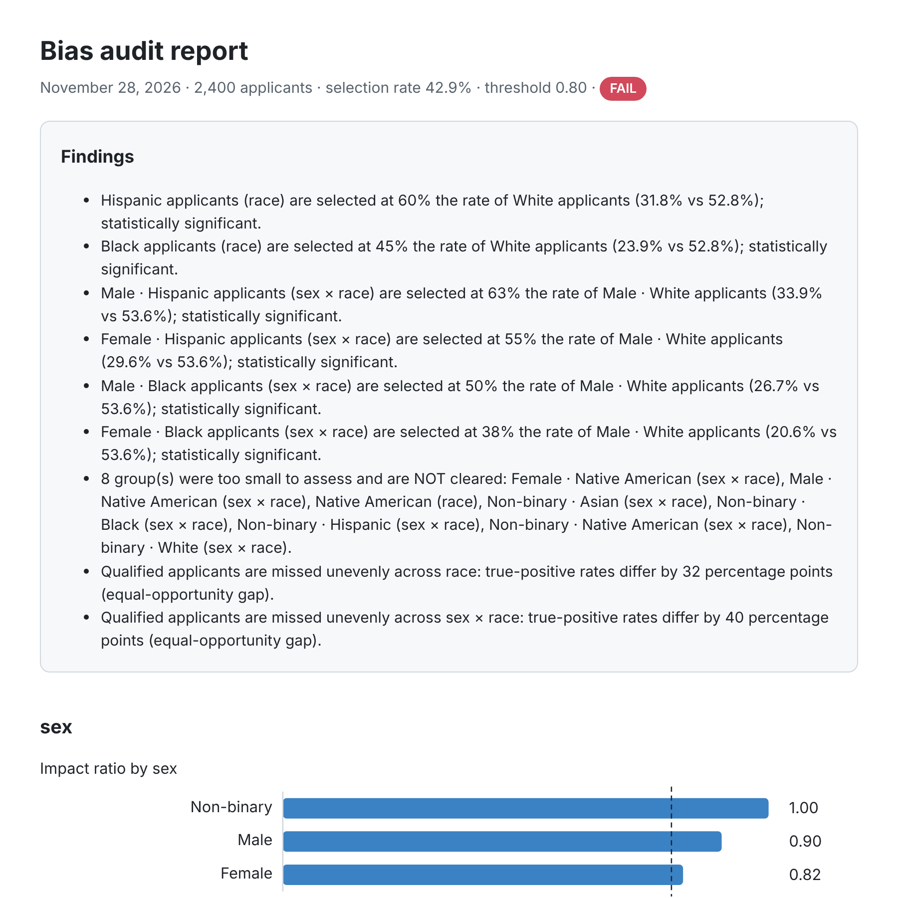

<div align="center">

# ⚖️ fairhire

**Find out whether your hiring algorithm discriminates — before your applicants do.**

A zero-dependency Python toolkit that audits automated hiring decisions for adverse impact,<br>
using the same statistics regulators use, and explains the results in plain English.

`Python 3.9+` · `0 dependencies` · `~530 lines` · `MIT`

</div>

---

## Why this exists

Most large employers now screen candidates with software: résumé rankers, assessment scores, video-interview
models. Those tools are trained on past hiring decisions, so **they learn past discrimination**, usually
through proxies like employment gaps, zip codes, or college names. The model never sees race or sex and still
treats groups differently.

Regulators have caught on:

| Rule | What it requires |
|---|---|
| **EEOC Uniform Guidelines (US, 1978)** | A selection rate below **⁴⁄₅ (80%)** of the highest group's rate is evidence of adverse impact. |
| **NYC Local Law 144 (2023)** | Employers using automated employment decision tools must publish an **annual independent bias audit** with impact ratios by sex, race/ethnicity, **and their intersections**. |
| **EU AI Act (2024)** | Hiring AI is **high-risk**: providers must monitor for bias and keep records. |
| **Colorado AI Act (2026)** | Deployers of high-risk AI must run impact assessments and use reasonable care against algorithmic discrimination. |

Commercial audits are expensive and opaque. The maths is not. **fairhire** puts it in the hands of the HR
analyst, the auditor, the journalist, the advocacy group, or the engineer shipping the model, so a bias check
can run on every retrain and not once a year.

## What it does



- **Impact ratios** for each protected attribute, following the four-fifths rule and NYC LL144.
- **Intersectional analysis** (e.g. *Female · Black*). Bias that's invisible on each attribute alone often shows up here.
- **Statistical significance** (two-proportion z-test), so a small sample isn't read as proof of bias and a large gap isn't brushed off as noise.
- **Error-rate parity**: given ground-truth qualification, it measures whether *qualified* people in some groups are missed more often (equal opportunity).
- **Scoring-rate mode** for tools that output a score, not a yes/no (share of each group above the median, per LL144).
- **Honest about small groups.** Groups under 2% of the data are listed as *insufficient data, not cleared* and are never quietly dropped.
- **CI-friendly**: exits `1` on adverse impact, so a biased model can fail the build.
- **Readable output**: a self-contained HTML report with light/dark charts, plus Markdown and JSON.

## Quick start

```bash
git clone https://github.com/kareemrt/EthicalAI && cd EthicalAI/fairhire

python -m fairhire examples/applicants.csv \
    --groups sex,race --outcome advanced --label qualified \
    --html report.html
```

No `pip install` needed. To get a `fairhire` command anyway, run `pip install .`.

```text
fairhire audit · 2,400 applicants · overall selection rate 42.9% · threshold 0.80

■ race
  group                 n    rate  ratio       p  status
✓ White             1,243   52.8%   1.00       —  reference
✓ Asian               279   45.5%   0.86   0.028  ok
✗ Hispanic            437   31.8%   0.60  <0.001  ADVERSE IMPACT
✗ Black               397   23.9%   0.45  <0.001  ADVERSE IMPACT
· Native American      44   29.5%      —       —  insufficient data

RESULT: FAIL — adverse impact found
  • Black applicants (race) are selected at 45% the rate of White applicants (23.9% vs 52.8%); statistically significant.
  • Qualified applicants are missed unevenly across race: true-positive rates differ by 32 percentage points.
```

### The sample: bias with no protected attributes

[`examples/applicants.csv`](examples/applicants.csv) is synthetic, and it is built to show how proxy discrimination
works. True ability is **identically distributed** across every group, and the scoring model **never sees race or
sex**. It only penalises *employment gaps* (more common among caregivers) and *zip-code tier* (correlated with race
through residential segregation). The audit still finds it:

<p align="center">
  
</p>

Look at sex on its own and everything passes. The intersection tells a different story:

| Group | Impact ratio | |
|---|---:|---|
| Female (all) | 0.82 | ✓ passes |
| Black (all) | 0.45 | ✗ |
| **Female · Black** | **0.38** | ✗ worst of any group |

A single-attribute audit would have missed this, which is why NYC LL144 requires intersectional ratios.

### The HTML report

<p align="center">
  
</p>

Full examples: [HTML](docs/sample-report.html) · [Markdown](docs/sample-report.md)

## Usage

```text
python -m fairhire CSV --groups COLS (--outcome COL | --score COL) [options]

  -g, --groups        protected-attribute columns, comma-separated     sex,race
  -o, --outcome       yes/no column: did the tool advance the person?  advanced
  -s, --score         numeric score; used alone → scoring rate above the median
  -l, --label         yes/no ground truth (e.g. later job performance) → TPR/FPR
  -t, --threshold     impact-ratio threshold                           default 0.8
      --min-share     don't score groups under this share of the data  default 0.02
      --no-intersections
      --html PATH  --md PATH  --json

exit codes   0 = pass    1 = adverse impact found    2 = bad input
```

Yes/no columns accept `1/0`, `true/false`, `yes/no`, `selected/rejected`, `hired`, `advanced`, `pass/fail`.

**As a library**

```python
from fairhire import load_csv, run_audit
from fairhire.report import to_markdown

records = load_csv("applicants.csv", ["sex", "race"], outcome="advanced")
audit = run_audit(records, ["sex", "race"])
if not audit.passed:
    print(to_markdown(audit))
```

**As a deployment gate**

```yaml
# .github/workflows/model.yml
- name: Bias audit on holdout decisions
  run: python -m fairhire holdout_decisions.csv -g sex,race -o predicted --md audit.md
```

## How to read the numbers

| Metric | Definition | Read it as |
|---|---|---|
| **Selection rate** | selected ÷ applicants in group | How often this group gets through |
| **Impact ratio** | group rate ÷ highest group's rate | 1.00 = parity · **< 0.80 = adverse impact** |
| **p-value** | two-proportion z-test vs. reference group | < 0.05: unlikely to be chance |
| **TPR** | selected ÷ *qualified* in group | Low = qualified people being missed |
| **FPR** | selected ÷ *unqualified* in group | High = getting the benefit of the doubt |

**Status column**

- `ADVERSE IMPACT` means below threshold *and* statistically significant. Act on it.
- `below threshold (not significant)` means the gap is real in the data, but the sample is too small to rule out chance. Collect more data; don't dismiss it.
- `insufficient data` means the group is too small to score. This is **not** a pass.

## Project structure

```text
fairhire/
├── fairhire/                 the package (stdlib only)
│   ├── __init__.py           public API: load_csv, run_audit, Record, Audit
│   ├── __main__.py           CLI: argument parsing, output selection, exit codes
│   ├── data.py               CSV → Record; yes/no parsing, median scoring rate, clear errors
│   ├── metrics.py            selection & impact ratios, z-test, TPR/FPR, intersections
│   ├── report.py             text / Markdown / JSON / HTML renderers + plain-English findings
│   └── charts.py             ~50-line SVG bar chart with light/dark styling
├── examples/
│   ├── generate_sample.py    reproducible synthetic data with hidden proxy bias
│   └── applicants.csv        2,400 synthetic applicants
├── docs/                     sample reports and README images (generated by the tool)
├── tests/test_fairhire.py    unit + end-to-end tests  (python -m unittest discover -s tests)
└── pyproject.toml            optional install; exposes the `fairhire` command
```

**Design choices**

- **No dependencies.** It runs on any machine with Python, including locked-down HR laptops and air-gapped
  environments where applicant data has to stay put. Nothing is uploaded anywhere.
- **Data flows one way.** `data` → `metrics` → `report`. Metrics are plain dataclasses, so you can build your own
  output on top of them.
- **Every number can be explained in one sentence**, because the people acting on an audit are rarely statisticians.

## Limits (read before you rely on it)

- **This is a statistical screen, not a legal opinion.** A pass doesn't prove a tool is fair, and a fail
  doesn't prove it's unlawful. Business necessity and less-discriminatory alternatives are legal questions.
- **Garbage labels, garbage audit.** TPR/FPR are only as good as your "qualified" column. If it comes from
  past biased decisions, it inherits that bias.
- **Self-reported demographics are often missing.** Don't impute race from names or zip codes for an audit,
  because the error lands hardest on the groups you're trying to protect. Report the missing share instead
  (blank values show up as `Unknown`).
- **Many intersections means many tests**, so some false alarms are expected. Treat borderline p-values as
  prompts to investigate, not verdicts.

## Run the tests

```bash
python -m unittest discover -s tests -v
python examples/generate_sample.py > examples/applicants.csv   # regenerate sample data
```

## License

MIT. Use it, fork it, audit something.
