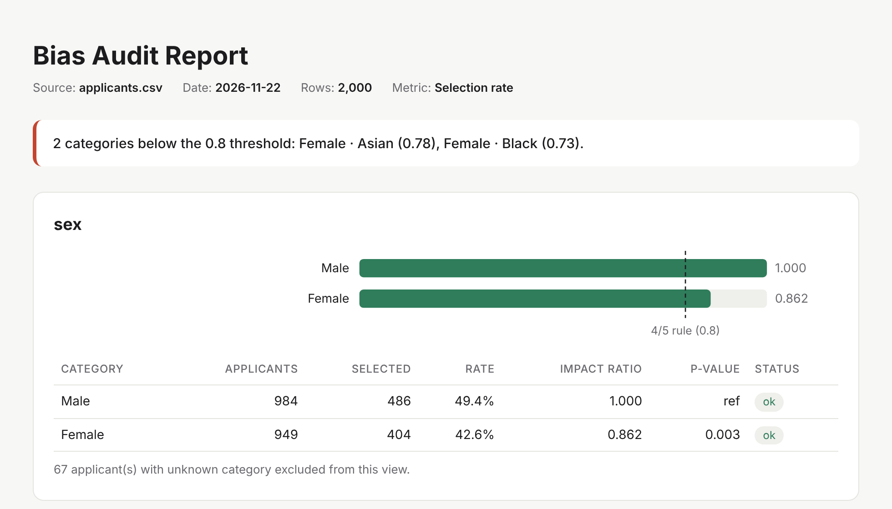
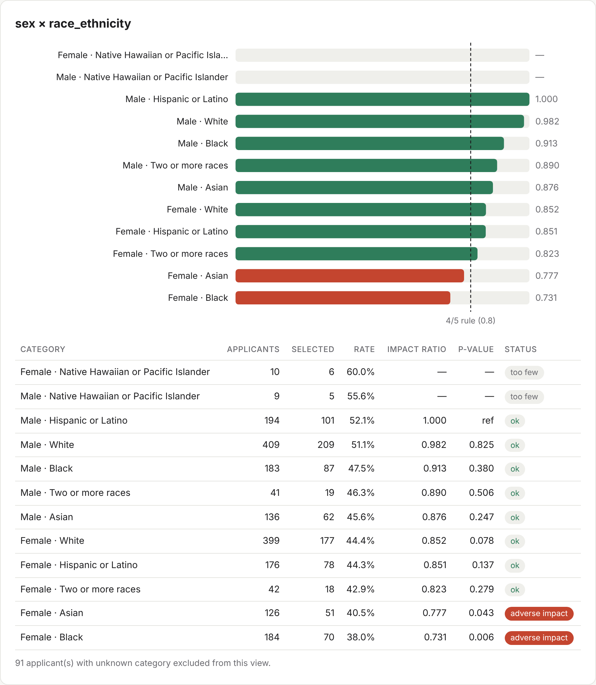
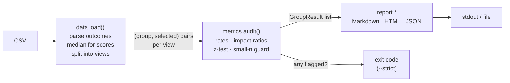

<div align="center">

# ⚖️ FairHire

**Bias audits for automated hiring decisions — one command, zero dependencies.**

Feed it a CSV of who applied and who got through. Get back impact ratios, the four-fifths test,<br>
significance checks and intersectional breakdowns as a report you can actually hand to someone.


<picture>
  <source media="(prefers-color-scheme: dark)" srcset="docs/report-dark.png">
  
</picture>

</div>

---

## The problem

Resume screeners, video-interview scorers and assessment tools now make the first cut for a large share of job
applications. When they are biased, they are biased **at scale and silently**: a rejected applicant never sees the
model, and the employer often never looks.

Regulators have noticed:

| Rule | What it asks for |
|---|---|
| **NYC Local Law 144** (enforced since July 2023) | An annual bias audit of any *automated employment decision tool*, reporting selection or scoring rates and **impact ratios** by sex, race/ethnicity, **and their intersections**, published before use. |
| **EEOC Uniform Guidelines** (29 CFR §1607.4) | The **four-fifths rule**: a group selected at under 80% of the top group's rate is evidence of adverse impact. |
| **EU AI Act** (Annex III) | Classifies AI used in recruitment as *high-risk*, requiring bias monitoring and documentation. |
| **Colorado AI Act** and others | Duties of care against algorithmic discrimination in consequential decisions, including employment. |

The math behind these audits is simple. Yet small employers, HR teams, nonprofits and researchers often have no
easy way to run it, so the check gets skipped or left to an expensive consultant once a year.
**FairHire makes the check cheap enough to run on every model release.**

## What it does

```text
applicants.csv ──▶ FairHire ──▶ report.html / report.md / report.json  (+ exit code for CI)
```

- **Selection-rate mode**: yes/no outcomes (`advanced`, `hired`, `passed`…)
- **Scoring-rate mode**: numeric scores, where "selected" means scoring above the overall median (the LL144 definition)
- **Impact ratios** against the most-favoured category, flagged at the **0.8** four-fifths line
- **Two-proportion z-test** for each flagged group, so a 0.78 on 12 people is not treated like a 0.78 on 1,200
- **Intersectional view** when you audit two or more attributes (e.g. `sex × race`). This is often where the bias actually shows up.
- **Small-group guard**: categories under 2% of the data are reported but not scored, and can't serve as the reference
- **Unknowns counted, not hidden**: blank, `unknown` and `declined` values are excluded from rates and reported per view
- **Three outputs**: a self-contained HTML page (light/dark, no external assets), Markdown for PRs and wikis, JSON for pipelines
- **`--strict`** exits with code 1 when anything is flagged, so a biased model can fail a build

## Why intersectionality matters: a worked example

The bundled [`examples/applicants.csv`](examples/applicants.csv) is **synthetic**: 2,000 fictional applicants run
through a screener that quietly penalises employment gaps. The penalty falls hardest on women and older applicants.

Audited one attribute at a time, the screener **passes**:

| View | Lowest impact ratio | Four-fifths test |
|---|---:|:---:|
| sex | Female **0.862** | ✅ pass |
| race_ethnicity | Black **0.888** | ✅ pass |
| **sex × race_ethnicity** | Female · Black **0.731** (p = 0.006) | ❌ **fail** |

Only the intersectional view shows that Black women and Asian women are being screened out:

<div align="center">

</div>

Full outputs: [`examples/report.html`](examples/report.html) · [`examples/report.md`](examples/report.md)

## Quick start

No install needed. Python 3.9+ is the only requirement.

```bash
git clone https://github.com/kareemrt/EthicalAI && cd EthicalAI/fairhire

# Yes/no outcomes, two attributes (adds the intersectional view automatically)
python -m fairhire examples/applicants.csv -g sex -g race_ethnicity -s advanced -o report.html

# Numeric scores: "selected" = scored above the median
python -m fairhire examples/applicants.csv -g age_band --score screen_score

# In CI: fail the build if any group falls below 0.8
python -m fairhire predictions.csv -g gender -s shortlisted --strict -o audit.md
```

Or install it as a command: `pip install .` then run `fairhire …`.

### Options

| Flag | Meaning |
|---|---|
| `-g, --group COL` | Demographic column to audit. Repeat it for several; 2+ adds an intersectional view. |
| `-s, --selected COL` | Yes/no outcome column. Accepts `1/true/yes/y/selected/hired/advanced/pass`. |
| `--score COL` | Numeric score column (scoring-rate mode). Use instead of `--selected`. |
| `-o, --output FILE` | Write to a file. The format comes from the extension (`.html`, `.md`, `.json`). |
| `-f, --format` | Force a format: `md`, `html` or `json`. Defaults to Markdown on stdout. |
| `--min-share X` | Share of the data below which a category isn't scored. Default `0.02`. |
| `--strict` | Exit `1` if any category is flagged. Exit `2` means bad input. |

### Input format

One row per applicant. Column names are up to you:

```csv
applicant_id,sex,race_ethnicity,age_band,screen_score,advanced
A00001,Female,Black,40 and over,50.5,no
A00002,Male,White,Under 40,71.2,yes
```

### Use it as a library

```python
from fairhire import audit

results = audit([("A", True), ("A", False), ("B", False), ...])
for r in results:
    print(r.group, r.rate, r.impact_ratio, r.p_value, r.status)
```

## How it works



| Quantity | Formula |
|---|---|
| Selection rate | `selected ÷ applicants` in the category |
| Scoring rate | share of the category scoring **above the median of all applicants** |
| Impact ratio | `category rate ÷ highest eligible category rate` |
| Flag | impact ratio `< 0.8`; reported as **adverse impact** if `p < 0.05`, otherwise **adverse (n.s.)** |
| p-value | two-sided pooled two-proportion z-test against the reference category |

## Codebase structure

```text
fairhire/
├── fairhire/                 # the package (~400 lines, standard library only)
│   ├── metrics.py            # pure fairness math: audit(), GroupResult, z-test, median. No I/O.
│   ├── data.py               # CSV → Dataset of Views; outcome parsing, unknown handling, intersections
│   ├── report.py             # Markdown / JSON / HTML renderers + inline-SVG bar chart
│   ├── cli.py                # argparse front end, format dispatch, exit codes
│   ├── __main__.py           # enables `python -m fairhire`
│   └── __init__.py           # public API: audit, GroupResult, two_proportion_p_value
├── tests/
│   └── test_fairhire.py      # unit tests (metrics, data) + end-to-end CLI tests
├── examples/
│   ├── generate_sample.py    # seeded generator for the synthetic, deliberately biased dataset
│   ├── applicants.csv        # 2,000 fictional applicants
│   ├── report.html           # sample output
│   └── report.md             # sample output
├── docs/
│   ├── ARCHITECTURE.md       # design decisions and data flow in depth
│   └── *.png                 # README screenshots
└── pyproject.toml            # optional `pip install .` → `fairhire` command
```

Layers depend only on the ones below them: `cli → data, report → metrics`. `metrics.py` has no I/O,
so it's easy to test and to reuse in a notebook or a service. See [`docs/ARCHITECTURE.md`](docs/ARCHITECTURE.md) for more.

## Testing

```bash
python -m unittest discover -s tests -v
```

## Limits and responsible use

FairHire is a **screening instrument, not a verdict**.

- **A failing ratio is not proof of discrimination**, and **a passing ratio does not prove fairness.** Selection rates
  ignore qualification differences, proxy features and harms that never reach the outcome column.
- **The four-fifths rule is a rule of thumb.** Courts and agencies also weigh statistical significance and practical
  significance. FairHire reports p-values for that reason, but they don't settle the question.
- **LL144 requires an *independent* auditor.** FairHire helps you prepare, monitor and catch problems early. It does
  not replace that audit and is not legal advice.
- **Demographic data is sensitive.** Run FairHire where the data already lives. It makes no network calls and writes
  only the report you ask for.
- **Unknowns matter.** If many applicants decline to self-identify, the audit covers fewer people. The report shows
  how many were excluded so you can judge.

## Roadmap

- [ ] Odds-ratio and Fisher exact test for very small groups
- [ ] Multi-stage funnels (screen → interview → offer) in one report
- [ ] Bootstrapped confidence intervals on impact ratios
- [ ] LL144 summary-of-results template for public posting

## License

MIT
