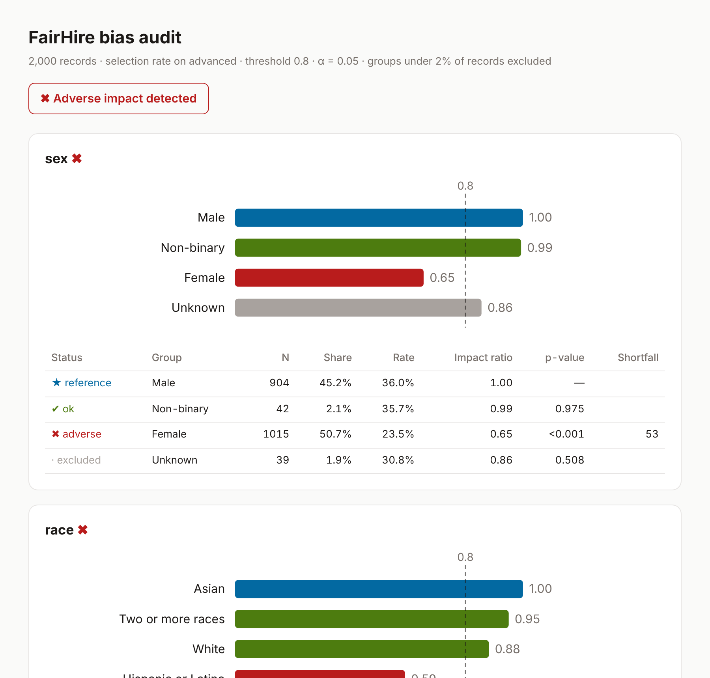
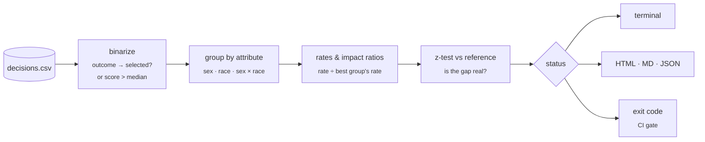

<div align="center">

# ⚖️ FairHire

**Find out whether your hiring algorithm treats people unequally — before your candidates do.**

A zero-dependency Python tool that audits automated hiring decisions for adverse impact,<br>
using the same impact-ratio method as **NYC Local Law 144** bias audits and the **EEOC four-fifths rule**.

`pure stdlib` · `~370 lines` · `runs offline` · `CLI + Python API` · `HTML / Markdown / JSON reports` · `CI gate`

</div>

<picture>
  <source media="(prefers-color-scheme: dark)" srcset="docs/report-dark.png">
  
</picture>

---

## The problem

Most large employers now screen applicants with software: résumé rankers, assessment scorers,
video-interview graders. These models learn from historical hiring data, and **history carries bias**.
A screener never told someone's race or sex can still learn proxies for them (zip code, school, gaps in
employment, word choice) and quietly filter whole groups out at scale.

Regulators have noticed:

| Rule | What it requires |
|---|---|
| **EEOC Uniform Guidelines (1978)** | A selection rate under **4/5 (80%)** of the highest group's rate is generally evidence of adverse impact. |
| **NYC Local Law 144 (in force 2023)** | Employers using automated employment decision tools must publish an annual **bias audit**: selection or scoring rates and **impact ratios** by sex, race/ethnicity *and their intersections*. |
| **EU AI Act** | Classes AI used in recruitment as **high-risk**, which brings risk-management, data-governance and monitoring duties. |
| **Colorado AI Act & others** | A growing set of state laws require impact assessments for "consequential decisions" such as hiring. |

Yet the tooling is either buried in heavyweight ML-fairness frameworks or locked inside consultancies.
Most HR teams, small vendors and journalists can't easily check the basic numbers themselves.

**FairHire makes that check a one-liner.** Give it a CSV of decisions; get back an audit you can read,
publish, or wire into CI so a biased model never ships.

## Quickstart

```bash
git clone https://github.com/kareemrt/EthicalAI && cd EthicalAI/fairhire

# Audit the included synthetic dataset (2,000 applicants, deliberately biased screener)
python -m fairhire examples/applicants.csv --outcome advanced --attrs sex race --html report.html
```

No install, no dependencies, Python 3.10+. Optionally `pip install .` to get a `fairhire` command.

```text
FairHire audit — Adverse impact detected
2,000 records · selection rate on advanced · threshold 0.8 · α = 0.05 · groups under 2% of records excluded

▌ race
Status       Group                      N    Share  Rate   Impact ratio  p-value  Shortfall
───────────  ─────────────────────────  ───  ─────  ─────  ────────────  ───────  ─────────
★ reference  Asian                      247  12.3%  37.7%  1.00          —
✔ ok         Two or more races          109  5.5%   35.8%  0.95          0.736
✔ ok         White                      988  49.4%  33.2%  0.88          0.187
✖ adverse    Hispanic or Latino         333  16.7%  22.2%  0.59          <0.001   27
✖ adverse    Black or African American  282  14.1%  13.8%  0.37          <0.001   46
· excluded   Unknown                    21   1.1%   47.6%  1.26          0.367
· excluded   Native American            20   1.0%   40.0%  1.06          0.835
```

Read the last ✖ row like this: *Black applicants advanced at 37% of the rate of the top group. That gap is
almost certainly not chance, and 46 more of them would have had to advance just to clear the 80% floor.*

Full sample outputs: [HTML](docs/sample-report.html) · [Markdown](docs/sample-report.md) · [JSON](docs/sample-report.json)

## How it works



For each protected attribute, and for the intersection of all of them:

1. **Rate.** Share of each group that was selected. With `--score`, a candidate counts as selected when
   their score is strictly above the sample median (LL144's *scoring rate*).
2. **Reference group.** The eligible group with the highest rate.
3. **Impact ratio** = group rate ÷ reference rate.
4. **Significance.** A two-proportion z-test against the reference group, so a gap in a group of 12 people
   is not treated like the same gap in a group of 1,200.
5. **Shortfall** = how many more selections the group would need to reach the threshold. It turns an
   abstract ratio into a count of people.

| Status | Meaning |
|---|---|
| ★ `reference` | Highest-rate group; the yardstick for everyone else. |
| ✔ `ok` | Impact ratio ≥ threshold (default 0.8). |
| ▲ `watch` | Below threshold, but not statistically significant. Often a small group. Investigate, collect more data. |
| ✖ `adverse` | Below threshold **and** p < α. Strong evidence of adverse impact. |
| · `excluded` | Unknown attribute, or under `--min-share` (default 2%) of records. Reported, never flagged, as LL144 permits. |

> **Why intersections matter.** A model can look fair on sex and fair on race while being badly unfair to,
> say, Black women. In the sample data, `Female · Black or African American` has an impact ratio of
> **0.18**, far worse than either single-axis view suggests.

## Usage

```text
python -m fairhire CSV (--outcome COL | --score COL) --attrs COL [COL ...] [options]

  --outcome COL       binary column; 1/yes/true/hired/selected/advanced/pass = selected
  --score COL         numeric column; selected = scored above the median
  --attrs COL ...     protected-attribute columns (intersection is audited automatically)
  --threshold 0.8     impact-ratio floor
  --alpha 0.05        significance level
  --min-share 0.02    groups below this share are reported but not flagged
  --no-intersect      skip the intersectional breakdown
  --html / --md / --json PATH    write reports
  --fail-on {never,watch,adverse}  exit 1 when the audit reaches this status
```

Exit codes: `0` passed · `1` reached `--fail-on` level · `2` bad input.

### As a release gate in CI

Re-score a held-out applicant set with every new model version, and refuse to ship one that introduces adverse impact:

```yaml
# .github/workflows/fairness.yml
- name: Bias audit
  run: |
    python model/score_holdout.py > holdout_scores.csv
    python -m fairhire holdout_scores.csv --score score --attrs sex race \
      --fail-on adverse --html fairness-report.html
```

### As a library

```python
import csv
from fairhire import run_audit
from fairhire.report import render_markdown

rows = list(csv.DictReader(open("decisions.csv")))
audit = run_audit(rows, attrs=["sex", "race"], outcome="hired")

print(audit.status)                         # "adverse" | "watch" | "ok"
for dim in audit.dimensions:
    for g in dim.groups:
        print(dim.name, g.name, g.impact_ratio, g.status)

open("audit.md", "w").write(render_markdown(audit))
```

## Codebase structure

```text
fairhire/
├── fairhire/               the package (stdlib only)
│   ├── __init__.py         public API: run_audit, Audit, Dimension, GroupStat
│   ├── audit.py            core math: binarize → group → impact ratio → z-test → status. Pure functions, no I/O.
│   ├── report.py           renderers: terminal table, Markdown, JSON, self-contained HTML with inline SVG charts
│   └── __main__.py         CLI: argument parsing, CSV loading, writing reports, exit codes
├── examples/
│   ├── generate_sample.py  seeded generator for a synthetic applicant pool with a hidden-penalty screener
│   └── applicants.csv      its output: 2,000 fictional applicants
├── tests/
│   └── test_audit.py       unit tests for the stats, edge cases, intersections and every renderer
├── docs/                   sample reports (HTML / MD / JSON) and the README screenshots
├── pyproject.toml          optional install; exposes the `fairhire` command
└── LICENSE                 MIT
```

**Design choices**

- **Math and presentation are separate.** `audit.py` returns plain dataclasses; `report.py` only formats them.
  You can add a renderer (PDF, Slack, dashboard) without touching the statistics.
- **No dependencies.** No pandas, numpy or scipy. The z-test uses `math.erfc`. It installs anywhere, starts
  instantly, and is easy to review, which matters for a tool whose output may end up in a legal filing.
- **The data stays on your machine.** No network calls and no telemetry. Candidate data is sensitive, and
  the HTML report is a single file with no external assets.
- **Conservative by default.** Unknowns and tiny groups are reported but not flagged, and a gap must be both
  large *and* significant to count as `adverse`. Nothing is hidden: every group appears in every report.

## Run the tests

```bash
python -m unittest discover -s tests -v
```

## Limitations — read before relying on it

- **This is not legal advice, and not an LL144 audit by itself.** LL144 requires the audit to be done by an
  *independent* auditor. FairHire produces the required numbers; it doesn't replace that independence.
- **Impact ratios measure outcomes, not causes.** A low ratio says *something* is wrong, not *what*. Pair it
  with a review of features, training data and job-relatedness.
- **The z-test is an approximation.** It is unreliable when a group has very few selections. Treat `watch`
  results in small groups as a prompt to gather more data, not as a clean bill of health.
- **Garbage in, garbage out.** Demographic data is often self-reported, incomplete or coarse. Report your
  `Unknown` counts honestly; FairHire always shows them.
- **Fairness is more than one metric.** Selection-rate parity is the regulatory baseline. Calibration and
  error-rate balance (e.g. equal opportunity) are complementary lenses worth adding.

## Roadmap

- [ ] Fisher's exact test for small groups
- [ ] Equal-opportunity and false-negative-rate gaps when ground-truth outcomes are available
- [ ] Multi-stage funnel audits (applied → screened → interviewed → hired)
- [ ] Year-over-year drift comparison between two audits

## License

MIT. Sample data is synthetic and generated by `examples/generate_sample.py`; it describes no real person.
