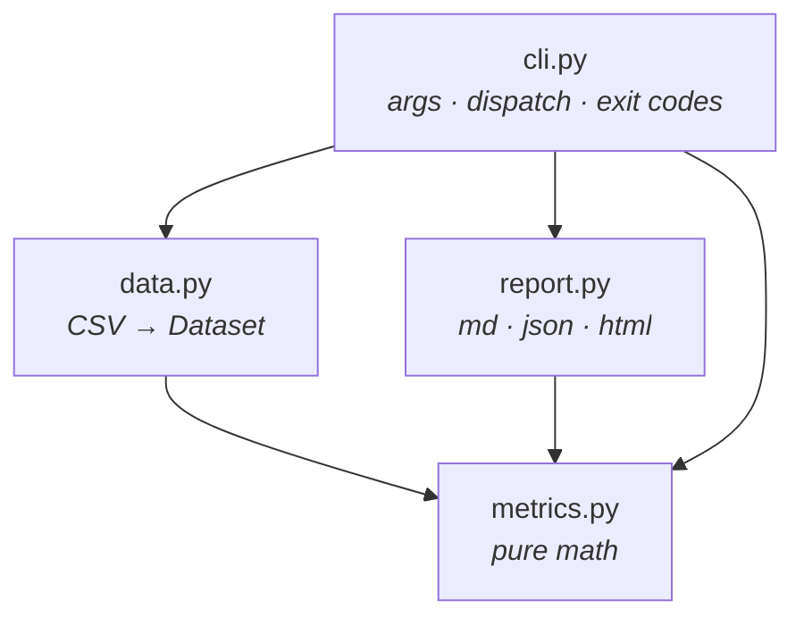

# Architecture

FairHire is about 400 lines of standard-library Python in four modules, split so that the statistics can be
checked without touching files or formatting.

## Data flow

1. **`cli.parse_args`** checks flags. `--selected` and `--score` are mutually exclusive, and `--group` can be repeated.
2. **`data.load`** reads the CSV once and returns a `Dataset`:
   - computes a boolean outcome per row. In scoring mode the outcome is `score > median(all scores)`, as LL144
     defines the scoring rate.
   - builds one **`View`** per `--group` column, plus one intersectional view when there are two or more. Each view
     is a flat list of `(category, selected)` pairs, plus a count of rows whose category was missing.
3. **`metrics.audit`** turns a view's pairs into `GroupResult`s:
   - counts per category in a single pass
   - sets aside categories under `min_share` of the view (default 2%). They get a rate but no impact ratio, and they
     can't become the reference group, so a 3-person category with a 100% rate can't distort everyone else's ratio.
   - picks the reference (highest-rate eligible category), then computes impact ratios and z-test p-values against it
4. **`report.RENDERERS[fmt]`** formats `[(view name, unknown count, results), …]`. All three renderers share the
   verdict and metadata helpers, so the outputs never disagree.
5. **`cli.main`** returns `0` (clean or non-strict), `1` (`--strict` with flags) or `2` (bad input).

## Design decisions

| Decision | Why |
|---|---|
| **No dependencies** | Audits often run on locked-down HR or compliance machines. With nothing to install there's nothing to approve, and there are no supply-chain worries. |
| **`metrics.py` is pure** | The math is what people need to trust, so it takes plain tuples and returns frozen dataclasses. Tests build inputs in one line. |
| **Status is derived, not stored** | `GroupResult.status` is a property computed from the ratio and p-value, so the flag logic lives in one place. |
| **Float guard at the boundary** | Ratios are rounded to 9 places before comparing with 0.8, so an exact 0.8 isn't flagged because of float noise. |
| **Self-contained HTML** | Inline CSS and SVG with no CDN, so the report can be emailed, archived or opened offline. It follows the OS light/dark setting. |
| **Unknowns are excluded per view** | A row missing race still counts in the sex view. Dropping it everywhere would quietly shrink every audit. |
| **Exit codes** | `--strict` lets a CI job block a model release the same way a failing unit test blocks a merge. |

## Extending

- **New metric** (e.g. Fisher exact): add a pure function to `metrics.py`, store the result on `GroupResult`,
  and add a column in each renderer.
- **New output format**: write `to_x(audit, ds, source) -> str` in `report.py` and register it in `RENDERERS`.
  The CLI picks it up automatically.
- **New input source** (Parquet, a database): produce `View` objects. Nothing downstream reads files.
