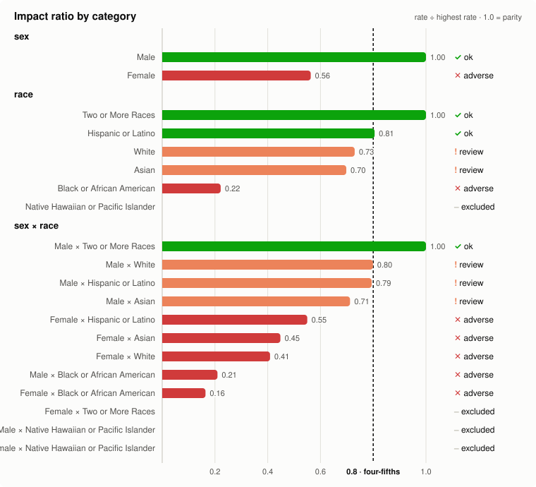

# Bias Audit Report

_Generated 2026-11-22 by fairhire._

> **✕ ADVERSE** — Adverse impact: at least one category falls below the threshold with a statistically significant gap.

## sex

Selection rate of `advanced` · 2000 records · 62 with unknown category (excluded from ratios) · reference: **Male**

| Category | N | Share | Rate | Impact ratio | p-value | Status |
|:--|--:|--:|--:|--:|--:|--:|
| Male | 1076 | 55.5% | 38.9% | 1.000 | 1.000 | ✓ ok (ref) |
| Female | 862 | 44.5% | 21.9% | 0.563 | <0.001 | ✕ adverse |

## race

Selection rate of `advanced` · 2000 records · 10 with unknown category (excluded from ratios) · reference: **Two or More Races**

| Category | N | Share | Rate | Impact ratio | p-value | Status |
|:--|--:|--:|--:|--:|--:|--:|
| Two or More Races | 83 | 4.2% | 47.0% | 1.000 | 1.000 | ✓ ok (ref) |
| Hispanic or Latino | 333 | 16.7% | 37.8% | 0.805 | 0.127 | ✓ ok |
| White | 1012 | 50.9% | 34.3% | 0.730 | 0.060 | ! review |
| Asian | 247 | 12.4% | 32.8% | 0.698 | 0.060 | ! review |
| Black or African American | 288 | 14.5% | 10.4% | 0.222 | <0.001 | ✕ adverse |
| Native Hawaiian or Pacific Islander | 27 | 1.4% | 25.9% | — | — | – excluded |

## sex × race

Selection rate of `advanced` · 2000 records · 72 with unknown category (excluded from ratios) · reference: **Male × Two or More Races**

| Category | N | Share | Rate | Impact ratio | p-value | Status |
|:--|--:|--:|--:|--:|--:|--:|
| Male × Two or More Races | 48 | 2.5% | 54.2% | 1.000 | 1.000 | ✓ ok (ref) |
| Male × White | 550 | 28.5% | 43.3% | 0.799 | 0.290 | ! review |
| Male × Hispanic or Latino | 179 | 9.3% | 43.0% | 0.794 | 0.290 | ! review |
| Male × Asian | 140 | 7.3% | 38.6% | 0.712 | 0.178 | ! review |
| Female × Hispanic or Latino | 141 | 7.3% | 29.8% | 0.550 | 0.009 | ✕ adverse |
| Female × Asian | 103 | 5.3% | 24.3% | 0.448 | 0.001 | ✕ adverse |
| Female × White | 429 | 22.3% | 22.1% | 0.409 | <0.001 | ✕ adverse |
| Male × Black or African American | 141 | 7.3% | 11.3% | 0.209 | <0.001 | ✕ adverse |
| Female × Black or African American | 135 | 7.0% | 8.9% | 0.164 | <0.001 | ✕ adverse |
| Female × Two or More Races | 35 | 1.8% | 37.1% | — | — | – excluded |
| Male × Native Hawaiian or Pacific Islander | 14 | 0.7% | 42.9% | — | — | – excluded |
| Female × Native Hawaiian or Pacific Islander | 13 | 0.7% | 7.7% | — | — | – excluded |

## Method

* **Rate** — share of each category selected (or scoring above the sample median).
* **Impact ratio** — category rate ÷ highest category rate. Below **0.8** fails the four-fifths rule.
* **p-value** — two-sided two-proportion z-test against the reference category (α = 0.05), Holm–Bonferroni-adjusted across categories in each table.
* **Status** — `ok` passes · `watch` passes but gap is significant · `review` fails but not significant (small sample) · `adverse` fails and is significant · `excluded` category is under the minimum share and is not rated.

_A statistical screen, not a legal determination. Interpret with domain and legal expertise._

