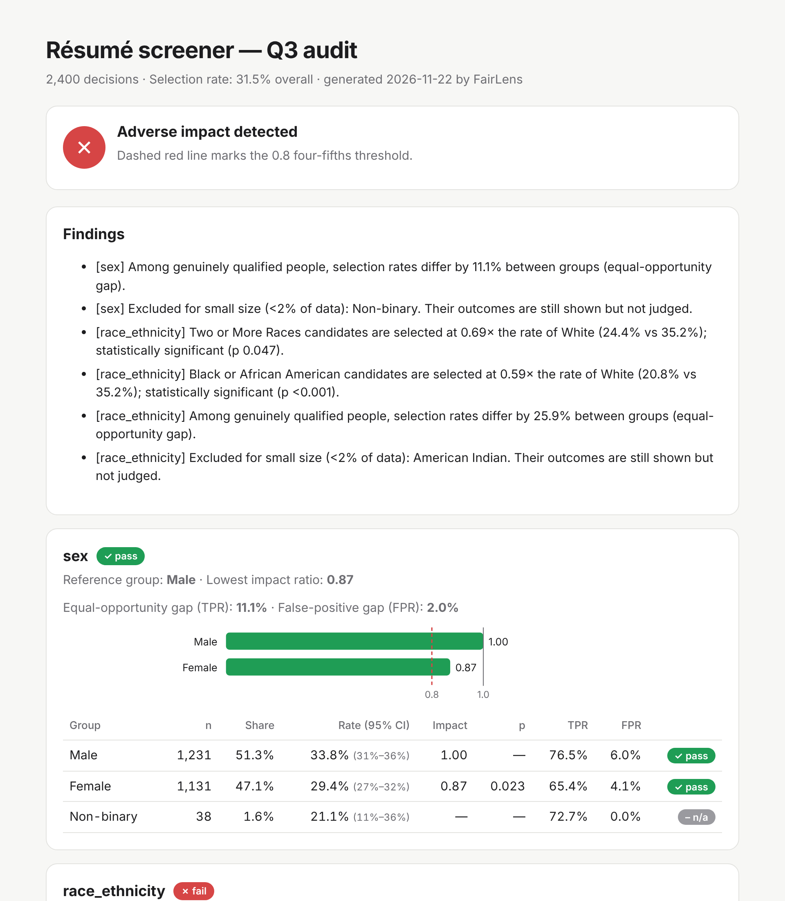
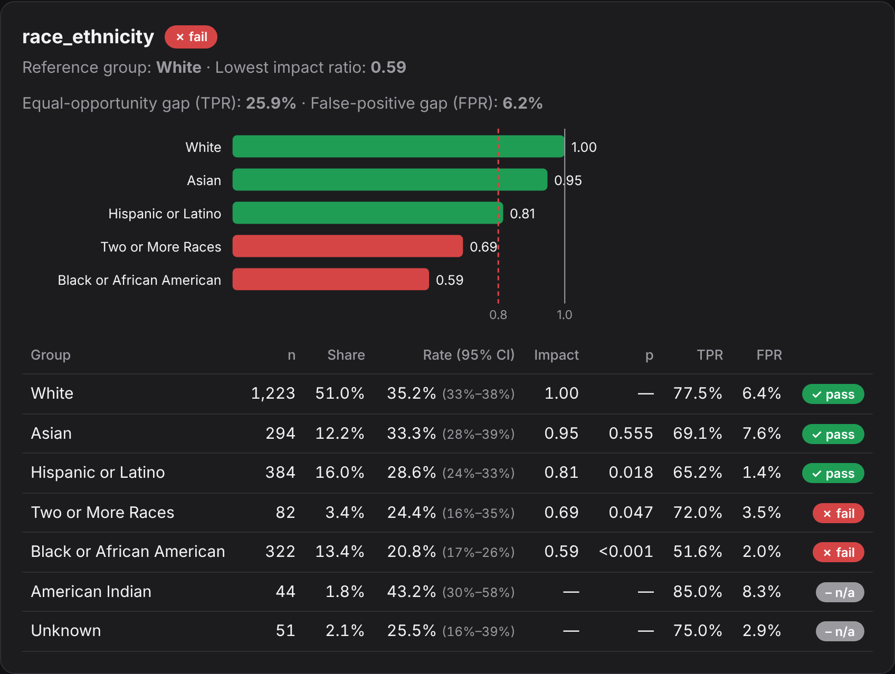
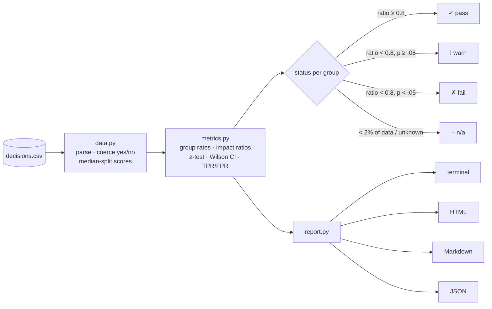

<div align="center">

# 🔍 FairLens

**Audit any automated decision system for bias, using one command and no dependencies.**

Point FairLens at a CSV of decisions (who was hired, approved or flagged) and it tells you,
in plain English, whether any group is being disadvantaged. The tests it runs are the ones
regulators use.

`Python ≥ 3.10` · `stdlib only` · `~600 lines` · `MIT`



</div>

---

## Why this exists

Algorithms now screen résumés, approve loans, set insurance prices and flag welfare claims.
When they're biased, the harm lands at scale and is often invisible to the people affected:

- A major tech company **scrapped an AI recruiting tool** after finding it downgraded résumés containing the word *"women's"*.
- A widely used **healthcare algorithm** cut the number of Black patients flagged for extra care by more than half, because it used past healthcare *spending* as a stand-in for *need*.
- The Dutch **childcare-benefits scandal** wrongly accused thousands of families of fraud. Risk-scoring that factored in nationality played a part, and the government resigned over it.

Regulators are responding. **NYC Local Law 144** (in force since 2023) requires an annual
independent *bias audit* of any automated employment decision tool. The **EU AI Act**
classes hiring, credit and public-benefits systems as *high-risk*. US anti-discrimination
law has used the **four-fifths rule** since 1978.

Even so, the teams building and buying these systems often have no simple way to run that
check. Commercial audits are expensive. Fairness libraries assume you're an ML engineer
working inside the model's training code. **FairLens only needs a spreadsheet of decisions**,
so HR teams, procurement officers, journalists, advocates and engineers can all use it,
before deployment or after.

## What it does

| | |
|---|---|
| 📏 **Impact ratios** | Each group's selection rate divided by the most-favoured group's rate, the metric LL144 audits report. Below **0.80** fails the EEOC four-fifths rule. |
| 🎲 **Significance testing** | A two-proportion z-test separates real disparities (**fail**) from noise in small samples (**warn**), so you neither ignore real gaps nor over-react to random ones. |
| 🎯 **Error-rate fairness** | Optionally add ground truth (e.g. "was actually qualified") to get **equal-opportunity** (TPR) and **false-positive** (FPR) gaps per group. A system can pass the 4/5ths rule and still pass over qualified people from one group. |
| 🔀 **Intersectional audit** | `--intersect` checks combinations like *Female · Black*, where bias often hides when each attribute is examined separately. |
| 📈 **Scores, not just decisions** | `--score` handles tools that output a number, using LL144's definition: a "selection" means scoring above the median. |
| 🧾 **Reports for humans and machines** | Colour terminal table, a self-contained **HTML** report (no JS, light/dark), **Markdown** for wikis and PRs, and **JSON** for pipelines. |
| 🚦 **CI gate** | `--strict` exits with code `1` on any significant adverse impact, so a biased model can't ship unnoticed. |
| 🤝 **Honest about uncertainty** | 95% Wilson confidence intervals for every rate. Groups under 2% of the data and unknown values are shown but not judged, following LL144 guidance. |

## Quick start

```bash
git clone <this repo> && cd EthicalAI/fairlens

# 1. Generate a synthetic résumé-screening log with a deliberately biased "AI screener"
python examples/generate_hiring.py

# 2. Audit it
python -m fairlens examples/hiring.csv \
    --outcome advanced \
    --attrs sex race_ethnicity \
    --label qualified \
    --html report.html
```

```text
  FairLens bias audit · 2,400 decisions · overall selection rate 31.5%
  Verdict: ✗ Adverse impact detected

  ▌RACE_ETHNICITY
  Group                           n     Rate  Impact       p     TPR     FPR
  ──────────────────────────────────────────────────────────────────────────
  White                       1,223    35.2%    1.00       —     78%      6%  ✓ pass
  Asian                         294    33.3%    0.95   0.555     69%      8%  ✓ pass
  Hispanic or Latino            384    28.6%    0.81   0.018     65%      1%  ✓ pass
  Two or More Races              82    24.4%    0.69   0.047     72%      4%  ✗ fail
  Black or African American     322    20.8%    0.59  <0.001     52%      2%  ✗ fail
  American Indian                44    43.2%       —       —     85%      8%  – n/a
  Unknown                        51    25.5%       —       —     75%      3%  – n/a

  Findings
  • [race_ethnicity] Black or African American candidates are selected at 0.59× the rate
    of White (20.8% vs 35.2%); statistically significant (p <0.001).
  • [race_ethnicity] Among genuinely qualified people, selection rates differ by 25.9%
    between groups (equal-opportunity gap).
  …
```

FairLens found both biases planted in the synthetic screener: a zip-code proxy for race,
and a career-gap penalty that falls mostly on women. The second one is subtle. Women's
impact ratio is **0.87**, which passes the four-fifths rule, but qualified women are
selected **11 points** less often than qualified men. Without error-rate metrics, that
gap would go unnoticed.

<div align="center">

<br><sub>HTML report, dark mode. Bars left of the dashed line fall below the four-fifths threshold.</sub>
</div>

Full sample outputs: [`docs/sample-report.html`](docs/sample-report.html) ·
[`.md`](docs/sample-report.md) · [`.json`](docs/sample-report.json)

## Usage

```text
python -m fairlens CSV (--outcome COL | --score COL) --attrs COL [COL ...]
                   [--label COL] [--intersect] [--strict]
                   [--html FILE] [--md FILE] [--json FILE] [--title TEXT] [--no-color]
```

| Flag | Meaning |
|---|---|
| `--outcome` | Yes/no decision column. Accepts `yes/no`, `1/0`, `true/false`, `hired`, `approved`, `rejected`, … |
| `--score` | Numeric score column. "Selected" means above the median (LL144's *scoring rate*). |
| `--attrs` | One or more protected-attribute columns. Blank cells become `Unknown`. |
| `--label` | Optional ground truth, which enables TPR/FPR and the equal-opportunity gap. |
| `--intersect` | Also audit the combination of all `--attrs`. |
| `--strict` | Exit with `1` if anything **fails** (`2` on bad input). |

**Your data needs only one row per person**, for example:

```csv
applicant_id,sex,race_ethnicity,advanced
A00001,Female,Hispanic or Latino,yes
A00002,Male,White,no
```

**Use it as a library:**

```python
from fairlens import load, run_audit
from fairlens.report import findings

audit = run_audit(load("decisions.csv", outcome="approved"), ["age_band", "sex"])
print(audit.status)            # 'pass' | 'warn' | 'fail' | 'n/a'
for line in findings(audit):
    print(line)
```

**Gate deployments in CI:**

```yaml
# .github/workflows/bias-audit.yml
- run: python -m fairlens predictions.csv --outcome approved --attrs sex race --strict --md audit.md
```

## How it works



**The maths, in full:**

| Metric | Formula | Reference |
|---|---|---|
| Selection rate | `selected_g / n_g` | |
| Impact ratio | `rate_g / max(rate)` | EEOC 29 CFR 1607.4(D); NYC LL144 (6 RCNY §5-300) |
| Significance | two-proportion pooled z-test vs. reference group, two-sided | |
| Confidence interval | Wilson score, 95% | |
| Equal opportunity | `max(TPR) − min(TPR)` over judged groups | Hardt et al., 2016 |
| FPR gap | `max(FPR) − min(FPR)` over judged groups | equalized odds |

Each result is a frozen dataclass (`Audit → AttributeAudit → GroupStat`), and status
logic lives in properties next to the data it describes. That makes every verdict
traceable to a single line of code.

## Codebase structure

```text
fairlens/
├── fairlens/               the package (stdlib only)
│   ├── __init__.py         public API: load, run_audit, Dataset, Audit
│   ├── __main__.py         CLI: argument parsing, output files, exit codes
│   ├── data.py             CSV → Dataset; yes/no coercion; score→median split; group labels
│   ├── metrics.py          statistics helpers + GroupStat/AttributeAudit/Audit + run_audit()
│   └── report.py           findings(), terminal(), markdown(), to_json(), html() with inline SVG
├── examples/
│   ├── generate_hiring.py  synthetic résumé screener with two known, injected biases
│   └── hiring.csv          2,400 generated rows (seeded, reproducible)
├── tests/
│   └── test_fairlens.py    14 unit + CLI tests (python -m unittest discover tests)
├── docs/                   screenshots and sample HTML / Markdown / JSON reports
└── pyproject.toml          optional install → `fairlens` command
```

| Module | Responsibility | Depends on |
|---|---|---|
| `data.py` | Read and validate input only. No maths. | `csv`, `statistics` |
| `metrics.py` | Pure functions and immutable results. No I/O. | `data` |
| `report.py` | Presentation only. Never changes numbers. | `metrics` |
| `__main__.py` | Connects the three modules and handles errors. | all |

## Install & test

```bash
pip install -e .                       # optional: adds the `fairlens` command
python -m unittest discover tests      # 14 tests, < 0.1 s
```

## Limits (please read)

FairLens is a **screening tool, not a legal opinion**.

- **Passing is not proof of fairness.** A selection process can have equal rates and still be unfair, for example if the criteria aren't job-related. Failing isn't proof of illegal discrimination either; it is a reason to look closer.
- **You need demographic data** to audit for bias. Collect it voluntarily, store it separately from decision-making, and handle it under your privacy obligations (GDPR special-category data, etc.).
- **Fairness metrics can conflict.** When base rates differ, equal selection rates and equal error rates usually can't both hold. FairLens reports both so people can weigh the trade-off openly instead of hiding it.
- **Small samples are noisy.** That is why `warn` exists, and why rates come with confidence intervals.

## Roadmap

- [ ] Multi-class outcomes and ranking metrics (e.g. exposure at top-k)
- [ ] Bootstrap CIs for impact ratios
- [ ] Trend mode: compare audits over time to catch drift
- [ ] Optional regulator-specific templates (LL144 summary of results, EU AI Act Annex IV)

## License

MIT. Use it, fork it, and audit something that matters.
