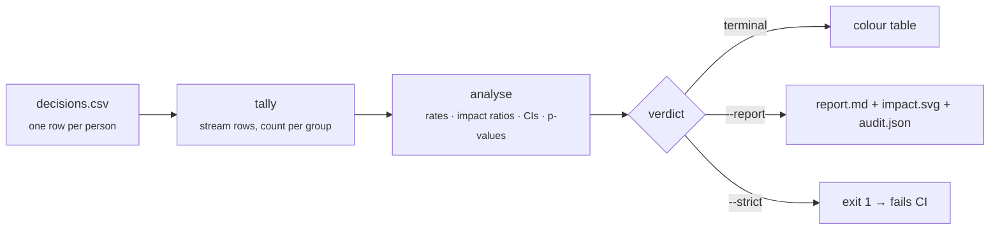
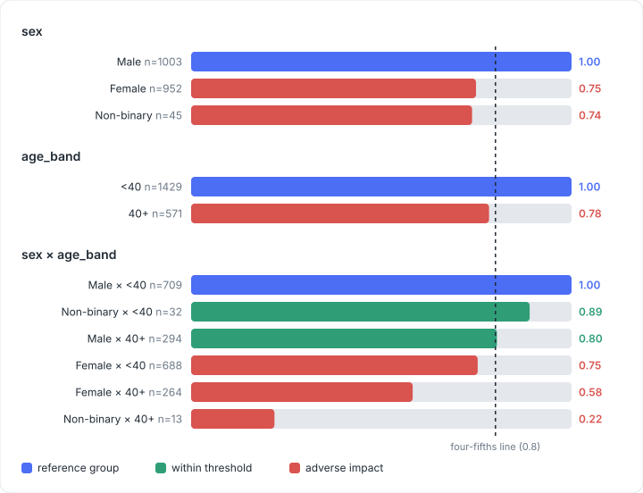

<p align="center"></p>

<p align="center">
  <b>Find out whether your algorithm treats people unfairly before it goes live.</b><br>
  One CSV in, a clear verdict out. Pure Python standard library, about 400 lines.
</p>

---

## Why this exists

Algorithms now screen job applicants, approve loans, rank tenants and shortlist students. When they learn from historical decisions, they **learn historical discrimination too**. The best-known case is a recruiting model that learned to penalise résumés containing the word *"women's"*.

Regulators have responded:

| Rule | What it requires |
|---|---|
| **EEOC four-fifths rule** (US, 29 CFR 1607.4D) | A group selected at under 80% of the top group's rate is evidence of adverse impact |
| **NYC Local Law 144** (2023) | An annual independent **bias audit** reporting the *impact ratio* of automated employment decision tools by sex, race/ethnicity and their intersections |
| **EU AI Act** (Annex III) | Hiring, credit and education systems are *high-risk* and must be tested for bias |

Commercial audits are expensive, and the open-source toolkits are heavy ML frameworks built for data scientists. **fairlens** is for everyone else: the HR analyst, the small lender, the civic-tech volunteer and the journalist with a FOIA spreadsheet. If you can export a CSV, you can audit a system.

## What it does



For each protected attribute (and, with `-x`, each **intersection** such as *Female × 40+*), fairlens reports:

- **Selection rate** with a 95% Wilson confidence interval
- **Impact ratio** against the most-selected group, flagged below the four-fifths threshold
- **Statistical significance** (two-proportion z-test), so a real gap can be told apart from noise
- **Equal opportunity**: if you supply ground truth, it also reports true- and false-positive rates per group
- **Data-quality flags** for small samples (n < 30) and groups under 2% of the data (LL144 allows excluding these)

## Quick start

```bash
git clone https://github.com/kareemrt/EthicalAI && cd EthicalAI/fairlens
python -m fairlens examples/hiring.csv --outcome advanced --groups sex,age_band --label qualified
```

No install step and no dependencies. Python ≥ 3.9. To get a `fairlens` command, run `pip install .`.

```text
fairlens audit · 2000 rows

sex (reference: Male)
  Group       N     Selected  Rate   95% CI       Impact ratio  p-value  TPR    FPR    Flags
  Male        1003  332       33.1%  30.3%–36.1%  1.00          ref      67.5%  11.7%  ok
  Female      952   236       24.8%  22.2%–27.6%  0.75          <0.001   50.1%  8.0%   adverse-impact, significant
  Non-binary  45    11        24.4%  14.2%–38.7%  0.74          0.226    57.1%  9.7%   adverse-impact
  TPR gap 17.4% · FPR gap 3.6%

age_band (reference: <40)
  Group  N     Selected  Rate   95% CI       Impact ratio  p-value  TPR    FPR    Flags
  <40    1429  441       30.9%  28.5%–33.3%  1.00          ref      63.1%  11.0%  ok
  40+    571   138       24.2%  20.8%–27.8%  0.78          0.003    48.9%  7.1%   adverse-impact, significant
  TPR gap 14.2% · FPR gap 3.9%

REVIEW — 3 group(s) below threshold (2 statistically significant at p<0.05).
```

**How to read this:** qualified women advance 50% of the time, against 68% for qualified men. That is a 17-point equal-opportunity gap, and it is significant. The Non-binary group shows a similar ratio, but with n = 45 the p-value (0.23) says the data can't yet separate it from chance, so the right response is to collect more data rather than dismiss it.

### Visual report

```bash
python -m fairlens examples/hiring.csv -o advanced -g sex,age_band -l qualified -x --report examples/report
```

<p align="center"></p>

The intersectional rows show bias that single attributes hide: **women over 40** are selected at just **0.58×** the reference rate, a much larger gap than either "Female" (0.75) or "40+" (0.78) alone. The full output is in [`examples/report/report.md`](examples/report/report.md).

## Usage

```text
fairlens CSV -o OUTCOME -g COL[,COL…] [options]

  -o, --outcome COL     decision column (1/true/yes/hired/approved/selected… = selected)
  -g, --groups COLS     comma-separated protected attributes
  -l, --label COL       ground truth (qualified / repaid) → adds TPR, FPR and gaps
      --positive VALUE  exact value meaning "selected", e.g. --positive Offer
  -x, --intersect       also audit every pair of attributes
  -t, --threshold 0.8   impact-ratio threshold
      --min-n 30        small-sample warning size
  -f, --format          text | md | json
      --report DIR      write report.md, impact.svg, audit.json
      --strict          exit 1 if adverse impact is found
```

Blank or unknown values (`""`, `NA`, `unknown`, …) are skipped for that attribute only, so one missing field doesn't discard the whole row.

### Use it as a fairness gate in CI

Retraining a model? Fail the build if the new version is biased on a held-out evaluation set:

```yaml
# .github/workflows/fairness.yml
- name: Bias audit
  run: python -m fairlens eval/predictions.csv -o predicted -g sex,race -x --strict --report audit
- uses: actions/upload-artifact@v4
  if: always()
  with: { name: bias-audit, path: audit/ }
```

Exit codes: `0` pass · `1` adverse impact (with `--strict`) · `2` bad input.

## Codebase structure

```text
fairlens/
├── fairlens/                 the package (stdlib only)
│   ├── __init__.py           version
│   ├── __main__.py           enables `python -m fairlens`
│   ├── cli.py                argument parsing, orchestration, exit codes
│   ├── data.py               streams the CSV and counts outcomes per group (and intersection)
│   ├── metrics.py            GroupStats/Audit models; Wilson CI, z-test, impact ratio, flags
│   ├── report.py             renders terminal text, Markdown and JSON
│   └── chart.py              renders a self-contained SVG bar chart
├── examples/
│   ├── generate_hiring.py    seeded synthetic résumé screener with known, injected bias
│   ├── hiring.csv            2,000 generated applicants
│   └── report/               sample output: report.md · impact.svg · audit.json
├── tests/test_fairlens.py    unit + end-to-end tests (unittest, no pytest needed)
├── docs/banner.svg
└── pyproject.toml            optional `pip install .` → `fairlens` command
```

**Design principles**

- **Pure functions in the middle.** `data.tally` turns rows into counts, `metrics.analyse` turns counts into an `Audit`, and the renderers turn an `Audit` into output. Each layer can be tested on its own, and adding a format (HTML or PDF) only touches `report.py`.
- **Streaming.** Rows are counted as they are read, so memory scales with the number of groups rather than the number of rows. A file with millions of decisions works on a laptop.
- **Counts only, no personal data in outputs.** Reports contain aggregate statistics and never individual rows, so they can be shared with auditors or published.
- **Honest statistics.** Every ratio comes with a confidence interval, a p-value and a sample-size warning, because a bare ratio from 12 people misleads.

## Run the tests

```bash
python -m unittest discover -s tests     # 13 tests, ~20 ms
```

The suite checks the metrics against textbook values (for example the classic EEOC 60% vs 30% example gives an impact ratio of 0.5). It also confirms that the bias injected into the synthetic dataset is detected end to end.

## Methodology and limits

| Metric | Definition |
|---|---|
| Selection rate | selected ÷ total in group |
| Impact ratio | group rate ÷ highest group rate (NYC rules, 6 RCNY §5-301) |
| 95% CI | Wilson score interval, which stays reliable at small n and at 0% or 100% |
| p-value | pooled two-proportion z-test against the reference group, two-sided |
| TPR / FPR | share selected among label-positive / label-negative people in the group |

fairlens is a **screening tool, not a legal opinion.** A low ratio is a reason to investigate: the cause could be the model, the applicant pool or a legitimate job requirement. A passing ratio does not prove the system is fair. Groups can be harmed in ways selection rates don't capture, and a model can meet the four-fifths rule while still having unequal error rates (check TPR/FPR). Use it alongside domain expertise and the people affected.

## Roadmap

- [ ] Scoring-rate audits for continuous scores (the "scoring rate" in 6 RCNY §5-301)
- [ ] Optional HTML report with a sortable table
- [ ] Bootstrap CIs for the impact ratio itself
- [ ] Before/after comparison mode for model retrains

## License

[MIT](LICENSE). Use it, fork it, audit something.
