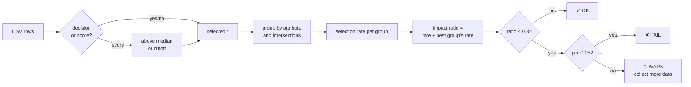

<div align="center">

# 🔍 FairLens

**A bias audit for automated decisions, in one command and zero dependencies.**

Point it at a CSV of decisions made by a hiring, lending, housing or admissions model.
It tells you which groups are being shortchanged, whether that gap is statistically real,
and whether the model's *mistakes* fall unevenly.


</div>

---

## Why this exists

Algorithms already decide who gets a job interview, a loan or an apartment viewing, and they
regularly reproduce the bias in their training data. A well-known example is the résumé
screener that learned to downgrade applications mentioning "women's".

Regulators now require audits:

| Rule | What it requires |
|---|---|
| **NYC Local Law 144** (in force since 2023) | Employers using automated hiring tools must publish an annual **independent bias audit** showing selection rates and **impact ratios** by sex, race/ethnicity and their **intersections**. |
| **EU AI Act** (high-risk obligations from 2026) | Hiring, credit and education systems are *high-risk*. Providers must examine data and outputs for bias. |
| **Colorado AI Act** | Deployers of high-risk AI must use reasonable care to prevent algorithmic discrimination. |
| **US EEOC four-fifths rule** | A selection rate below 80% of the highest group's rate is evidence of adverse impact. |

Existing fairness toolkits are powerful, but they are built for ML engineers. They pull in
heavy dependency stacks and assume a notebook. The people who most need an answer (an HR team,
a small lender, a city agency, a journalist, a nonprofit) often have **only a spreadsheet**.

FairLens is for them. It is about 450 lines of standard-library Python. It reads a CSV, prints an
answer anyone can read, and writes a report you can publish.

## What it looks like

```console
$ fairlens examples/hiring.csv -g gender race age_band -d advanced -l qualified --min-share 0.02

■ race   reference group: White
group               n  share  sel. rate  impact  p-value    TPR    FPR    status
───────────────  ────  ─────  ─────────  ──────  ───────  ─────  ─────  ────────
Asian             347  11.6%      36.6%    0.98    0.796  70.0%  11.2%        OK
Black             515  17.2%      20.8%    0.56   <0.001  43.5%   1.4%      FAIL
Hispanic          518  17.3%      29.2%    0.78   <0.001  63.1%   5.3%      FAIL
Native American    56   1.9%      39.3%       —        —  74.1%   6.9%  EXCLUDED
White            1564  52.1%      37.3%    1.00      ref  74.7%   9.6%        OK
→ FAIL: 2 group(s) fall below the 0.80 impact-ratio threshold with a statistically significant gap (p < 0.05).
  Equal-opportunity gap (TPR): 31.2 pts
  False-positive gap (FPR): 9.7 pts
```

How to read it: Black applicants are advanced at **56%** of the rate of White applicants.
Among applicants who were *actually qualified*, only **43.5%** of Black applicants got through,
compared with **74.7%** of White applicants. The model is not only selecting fewer of them. It is
wrongly rejecting the qualified ones.

`--svg` writes a chart (it adapts to light and dark mode):

<p align="center"></p>

`--md` writes a full report ready to publish: 👉 **[docs/sample-report.md](docs/sample-report.md)**

## Quick start

```bash
git clone https://github.com/kareemrt/EthicalAI.git
cd EthicalAI/fairlens
pip install -e .            # optional: adds the `fairlens` command
                            # or skip it and use `python -m fairlens`

fairlens examples/hiring.csv -g gender race -d advanced
```

Your data needs **one row per person**: at least one demographic column, plus either a yes/no
decision column or a numeric score column.

```csv
applicant_id,gender,race,age_band,model_score,advanced,qualified
A0001,Female,White,40+,34.4,no,0
A0002,Female,White,<40,48.4,no,0
```

## Usage

```text
fairlens CSV -g COL [COL ...] (-d COL | -s COL) [options]
```

| Option | Purpose |
|---|---|
| `-g, --group COL…` | Protected-attribute column(s) to audit: `gender race age_band` |
| `-d, --decision COL` | Yes/no outcome. Recognises `yes/1/true/hired/approved/selected/…` |
| `-s, --score COL` | Numeric score instead. Binarized at the **median** by default (the LL144 *scoring rate*) |
| `--positive VALUE` | Exact decision value that counts as selected, e.g. `--positive advance` |
| `--cutoff N` | Score threshold instead of the median |
| `-l, --label COL` | Ground truth (`qualified`, `repaid`). Adds **TPR/FPR** and equalized-odds gaps |
| `-i, --intersect` | Also audit combinations, e.g. `Female × Black` (required by LL144) |
| `-t, --threshold` | Impact-ratio threshold, default `0.8` |
| `--alpha` | Significance level, default `0.05` |
| `--min-share FRAC` | Report but don't score groups under this share of the data (LL144 allows `0.02`) |
| `--md FILE` / `--svg FILE` | Write a Markdown report / SVG chart |
| `--json` | Machine-readable output |
| `--strict` | Treat `WARN` as a failure |

**Exit codes:** `0` no adverse impact · `1` adverse impact found · `2` bad input

### Use it as a fairness gate in CI

Because the exit code reflects the verdict, you can block a model release when it discriminates.
This works the same way as failing a build on broken tests:

```yaml
# .github/workflows/fairness.yml
- name: Bias audit on holdout predictions
  run: |
    python -m fairlens predictions.csv -g sex race -d predicted -l actual \
      --intersect --min-share 0.02 --md audit.md --svg audit.svg
```

### Use it as a library

```python
from fairlens import audit

result = audit([("A", True, None), ("A", False, None), ("B", False, None)])
result.status        # 'OK' | 'WARN' | 'FAIL'
result.reference     # highest-rate group
[(g.name, g.impact_ratio, g.p_value) for g in result.groups]
```

## How it decides



| Metric | Question it answers |
|---|---|
| **Selection rate** | What share of this group got the positive outcome? |
| **Impact ratio** | How does that compare with the most-favoured group? (four-fifths rule, LL144) |
| **p-value** | Two-proportion z-test: could this gap be chance? |
| **TPR gap** (equal opportunity) | Among people who *deserved* a yes, does each group get one equally often? |
| **FPR gap** | Among people who *didn't qualify*, are some groups waved through more than others? |

**Why both a ratio *and* a p-value?** The four-fifths rule alone misfires in both directions. With
small groups, random noise can push a ratio below 0.8, which gives false alarms. With huge datasets,
a ratio of 0.85 can still reflect a real and systematic gap. FairLens returns `FAIL` only when both
tests agree. It returns `WARN` when the ratio is low but the evidence is thin, so you know to look
closer instead of concluding too early.

## Try the bundled example

`examples/hiring.csv` contains 3,000 synthetic applicants. It is generated by
[`make_hiring_data.py`](examples/make_hiring_data.py) with a fixed seed. True qualification is drawn
from the **same distribution for every group**, and the simulated screening model then applies
hidden score penalties to women, Black and Hispanic applicants, and applicants aged 40 and over.
This mimics a model trained on historically skewed hiring decisions.

FairLens recovers every planted penalty and flags nothing that wasn't planted. With `--intersect`
it also shows something the single-attribute tables can't: **White women** (0.72) and
**Black men** (0.69) both fail, and **Black women** have the lowest ratio at **0.47**.

```bash
fairlens examples/hiring.csv -g gender race -s model_score --intersect --min-share 0.02
```

## Project structure

```text
fairlens/
├── fairlens/                 the package (standard library only)
│   ├── __init__.py           public API: audit, Audit, Group
│   ├── __main__.py           enables `python -m fairlens`
│   ├── cli.py                argument parsing, orchestration, exit codes
│   ├── data.py               CSV loading, yes/no parsing, score→decision, group keys
│   ├── metrics.py            pure math: rates, impact ratios, z-test, TPR/FPR, status
│   └── report.py             renderers: terminal table, Markdown, JSON, SVG chart
├── examples/
│   ├── make_hiring_data.py   reproducible synthetic dataset with planted bias
│   └── hiring.csv            its output (3,000 applicants)
├── tests/
│   └── test_fairlens.py      unit + end-to-end tests (python -m unittest)
├── docs/
│   ├── sample-report.md      generated Markdown audit
│   └── sample-chart.svg      generated chart
└── pyproject.toml            packaging; installs the `fairlens` command
```

**Design principles**

- **Layered and pure.** `data` turns rows into `(group, selected, label)` records, `metrics` turns
  records into an `Audit`, and `report` renders it. Only `cli` performs I/O, so each layer can be
  tested on its own.
- **Zero dependencies.** It runs anywhere Python runs, including air-gapped machines with
  sensitive HR data, and there is no supply chain to audit.
- **Readable by non-experts.** Every verdict is a plain-English sentence, and every metric is
  explained in the generated report.
- **Honest about uncertainty.** Small samples get `WARN`, not a false verdict. Tiny groups are
  shown but not scored. Missing demographic values become an explicit `(unknown)` group instead of
  being dropped.

## Running the tests

```bash
python -m unittest discover -s tests
```

## Limitations: read before relying on a result

- **A pass is not a certificate of fairness.** FairLens measures *outcome parity on the data
  you give it*. It cannot see proxies such as zip code standing in for race, people who never
  applied, or bias in the ground-truth labels themselves.
- **Fairness definitions conflict.** When base rates differ, equal selection rates and equal
  error rates can be mathematically impossible to achieve together. FairLens reports both so that
  humans can make that trade-off openly.
- **Not legal advice.** LL144 requires an *independent* auditor. FairLens computes the numbers
  that auditor reports, and helps you find problems before they do.
- **Demographic data is sensitive.** Audit locally, aggregate before sharing, and follow your
  jurisdiction's rules for collecting it.

## Roadmap

- [ ] Confidence intervals on impact ratios (Wilson / bootstrap)
- [ ] Calibration-by-group for risk scores
- [ ] Single-file HTML report
- [ ] Fisher's exact test for very small groups

## License

MIT
