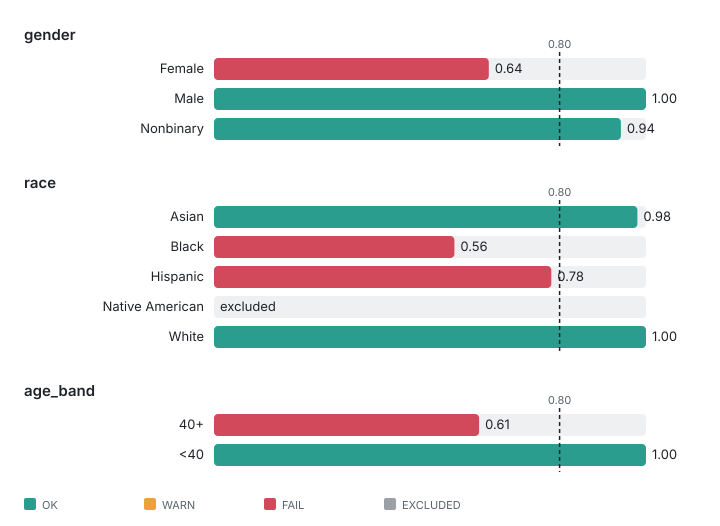

# FairLens bias audit

Data: `hiring.csv` · 3,000 records

**Overall: ❌ FAIL**

| Attribute | Reference group | Status | Finding |
|---|---|---|---|
| gender | Male | ❌ FAIL | 1 group(s) fall below the 0.80 impact-ratio threshold with a statistically significant gap (p < 0.05). |
| race | White | ❌ FAIL | 2 group(s) fall below the 0.80 impact-ratio threshold with a statistically significant gap (p < 0.05). |
| age_band | <40 | ❌ FAIL | 1 group(s) fall below the 0.80 impact-ratio threshold with a statistically significant gap (p < 0.05). |

## gender

| group | n | share | sel. rate | impact | p-value | TPR | FPR | status |
|---|---:|---:|---:|---:|---:|---:|---:|:---:|
| Female | 1382 | 46.1% | 25.3% | 0.64 | <0.001 | 55.3% | 2.4% | ❌ FAIL |
| Male | 1482 | 49.4% | 39.8% | 1.00 | ref | 75.5% | 12.6% | ✅ OK |
| Nonbinary | 136 | 4.5% | 37.5% | 0.94 | 0.598 | 83.6% | 6.2% | ✅ OK |

- Equal-opportunity gap (TPR): 28.4 pts
- False-positive gap (FPR): 10.2 pts

## race

| group | n | share | sel. rate | impact | p-value | TPR | FPR | status |
|---|---:|---:|---:|---:|---:|---:|---:|:---:|
| Asian | 347 | 11.6% | 36.6% | 0.98 | 0.796 | 70.0% | 11.2% | ✅ OK |
| Black | 515 | 17.2% | 20.8% | 0.56 | <0.001 | 43.5% | 1.4% | ❌ FAIL |
| Hispanic | 518 | 17.3% | 29.2% | 0.78 | <0.001 | 63.1% | 5.3% | ❌ FAIL |
| Native American | 56 | 1.9% | 39.3% | — | — | 74.1% | 6.9% | ➖ EXCLUDED |
| White | 1564 | 52.1% | 37.3% | 1.00 | ref | 74.7% | 9.6% | ✅ OK |

- Equal-opportunity gap (TPR): 31.2 pts
- False-positive gap (FPR): 9.7 pts

## age_band

| group | n | share | sel. rate | impact | p-value | TPR | FPR | status |
|---|---:|---:|---:|---:|---:|---:|---:|:---:|
| 40+ | 937 | 31.2% | 23.1% | 0.61 | <0.001 | 53.5% | 1.6% | ❌ FAIL |
| <40 | 2063 | 68.8% | 37.6% | 1.00 | ref | 72.0% | 10.5% | ✅ OK |

- Equal-opportunity gap (TPR): 18.5 pts
- False-positive gap (FPR): 8.8 pts

## Method

| Metric | Meaning |
|---|---|
| **Selection rate** | Share of the group that received the positive decision. |
| **Impact ratio** | Group's selection rate ÷ the highest group's rate. Below **0.80** is evidence of adverse impact under the EEOC *four-fifths rule* and is the figure NYC Local Law 144 bias audits must publish. |
| **p-value** | Two-proportion z-test against the reference group. Small values mean the gap is unlikely to be chance. |
| **TPR / FPR** | Among people who truly qualified (TPR) or did not (FPR), the share selected. Large gaps mean the model's *mistakes* fall unevenly (equalized odds). |

**Status** — `FAIL`: below threshold and significant (p < 0.05). `WARN`: below threshold, sample too small to be sure. `EXCLUDED`: group is under the minimum share of data and is reported but not scored.

> A passing audit is not proof of fairness. It shows outcome parity on the data provided, for the
> attributes provided. Check data quality, proxies for protected traits, and the human process around
> the model too.
