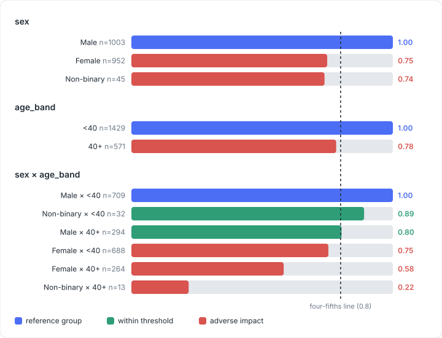

# Bias audit — `hiring.csv`

> **REVIEW — 6 group(s) below threshold (5 statistically significant at p<0.05).**

Rows analysed: **2000** · Threshold: impact ratio **≥ 0.8** (EEOC four-fifths rule / NYC LL144 impact ratio)

## sex

Reference group (highest selection rate): **Male**

| Group | N | Selected | Rate | 95% CI | Impact ratio | p-value | TPR | FPR | Flags |
|---|---|---|---|---|---|---|---|---|---|
| Male | 1003 | 332 | 33.1% | 30.3%–36.1% | 1.00 | ref | 67.5% | 11.7% | ok |
| Female | 952 | 236 | 24.8% | 22.2%–27.6% | 0.75 | <0.001 | 50.1% | 8.0% | adverse-impact, significant |
| Non-binary | 45 | 11 | 24.4% | 14.2%–38.7% | 0.74 | 0.226 | 57.1% | 9.7% | adverse-impact |

Equal-opportunity (TPR) gap: **17.4%** · False-positive-rate gap: **3.6%**

## age_band

Reference group (highest selection rate): **<40**

| Group | N | Selected | Rate | 95% CI | Impact ratio | p-value | TPR | FPR | Flags |
|---|---|---|---|---|---|---|---|---|---|
| <40 | 1429 | 441 | 30.9% | 28.5%–33.3% | 1.00 | ref | 63.1% | 11.0% | ok |
| 40+ | 571 | 138 | 24.2% | 20.8%–27.8% | 0.78 | 0.003 | 48.9% | 7.1% | adverse-impact, significant |

Equal-opportunity (TPR) gap: **14.2%** · False-positive-rate gap: **3.9%**

## sex × age_band

Reference group (highest selection rate): **Male × <40**

| Group | N | Selected | Rate | 95% CI | Impact ratio | p-value | TPR | FPR | Flags |
|---|---|---|---|---|---|---|---|---|---|
| Male × <40 | 709 | 249 | 35.1% | 31.7%–38.7% | 1.00 | ref | 73.5% | 12.9% | ok |
| Non-binary × <40 | 32 | 10 | 31.2% | 18.0%–48.6% | 0.89 | 0.653 | 66.7% | 10.0% | under-2% |
| Male × 40+ | 294 | 83 | 28.2% | 23.4%–33.6% | 0.80 | 0.035 | 55.2% | 8.3% | ok |
| Female × <40 | 688 | 182 | 26.5% | 23.3%–29.9% | 0.75 | <0.001 | 53.1% | 8.9% | adverse-impact, significant |
| Female × 40+ | 264 | 54 | 20.5% | 16.0%–25.7% | 0.58 | <0.001 | 42.5% | 5.7% | adverse-impact, significant |
| Non-binary × 40+ | 13 | 1 | 7.7% | 1.4%–33.3% | 0.22 | 0.039 | 0.0% | 9.1% | adverse-impact, significant, small-sample, under-2% |

Equal-opportunity (TPR) gap: **73.5%** · False-positive-rate gap: **7.2%**

## How to read this

- **Impact ratio** — a group's selection rate divided by the most-selected group's rate. Below the threshold suggests adverse impact.
- **p-value** — two-proportion z-test against the reference group. Small samples can show large gaps by chance; large samples can make tiny gaps significant.
- **TPR / FPR** — among people the ground-truth label marks qualified (TPR) or not (FPR), the share selected. Gaps indicate unequal error rates.
- Flags: `adverse-impact`, `significant` (p<0.05), `small-sample` (n<30), `under-2%` (LL144 allows excluding these from the ratio calculation).

_A statistical screen, not a legal determination. Investigate causes before acting._
