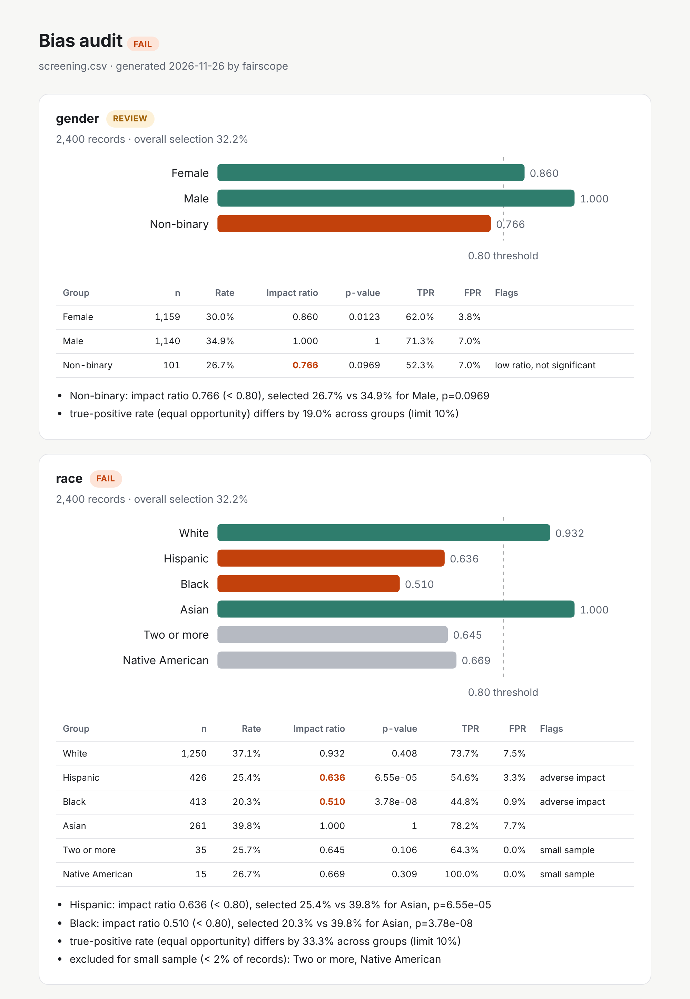
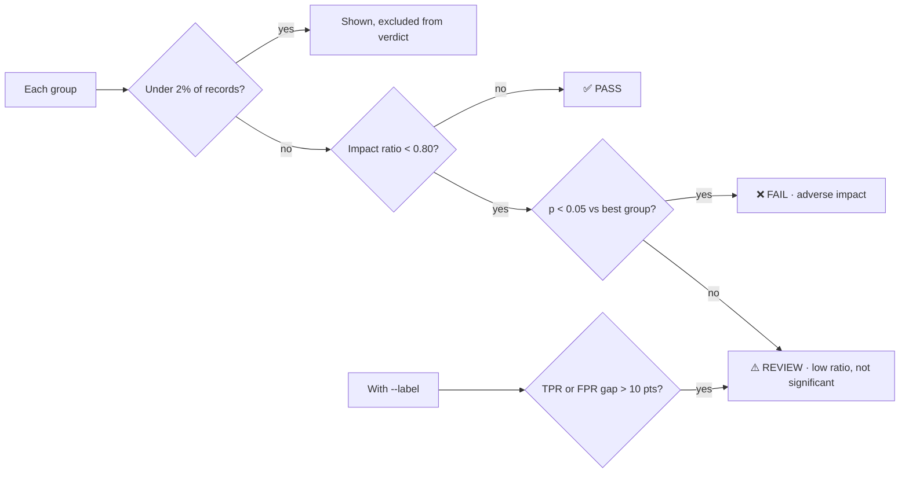
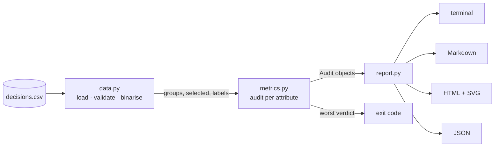

<div align="center">

# fairscope

**A zero-dependency bias auditor for automated decisions.**
Point it at a CSV of who got hired, approved or flagged. It tells you whether some groups are being left behind, how sure it is, and whether that should block a release.

`Python ≥ 3.9` · `stdlib only` · `~400 lines` · `MIT`

<picture>
  <source media="(prefers-color-scheme: dark)" srcset="docs/report-dark.png">
  
</picture>

</div>

---

## Why this exists

Algorithms now screen résumés, price loans, rank tenants and triage patients. When one of them quietly disadvantages a group, the people affected rarely find out, and the team that shipped it often doesn't either.

- **The law is catching up.** [NYC Local Law 144](https://www.nyc.gov/site/dca/about/automated-employment-decision-tools.page) requires an annual *bias audit* of automated hiring tools, reported as **impact ratios** by sex, race/ethnicity and their intersections. The EU AI Act classes hiring, credit and essential-services systems as *high-risk*. US regulators (EEOC, CFPB) apply the long-standing **four-fifths rule** to algorithmic decisions too.
- **Existing tools are heavy.** Most fairness libraries need a data-science stack, a trained model object, or a notebook. Many teams that *operate* these systems only have the decision log.
- **Audits happen once a year, but models change every week.** Bias should fail a build the way a broken test does.

fairscope is small enough to read in one sitting, needs nothing beyond Python, and works on the one artefact every organisation has: **a table of decisions**.

## What it checks

| Check | Question it answers | Standard |
|---|---|---|
| **Selection rate** | What share of each group got the favourable outcome? | — |
| **Impact ratio** | Group rate ÷ best group's rate. Below **0.80**? | EEOC four-fifths rule · NYC LL144 |
| **Significance** | Is the gap to the best group real, or noise? (two-proportion z-test) | Common practice in disparate-impact analysis |
| **Small-sample guard** | Groups under 2% of records are shown but don't drive the verdict | NYC LL144 rules (§ 5-301) |
| **Scoring rate** | For systems that output scores, not decisions: share above the median | NYC LL144 |
| **Intersectionality** | Does harm concentrate where attributes overlap (e.g. *Female × Black*)? | NYC LL144 |
| **Equal opportunity / odds** | Given a ground-truth label, are qualified people (TPR) and unqualified people (FPR) treated alike? | Hardt et al., 2016 |

### How a verdict is reached



The worst verdict across all attributes becomes the overall verdict and sets the exit code.

## Quick start

```bash
git clone https://github.com/kareemrt/EthicalAI && cd EthicalAI/fairscope
python -m fairscope audit examples/screening.csv --by gender --by race --outcome advanced --label qualified
```

No install step needed. To get a `fairscope` command, run `pip install .`.

```text
fairscope · screening.csv · overall verdict: FAIL

■ race  [FAIL]  n=2,400  overall selection 32.2%
  White             37.1%  IR 0.932 ███████████████████
  Hispanic          25.4%  IR 0.636 █████████████        ◂  adverse impact
  Black             20.3%  IR 0.510 ██████████           ◂  adverse impact
  Asian             39.8%  IR 1.000 ████████████████████
  Two or more       25.7%  IR 0.645 █████████████        ◂  small sample
  Native American   26.7%  IR 0.669 █████████████        ◂  small sample
  • Hispanic: impact ratio 0.636 (< 0.80), selected 25.4% vs 39.8% for Asian, p=6.55e-05
  • Black: impact ratio 0.510 (< 0.80), selected 20.3% vs 39.8% for Asian, p=3.78e-08
  • true-positive rate (equal opportunity) differs by 33.3% across groups (limit 10%)
```

The [sample data](examples/make_sample.py) is synthetic résumé screening with a planted bias: a few score points subtracted for two groups, the way a proxy feature (zip code, employment gaps, name) would. fairscope finds both. With `--intersect` it also shows that **Black women are advanced at less than a third of the benchmark rate (0.306)**, worse than either attribute shows on its own. See the full [Markdown](examples/report.md) and [HTML](examples/report.html) reports.

## Usage

```text
fairscope audit FILE --by COL [--by COL ...] (--outcome COL | --score COL [--cutoff X]) [options]
```

| Option | Meaning |
|---|---|
| `--by COL` | Protected attribute column. Repeat for several. |
| `--intersect` | Also audit the combination of all `--by` columns. |
| `--outcome COL` | Yes/no decision column (`yes/no`, `1/0`, `true/false`, `hired`, `approved`, …). |
| `--score COL` | Numeric score column. Selected = above `--cutoff`, or above the median by default. |
| `--label COL` | Optional ground truth (e.g. *actually qualified*, *repaid loan*). Enables TPR/FPR parity. |
| `--threshold 0.8` | Minimum acceptable impact ratio. |
| `--min-share 0.02` | Groups below this share of records are excluded from the verdict. |
| `-o report.html` | Write a report. Format comes from the extension: `.html`, `.md` or `.json`. |
| `--format` | Force `text`, `md`, `html` or `json`. |
| `--fail-on` | Exit 1 on `fail` (default), `review`, or `never`. |

**Exit codes:** `0` = within policy · `1` = verdict breached `--fail-on` · `2` = bad input (missing column, unreadable value).

### As a CI gate

Run it on a holdout set's predictions before every deploy. A biased model fails the build:

```yaml
# .github/workflows/fairness.yml
- run: python model/predict.py --out predictions.csv
- run: python -m fairscope audit predictions.csv --by sex --by race --intersect
         --outcome approved --label repaid --fail-on review -o fairness.html
- uses: actions/upload-artifact@v4
  if: always()
  with: { name: fairness-report, path: fairness.html }
```

A complete workflow is in [`docs/ci-example.yml`](docs/ci-example.yml).

### As a library

```python
from fairscope import audit

result = audit("race", groups=["A", "A", "B", "B"], selected=[True, True, True, False])
result.verdict                                       # 'PASS' / 'REVIEW' / 'FAIL'
[(g.name, g.impact_ratio) for g in result.groups]    # [('A', 1.0), ('B', 0.5)]
```

## Codebase

```text
fairscope/
├── fairscope/
│   ├── __init__.py       public API: audit(), Audit, GroupStats
│   ├── __main__.py       enables `python -m fairscope`
│   ├── cli.py            argument parsing, orchestration, exit codes
│   ├── data.py           CSV loading, yes/no parsing, score→outcome, group labels
│   ├── metrics.py        the maths: rates, impact ratios, z-test, TPR/FPR, verdicts
│   └── report.py         renderers: terminal · Markdown · JSON · HTML (inline SVG)
├── examples/
│   ├── make_sample.py    deterministic synthetic dataset with a planted bias
│   ├── screening.csv     2,400 generated applicants
│   ├── report.md         sample Markdown report
│   └── report.html       sample HTML report (self-contained, light/dark)
├── tests/
│   └── test_fairscope.py 14 unit and end-to-end tests (unittest, no deps)
├── docs/
│   ├── ARCHITECTURE.md   data flow, design decisions, extension points
│   ├── ci-example.yml    GitHub Actions fairness gate
│   └── report-*.png      README screenshots
└── pyproject.toml        packaging + `fairscope` console script
```



Each layer only passes plain lists and dataclasses to the next, so each can be used or tested on its own. Design notes are in [docs/ARCHITECTURE.md](docs/ARCHITECTURE.md).

## Run the tests

```bash
python -m unittest discover -s tests -v
```

## Limits

- **A statistical screen, not a legal opinion.** A FAIL means *investigate*: look for proxy features, label bias and process problems. A PASS doesn't certify a system as fair.
- **You need demographic data to measure disparity.** Collect it with consent, store it apart from the decision pipeline, and never feed it to the model.
- **Metrics can conflict.** When base rates differ between groups, a system usually can't equalise selection rates and error rates at the same time. fairscope reports both so humans can decide which matters for the context.
- **Ground-truth labels can be biased too.** "Was promoted" or "was re-arrested" encode past decisions. Treat TPR/FPR with care.

## License

MIT
