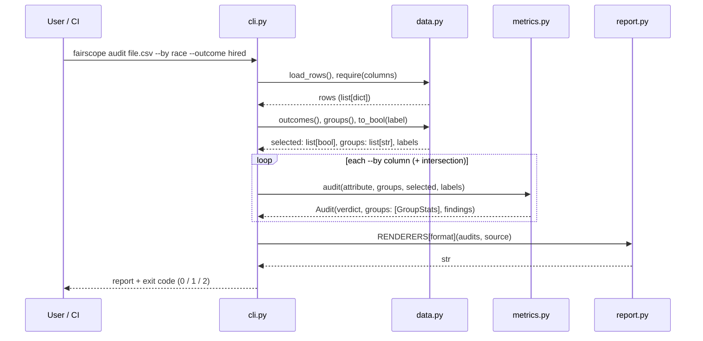

# Architecture

fairscope is four small modules in a straight pipeline. No module reaches back up the chain, and the values passed between them are plain Python: lists, strings and dataclasses.

## Modules

### `data.py`: input → columns
- `load_rows` reads a CSV (with BOM handling) into dicts.
- `require` checks every requested column up front and lists the ones that exist, so a typo fails fast with a useful message.
- `to_bool` accepts the many spellings of yes/no found in real exports and **rejects** anything else instead of guessing.
- `outcomes` either reads a decision column or thresholds a score. With no cutoff it uses the median, which is the LL144 *scoring rate*.
- `groups` builds a label per row. Several attributes are joined with ` × `, which is all intersectionality needs. Blank values become `Unknown`, so they are counted instead of dropped.

### `metrics.py`: columns → judgement
The core is `audit()`, a single pass that:
1. counts records and selections per group (`Counter`);
2. marks groups under `min_share` as *excluded*: shown in the report, but never used as the benchmark and never driving the verdict;
3. picks the **benchmark** (highest selection rate among eligible groups) and computes each group's impact ratio against it;
4. runs a two-proportion z-test of each group **against the benchmark**. This is the comparison the impact ratio describes, and it avoids flagging a group that is above average but still under 0.80 of the best group;
5. computes TPR/FPR per group when labels exist, and the max–min gap across eligible groups;
6. combines everything into `PASS` / `REVIEW` / `FAIL` plus readable `findings`.

`two_proportion_p` uses `math.erfc` for the normal tail, so there is no SciPy dependency.

### `report.py`: judgement → output
Four pure functions with the same signature `(audits, source) -> str`, registered in `RENDERERS`. The HTML renderer produces a single self-contained file: inline CSS with light/dark tokens and hand-built SVG bar charts. It has no JavaScript or external requests, so it can be emailed, attached to a ticket or archived as audit evidence.

### `cli.py`: orchestration
Parses arguments, runs one `audit()` per `--by` column (plus the intersection), chooses a renderer from `--format` or the output file extension, and maps the worst verdict to an exit code. Input errors (`OSError`, `ValueError`) become exit code 2 with a one-line message, never a traceback.

## Design decisions

| Decision | Why |
|---|---|
| **Standard library only** | Runs anywhere Python runs (CI images, locked-down compliance laptops, air-gapped servers). Nothing to audit in the supply chain of an auditing tool. |
| **Works on decision logs, not models** | The people responsible for fairness (HR, compliance, auditors) usually have the outputs, not the model. It also works the same for vendor black boxes. |
| **Significance + ratio, not ratio alone** | A 0.75 ratio on 12 people is noise, and a 0.79 ratio on 50,000 is not. Both facts are shown. Only the combination escalates to FAIL. |
| **REVIEW as a distinct state** | Gives teams a "look at this" signal without blocking releases on noisy data. `--fail-on review` makes it strict. |
| **3-decimal impact ratios** | Two decimals would show 0.798 as "0.80" next to a red FAIL bar. |
| **Exit codes as the API for CI** | `0/1/2` lets any CI system use it as a gate without parsing output. |

## Extension points

- **New metric:** add a field to `GroupStats`, compute it in `audit()`, and add a column in the renderers you care about.
- **New output format:** write `fn(audits, source) -> str` and add it to `RENDERERS`. The CLI picks it up automatically.
- **New input source** (Parquet, SQL): produce `groups`, `selected` and optionally `labels` lists and call `audit()` directly. `data.py` is the only CSV-specific part.
