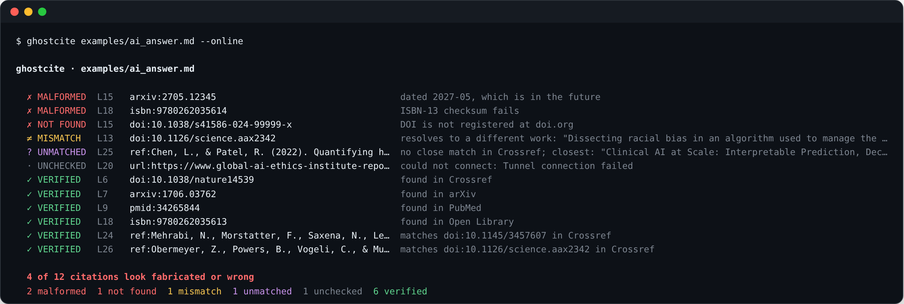
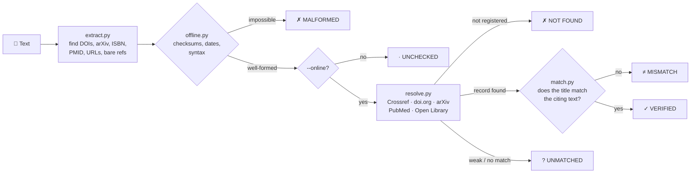

<div align="center">

# 👻 ghostcite

**Catch fabricated citations in AI-generated text before they reach a court, a journal, or a patient.**

Zero dependencies · Pure Python 3.9+ · Works offline · ~650 lines you can read in one sitting

</div>



---

## The problem

Large language models write references that *look* perfect: plausible authors, a real journal, a well-formed DOI. Many don't exist, and some point to a different paper entirely.

- **Courts.** Lawyers have been sanctioned again and again for filing briefs that cite cases invented by chatbots (*Mata v. Avianca*, S.D.N.Y. 2023, was the first widely reported one). Since then judges have logged hundreds more.
- **Science.** Studies of chatbot-written literature reviews keep finding that a large share of the references are fabricated or contain errors. Some of these have made it through peer review.
- **Health & policy.** Government and medical reports have had to be withdrawn or corrected after readers found citations to studies that were never written.

Checking every reference by hand is slow, so it often gets skipped. **ghostcite does the first pass in seconds** and tells you which references a person needs to look at.

## What it does

ghostcite reads any text (Markdown, plain text, a pasted chatbot answer), finds every citation, and runs two passes on each one:

| Pass | Needs network? | Catches |
|---|---|---|
| **Offline** | No | Bad ISBN checksums · impossible arXiv IDs (month 13, future dates, wrong digit count, retired formats) · malformed DOIs · placeholder domains · publication years in the future |
| **Online** (`--online`) | Yes | DOIs that aren't registered · arXiv/PubMed IDs that don't exist · **real identifiers attached to the wrong paper** · dead links and made-up domains · reference-list entries with no match in Crossref |

The **mismatch** check is the one that matters most. A common hallucination is a *real* DOI paired with a made-up title. A simple "does this link work?" check passes it. ghostcite fetches the registry's record and compares its title with the text around the citation.

## How it works



### Verdicts

| Verdict | Meaning | Fails the run? |
|---|---|:-:|
| ✗ `malformed` | Can't exist: checksum, date or syntax is impossible | ✅ |
| ✗ `not_found` | The authoritative registry says this ID doesn't exist | ✅ |
| ≠ `mismatch` | The ID exists but belongs to a different work | ✅ |
| ? `unmatched` | No close match found. Weaker evidence, because registries have gaps | with `--strict` |
| · `unchecked` | Well-formed but not looked up (offline mode, or the site blocks bots) | — |
| ✓ `verified` | Exists, and its title matches the citing text | — |

ghostcite would rather leave something `unchecked` than call a real paper fake. Network errors and HTTP 403s are never reported as fabrications.

## Quick start

```bash
git clone https://github.com/kareemrt/EthicalAI && cd EthicalAI/ghostcite

python -m ghostcite examples/ai_answer.md            # offline: instant, private
python -m ghostcite examples/ai_answer.md --online   # verify against open registries
```

Or install the `ghostcite` command with `pip install .`.

### Everyday use

```bash
pbpaste | ghostcite --online                 # check a chatbot answer from the clipboard
ghostcite brief.md --only doi,ref --online   # only certain kinds of citation
ghostcite paper.md --online -f md > CHECK.md # Markdown table for a PR or review
ghostcite notes.md --online -f json | jq '.findings[] | select(.verdict=="mismatch")'
```

| Flag | Purpose |
|---|---|
| `-o, --online` | Look citations up in public registries |
| `-f, --format text\|md\|json` | Output format (default `text`) |
| `--only doi,arxiv,isbn,pmid,url,ref` | Check only some kinds of citation |
| `--strict` | Also fail on `unmatched` |
| `-j, --workers N` | Number of lookups to run in parallel (default 4) |
| `--no-color` | Plain output (`NO_COLOR` is also respected) |

**Exit codes:** `0` clean · `1` suspect citations found · `2` usage error. That makes it easy to use as a CI gate for generated docs, knowledge bases or RAG answer logs.

### As a library

```python
from ghostcite import check_text

for f in check_text(answer, online=True):
    if f.verdict in {"malformed", "not_found", "mismatch"}:
        print(f.citation.line, f.citation.value, "→", f.reason)
```

### In CI

```yaml
- run: pip install ./ghostcite
- run: ghostcite docs/*.md --online --only doi,arxiv,pmid
```

## Codebase structure

```
ghostcite/
├── ghostcite/
│   ├── __init__.py     Public API: check_text, check_citation, extract
│   ├── __main__.py     Lets you run `python -m ghostcite`
│   ├── models.py       Citation / Record / Finding dataclasses and the verdict scale
│   ├── extract.py      Regex extractors + "is this line a reference?" heuristic + context window
│   ├── offline.py      ISBN-10/13 checksums, arXiv ID rules, DOI syntax, placeholder domains, future years
│   ├── match.py        Title-coverage scoring: does a registry record describe the citing text?
│   ├── resolve.py      One small function per registry; HTTP is injectable, so tests never touch the network
│   ├── core.py         Pipeline: extract → offline → online (thread pool), sorted worst-first
│   ├── report.py       Terminal (colour), Markdown and JSON renderers
│   └── cli.py          argparse front-end and exit codes
├── tests/
│   └── test_ghostcite.py   20 offline tests: extraction, checks, matching, resolvers (faked), CLI
├── examples/
│   └── ai_answer.md    A realistic chatbot answer mixing real and invented sources
├── docs/
│   └── demo.png        Screenshot of a real --online run on the example
└── pyproject.toml      Packaging; no runtime dependencies
```

**Data flow:** `cli.main` → `core.check_text` → `extract.extract` gives a list of `Citation`s → for each one, `offline.check`, then `resolve.RESOLVERS[kind]` (which uses `match.compare`) gives a `Finding` → `report.*`.

**To add a registry:** write a `fn(citation, get) -> Finding` in `resolve.py`, register it in `RESOLVERS`, and add a regex to `extract.py`. That's all.

## Design choices

- **No dependencies.** Only the standard library (`urllib`, `json`, `xml`, `re`), so you can audit it, vendor it, or run it in an air-gapped review room.
- **Private by default.** Without `--online`, nothing leaves your machine. With it, only the identifiers (and, for bare references, the reference text) are sent to the public registries listed below. The User-Agent is generic.
- **Explains every verdict.** Each finding says *why*, e.g. "ISBN-13 checksum fails" or "resolves to a different work: …". There's no opaque score.
- **Tuned against false accusations.** Uncertain results are `unmatched` or `unchecked`, never `not_found`. Prose such as "by 2030" doesn't trigger the future-date check. Titles that wrap onto the next line are still matched.
- **Fast.** Offline checks are instant. Online lookups run in parallel: the 12-citation example finishes in about 1.5 s.

### Registries used (all free and open)

| Kind | Source |
|---|---|
| DOI | [Crossref REST API](https://api.crossref.org), then the [doi.org handle API](https://www.doi.org/) for non-Crossref DOIs (DataCite, etc.) |
| arXiv | [arXiv export API](https://info.arxiv.org/help/api/) |
| PMID | [NCBI E-utilities](https://www.ncbi.nlm.nih.gov/books/NBK25501/) |
| ISBN | [Open Library](https://openlibrary.org/developers/api) |
| Bare reference | Crossref bibliographic search |

## Limitations

- **Legal case citations** (e.g. *123 F.3d 456*) aren't checked yet. They need a case-law source such as CourtListener, which is the most-requested next step.
- **A citation can be real and still not support the claim.** ghostcite checks that a source *exists and is the work named*, not that it says what the text claims it says.
- Open Library and Crossref don't cover everything (books, grey literature, non-English venues). That's why misses on those sources are reported as `unmatched`, not `not_found`.
- Some websites block automated requests. Those links stay `unchecked`.

## Run the tests

```bash
python -m unittest discover -s tests -v     # 20 tests, no network needed
```

## License

MIT
