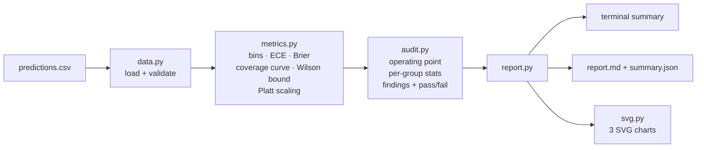

# handoff

**Know when your AI should hand a decision to a human.**

`handoff` audits a classifier's *confidence*: whether a "95% sure" really means
95%, which cases are safe to automate, which must go to a person, and whether
that line is drawn fairly across groups. It reads one CSV of predictions,
uses only the Python standard library, and finishes in under a second.

```bash
python -m handoff predictions.csv --group site --target 0.95 --out report/
```

---

## Why this matters

AI systems are now sorting medical images, flagging fraud, moderating posts and
pre-screening benefit claims. Nearly every deployment uses the same safety
valve: *if the model isn't confident, send the case to a human.*

That valve only works if the confidence numbers are honest, and often they
aren't:

- **Modern neural networks tend to be overconfident.** A model that says
  "97%" may be right 85% of the time. Calibration is well-studied, but
  teams rarely check it before shipping.
- **Confidence can be less honest for some people than others.** A model
  trained mostly on one population can stay just as "sure" on the people it
  knows least about. Dermatology classifiers trained on lighter skin are a
  well-documented example.
- **The review threshold is usually a guess.** Teams pick "0.9" because it
  sounds safe. Nobody says what accuracy the automated cases will actually
  get, or how many cases will land on reviewers' desks.

A broken safety valve is worse than none, because people trust it.
`handoff` turns "send uncertain cases to a human" from a vague promise into a
number you can check, defend and monitor.

## What it tells you

| Question | How `handoff` answers it |
|---|---|
| Does the model's confidence mean what it says? | Reliability diagram, **ECE**, **MCE**, Brier score |
| Can the scores be fixed? | Fits **Platt scaling** on half the data and scores it on the other half, so the fix is measured honestly |
| Where should the human-review line go? | The widest automation rate whose accuracy, at its **95% Wilson lower bound**, still meets your target |
| What does that cost? | The share of cases that goes to people, overall and per group |
| Is it fair? | Calibration error, review rate and automated accuracy **for each group**, with a flag when one global threshold leaves a group below target |
| Can CI enforce it? | Exit code `0` on pass, `1` on fail, `2` on bad input |

## Example: a skin-lesion triage model

The repository ships a **synthetic** dataset (`examples/triage.csv`, 4,000
cases, no real patients) that copies a documented failure pattern: the model is
weaker on darker skin (Fitzpatrick V-VI) but nearly as confident there.

```text
$ python -m handoff examples/triage.csv --group skin_type --out docs/example

handoff audit  ·  4000 predictions  ·  target 95.0%
accuracy 85.1%   mean confidence 95.3%   ECE 10.2%   MCE 25.3%   Brier 0.119

FAIL  Miscalibrated: ECE 10.2% > 5.0%. The model is overconfident (says 95.3%, is right 85.1%).
FIX   Platt scaling (a=0.59, b=-0.63) cuts held-out ECE 10.2% -> 1.4%. Apply it before trusting raw scores.
PLAN  Automate when confidence >= 0.995: the AI decides 45.4% of cases at 96.0% accuracy (>= 95.0% with 95% confidence); 54.6% go to a human.
FAIL  Calibration gap between groups: 'V-VI' ECE 16.8% vs 'I-II' 8.2%. Its confidence scores mean less.
FAIL  Group 'V-VI': automated accuracy 93.2% (n=118) is below the 95.0% target. One global threshold does not protect this group.
NOTE  'V-VI' cases go to a human 1.8x as often as 'I-II' (79.9% vs 45.2%). Staff review queues accordingly.

group               n      acc     conf     ECE  to human  auto acc
I-II             1822    88.7%    96.9%    8.2%     45.2%     96.1%
III-IV           1592    85.8%    96.0%   10.2%     56.1%     96.4%
V-VI              586    71.8%    88.6%   16.8%     79.9%     93.2%

RESULT: FAIL
```

A typical "automate above 0.9" rule would have automated 88% of cases at only
90% accuracy, and 84% for V-VI patients. `handoff` finds a line that meets the target overall, and
then shows that the same line still lets darker-skinned patients through at
93%.

### The charts it draws

The charts are plain SVG and follow your light or dark theme.

<p align="center">
  
</p>

**Reliability diagram.** Points below the dashed diagonal mean the model is
overconfident. The orange line shows the same model after Platt scaling,
measured on held-out rows.

<p align="center">
  
</p>

**Coverage vs. accuracy.** Read left to right: automate only the most confident
cases, then include more. The ring marks the chosen operating point, where
the *lower bound* (orange) still meets the target. Using the lower bound means
a small, lucky set of cases can't justify automating too much.

<p align="center">
  
</p>

**Per-group reliability.** At the same confidence, a V-VI case is less likely
to be classified correctly. (Drawn when there are two or three groups; with
more, see the table in `report.md`.)

The full generated report is in [`docs/example/report.md`](docs/example/report.md).

## How it works



1. **Calibration.** Predictions are put into ten equal-width confidence bins.
   ECE is the count-weighted gap between average confidence and accuracy in
   each bin. MCE is the worst bin.
2. **Recalibration.** It fits `c' = sigmoid(a·logit(c) + b)` with damped
   Newton steps on log-loss, using even rows, and scores it on odd rows.
   `a < 1` means the raw scores are too extreme.
3. **Operating point.** It sorts cases by confidence and, for every possible
   cut-off, computes the accuracy of the cases above it plus the Wilson 95%
   lower bound on that accuracy. It picks the widest coverage whose lower
   bound meets `--target`.
4. **Groups.** It repeats the calibration and review-rate maths for each
   value of `--group`, then flags calibration gaps and any group whose
   automated accuracy falls below target.

## Usage

### Input

One row per prediction. Two layouts are accepted, and `handoff` detects which
one you have:

| Layout | Columns | Use for |
|---|---|---|
| Top-label | `confidence`, `correct` | Any classifier, including multiclass. `confidence` = probability of the predicted class; `correct` = `1`/`0` |
| Binary | `score`, `label` | Binary classifiers. `score` = P(class 1); `label` = true class |

Any extra columns are ignored unless you name one with `--group`.

### Options

| Flag | Default | Meaning |
|---|---|---|
| `-g, --group COL` | – | Break results down by this column (site, age band, language…) |
| `-t, --target P` | `0.95` | Accuracy the AI must reach on the cases it decides alone |
| `--max-ece P` | `0.05` | Fail if overall calibration error is above this |
| `--max-gap P` | `0.03` | Fail if group ECEs differ by more than this |
| `-o, --out DIR` | – | Write `report.md`, `summary.json`, `reliability.svg`, `coverage.svg`, `groups.svg` |

### As a library

```python
from handoff import load_csv, run_audit

audit = run_audit(load_csv("preds.csv", group_col="site"), target=0.97)
print(audit.ece, audit.operating_point.threshold)
for line in audit.findings:
    print(line)
```

### In CI

```yaml
- run: python -m handoff eval/predictions.csv --group region --target 0.95
  # fails the build if the model drifts out of calibration or a group falls below target
```

## Install & test

No dependencies. Python 3.8 or later.

```bash
cd handoff
python -m handoff examples/triage.csv -g skin_type     # run the demo
python -m unittest discover -s tests                   # 12 tests, < 1 s
pip install .                                          # optional: adds the `handoff` command
python examples/make_triage.py > examples/triage.csv   # regenerate the demo data
```

## Codebase structure

```text
handoff/
├── handoff/              # the package (≈ 500 lines, stdlib only)
│   ├── __init__.py       # public API: load_csv, run_audit, Prediction, Audit
│   ├── __main__.py       # enables `python -m handoff`
│   ├── cli.py            # argument parsing, exit codes
│   ├── data.py           # CSV loading, layout detection, input validation
│   ├── metrics.py        # pure maths: bins, ECE/MCE/Brier, coverage curve,
│   │                     #   Wilson bound, Platt scaling
│   ├── audit.py          # combines metrics into an Audit + plain-English findings
│   ├── report.py         # terminal text, Markdown, JSON, chart assembly
│   └── svg.py            # ~90-line theme-aware SVG line-chart renderer
├── examples/
│   ├── make_triage.py    # seeded generator for the synthetic demo data
│   └── triage.csv        # 4,000 synthetic dermatology-triage predictions
├── docs/example/         # the generated report and charts shown above
├── tests/
│   └── test_handoff.py   # metrics, audit logic, CLI, end-to-end
└── pyproject.toml        # packaging + `handoff` console script
```

**Design rules:** `metrics.py` has no I/O and no state, so every number is a
pure function you can test. `audit.py` makes the decisions. `report.py` and
`svg.py` only present them. Adding a new output format never touches the maths.

## Limits, and how to use this responsibly

- **Your evaluation data must look like production.** A threshold chosen on
  clean benchmark data won't protect anyone from distribution shift. Re-run
  the audit on fresh, labelled samples regularly.
- **Small groups give wide uncertainty.** A per-group accuracy from 50 cases
  is a warning sign, not a verdict. The `n` column is there for a reason.
- **A global threshold may not be enough.** If a group fails, the honest fixes
  are better data for that group, per-group recalibration, or sending that
  group's cases to review more often. Each has legal and ethical trade-offs
  that people should decide, not a script.
- **Deferral is only as good as the reviewers.** Routing 55% of cases to
  people who have 10 seconds each is not oversight. Use the review-rate
  figures to staff the queue properly.
- **The demo data is synthetic.** It shows a realistic pattern, not any real
  product's performance.

## License

MIT
