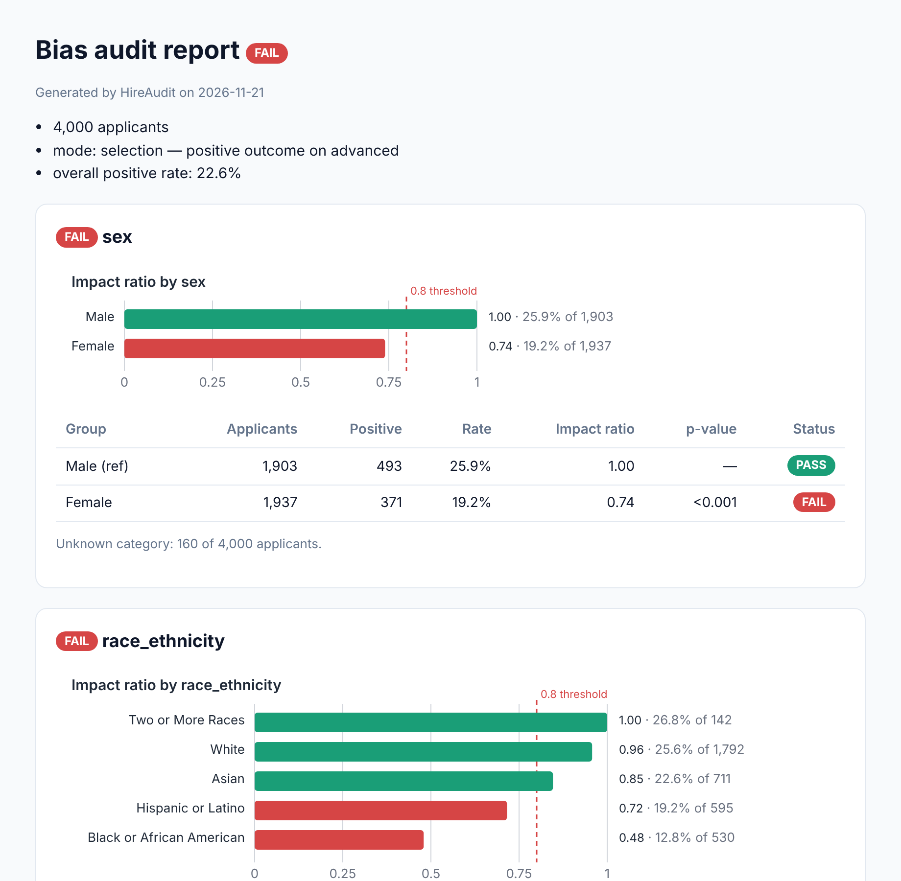
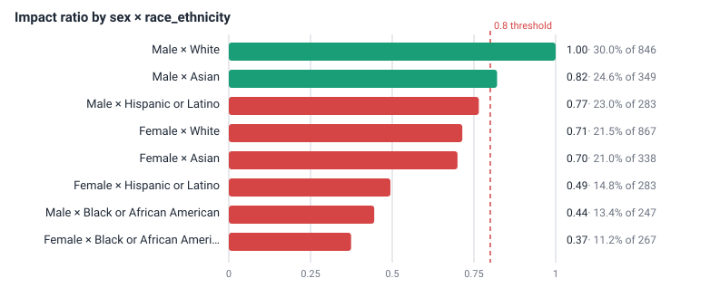
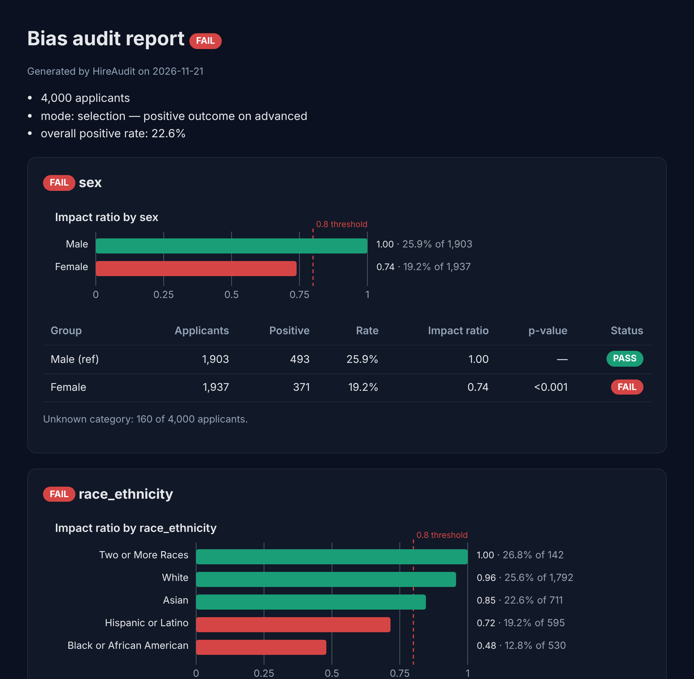
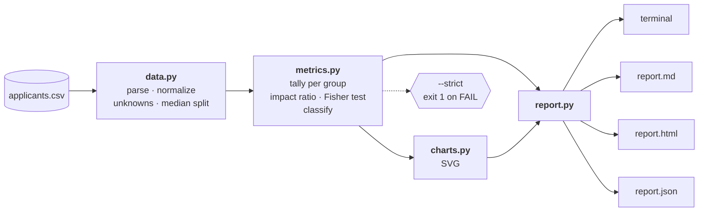

<div align="center">

# ⚖️ HireAudit

**Open, dependency-free bias audits for automated hiring tools.**

Feed it a CSV of who an AI screener advanced. Get back impact ratios, significance tests,
intersectional breakdowns and a shareable report — in about a second.




</div>

---

## Contents

- [The problem](#the-problem)
- [What HireAudit does](#what-hireaudit-does)
- [Quick start](#quick-start)
- [Example: auditing a résumé screener](#example-auditing-a-résumé-screener)
- [How it works](#how-it-works)
- [Reading the results](#reading-the-results)
- [Usage reference](#usage-reference)
- [Codebase structure](#codebase-structure)
- [Limitations & responsible use](#limitations--responsible-use)
- [References](#references)

---

## The problem

Most large employers now use software to rank résumés, score video interviews or filter
applicants before a human ever looks. When these systems learn from past hiring decisions,
they can quietly reproduce past discrimination — at a scale no single recruiter could.

Regulators have noticed:

| Rule | What it requires |
|:--|:--|
| **NYC Local Law 144** (enforced since July 2023) | An independent **bias audit** of any automated employment decision tool every year, reporting **impact ratios** by sex, race/ethnicity and their **intersections**, published publicly. |
| **EEOC Uniform Guidelines** (29 CFR 1607.4) | The **four-fifths rule**: a selection rate below 80% of the highest group's rate is evidence of adverse impact. |
| **EU AI Act** (Annex III) | AI used in recruitment is classified **high-risk**, requiring bias monitoring and documentation. |

Yet the tooling is either buried inside expensive consultancies or heavyweight ML libraries
that HR, compliance and small vendors can't easily run. **The math is not hard — it should be
free, transparent and runnable by anyone.**

## What HireAudit does

- 📊 **Selection-rate and scoring-rate audits** — matches both LL144 audit types (yes/no outcomes, or numeric scores split at the median).
- ⚖️ **Impact ratios + four-fifths rule** for every demographic column.
- 🔀 **Intersectional analysis** (e.g. *Female × Black*) — where bias often hides when single attributes look fine.
- 🧪 **Exact significance tests** (two-sided Fisher exact) so small, noisy groups aren't over- or under-flagged.
- 🙈 **Honest handling of missing data** — unknown categories are counted and reported, never silently dropped; tiny groups (< 2%) are shown but excluded from comparison, as LL144 permits.
- 📝 **Four output formats** — terminal, Markdown, self-contained HTML (light/dark), and JSON for pipelines.
- 🚦 **CI gate** — `--strict` exits non-zero on a FAIL, so a biased model can block its own release.
- 🪶 **Zero dependencies**, ~550 lines of readable, standard-library Python.

## Quick start

```bash
git clone https://github.com/kareemrt/EthicalAI.git
cd EthicalAI/hireaudit

# run directly (nothing to install) ...
python -m hireaudit examples/applicants.csv --groups sex race_ethnicity --outcome advanced

# ... or install the `hireaudit` command
pip install .
hireaudit examples/applicants.csv -g sex race_ethnicity -o advanced --out report/
```

Your data needs just one row per applicant, one column per demographic attribute, and either
an outcome column or a score column:

```csv
applicant_id,sex,race_ethnicity,score,advanced
A00001,Female,White,58.5,no
A00002,Male,Asian,74.2,yes
A00003,,Declined,66.0,no        ← blanks/"Declined" are counted as unknown
```

## Example: auditing a résumé screener

[`examples/applicants.csv`](examples/applicants.csv) contains 4,000 **synthetic** applicants
scored by a fictional AI screener with a hidden penalty against some groups
(see [`generate_sample.py`](examples/generate_sample.py)). HireAudit finds it:

```text
$ python -m hireaudit examples/applicants.csv -g sex race_ethnicity -o advanced

▸ sex  [FAIL]  (unknown: 160)
  Group       Applicants  Positive   Rate  Impact ratio  p-value  Status
  Male (ref)       1,903       493  25.9%          1.00        —    PASS
  Female           1,937       371  19.2%          0.74   <0.001    FAIL

▸ race_ethnicity  [FAIL]  (unknown: 177)
  Group                             Applicants  Positive   Rate  Impact ratio  p-value    Status
  Two or More Races (ref)                  142        38  26.8%          1.00        —      PASS
  White                                  1,792       459  25.6%          0.96    0.765      PASS
  Asian                                    711       161  22.6%          0.85    0.328      PASS
  Hispanic or Latino                       595       114  19.2%          0.72   0.0498      FAIL
  Black or African American                530        68  12.8%          0.48   <0.001      FAIL
  Native American or Alaska Native          53        13  24.5%             —        —  EXCLUDED
```

The intersectional view shows how the penalties **compound** — Black women are advanced at
just over a third the rate of White men:

<p align="center"></p>

Full generated output: [Markdown](examples/report/report.md) ·
[HTML](examples/report/report.html) · [JSON](examples/report/report.json).
The HTML report adapts to dark mode:

<p align="center"></p>

## How it works



For each attribute (and their intersection):

| Step | Formula |
|:--|:--|
| Selection rate | `selected ÷ applicants` in the category |
| Scoring rate *(score mode)* | share of the category scoring **above the overall median** |
| Reference group | the included category with the highest rate |
| Impact ratio | `category rate ÷ reference rate` |
| Significance | two-sided **Fisher exact test**, category vs. reference (exact, via log-gamma — fast at any size) |
| Exclusion | categories under `--min-share` (default 2%) of known data are reported but not compared |

## Reading the results

Impact ratios alone mislead in both directions: a 6-person group can dip below 0.8 by chance,
and with 100,000 applicants a tiny, real gap can sit just above it. HireAudit combines both signals:

| Status | Impact ratio < threshold | p < α | Interpretation |
|:--|:-:|:-:|:--|
| 🔴 **FAIL** | ✔ | ✔ | Strong evidence of adverse impact. Investigate before use. |
| 🟡 **REVIEW** | ✔ | ✘ | Large gap, but sample too small to be sure. Collect more data. |
| 🟡 **REVIEW** | ✘ | ✔ | Statistically real gap that passes the 4/5 rule. Worth understanding. |
| 🟢 **PASS** | ✘ | ✘ | No evidence of adverse impact at these settings. |
| ⚪ **EXCLUDED** | — | — | Category too small to compare; still reported for transparency. |

> **Note** — the reference is whichever group has the highest rate, even a small one
> (above: *Two or More Races*, n = 142). That's how LL144 defines it, and it's exactly why
> HireAudit attaches a p-value to every comparison.

## Usage reference

```text
hireaudit CSV -g COL [COL ...] (-o COL | -s COL) [options]

  -g, --groups COL ...    demographic column(s); 2+ columns also audits their intersection
  -o, --outcome COL       yes/no outcome column            (selection-rate mode)
  -s, --score COL         numeric score column             (scoring-rate mode)
  --positive VALUE ...    values meaning "yes" (default: 1, yes, true, hired, advanced, ...)
  --threshold 0.8         impact-ratio threshold (four-fifths rule)
  --alpha 0.05            significance level
  --min-share 0.02        exclude categories below this share of known data
  --no-intersect          skip the intersectional audit
  --out DIR               write report.md, report.html, report.json, charts/*.svg
  --strict                exit 1 if any group FAILs
```

Exit codes: `0` ok · `1` FAIL under `--strict` · `2` bad input.

**As a CI fairness gate** — block a model release if its validation decisions show adverse impact:

```yaml
# .github/workflows/fairness.yml
- run: python -m hireaudit predictions.csv -g sex race -o predicted_hire --strict --out audit/
- uses: actions/upload-artifact@v4
  if: always()
  with: { name: bias-audit, path: audit/ }
```

**As a library:**

```python
from hireaudit import load, audit_all, Config

ds = load("predictions.csv", groups=["sex", "race"], outcome="predicted_hire")
for a in audit_all(ds, Config(threshold=0.8, alpha=0.01)):
    print(a.attribute, a.status, [(g.name, round(g.impact_ratio or 0, 2)) for g in a.groups])
```

**Run the tests:**

```bash
python -m unittest discover tests      # 13 tests, < 0.1 s
```

## Codebase structure

```text
hireaudit/
├── hireaudit/                 the package — stdlib only
│   ├── __init__.py            public API: load, audit, audit_all, Config, fisher_exact
│   ├── __main__.py            enables `python -m hireaudit`
│   ├── cli.py                 argument parsing, orchestration, file output, exit codes
│   ├── data.py                CSV → Dataset: column checks, unknown handling, median split
│   ├── metrics.py             Group/Audit models, impact ratios, Fisher exact test, status rules
│   ├── charts.py              theme-aware SVG bar chart, no plotting library
│   └── report.py              renderers: terminal table, Markdown, HTML, JSON
├── tests/
│   └── test_hireaudit.py      statistics vs. reference values, edge cases, CLI end-to-end
├── examples/
│   ├── generate_sample.py     seeded synthetic dataset with injected bias
│   ├── applicants.csv         4,000 synthetic applicants
│   └── report/                generated output (md, html, json, charts/)
├── docs/                      README images
└── pyproject.toml             packaging; installs the `hireaudit` command
```

**Design choices**

| Module | Responsibility | Depends on |
|:--|:--|:--|
| `data.py` | The only code that touches files. Everything downstream works on a plain `Dataset` of `(categories, positive)` tuples, so other sources (a DataFrame, a database) only need a new loader. | — |
| `metrics.py` | Pure functions, no I/O. All statistical logic lives here and is unit-tested directly. | `data` |
| `charts.py` | Builds SVG as text: renders identically on GitHub, in browsers and inside the HTML report. | `metrics` |
| `report.py` | Formatting only. Every format is built from the same `rows()` helper, so they never disagree. | `metrics`, `charts` |
| `cli.py` | Thin glue: parse → load → audit → render → exit code. | all |

## Limitations & responsible use

- **An audit is evidence, not a verdict.** A FAIL means the outcomes differ in a way that demands
  explanation — the next question is whether the criteria are genuinely job-related.
- **A PASS is not a certificate of fairness.** Impact ratios measure *outcomes* only. They don't
  detect proxy discrimination in how candidates are treated, accessibility barriers, or harms to
  groups that weren't recorded.
- **Garbage in, garbage out.** Self-reported demographics are often incomplete; check the
  *unknown* counts before trusting a result.
- **Not legal advice.** LL144 requires the audit to be performed by an *independent* auditor.
  HireAudit gives that auditor — or the vendor preparing for one — transparent, reproducible numbers.
- **Privacy.** Demographic data is sensitive. HireAudit runs fully offline and only ever writes
  aggregate counts to its reports.

## References

- NYC Department of Consumer and Worker Protection — [Automated Employment Decision Tools (Local Law 144)](https://www.nyc.gov/site/dca/about/automated-employment-decision-tools.page), rules at 6 RCNY § 5-300.
- U.S. EEOC — [Uniform Guidelines on Employee Selection Procedures, 29 CFR § 1607.4(D)](https://www.ecfr.gov/current/title-29/subtitle-B/chapter-XIV/part-1607/section-1607.4).
- Regulation (EU) 2024/1689 (AI Act), Annex III §4 — employment and worker management as high-risk.
- Buolamwini & Gebru (2018), *Gender Shades* — why intersectional analysis matters.

---

<sub>Part of [EthicalAI](../README.md). The sample data is synthetic; no real applicants are represented.</sub>
