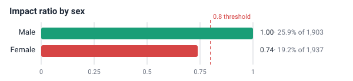
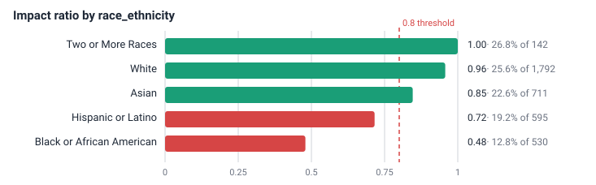
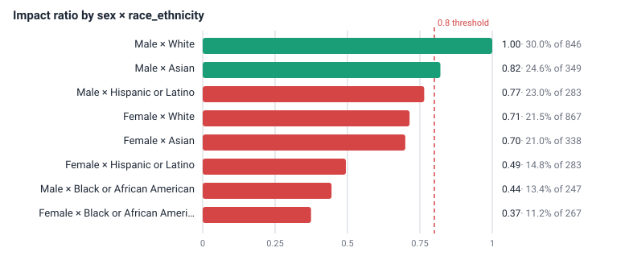

# Bias audit report — 🔴 FAIL

_Generated by HireAudit on 2026-11-21_

- 4,000 applicants
- mode: selection — positive outcome on `advanced`
- overall positive rate: 22.6%
- impact-ratio threshold: **0.8** · significance level: **0.05** · categories under **2%** of data excluded

## 🔴 sex

| Group | Applicants | Positive | Rate | Impact ratio | p-value | Status |
|:--|--:|--:|--:|--:|--:|:-:|
| Male (ref) | 1,903 | 493 | 25.9% | 1.00 | — | 🟢 PASS |
| Female | 1,937 | 371 | 19.2% | 0.74 | <0.001 | 🔴 FAIL |

Applicants with unknown category: **160** of 4,000.

## 🔴 race_ethnicity

| Group | Applicants | Positive | Rate | Impact ratio | p-value | Status |
|:--|--:|--:|--:|--:|--:|:-:|
| Two or More Races (ref) | 142 | 38 | 26.8% | 1.00 | — | 🟢 PASS |
| White | 1,792 | 459 | 25.6% | 0.96 | 0.765 | 🟢 PASS |
| Asian | 711 | 161 | 22.6% | 0.85 | 0.328 | 🟢 PASS |
| Hispanic or Latino | 595 | 114 | 19.2% | 0.72 | 0.0498 | 🔴 FAIL |
| Black or African American | 530 | 68 | 12.8% | 0.48 | <0.001 | 🔴 FAIL |
| Native American or Alaska Native | 53 | 13 | 24.5% | — | — | ⚪ EXCLUDED |

Applicants with unknown category: **177** of 4,000.

## 🔴 sex × race_ethnicity

| Group | Applicants | Positive | Rate | Impact ratio | p-value | Status |
|:--|--:|--:|--:|--:|--:|:-:|
| Male × White (ref) | 846 | 254 | 30.0% | 1.00 | — | 🟢 PASS |
| Male × Asian | 349 | 86 | 24.6% | 0.82 | 0.0667 | 🟢 PASS |
| Male × Hispanic or Latino | 283 | 65 | 23.0% | 0.77 | 0.0223 | 🔴 FAIL |
| Female × White | 867 | 186 | 21.5% | 0.71 | <0.001 | 🔴 FAIL |
| Female × Asian | 338 | 71 | 21.0% | 0.70 | 0.00152 | 🔴 FAIL |
| Female × Hispanic or Latino | 283 | 42 | 14.8% | 0.49 | <0.001 | 🔴 FAIL |
| Male × Black or African American | 247 | 33 | 13.4% | 0.44 | <0.001 | 🔴 FAIL |
| Female × Black or African American | 267 | 30 | 11.2% | 0.37 | <0.001 | 🔴 FAIL |
| Male × Native American or Alaska Native | 26 | 9 | 34.6% | — | — | ⚪ EXCLUDED |
| Male × Two or More Races | 65 | 19 | 29.2% | — | — | ⚪ EXCLUDED |
| Female × Two or More Races | 72 | 17 | 23.6% | — | — | ⚪ EXCLUDED |
| Female × Native American or Alaska Native | 26 | 4 | 15.4% | — | — | ⚪ EXCLUDED |

Applicants with unknown category: **331** of 4,000.

## How to read this report

| Status | Meaning |
|:--|:--|
| 🔴 FAIL | Impact ratio below threshold **and** statistically significant — strong evidence of adverse impact. |
| 🟡 REVIEW | Only one signal fired: a low ratio that may be noise (small group), or a significant gap above the threshold. |
| 🟢 PASS | Neither signal fired. |
| ⚪ EXCLUDED | Category is under the minimum share of data; reported but not compared. |

An audit is evidence, not a verdict. Investigate flagged groups together with the
job-relatedness of the criteria the tool uses.
