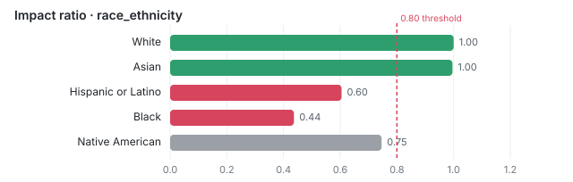
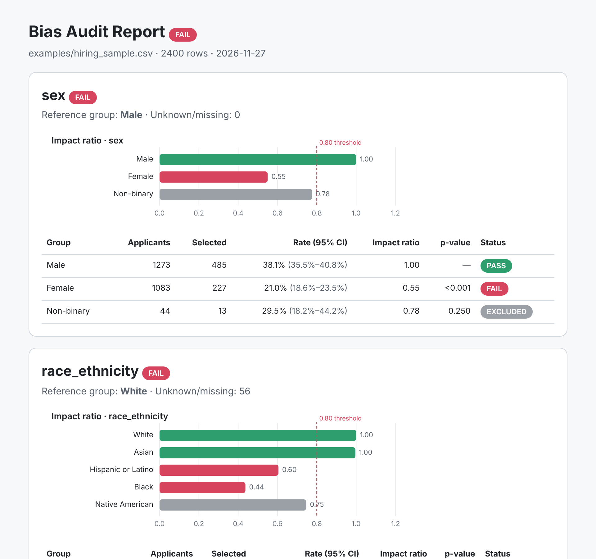
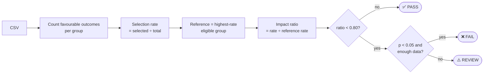

<div align="center">

# ⚖️ Impartial

**Find out if your hiring algorithm is fair, before it hurts someone.**

A zero-dependency Python tool that audits automated decisions (hiring, lending, admissions)
for adverse impact, then writes a report people without a statistics background can read.

`Python 3.10+` · `stdlib only` · `~500 lines` · `MIT`



</div>

---

## The problem

Most large employers now screen applicants with software: résumé rankers, assessment
scorers, video-interview graders. These tools can pass along historical bias at scale,
and the people affected rarely learn that it happened.

Regulators have started requiring checks:

| Rule | What it asks for |
|---|---|
| **NYC Local Law 144** (in force since 2023) | An independent **bias audit** of automated employment decision tools every year, reporting selection rates and **impact ratios** by sex, race/ethnicity and their intersection |
| **EEOC four-fifths rule** (US) | A group whose selection rate is under **80%** of the top group's rate is evidence of adverse impact |
| **EU AI Act** (high-risk systems) | Recruitment AI is classed *high-risk* and needs bias monitoring and data-governance records |
| **Colorado AI Act** | Duty of care against algorithmic discrimination in consequential decisions |

Commercial audits cost thousands of dollars, and the open-source fairness libraries are
built for ML engineers, with heavy dependencies and outputs that a hiring manager, union rep
or journalist can't easily use. **Impartial** sits between the two: you give it one CSV and
get an answer within seconds.

## What it does

```text
$ impartial applicants.csv --groups sex race_ethnicity --outcome hired

■ race_ethnicity  →  FAIL   (reference: White, unknown: 56)
  group                    n     rate   ratio        p  status
  White                 1093    37.2%    1.00        —  PASS
  Asian                  337    37.1%    1.00    0.962  PASS
  Hispanic or Latino     484    22.5%    0.60   <0.001  FAIL
  Black                  412    16.3%    0.44   <0.001  FAIL
  Native American         18    27.8%    0.75    0.410  EXCLUDED
```

- 📊 **Selection rates and impact ratios** for each group, following the LL144 method
- 🔀 **Intersectional analysis** (e.g. *Female × Black*), where bias that averages out at the single-attribute level often shows up
- 🧪 **Significance testing** (two-proportion z-test and Wilson 95% CIs), so a real pattern isn't confused with noise
- 🫥 **Honest about missing data**: unknown values are counted and disclosed, never silently dropped
- 🔢 **Score mode**: audits numeric model scores using the LL144 *scoring rate* (share above the median)
- 📝 **Five output formats**: terminal, Markdown, standalone HTML, JSON, SVG
- 🚦 **CI-ready exit codes**: block a model release that fails the audit

<p align="center"></p>

## Quick start

```bash
git clone https://github.com/kareemrt/EthicalAI.git && cd EthicalAI/impartial

# run it right away (no install step, no dependencies)
python -m impartial examples/hiring_sample.csv -g sex race_ethnicity -o hired

# shareable HTML report
python -m impartial examples/hiring_sample.csv -g sex race_ethnicity -o hired -f html --out report.html

# audit raw model scores instead of final decisions
python -m impartial examples/hiring_sample.csv -g sex race_ethnicity -s model_score

# optional: install the `impartial` command
pip install .
```

### Your data

You need one row per person, and nothing beyond that:

| applicant_id | sex | race_ethnicity | model_score | hired |
|---|---|---|---|---|
| A00001 | Female | Black | 58.2 | 0 |
| A00002 | Male | White | 71.9 | 1 |
| A00003 | Female | *(blank)* | 64.0 | 1 |

- **Outcome columns** accept `1/0`, `true/false`, `yes/no`, `hired`, `selected`, `approved`, `pass`, `advanced`.
- **Blank, `NA`, `unknown`, `?`** are treated as *unknown* and reported in a separate count.
- Names and IDs are never read, so you can strip them before running.

### Options

| Flag | Default | Meaning |
|---|---|---|
| `-g, --groups COL…` | *required* | Protected-attribute column(s) |
| `-o, --outcome COL` | — | Yes/no decision column |
| `-s, --score COL` | — | Numeric score column (favourable = above median) |
| `-f, --format` | `text` | `text` · `md` · `html` · `json` · `svg` |
| `--out FILE` | stdout | Write the report to a file |
| `--threshold` | `0.8` | Impact-ratio cut-off (four-fifths rule) |
| `--min-share` | `0.02` | Groups smaller than this share are *excluded* (LL144 allows this, but their counts are still shown) |
| `--alpha` | `0.05` | Significance level |
| `--no-intersections` | off | Skip the combined-attribute table |
| `--strict` | off | Exit `1` on `REVIEW` as well as `FAIL` |

## How it decides



| Status | Meaning | What to do |
|---|---|---|
| ✅ **PASS** | Ratio ≥ 0.80 | Keep monitoring |
| ⚠️ **REVIEW** | Ratio < 0.80, but the sample is too small or noisy to be conclusive | Collect more data, look at the specific pipeline stage |
| ❌ **FAIL** | Ratio < 0.80 **and** statistically significant | Investigate features, retrain or recalibrate, and consider pausing the tool |
| ➖ **EXCLUDED** | Group is < 2% of the data | Counts are disclosed but the group is not scored. Treat as a data-collection gap |

**Exit codes:** `0` = pass · `1` = adverse impact found · `2` = input error. To gate a deployment:

```yaml
# .github/workflows/fairness.yml (excerpt)
- run: python -m impartial predictions.csv -g sex race -o selected --strict -f md --out audit.md
```

## Codebase structure

```text
impartial/
├── impartial/              # the package (stdlib only)
│   ├── __init__.py         # public API: load_csv, run_audit, audit_dimension
│   ├── __main__.py         # enables `python -m impartial`
│   ├── cli.py              # argument parsing, output routing, exit codes
│   ├── data.py             # CSV → (attributes, outcome) records; missing-value + score handling
│   ├── metrics.py          # selection rates, impact ratios, PASS/REVIEW/FAIL/EXCLUDED verdicts
│   ├── stats.py            # Wilson interval, two-proportion z-test, power check
│   └── report.py           # renderers: text · Markdown · HTML · JSON · SVG
├── examples/
│   ├── generate_sample.py  # reproducible synthetic dataset with injected bias
│   ├── hiring_sample.csv   # 2,400 fictional applicants
│   ├── sample_report.html  # example output
│   └── sample_report.md    # example output
├── tests/
│   └── test_impartial.py   # unit and end-to-end tests (unittest, no extra deps)
├── docs/                   # README visuals + ARCHITECTURE.md
└── pyproject.toml          # optional `pip install .` → `impartial` command
```

Data moves through the package in one direction:
**`data` → `metrics` (uses `stats`) → `report`**, with `cli` connecting them.
Each module can be used and tested on its own. See [`docs/ARCHITECTURE.md`](docs/ARCHITECTURE.md) for the design notes.

### Use it as a library

```python
from impartial import load_csv, run_audit

records, meta = load_csv("decisions.csv", ["sex", "race"], outcome="approved")
for dim in run_audit(records, ["sex", "race"]):
    print(dim.dimension, dim.verdict, [(g.group, round(g.ratio, 2)) for g in dim.groups])
```

## Run the tests

```bash
python -m unittest discover -s tests -v
```

## Limits and responsible use

- **Screening, not a verdict.** A FAIL is strong evidence to investigate, not proof of
  illegal discrimination, and a PASS doesn't certify a system as fair. Impact ratios
  measure *outcome* parity only. They don't measure error-rate parity, calibration, or
  whether the job requirements themselves are fair.
- **Not legal advice.** LL144 requires an *independent* auditor. Use Impartial to prepare
  for that audit, monitor continuously between audits, or check a vendor's claims.
- **Self-identification matters.** Never infer protected attributes from names or photos
  to fill gaps. Report unknowns, as this tool does.
- **Protect the data.** Run it locally. Nothing is uploaded, and no network calls are made.

## Roadmap

- [ ] Multi-stage funnel audits (screen → interview → offer)
- [ ] Fisher's exact test for very small groups
- [ ] Drift tracking: compare this quarter's audit to the last one
- [ ] Equal-opportunity metrics when ground-truth job performance is available

---

<sub>The sample data is synthetic and fictional. Part of the <a href="../README.md">EthicalAI</a> collection.</sub>
