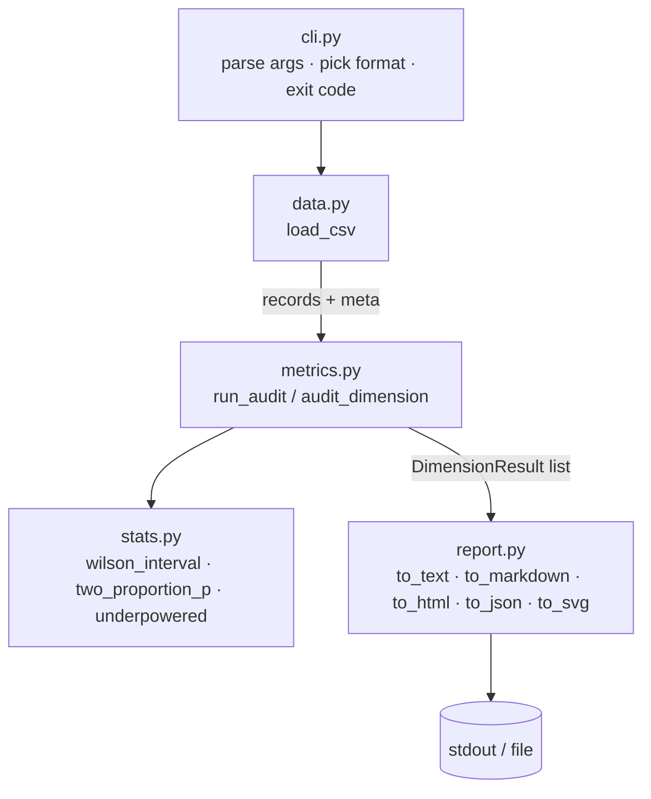

# Architecture

Impartial is deliberately small: five modules and no third-party dependencies, so that
an HR analyst, auditor or regulator can read the full source in one sitting and trust
what it computes.

## Data model

| Type | Defined in | Shape |
|---|---|---|
| `Record` | `data.py` | `(dict[attr → value or None], bool outcome)` |
| `GroupResult` | `metrics.py` | group, total, selected, share, rate, 95% CI, ratio, p-value, low_power, status |
| `DimensionResult` | `metrics.py` | dimension name, `GroupResult` list, reference group, unknown count, verdict |

`None` always means *unknown*. It is counted in `DimensionResult.unknown` and never
merged into another group.

## Design decisions

1. **Stdlib only.** `csv`, `statistics`, `math`, `dataclasses`, `argparse`, `html`, `json`.
   This keeps installs trivial, leaves no supply-chain surface, and means it runs on locked-down HR laptops.
2. **Reference group = highest rate among *eligible* groups.** A tiny group with a lucky
   100% rate shouldn't become the benchmark, which is why exclusion runs before reference selection.
3. **Two-step verdict.** The four-fifths rule alone gives false alarms on small samples.
   Adding a significance test separates `FAIL` from `REVIEW`
   without ever hiding a ratio. All numbers are always shown.
4. **Power check.** When any expected cell count is below 5, the z-test is unreliable, so
   the group is downgraded from `FAIL` to `REVIEW` and labelled "low n".
5. **Score mode uses the sample median.** This matches the LL144 definition of *scoring
   rate*. Scores that aren't numbers are dropped, and the number dropped is recorded in `meta["dropped"]`.
6. **Renderers are pure functions.** Each takes results and returns a string, which makes them
   easy to test and to extend (e.g. a PDF renderer).
7. **Self-contained HTML.** CSS and SVG are inline, with no JavaScript or external requests, so
   the report can be emailed, archived or printed as it is.

## Extending

| Want to… | Touch |
|---|---|
| Add a metric (e.g. equal opportunity) | `metrics.py`: add fields to `GroupResult`, compute in `audit_dimension` |
| Add an output format | `report.py`: new `to_x()` function, then register it in `cli.FORMATS` and the `render` map |
| Read Parquet / a database | `data.py`: produce the same `Record` list |
| Change the statistical test | `stats.py` (e.g. Fisher exact for small n) |
