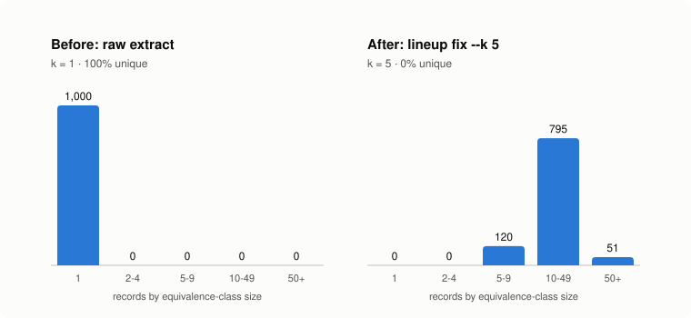
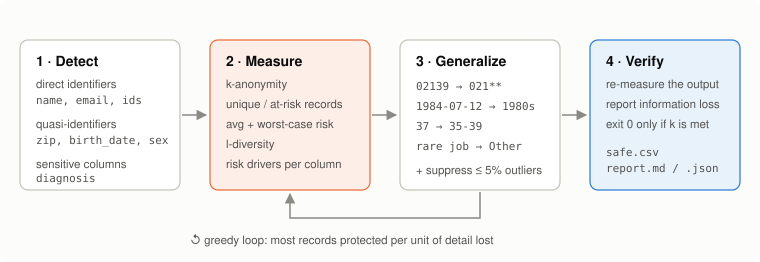
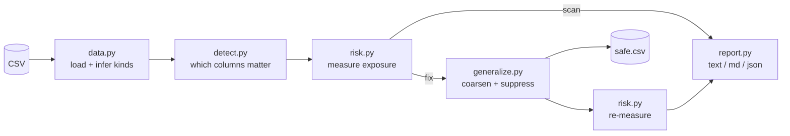

# Lineup

**Would a person in your dataset stand out in a lineup?**
Lineup checks whether the people in a table can be re-identified before you share it, and then fixes it.

```bash
lineup scan patients.csv                 # how exposed is everyone?
lineup fix  patients.csv -o safe.csv     # make every person hide among at least k others
```

Pure Python standard library · no dependencies · ~600 lines · anonymizes 100k rows in a few seconds

<p align="center"></p>

---

## Why this matters

Removing names is not anonymization. Datasets are shared every day for AI training,
research, open data portals and vendor handoffs, and they are usually "de-identified"
by deleting the name and email columns. The rest of the table stays, and the rest of
the table is often enough:

| | |
|---|---|
| **87%** of Americans are uniquely identified by just **ZIP code + birth date + sex** | Sweeney, 2000 |
| A Massachusetts governor's "anonymized" hospital records were re-identified using a voter roll bought for $20 | Sweeney, 1997 |
| **99.98%** of Americans could be re-identified from 15 demographic attributes | Rocher et al., *Nature Communications*, 2019 |

The people hurt by this are the ones who were never asked: patients, students, benefit
claimants, survey respondents. Once a diagnosis, an income or an immigration status is
tied back to a name, nobody can take it back.

Professional tools for this exist (ARX, sdcMicro), but they are heavyweight and few
analysts ever run them. Lineup is the small check you run in ten seconds, or put in CI,
before a CSV leaves your hands.

## What it does

<p align="center"></p>

1. **Detect.** It flags *direct identifiers* (names, emails, phone numbers, SSNs, record IDs)
   from column names and value patterns. It also suggests *quasi-identifiers* (ZIP, birth date,
   sex, race, occupation…) and *sensitive* columns (diagnosis, income…).
2. **Measure.** It groups records that share the same quasi-identifier values into
   *equivalence classes* and reports:
   - **k-anonymity**: the size of the smallest group. With k = 1, someone in the data is unique.
   - **Unique and at-risk records**: how many people fall in groups smaller than your target k.
   - **Average and worst-case risk**: the chance an attacker who knows the quasi-identifiers picks the right row.
   - **l-diversity**: whether a group shares one sensitive value, which reveals it without picking the right row. Example: everyone born in 1984 in ZIP 02139 has HIV.
   - **Risk drivers**: which column causes the most uniqueness, so you know what to coarsen first.
3. **Generalize.** It coarsens quasi-identifiers along a hierarchy for each kind of value:

   | Kind | Level 0 → … → hidden |
   |---|---|
   | ZIP | `02139 → 0213* → 021** → 02*** → 0**** → *` |
   | Date | `1984-07-12 → 1984-07 → 1984 → 1980s → *` |
   | Number | `37 → 35-39 → 30-39 → 20-39 → … → *` (widths sized to the data) |
   | Category | rare values (< k) → `Other` → `*` |

   A greedy search raises one column by one level at a time. At each step it picks the change
   that **protects the most records per unit of information lost**. When the remaining
   outliers fit within a small budget (default 5%), it drops them instead of blurring every row.
4. **Verify.** It measures the output again, drops direct identifiers, reports the information
   lost, and exits `0` only if the target is met.

## Quick start

```bash
cd lineup
pip install .            # or skip installing and use: python -m lineup ...
lineup scan examples/patients.csv
```

```text
Lineup · patients.csv · 1,000 records
─────────────────────────────────────
✗ NOT SAFE TO SHARE (target k=5, actual k=1)

Direct identifiers  (remove before sharing)
  • patient_id  nearly every value is unique (acts like a record ID)
  • name        column name suggests a direct identifier
  • email       column name suggests a direct identifier

Quasi-identifiers   zip, birth_date, sex, race
Sensitive           diagnosis

Re-identification risk
  Unique records         1,000  100.0%  ████████████████████
  In classes < k=5       1,000  100.0%  ████████████████████
  Average risk            1.00
  Worst-case risk         1.00  (k = 1)

What drives the risk  (unique records saved if the column were removed)
  birth_date     938 saved   986 distinct values
  zip              2 saved   30 distinct values
  sex              0 saved   2 distinct values
  race             0 saved   5 distinct values

Attribute disclosure (l-diversity)
  diagnosis: l = 1 · 1,000 records reveal their diagnosis just by their class
```

Then fix it:

```bash
lineup fix examples/patients.csv -o examples/patients.safe.csv
```

```text
After anonymization
  zip                  hidden
  birth_date           level 3/4
  sex                  kept as is
  race                 kept as is
  Records suppressed   34 (3.4%)
  Information loss     44%
  Unique records             0    0.0%  ░░░░░░░░░░░░░░░░░░░░
  In classes < k=5           0    0.0%  ░░░░░░░░░░░░░░░░░░░░
  Average risk            0.06
  Worst-case risk         0.20  (k = 5)
  l-diversity of diagnosis: 3 · 0 records still revealed
✓ SAFER TO SHARE (every record hides among ≥5)
```

| | zip | birth_date | sex | race | diagnosis |
|---|---|---|---|---|---|
| **before** | `02117` | `1975-06-03` | F | Black | Hypertension |
| **after** | `*` | `1970s` | F | Black | Hypertension |

Name, email and patient ID are gone. All 30 ZIPs in this example share the `021` prefix,
so a partial ZIP adds almost nothing and Lineup hides the column. Birth dates become decades.
The clinical columns you need for analysis are untouched.

## Usage

```text
lineup scan CSV [--qi COLS] [--sensitive COLS] [-k K] [--format text|md|json]
lineup fix  CSV -o OUT [--qi COLS] [--sensitive COLS] [-k K] [--max-suppress F] [--format ...]
```

| Option | Default | Meaning |
|---|---|---|
| `--qi` | auto-detect | Comma-separated quasi-identifier columns. **Set this explicitly for real data.** |
| `--sensitive` | auto-detect | Columns whose values must not be inferable from a person's group |
| `-k` | `5` | Every record must be indistinguishable from at least k−1 others |
| `--max-suppress` | `0.05` | Largest share of rows `fix` may drop instead of generalizing further |
| `--format` | `text` | `md` for pull requests and data-sharing reviews, `json` for pipelines |

**Exit codes:** `0` = target k met, `1` = not met. That makes Lineup a release gate:

```yaml
# .github/workflows/data-release.yml
- run: python -m lineup scan data/export.csv --qi zip,birth_date,sex -k 10 --format md >> $GITHUB_STEP_SUMMARY
```

**As a library:**

```python
from lineup.cli import audit
result = audit("export.csv", qis=["zip", "age", "sex"], sensitive=["diagnosis"], k=10, fix=True)
result["risk"].k_min, result["after"].k_min, result["fix"].info_loss
```

## Codebase structure

```text
lineup/
├── lineup/
│   ├── __init__.py       version
│   ├── __main__.py       enables `python -m lineup`
│   ├── cli.py            argument parsing + audit() — wires the steps below together
│   ├── data.py           CSV in/out, infers each column's kind (zip / date / numeric / categorical)
│   ├── detect.py         finds direct identifiers, suggests quasi-identifier & sensitive columns
│   ├── risk.py           equivalence classes, k-anonymity, risk scores, l-diversity, risk drivers
│   ├── generalize.py     generalization hierarchies + greedy k-anonymizer with suppression
│   └── report.py         renders an audit as terminal text, Markdown or JSON
├── tests/test_lineup.py  unit + end-to-end tests (stdlib unittest)
├── examples/
│   ├── make_patients.py  seeded generator for the synthetic demo data
│   ├── patients.csv      1,000 fake clinic records ("de-identified" the usual, broken way)
│   └── patients.safe.csv output of `lineup fix` on the above
├── docs/
│   ├── make_figures.py   regenerates class-sizes.svg from the real example run
│   ├── class-sizes.svg   before/after chart (light + dark aware)
│   └── how-it-works.svg  pipeline diagram
└── pyproject.toml        zero dependencies, installs the `lineup` command
```



Each module does one job and only `cli.py` knows about all of them. `risk.py` and
`generalize.py` are pure functions over lists of dicts, so you can use them on data
from any source, not just CSV.

## Running the tests

```bash
cd lineup
python -m unittest discover -s tests -v
python examples/make_patients.py   # regenerate demo data (deterministic)
python docs/make_figures.py        # regenerate the chart
```

## Honest limits

Lineup lowers risk. It does not make a dataset "anonymous", and no single tool can.

- **You choose the threat model.** k-anonymity protects only against attackers who know
  the columns you listed as quasi-identifiers. If an attacker also knows visit counts, list
  that column too. Auto-detection is a starting point, not a decision.
- **Size matters.** Very small datasets often can't reach k without losing most of their detail.
  Lineup shows that cost instead of hiding it.
- **Not differential privacy.** For publishing aggregate statistics, or for data of
  very high sensitivity, use formal methods (differential privacy, synthetic data with
  guarantees) and a human review.
- **Law still applies.** HIPAA, GDPR and similar rules have their own standards. Lineup's
  report is evidence for that review, not a replacement for it.

## License

MIT
