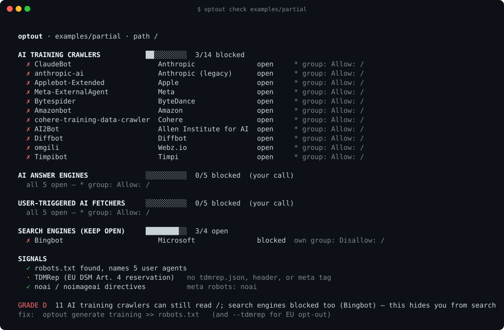
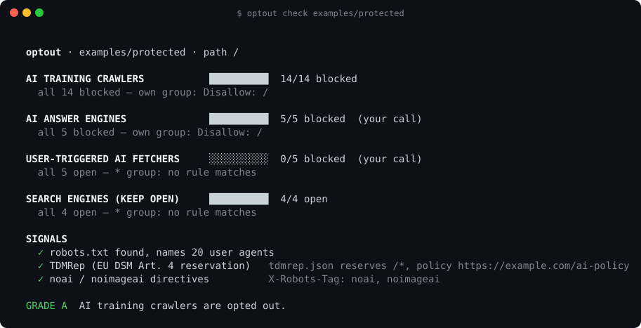
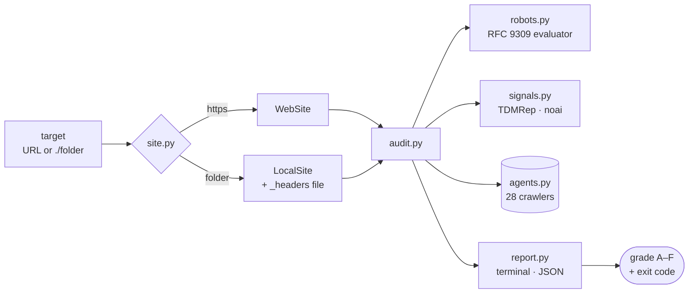
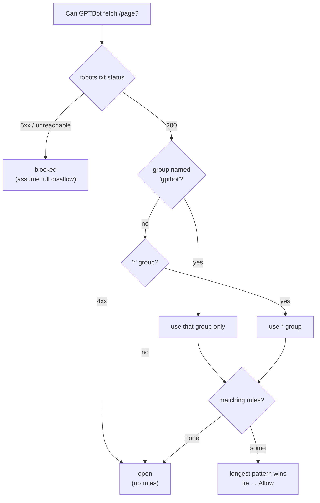

# optout

**Check whether your website really opts out of AI training, see why, and fix it.**

   

<p align="center"></p>

---

## Why this exists

Writers, artists, photographers, small publishers and open-source maintainers are asked to **opt out** if they don't want their work used to train AI. In practice, opting out means:

- knowing the names of a few dozen crawlers, which change every few months
  (`GPTBot`, `ClaudeBot`, `Google-Extended`, `Applebot-Extended`, `CCBot`, `Meta-ExternalAgent`, …),
- writing `robots.txt` rules that follow precedence rules most people have never read
  (a bot obeys **only** its own group, the longest path wins, `Allow` wins ties),
- and, in the EU, publishing a *machine-readable* reservation of text-and-data-mining rights
  (DSM Directive Art. 4(3)). The **EU AI Act** requires general-purpose AI providers to respect it.

The usual result is a `robots.txt` that blocks `GPTBot` and nothing else, or one that blocks
`Bingbot` by mistake and drops the site from search. **optout** makes the opt-out something you can see and check:

| | |
|---|---|
| 🔍 **Audit** | Checks 28 crawlers in 4 categories against your live site or local build folder |
| 🧾 **Explain** | Shows the group and rule behind every verdict, e.g. `* group: Allow: /` |
| 🛡️ **Catch mistakes** | Warns when you have also blocked real search engines |
| 🇪🇺 **Legal signals** | Detects TDMRep (`tdmrep.json`, header, meta) and `noai` / `noimageai` |
| 🛠️ **Fix** | Generates correct `robots.txt`, `tdmrep.json`, meta tags and headers |
| ✅ **CI-ready** | `--strict` exit codes and `--json` output; audit `./public` before you deploy |

No dependencies, no account, no telemetry. About 560 lines of standard-library Python.

---

## Quick start

```bash
git clone https://github.com/kareemrt/EthicalAI && cd EthicalAI/optout
python -m optout check example.com          # audit a live site
python -m optout check ./public --strict    # audit a static build, fail CI on gaps
python -m optout generate training --tdmrep # print the fix
```

Or install it as a command with `pip install .`, which gives you `optout`.

### Before → after

| Before: blocked the famous two, broke Bing | After: `optout generate training answer --tdmrep` |
|---|---|
|  |  |

---

## How it works



### Per-crawler decision (RFC 9309)



The case people miss most often: if a bot has its own group, the `*` group **no longer applies to it**.
So adding `User-agent: GPTBot` / `Allow: /images/` silently re-opens everything your `*` group blocked for that bot.
optout shows this in its reason column.

### Crawler categories

| Category | What it does with your content | Default stance | Examples |
|---|---|---|---|
| **AI training** | Collects pages to train models | ❌ should be blocked | GPTBot, ClaudeBot, Google-Extended, CCBot, Bytespider |
| **AI answer engines** | Indexes pages for AI search answers | ⚖️ your call | OAI-SearchBot, PerplexityBot, Claude-SearchBot |
| **User-triggered** | Fetches a page live because someone asked an AI about it | ⚖️ your call | ChatGPT-User, Claude-User, Perplexity-User |
| **Search engines** | Classic search indexing | ✅ should stay open | Googlebot, Bingbot, DuckDuckBot, Applebot |

`Google-Extended` and `Applebot-Extended` are *control tokens*. They never crawl anything themselves; they tell Google and Apple
whether content their search crawlers already fetched may be used for AI. That's why blocking them doesn't hurt search ranking.

### Grades

| Grade | Meaning |
|---|---|
| **A** | Every training crawler blocked **and** a TDMRep reservation published |
| **B** | Every training crawler blocked, no TDMRep |
| **C** | At least half blocked |
| **D** | Some blocked |
| **F** | None blocked |

The grade measures how well the site opts out. If you *want* AI crawlers (Wikipedia, for example, scores **F** on purpose),
read it as a description of your setup, not a judgement of it.

---

## Usage

```text
optout check <url | folder> [--path /blog/] [--json] [-v] [--strict] [--no-color]
optout generate [training] [answer] [user] [--tdmrep] [--policy URL]
```

| Flag | Effect |
|---|---|
| `--path` | Evaluate a specific page. Rules and meta tags differ per path |
| `-v` | List every crawler. By default, categories where every bot has the same result collapse to one line |
| `--json` | Structured output for dashboards and scripts |
| `--strict` | Exit `1` if any training crawler is open **or** any search engine is blocked |
| `--tdmrep` | Also print `/.well-known/tdmrep.json`, `<meta>` tags and HTTP headers |

`generate` won't produce rules that block search engines, because that's almost always a mistake.

### Use in CI (GitHub Actions)

```yaml
- run: pip install ./optout   # or vendor the folder, it's tiny
- run: npm run build          # your static site → ./public
- run: optout check ./public --strict
```

For local folders, response headers are read from a Netlify / Cloudflare Pages style `_headers` file.

---

## Codebase structure

```text
optout/
├── optout/                 the package, standard library only
│   ├── agents.py           crawler registry as plain data: token, operator, category  ← edit me
│   ├── robots.py           RFC 9309 parser and evaluator, returns allowed + the reason
│   ├── site.py             WebSite (urllib) and LocalSite (folder + _headers), same get() API
│   ├── signals.py          TDMRep (EU Art. 4) and noai/noimageai detection
│   ├── audit.py            one pass over a site → Audit dataclass (verdicts, signals, grade)
│   ├── report.py           Audit → coloured terminal report or JSON
│   ├── generate.py         robots.txt / tdmrep.json / meta / header generators
│   ├── cli.py              argparse front end: check, generate
│   └── __main__.py         enables `python -m optout`
├── tests/
│   ├── test_robots.py      precedence, wildcards, $ anchors, group merging, edge cases
│   └── test_audit.py       examples, generator round-trip, signals, real local HTTP server
├── examples/               three tiny static sites: unprotected (F), partial (D), protected (A)
├── docs/
│   ├── render.py           turns real CLI output into the SVGs in this README
│   └── report-*.svg
└── pyproject.toml          zero dependencies; installs the `optout` command
```

**Design choices**

- **Data in, data out.** `audit.run()` returns plain dataclasses. Rendering, JSON and exit codes are layered on top, so adding an HTML report or a web UI doesn't touch the core.
- **One interface for both sources.** `WebSite` and `LocalSite` both implement `get(path) → Page`, which is why the same audit runs before and after deploy.
- **Every verdict has a reason.** `robots.Decision` carries the group and rule that decided it, so the tool never asks you to just trust it.
- **The registry is editable data.** Crawler names change faster than code. `agents.py` is a list you can update in a one-line PR.

### Tests

```bash
cd optout && python -m unittest discover -s tests -v   # 19 tests, < 1 s
```

Regenerate the README visuals after changing the report format:

```bash
python docs/render.py examples/partial docs/report-partial.svg
python docs/render.py examples/protected docs/report-protected.svg
```

---

## Honest limits

- **robots.txt is a request, not a lock.** Well-behaved operators honour it. Some crawlers have been reported to ignore it, and data already collected stays collected. For hard enforcement you need server-side blocking, such as a WAF or user-agent and IP rules at your CDN.
- **TDMRep is a legal signal, not a technical barrier.** It makes your Art. 4 reservation machine-readable. What it achieves depends on jurisdiction and enforcement.
- **`noai` / `noimageai` are informal.** Few crawlers honour them. optout reports them but doesn't count them toward the grade.
- **The crawler list will go stale.** It was last reviewed in November 2026; check the operators' docs before relying on it for anything high-stakes.
- **This is not legal advice.**

## Contributing

The most useful contribution is keeping `optout/agents.py` current: add the token, operator and category, plus a link to the operator's documentation in the PR. Please run the tests before you open one.

MIT licensed.
