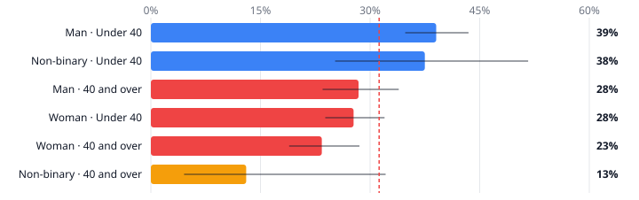
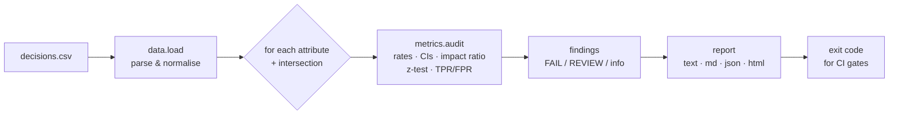

<div align="center">

# ⚖️ Parity

**A zero-dependency bias audit for automated decision systems.**

Point it at a CSV of decisions made by a hiring screener, credit model, or benefits triage tool.<br>
Get back a regulator-style disparate-impact audit in plain language, in under a second.




<sub>Selection rates from the bundled example. Red bars sit below the dashed <b>four-fifths line</b> and the gap is statistically significant. Whiskers show 95% confidence intervals.</sub>

</div>

---

## Why this exists

Algorithms now help decide **who gets interviewed, who gets a loan, who gets flagged for fraud, and whose benefits claim gets fast-tracked**. When those systems pick up historical bias, the harm is quiet, it happens at scale, and the people affected rarely find out.

Law has started to catch up. The tools haven't:

| Rule | What it requires |
|---|---|
| **NYC Local Law 144** (2023) | Annual independent *bias audit* of automated employment decision tools, with impact ratios published by sex and race/ethnicity, including intersections |
| **EU AI Act** (high-risk systems, phasing in from 2026) | Bias examination and monitoring for systems used in hiring, credit, education and public services |
| **US EEOC "four-fifths rule"** | A selection rate below **80%** of the highest group's rate is evidence of adverse impact |
| **Colorado AI Act** (SB 24-205) | Deployers of high-risk AI must take reasonable care to prevent algorithmic discrimination |

Most fairness toolkits are big ML libraries built for data scientists. The people who actually need an answer (HR teams, compliance officers, journalists, public-sector auditors, small startups) often just have **a spreadsheet of decisions** and one question: *is this treating people fairly?*

**Parity answers that question.** It does one job, has no dependencies, and explains its results in sentences instead of matrices.

---

## Quick start

```bash
git clone https://github.com/kareemrt/EthicalAI && cd EthicalAI/parity

# run straight from source (nothing to install)
python -m parity examples/hiring.csv --group gender --decision advanced --label qualified

# or install the `parity` command
pip install .
parity examples/hiring.csv -g gender -g age_band -d advanced -l qualified -f html -o audit.html
```

### What you get

```text
■ gender  [FAIL]
  Group         N  Selected   Rate   95% CI  Impact       p  TPR  FPR
  ──────────  ───  ────────  ─────  ───────  ──────  ──────  ───  ───
  Man (ref)   769       270  35.1%  32%–39%    1.00       —  64%  11%
  Non-binary   71        21  29.6%  20%–41%    0.84   0.349  50%  11%
  Woman       760       198  26.1%  23%–29%    0.74  <0.001  43%  13%
  ⚠️  Equal-opportunity gap: qualified people in the Non-binary group are selected 50% of the time vs 64% in Man.
  ❌  Adverse impact: Woman is selected at 74% of Man's rate (26% vs 35%, p<0.001).
  ⚠️  Equal-opportunity gap: qualified people in the Woman group are selected 43% of the time vs 64% in Man.

Overall: FAIL
```

Add `-f html` and you get a self-contained report (no external assets, light and dark mode) that you can email, attach to a ticket, or archive for an auditor:

<p align="center"></p>

👉 The full sample outputs are in [`examples/report.html`](examples/report.html) and [`examples/report.md`](examples/report.md).

---

## How it works



For every protected attribute you pass (and **their intersection**, since bias against older women can hide inside two "passing" single-attribute audits):

| Step | Metric | Why it matters |
|---|---|---|
| 1 | **Selection rate** + 95% Wilson interval | How often each group gets the favourable outcome, and how sure we are |
| 2 | **Impact ratio** = rate ÷ highest rate | The four-fifths / LL144 metric regulators actually use |
| 3 | **Two-proportion z-test** vs reference | Separates real disparity from small-sample noise |
| 4 | **TPR / FPR** *(needs `--label`)* | *Equal opportunity*: do equally qualified people get equal treatment? |
| 5 | **Plain-language finding** | One sentence that someone who isn't a statistician can act on |

### How results are graded

| Verdict | Condition |
|---|---|
| ❌ **FAIL** | Impact ratio < `threshold` **and** p < `alpha` **and** group n ≥ `min-n` |
| ⚠️ **REVIEW** | Below threshold but inconclusive, *or* TPR/FPR gap > `max-gap` |
| ℹ️ info | Group has fewer than `min-n` records |
| ✅ **PASS** | None of the above |

Some details are there to stop the audit from misleading people:

- **Tiny groups can't set the bar.** The reference group is the highest-rate group *with at least `min-n` records*, so three lucky applicants can't make everyone else look biased.
- **Missing demographics are kept.** Blank attribute cells become `Unknown` instead of being dropped. Leaving out people who didn't disclose can hide bias.
- **Small samples are never FAIL.** They get flagged for review along with a request for more data, because a false accusation does harm too.

---

## Usage

```text
parity CSV -g COL [-g COL ...] -d COL [options]

  -g, --group COL     protected attribute (repeat for intersectional audit)
  -d, --decision COL  outcome column: 1 / yes / true / hired / approved ... = favourable
  -l, --label COL     ground truth (was the person actually qualified?) → TPR/FPR
      --cutoff X      decision column is a score; favourable if score ≥ X
  -f, --format        text | md | json | html            (default: text)
  -o, --output FILE   write to file instead of stdout
      --threshold     impact-ratio floor                 (default: 0.80)
      --alpha         significance level                 (default: 0.05)
      --min-n         small-sample cutoff                (default: 30)
      --max-gap       tolerated TPR/FPR gap              (default: 0.10)
      --strict        non-zero exit on REVIEW too
```

**Exit codes:** `0` pass · `1` adverse impact · `2` needs review (with `--strict`) · `3` bad input

### Recipes

```bash
# Credit model that outputs a probability: approve at 0.6
parity loans.csv -g race -g sex -d approval_score --cutoff 0.6

# Markdown for a pull request, compliance ticket, or LL144 summary
parity screener.csv -g sex -g race_ethnicity -d advanced -f md -o AUDIT.md

# Machine-readable output for dashboards
parity decisions.csv -g region -d flagged -f json | jq '.audits[].status'
```

### Use it as a fairness gate in CI

Retraining a model? Fail the build if a new version introduces adverse impact, the same way you'd fail it on a broken unit test:

```yaml
# .github/workflows/fairness.yml
- name: Bias audit on holdout predictions
  run: |
    python model/predict.py --out preds.csv
    python -m parity preds.csv -g gender -g age_band -d pred -l actual \
      -f md -o fairness.md --strict
```

### Use it as a library

```python
from parity import load, run, Policy
from parity.report import to_markdown

records = load("decisions.csv", groups=["sex"], decision="hired", label="qualified")
audits  = run(records, ["sex"], Policy(threshold=0.8, min_n=50))

for a in audits:
    print(a.attribute, a.status, [(g.name, round(g.impact_ratio, 2)) for g in a.groups])
```

---

## Try the planted-bias example

[`examples/generate.py`](examples/generate.py) simulates 1,600 applicants. **Every group is equally likely to be qualified**, but the simulated screener quietly penalises women and applicants aged 40+. Parity should catch both, and it does. It also catches the compounding effect at the intersection (Woman · 40 and over: impact ratio **0.60**).

```bash
python examples/generate.py > examples/hiring.csv   # deterministic (seed 42)
python -m parity examples/hiring.csv -g gender -g age_band -d advanced -l qualified
```

---

## Codebase structure

```text
parity/
├── parity/                 # the package (~550 lines, stdlib only)
│   ├── __init__.py         # public API: load, run, audit, Policy, Record
│   ├── __main__.py         # enables `python -m parity`
│   ├── cli.py              # argparse front-end, output routing, exit codes
│   ├── data.py             # CSV → Record(groups, decision, label); truthy parsing, cutoffs
│   ├── metrics.py          # GroupStats, Audit, Policy; impact ratio, TPR/FPR, findings
│   ├── stats.py            # Wilson interval, two-proportion z-test (closed form)
│   └── report.py           # text / Markdown / JSON / HTML renderers + inline SVG chart
├── tests/
│   └── test_parity.py      # unit + end-to-end tests (stdlib unittest)
├── examples/
│   ├── generate.py         # synthetic hiring data with a known, planted bias
│   ├── hiring.csv          # its output (1,600 rows)
│   ├── report.html         # sample HTML report
│   └── report.md           # sample Markdown report
├── docs/
│   ├── chart-intersectional.svg
│   └── report.png
└── pyproject.toml          # installs the `parity` console command
```

**Data flow:** `cli` → `data.load` → `metrics.run` (calls `metrics.audit` once per attribute plus the intersection, and `audit` uses `stats`) → `report.to_*` → stdout / file + exit code.

**Design choices**

- **Zero dependencies.** It runs anywhere Python 3.10+ runs, including locked-down government and enterprise machines where `pip install pandas` needs a ticket.
- **One pass, in memory.** Audits 300,000 rows across two attributes and their intersection in about 1 second on a single core. Records are slotted, frozen dataclasses.
- **Closed-form statistics.** No sampling and no randomness, so the same input always gives the same audit. That matters when the audit itself might be scrutinised.
- **Findings are data.** Every `Finding` has a `level`, a `group` and a `message`, so the renderers stay simple and adding a new output format is about 20 lines.

---

## Running tests

```bash
python -m unittest discover -s tests -v
```

---

## Interpreting results responsibly

Parity measures **outcomes**. It doesn't measure intent, and it doesn't give legal conclusions.

- A **FAIL** is strong statistical evidence of disparity. It should start a human investigation: look at features, proxies, training data, and the business necessity of the criteria.
- A **PASS** doesn't mean the system is fair. Disparities can sit in attributes you didn't audit, in groups too small to test, or in harms that selection rates don't capture.
- Fairness metrics can **conflict**. Equal selection rates and equal error rates usually can't both hold when base rates differ. Pick the metric that fits the harm, and write down why.
- Handle demographic data with care. Audit on aggregated or pseudonymised data where you can, and collect protected attributes only with consent and a clear purpose.

## Roadmap

- [ ] Multi-class and ranked outcomes (e.g. interview tiers, top-k ranking exposure)
- [ ] Drift mode: compare two audits over time and flag regressions
- [ ] Optional Fisher exact test for very small groups
- [ ] Counterfactual probe: re-score records with the attribute swapped (needs model access)

## License

MIT. Use it, fork it, and audit something that matters.
