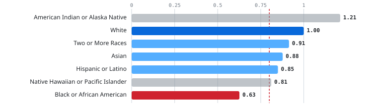
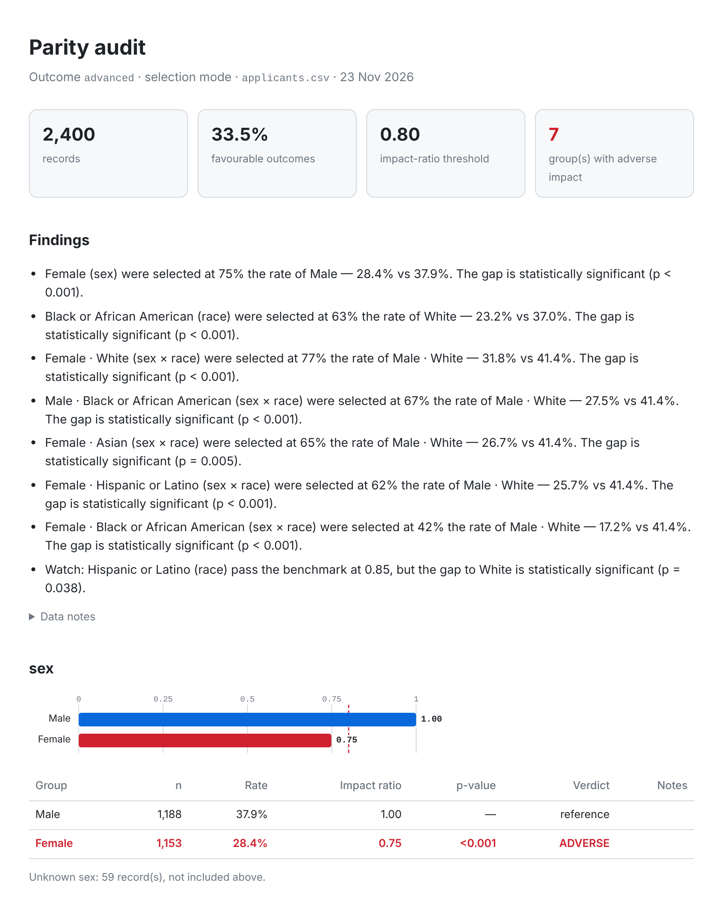
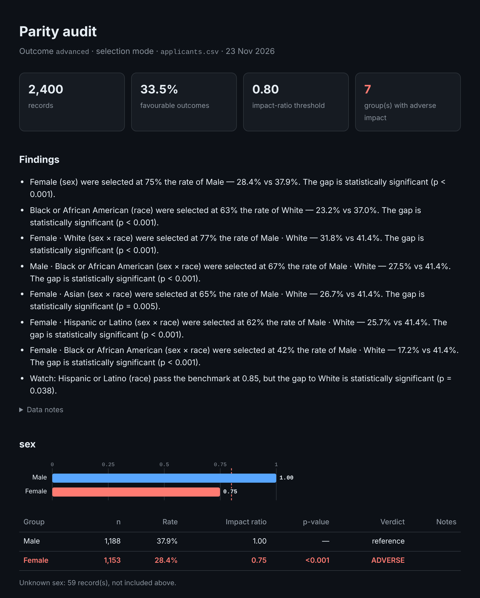
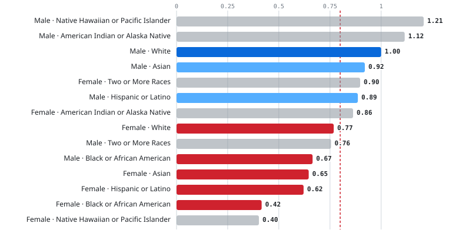
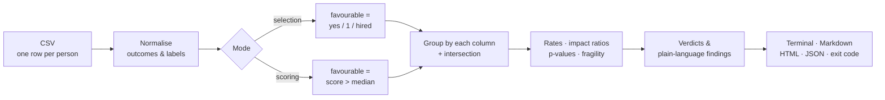

<div align="center">

# ⚖️ Parity

**Check whether an automated decision system treats groups of people fairly. One command, and nothing to install beyond Python.**




</div>

---

## The problem

Algorithms now decide **who gets an interview, a loan, an apartment, or a benefit**. Résumé screeners, credit models and tenant-scoring tools learn from historical data, and historical data carries historical discrimination. A model can reject women or minority applicants at a much higher rate without anyone having intended it, and nobody notices until someone runs the numbers.

Regulators have started to require that someone does run them:

| Rule | What it asks for |
|---|---|
| **US EEOC Uniform Guidelines** (29 CFR §1607.4(D)) | The *four-fifths rule*: a selection rate below 80% of the highest group's rate is evidence of adverse impact. |
| **NYC Local Law 144** (in force since 2023) | Employers using automated hiring tools must publish a yearly **bias audit**: selection or scoring rates and **impact ratios** by sex, race/ethnicity, and their **intersection**. |
| **EU AI Act** | Treats AI used in hiring, credit and access to essential services as *high-risk*, which requires bias monitoring. |

Commercial audit tools are expensive, and open-source fairness toolkits expect a data-science stack and statistics training. **The people who most need these checks, such as small employers, HR teams, journalists, advocates and public agencies, often have neither.**

## The solution

Parity is a small, **dependency-free** Python tool that takes a CSV of decisions and returns:

- 📊 **Selection or scoring rates and impact ratios** for each group, including **intersectional** groups (sex × race).
- 🚩 **Four-fifths rule verdicts** with **statistical significance**, so real gaps are told apart from noise.
- 🧊 **Fragility checks** that flag any verdict that would flip if a single person's outcome changed.
- 🗣️ **Plain-language findings** that someone without statistics training can read and act on.
- 📄 **Reports** as a terminal table, Markdown, JSON, or a self-contained HTML page with charts (no CDN or tracking, and it works offline).
- 🚦 **A CI gate** (`--fail-on-adverse`) so a model that starts discriminating fails its build the way a broken unit test does.

> **Design principle:** Parity never guesses anyone's demographics. Unknown values are counted and disclosed, not imputed.

---

## Quick start

```bash
cd parity
python -m parity examples/applicants.csv --outcome advanced --by sex race
```

That is the whole setup. To install the `parity` command globally, run `pip install .`.

<details open>
<summary><b>Terminal output</b> (sample data, trimmed)</summary>

```text
Parity audit · outcome 'advanced' (selection) · 2,400 records · 33.5% favourable · threshold 0.80

race  (unknown: 6)
  group                                     n    rate  impact                  p  verdict
  American Indian or Alaska Native         29   44.8%  ████████████ 1.21   0.388  excluded (<min share) [low-n]
  White                                 1,292   37.0%  ████████████ 1.00       —  reference
  Two or More Races                        68   33.8%  ███████████░ 0.91   0.597  ok
  Asian                                   231   32.5%  ███████████░ 0.88   0.187  ok
  Hispanic or Latino                      423   31.4%  ██████████░░ 0.85   0.038  ok
  Native Hawaiian or Pacific Islander      10   30.0%  ██████████░░ 0.81   0.648  excluded (<min share) [fragile, low-n]
  Black or African American               341   23.2%  ████████░░░░ 0.63  <0.001  ADVERSE

Findings
  • Black or African American (race) were selected at 63% the rate of White — 23.2% vs 37.0%.
    The gap is statistically significant (p < 0.001).
  • Watch: Hispanic or Latino (race) pass the benchmark at 0.85, but the gap to White is
    statistically significant (p = 0.038).

Data notes
  • 2 race group(s) under 2% of the sample were reported but not flagged: ...
  • 6 record(s) had unknown race and were left out of that dimension.
```
</details>

### HTML report

```bash
python -m parity examples/applicants.csv -o advanced -b sex race --html report.html
```

The page is a single file with no external requests, and it follows the reader's light or dark mode.

<table>
<tr><td></td>
<td></td></tr>
</table>

See the complete outputs in [`examples/report.html`](examples/report.html) and [`examples/report.md`](examples/report.md).

### Intersectional view

Looking at one attribute at a time can hide the people who are hit hardest. In the sample data, the separate sex and race audits show disparities, but the intersectional audit shows that **Black women are selected at 42% of the rate of white men**:

<div align="center"></div>

---

## How it works



### The metrics

| Metric | Definition | Why it matters |
|---|---|---|
| **Rate** | favourable ÷ group size | The raw outcome for each group. |
| **Reference group** | The group with the highest rate among groups making up at least `--min-share` of the sample | Gives every other group a fair comparison point. Tiny groups can't become the reference by chance. |
| **Impact ratio** | group rate ÷ reference rate | The measure used by the four-fifths rule and NYC LL144. Values **below 0.80 are flagged.** |
| **p-value** | Two-sided two-proportion z-test against the reference group | Separates real gaps from random variation. |
| **Fragile** | The verdict flips if one person's outcome changes | Stops a single individual from deciding a headline result. |
| **Low-n** | Fewer than 30 people in the group | Rates for small groups move a lot from person to person. |
| **Excluded** | The group is below `--min-share` (default 2%) | Still reported, but not flagged. NYC LL144 allows this exclusion as long as it is disclosed. |

**Scoring mode** (`--score`) is for tools that output a score rather than a yes/no decision. A person counts as favourable if their score is **above the sample median**, which is the *scoring rate* definition in NYC LL144.

### Reading a verdict

| Verdict | Meaning | Suggested action |
|---|---|---|
| `ADVERSE` + significant | A real disparity, unlikely to be chance | Investigate the model and its features, and consider remediation. |
| `ADVERSE` + not significant / fragile | Possible disparity with weak evidence | Collect more data before drawing conclusions. |
| `ok` + significant (**Watch**) | Passes the 0.80 line but has a real gap | Monitor over time. Four-fifths is a minimum, not the goal. |
| `ok` | No adverse impact detected | Keep auditing as the data drifts. |

---

## Usage

### Command line

```text
parity CSV --outcome COL --by COL [COL ...] [options]

  -o, --outcome COL      decision column (yes/no, 1/0, hired…) or score column
  -b, --by COL ...       demographic column(s) to audit, e.g. sex race
  --score                outcome is numeric; favourable = above the sample median
  --no-intersect         skip the combined (intersectional) audit
  --threshold 0.8        impact-ratio benchmark
  --min-share 0.02       groups smaller than this are reported but not flagged
  --html FILE            write a self-contained HTML report
  --md FILE              write a Markdown report
  --json                 print JSON instead of the table
  --fail-on-adverse      exit 1 if any group shows adverse impact
```

Exit codes: `0` means the audit ran, `1` means adverse impact was found (only with `--fail-on-adverse`), and `2` means the input was invalid.

### Python API

```python
import csv
from parity import audit, to_html

with open("decisions.csv") as f:
    result = audit(csv.DictReader(f), outcome="approved", by=["sex", "race"])

result.has_adverse_impact        # True / False
for dim in result.dimensions:
    for g in dim.adverse:
        print(dim.name, g.name, round(g.impact_ratio, 2), g.p_value)
```

It accepts any iterable of dict-like rows, so a pandas DataFrame works too: `audit(df.to_dict("records"), ...)`.

### As a fairness test in CI

You can audit a model's predictions on a held-out set on every pull request, so a retrain that introduces bias fails before it ships:

```yaml
# .github/workflows/fairness.yml
- name: Fairness gate
  run: |
    python predict.py --out predictions.csv
    python -m parity predictions.csv -o predicted_hire -b sex race \
      --fail-on-adverse --md fairness-report.md
```

### Input format

The input is one row per person. Columns can have any name, and extra columns are ignored.

```csv
applicant_id,sex,race,score,advanced
A00001,Male,Black or African American,66.9,yes
A00002,Female,White,80.3,yes
A00003,,Asian,35.6,no          ← blank = unknown, counted and disclosed
```

The following count as **unknown**: blank, `unknown`, `n/a`, `prefer not to say`, `declined`, and similar values.
The following count as **favourable**: `1`, `yes`, `true`, `selected`, `hired`, `advanced`, `approved`, and similar values (case-insensitive).

---

## Codebase structure

```text
parity/
├── parity/                 the package (standard library only)
│   ├── __init__.py         public API: audit(), report renderers, dataclasses
│   ├── __main__.py         enables `python -m parity`
│   ├── cli.py              argument parsing, file I/O, exit codes
│   ├── metrics.py          the math: outcomes → groups → rates, impact ratios,
│   │                       p-values, fragility → Audit / Dimension / Group
│   └── report.py           Audit → plain-language findings, terminal table,
│                           Markdown, JSON, SVG chart, self-contained HTML
├── tests/
│   ├── test_metrics.py     unit tests: thresholds, exclusion, unknowns,
│   │                       intersections, scoring mode, statistics, edge cases
│   └── test_cli.py         end-to-end: detects the planted bias, exit codes, reports
├── examples/
│   ├── generate_sample.py  synthetic hiring data with a known, planted bias
│   ├── applicants.csv      generated sample (2,400 applicants, seed 1964)
│   ├── report.html         example HTML report
│   └── report.md           example Markdown report
├── docs/assets/            README charts (generated by Parity itself) and screenshots
└── pyproject.toml          packaging; installs the `parity` command
```

### Data flow

| Step | Function | Input → output |
|---|---|---|
| 1 | `metrics.to_outcomes` | raw outcome values → `list[bool]` (selection rule or median split) |
| 2 | `metrics.audit` | rows + column names → per-column labels (unknown → `None`), plus the intersection |
| 3 | `metrics._dimension` | labels + outcomes → `Dimension` holding a `Group` for each value |
| 4 | `report.findings` / `report.data_notes` | `Audit` → English sentences |
| 5 | `report.to_text` / `to_markdown` / `to_html` / `to_json` / `to_svg` | `Audit` → output format |

`metrics.py` has no I/O and `report.py` does no math. Each layer can be tested, replaced or reused on its own. All result objects are frozen dataclasses, so they serialise directly to JSON.

### Run the tests

```bash
pip install pytest
python -m pytest -q        # 15 tests, < 0.1 s
```

The sample data contains bias that was **planted on purpose**: the simulated scoring model penalises women and Black and Hispanic applicants by a few points. The end-to-end test checks that Parity finds it, which validates the tool against a known answer.

---

## Limitations and responsible use

- **The four-fifths rule is a screening heuristic.** It is neither proof of discrimination nor proof of fairness. A passing audit does not make a system fair.
- **Parity measures outcome disparity** (demographic parity). It does not measure error-rate fairness (for example, equalised odds), which needs ground-truth labels. That is on the roadmap.
- **Significance depends on sample size.** With very large samples, tiny gaps become "significant". With small ones, real gaps may not. Read impact ratios and p-values together.
- **Demographic data is sensitive.** Keep audit inputs access-controlled and aggregate the outputs before you share them.
- **This is not legal advice**, and it does not replace the *independent* auditor that laws such as NYC LL144 require. It is meant for continuous internal monitoring and for preparing for that audit.

## Roadmap

- [ ] Error-rate metrics (false-positive/negative rate parity) when ground-truth labels are available
- [ ] Fisher's exact test for very small groups
- [ ] Confidence intervals on impact ratios
- [ ] Trend mode: compare audits over time and flag drift
- [ ] Ready-made LL144 summary-table export

---

<div align="center">
<sub>Part of <a href="../README.md">EthicalAI</a>: projects using AI for ethical goals.</sub>
</div>
