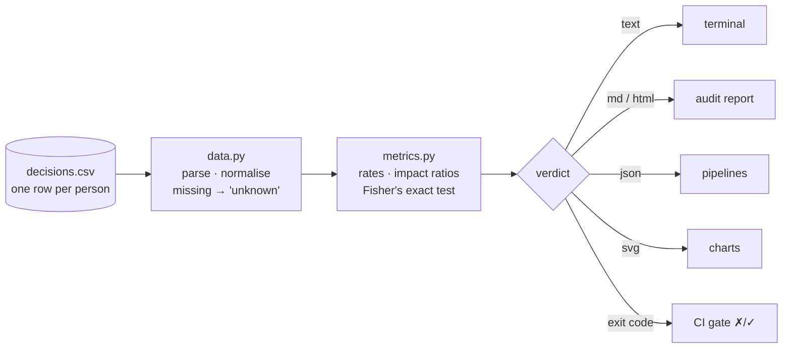

<div align="center">

# ⚖️ Parity

**Find out if your hiring algorithm discriminates before your candidates do.**

A zero-dependency bias audit for automated decision systems.
One CSV in → an audit-ready report out, aligned with NYC Local Law 144 and the EEOC four-fifths rule.

`pure Python` · `no dependencies` · `runs offline` · `~500 lines` · `CI-ready exit codes`

</div>

<p align="center">
  <picture>
    <source media="(prefers-color-scheme: dark)" srcset="docs/report-dark.png">
    
  </picture>
</p>

---

## The problem

Algorithms now screen most job applications before a human sees them. They rarely use race or sex directly; instead they learn **proxies**: a career gap, a zip code, a college name. Bias slips in quietly.

Regulators are catching up:

| Rule | What it requires |
|---|---|
| **NYC Local Law 144** (in force since July 2023) | An annual, independent **bias audit** of any automated employment decision tool, with selection rates and **impact ratios** by sex, race/ethnicity and their **intersection**, published online |
| **EEOC Uniform Guidelines** (29 CFR 1607.4D) | The **four-fifths rule**: a group selected at less than 80% of the top group's rate is evidence of adverse impact |
| **EU AI Act** (Annex III) | Hiring systems are *high-risk*: bias monitoring and data governance are mandatory |
| **Colorado AI Act**, Illinois HB 3773 | Duty of care against algorithmic discrimination in employment |

Yet the tooling is either **enterprise consulting** (expensive, slow, done once a year) or **ML fairness libraries** (heavy dependencies, need model access, written for data scientists). Small employers, HR teams, journalists and the candidates themselves get nothing.

**Parity closes that gap.** All it needs is a decision log, the one artifact every organisation already has.

## What it does



For each protected attribute, plus their intersection, Parity computes:

| Metric | Definition |
|---|---|
| **Selection rate** | `selected ÷ total` per group (yes/no decisions) |
| **Scoring rate** | share of a group scoring **above the full-sample median** (LL144's method for score-only tools) |
| **Impact ratio** | `group rate ÷ rate of the most-favoured group` |
| **p-value** | two-sided **Fisher's exact test** vs. the reference group: exact at any sample size, so it stays honest for small groups |

Then each group gets a status:

| Status | Meaning |
|---|---|
| ◆ `reference` | the most-favoured group (groups under 2% of records are never chosen) |
| ✓ `ok` | impact ratio ≥ threshold (default 0.8) |
| ? `review` | below threshold but **not** statistically conclusive, or the group is too small. A human should look |
| ✗ `FLAG` | below threshold **and** significant at α (default 0.05): evidence of adverse impact |

Pairing the four-fifths rule with a significance test means fewer false alarms from noise, and fewer real disparities waved away as "small numbers".

## Quick start

```bash
git clone https://github.com/kareemrt/EthicalAI && cd EthicalAI/parity

# Audit the bundled example: a fictional screening model with hidden proxy bias
python -m parity examples/hiring.csv --outcome advanced --groups sex race --intersect
```

```text
Parity bias audit  examples/hiring.csv · selection mode · threshold 0.8 · α=0.05

▸ sex
  group        n    rate  impact ratio                     p  status
  Male     1,943   41.4%  1.00 ████████████████████        —  ◆ reference
  Female   1,937   37.4%  0.90 ██████████████████      0.011  ✓ ok
  4,000 records · 120 with unknown category (excluded from rates, reported per LL144)

▸ race
  group                                      n    rate  impact ratio                     p  status
  Native American or Alaska Native*         39   43.6%  1.04 ████████████████████    0.871  ✓ ok
  White                                  2,074   41.9%  1.00 ████████████████████        —  ◆ reference
  ...
  Black or African American                556   33.1%  0.79 ███████████████▌       <0.001  ✗ FLAG

▸ sex × race
  ...
  Female × Black or African American        279   29.7%  0.67 █████████████  ┊       <0.001  ✗ FLAG

FAIL — 2 group(s) show statistically significant adverse impact
```

> **The intersectional lesson.** Audited by sex alone, this model *passes* (0.90). Audited by race alone, Black applicants sit right at the line (0.79). Only the **intersection** shows how big the harm is: Black women are advanced at **two-thirds** the rate of white men. Two "neutral" proxies, a career-gap penalty and a zip-code bonus, stacked on the same people. This is why LL144 requires intersectional reporting.

Or install it as a command:

```bash
pip install .          # no dependencies get pulled in
parity --help
```

## Usage

```text
parity CSV (--outcome COL | --score COL) --groups COL [COL ...] [options]
```

| Option | Default | Description |
|---|---|---|
| `--outcome COL` | | yes/no decision column. Accepts `1/0`, `yes/no`, `true/false`, `hired`, `selected`, `advanced`, `approved`… |
| `--score COL` | | numeric score column (scoring-rate mode) |
| `--groups COL…` | | protected-attribute columns, each audited separately |
| `--intersect` | off | also audit the combination of all `--groups` |
| `--threshold` | `0.8` | impact-ratio threshold |
| `--alpha` | `0.05` | significance level |
| `--min-share` | `0.02` | groups below this share are marked small (`*`) |
| `--format` | `text` | `text` · `md` · `html` · `json` |
| `-o FILE` | stdout | write the report to a file |
| `--svg PREFIX` | | also write a standalone chart per attribute |
| `--strict` | off | exit 1 on `review` too, not just `FLAG` |

**Exit codes:** `0` pass · `1` adverse impact found · `2` bad input.

### Outputs

```bash
parity hiring.csv --outcome advanced --groups sex race --intersect --format html -o report.html
parity hiring.csv --outcome advanced --groups sex race --intersect --format md   -o report.md
parity hiring.csv --score score      --groups sex race --format json | jq .result
parity hiring.csv --outcome advanced --groups race --svg docs/chart
```

| Format | Best for |
|---|---|
| **HTML** | a single self-contained file with no scripts or network calls, light and dark mode. Ready to publish, as LL144 requires ([example](examples/report.html)) |
| **Markdown** | pull requests, wikis, audit trails ([example](examples/report.md)) |
| **JSON** | dashboards and data pipelines |
| **SVG** | slides and docs (renders on GitHub, follows the reader's theme) |

<p align="center"></p>

### Bias audit as a CI gate

Retrain a model, re-run the audit, and block the deploy if it regressed:

```yaml
# .github/workflows/bias-audit.yml
- name: Bias audit
  run: |
    python model/score_holdout.py > decisions.csv      # your model's decisions on a validation set
    python -m parity decisions.csv --outcome selected --groups sex race --intersect \
           --format md -o audit.md
- uses: actions/upload-artifact@v4
  if: always()
  with: { name: bias-audit, path: audit.md }
```

### As a library

```python
from parity import load_rows, audit

rows = load_rows("decisions.csv")
result = audit(rows, ["sex", "race"], outcome="hired")   # intersection of sex × race

for g in result.flagged:
    print(f"{g.group}: impact ratio {g.ratio:.2f}, p={g.p_value:.4f}")
```

## Codebase structure

```text
parity/
├── parity/                  the package (stdlib only)
│   ├── __init__.py          public API: load_rows, audit, Audit, GroupStat, fisher_exact
│   ├── __main__.py          CLI: argument parsing, output routing, exit codes
│   ├── data.py              CSV loading; normalising messy cells (missing values, yes/no outcomes)
│   ├── metrics.py           the core: rates, impact ratios, reference choice, Fisher's exact test, status
│   └── report.py            renderers: terminal · Markdown · JSON · HTML · SVG chart
├── examples/
│   ├── generate.py          seeded synthetic screening log with hidden proxy bias
│   ├── hiring.csv           4,000 fictional applicants (output of generate.py)
│   ├── report.html          sample HTML report
│   └── report.md            sample Markdown report
├── tests/
│   └── test_parity.py       14 unit tests: statistics, edge cases, renderers, CLI exit codes
├── docs/                    README images (generated by Parity itself)
└── pyproject.toml           packaging, `parity` console script
```

**How a run flows.** Each module has one job, and data only moves one way:

1. **`data.py`** reads the CSV and trims whitespace. Values like `""`, `N/A` or `Prefer not to say` count as **unknown**. Those people are tallied and reported, never silently dropped.
2. **`metrics.audit()`** labels each row by group (`"Female × Asian"` for intersections) and works out who was a *hit* (selected, or above the median score). It then counts per group and picks the reference group. Tiny groups are not eligible, so one lucky 3-person group can't set the bar. Finally it computes the ratios and p-values and assigns each group a status. The result is a plain `Audit` dataclass.
3. **`report.py`** turns a list of `Audit`s into the chosen format. Renderers are pure functions with no I/O.
4. **`__main__.py`** wires it together and turns the verdict into an exit code.

## Design choices

- **Zero dependencies.** It runs on any machine with Python 3.10+, including locked-down HR laptops and air-gapped servers. Fisher's exact test takes 15 lines with `math.lgamma`.
- **Local-first and private.** Demographic data is sensitive. Parity never touches the network, and the HTML report embeds no scripts, fonts or trackers.
- **Model-agnostic.** It audits *outcomes*, not models. That works for vendor black boxes, rules engines, even human decisions.
- **Honest about uncertainty.** Every status carries its sample size and a p-value. Small groups go to human `review` and are never auto-flagged or auto-cleared.
- **Readable.** About 500 lines with no clever tricks, so an auditor, a lawyer or a curious candidate can read exactly how the numbers are made.

## Beyond hiring

The maths is the same for any yes/no decision about people:

| Domain | `--outcome` | `--groups` |
|---|---|---|
| Lending | `approved` | `race sex age_band` |
| Tenant screening | `accepted` | `race disability` |
| Insurance | `offered_standard_rate` | `sex age_band` |
| Content moderation | `removed` | `dialect language` |
| Healthcare triage | `referred` | `race sex` |

## Limitations: read before relying on it

- **Impact ratios are a screening test, not a verdict.** A `FLAG` is evidence that needs explaining. It is not proof of illegal discrimination, and an `ok` is not proof of fairness. Equal selection rates say nothing about error rates, calibration or *why* outcomes differ.
- **Garbage in, garbage out.** Self-reported demographics are incomplete. Inferring race from names or zip codes adds its own bias, and Parity deliberately doesn't do it.
- **Not legal advice.** LL144 requires an *independent* auditor. Parity gives them, and you, a transparent, reproducible starting point.
- **Multiple comparisons.** Intersectional audits run many tests. With 14 groups at α = 0.05, expect about one spurious low p-value. Read the `review` groups with that in mind, or lower `--alpha`.

## Development

```bash
python -m unittest discover tests        # 14 tests, < 0.1 s
python examples/generate.py > examples/hiring.csv
```

## License

MIT. Data in `examples/` is entirely synthetic. No real person is described.
