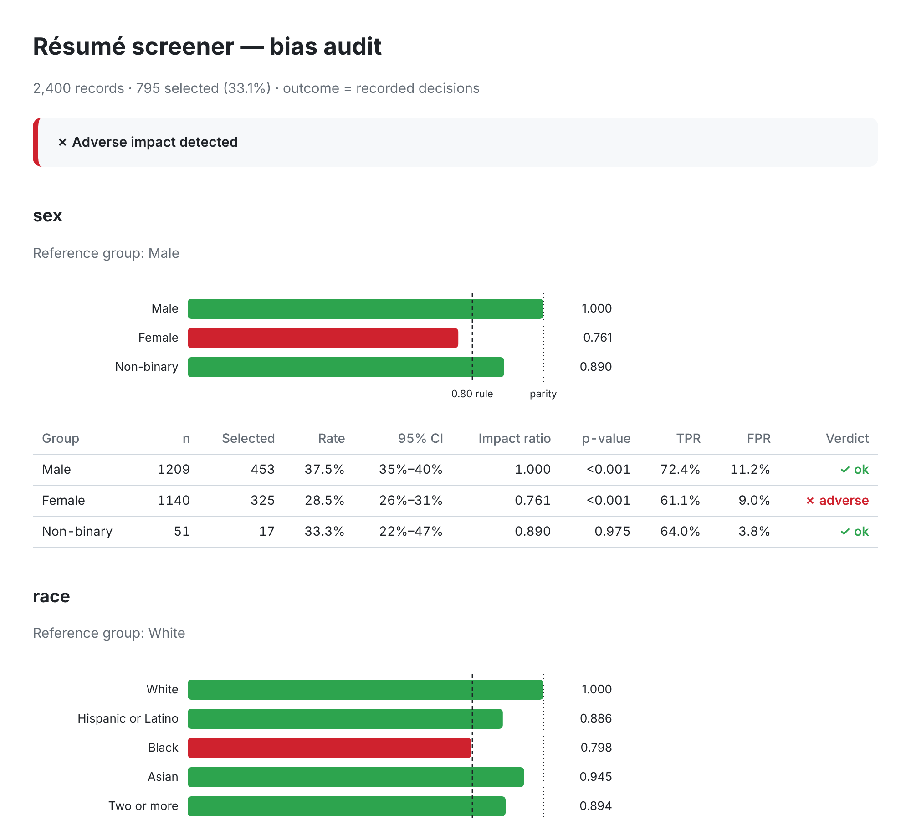
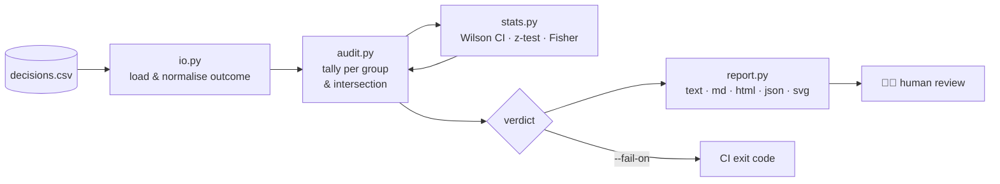
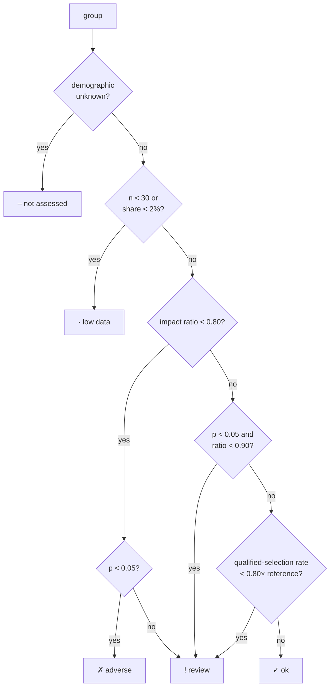

<div align="center">

# ⚖️ Parity

**Bias audits for automated decisions, in one command and with zero dependencies.**

Feed it a log of who was hired, approved or advanced by an algorithm, and it tells you,<br>
with statistics a regulator would recognise, whether any group is being treated unfairly.

`Python ≥ 3.9` · `stdlib only` · `~550 lines` · `MIT`



</div>

---

## Why this exists

Algorithms now screen **résumés, loan applications, tenant checks and benefits claims**, often
before a person ever looks at the file. When those systems carry historical bias, they repeat it
at scale, quietly.

Laws are catching up:

| Rule | What it requires |
| :--- | :--- |
| **EEOC four-fifths rule** (US, 1978) | A selection rate below **80%** of the top group's rate is evidence of adverse impact |
| **NYC Local Law 144** (2023) | Annual independent **bias audits** of automated employment decision tools, with published impact ratios by sex, race/ethnicity and their intersections |
| **EU AI Act** (2024) | Hiring, credit and essential-services AI is *high-risk*: providers must check data and systems for bias |
| **Colorado AI Act** (2026) | Deployers of high-risk AI must guard against algorithmic discrimination |

Existing fairness toolkits are powerful but heavy (NumPy, pandas, SciPy, sometimes TensorFlow),
built for ML researchers, and produce output that HR, compliance or a journalist can't read.
**Parity is the opposite:** one small, readable package that runs anywhere Python runs, takes a
CSV, and produces a report a non-statistician can act on.

### Who it's for

- 🏢 **Small employers and HR teams** who buy a screening tool and need to check it
- 🛠️ **ML engineers** who want a fairness gate in CI (`--fail-on adverse`)
- 📰 **Journalists, researchers and advocates** analysing records obtained through FOIA or leaks
- 🏛️ **Auditors** who need a transparent, reproducible baseline they can read line by line

---

## Quick start

```bash
git clone https://github.com/kareemrt/EthicalAI && cd EthicalAI/parity

# Run on the bundled synthetic example, no install needed
python -m parity examples/applicants.csv -y advanced -g sex -g race -l qualified

# Or install the `parity` command
pip install .
parity examples/applicants.csv -y advanced -g sex -g race -f html -o audit.html
```

Your data just needs **one row per person**: an outcome column plus the demographic columns to audit.

```csv
applicant_id,sex,race,advanced,score,qualified
A00000,Female,White,no,41.3,0
A00001,Male,Black,yes,77.9,1
```

---

## What you get

```text
✗ Adverse impact detected
2,400 records · 795 selected (33.1%) · outcome = recorded decisions

── sex (reference: Male)
Group          n  Selected   Rate   95% CI  Impact ratio  p-value    TPR    FPR  Verdict
Male        1209       453  37.5%  35%–40%         1.000   <0.001  72.4%  11.2%  ✓ ok
Female      1140       325  28.5%  26%–31%         0.761   <0.001  61.1%   9.0%  ✗ adverse
Non-binary    51        17  33.3%  22%–47%         0.890    0.975  64.0%   3.8%  ✓ ok

── race (reference: White)
Group                  n  Selected   Rate   95% CI  Impact ratio  p-value    TPR    FPR  Verdict
White               1230       432  35.1%  33%–38%         1.000    0.033  73.0%  11.2%  ✓ ok
Hispanic or Latino   450       140  31.1%  27%–36%         0.886    0.314  66.7%   5.4%  ✓ ok
Black                332        93  28.0%  23%–33%         0.798    0.033  49.6%  12.0%  ✗ adverse
Asian                265        88  33.2%  28%–39%         0.945    0.976  69.5%   9.4%  ✓ ok
Two or more           86        27  31.4%  23%–42%         0.894    0.729  59.5%  10.2%  ✓ ok
Unknown               37        15  40.5%  26%–57%             —        —  63.6%   6.7%  – not assessed

── sex × race (reference: Male · Asian)
Female · Black                   162        36  22.2%  17%–29%         0.562    0.002   45.2%   8.0%  ✗ adverse
Male · Black                     160        54  33.8%  27%–41%         0.854    0.862   54.8%  16.1%  ! review
…
```

<table>
<tr>
<td width="50%"></td>
<td width="50%"></td>
</tr>
</table>

Three things in that output that a simple four-fifths check would miss:

1. **Intersectional harm.** Black women are selected at **0.56×** the top group's rate, far worse than
   either "women" (0.76) or "Black applicants" (0.80) alone suggests.
2. **Equal opportunity.** Black men pass the 80% rule (0.854), but *qualified* Black men are advanced
   only 55% of the time versus 77% for the top group. Parity marks them `review`.
3. **Honest uncertainty.** Small groups get confidence intervals and a `low data` verdict instead
   of a false alarm or a false all-clear. Records with missing demographics are counted and shown,
   never silently dropped.

| Format | Flag | Use it for |
| :--- | :--- | :--- |
| Terminal | `-f text` (default) | Quick look, colour-coded |
| Markdown | `-f md` | PRs, wikis, audit appendices. [Example →](examples/report.md) |
| HTML | `-f html` | A self-contained, shareable report with charts, light and dark mode. [Example →](examples/report.html) |
| JSON | `-f json` | Dashboards, pipelines, archiving |

---

## How it works



### The metrics

| Metric | Definition | Why it matters |
| :--- | :--- | :--- |
| **Selection rate** | selected ÷ group size | The raw outcome for each group |
| **Impact ratio** | group rate ÷ highest reliable group rate | The number NYC LL144 audits must publish; < 0.80 fails the four-fifths rule |
| **95% CI** | Wilson score interval | Stays accurate for small groups, where the naïve ±2σ interval breaks down |
| **p-value** | group vs. everyone else; z-test, or Fisher's exact test when any expected count < 5 | Separates real gaps from noise |
| **TPR / FPR** | among truly qualified / unqualified people, the share selected (needs `--label`) | *Equal opportunity*: are qualified people from every group given the same chance? |

### The verdicts



Numeric outcomes like risk or match scores are supported as well. By default they are split at the
**sample median** (LL144's *scoring rate*); use `--threshold` to set your real cut-off.

---

## Usage

```text
parity CSV -y OUTCOME -g COLUMN [-g COLUMN ...] [options]

  -y, --outcome      decision column (yes/no, 1/0, hired/rejected…) or a numeric score
  -g, --group        demographic column to audit (repeat for several)
  -l, --label        ground-truth column (enables TPR/FPR, equal opportunity)
  -t, --threshold    score cut-off (default: median)
  --no-intersect     skip the intersectional breakdown
  --min-share 0.02   groups smaller than this share are reported but not judged
  --min-n 30         groups smaller than this are reported but not judged
  -f, --format       text | md | html | json
  -o, --output       write to a file
  --fail-on          adverse | review: exit 1 if found (CI gate)
```

### As a CI fairness gate

```yaml
# .github/workflows/fairness.yml
- run: python model/predict.py --holdout data/holdout.csv > preds.csv
- run: pip install ./parity && parity preds.csv -y approved -g sex -g age_band --fail-on adverse
```

### As a library

```python
from parity import load_csv, run_audit
from parity.report import to_html

audit = run_audit(load_csv("loans.csv"), outcome="approved", groups=["race"], label="repaid")
print(audit.verdict)                         # "ok" | "review" | "adverse"
for dim in audit.dimensions:
    worst = dim.worst
    print(dim.name, worst.name, round(worst.impact_ratio, 3))
open("audit.html", "w").write(to_html(audit, "Loan model audit"))
```

---

## Codebase

```text
parity/
├── parity/                 the package (~550 lines, standard library only)
│   ├── __init__.py         public API: run_audit, load_csv, Audit, Dimension, GroupStat
│   ├── __main__.py         enables `python -m parity`
│   ├── cli.py              argument parsing, output routing, CI exit codes
│   ├── io.py               CSV loading; yes/no and score → selected / not selected
│   ├── audit.py            core logic: grouping, intersections, impact ratios, verdicts
│   ├── stats.py            Wilson interval, two-proportion z-test, Fisher exact test
│   └── report.py           renderers: text, Markdown, JSON, SVG chart, standalone HTML
├── tests/
│   └── test_parity.py      16 unit tests: statistics vs. SciPy reference values, verdict logic, CLI
├── examples/
│   ├── build.py            regenerates the synthetic dataset, reports and README figures
│   ├── applicants.csv      2,400 synthetic applicants with known, injected bias
│   ├── report.md           example Markdown report
│   └── report.html         example HTML report
├── docs/                   README figures (generated, do not edit by hand)
└── pyproject.toml          packaging; installs the `parity` command
```

**Design choices**

- **Zero dependencies.** Auditing shouldn't need a data-science stack. It runs on a locked-down
  laptop, in a CI container, or on an air-gapped machine holding sensitive HR data.
- **Data never leaves the machine.** No network calls, no telemetry.
- **Readable over clever.** Every formula sits in one short, commented function, so an auditor
  can check the maths without having to trust it.
- **One pass, O(n).** Rows are tallied once per dimension; a million-row log audits in seconds.

### Development

```bash
python -m unittest discover -s tests   # run the tests
python examples/build.py               # regenerate example data, reports and figures
```

---

## Limitations and responsible use

- **A screen, not a verdict.** Parity flags statistical disparities. Whether a disparity is
  unlawful depends on job-relatedness, business necessity and less-discriminatory alternatives,
  which are questions for people and lawyers, not a script.
- **Garbage in, garbage out.** Results are only as good as the demographic data. Self-reported
  data is best; *inferred* demographics (e.g. from names) carry their own bias.
- **Passing ≠ fair.** Impact ratios capture one notion of fairness. A system can pass and still
  be harmful in ways outcome statistics can't see.
- **Many comparisons.** With many groups and intersections, some "significant" results will be
  chance. Treat `review` as a prompt to investigate, not a conclusion.
- The bundled dataset is **entirely synthetic**.

## Roadmap

- [ ] Multiple-comparison correction (Holm–Bonferroni) option
- [ ] LL144-formatted summary table export
- [ ] Calibration-by-group for risk scores
- [ ] Browser-only version (Pyodide) so non-technical users can drag-and-drop a CSV

## License

MIT
