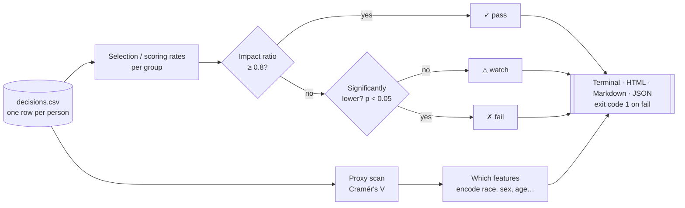
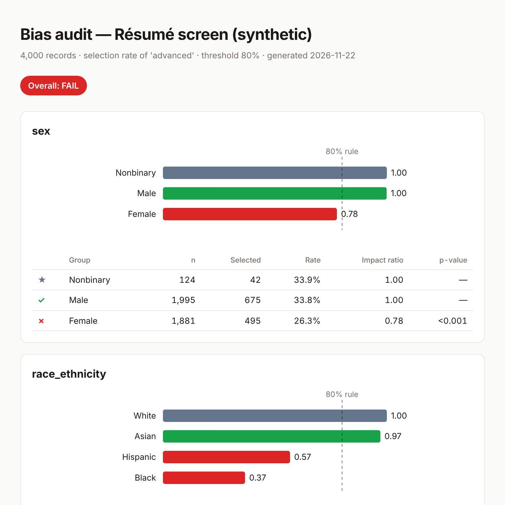
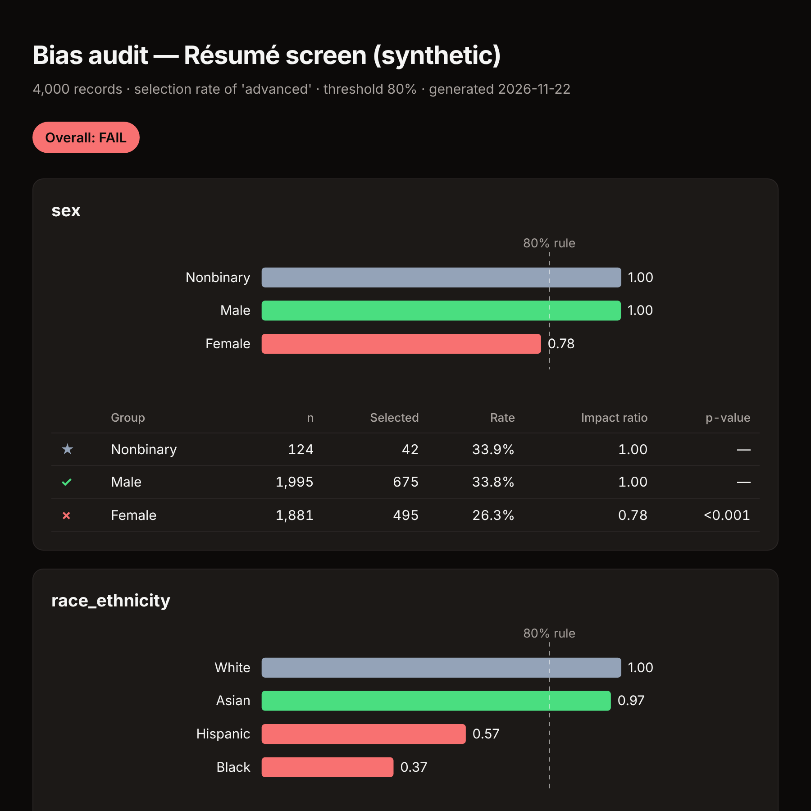
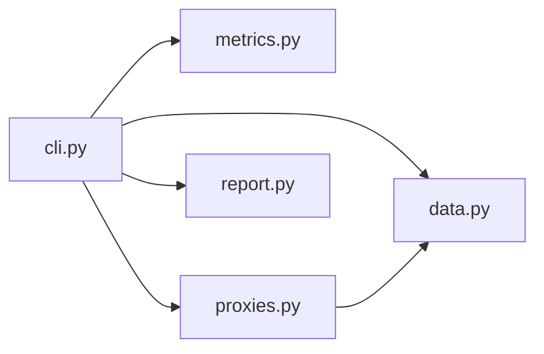

<div align="center">

# ⚖️ Parity

**Bias audits for automated decision systems, in one command.**

Find out whether your hiring, lending, or screening model treats groups unequally.
Then find out *which features* cause it.

`pure Python` · `zero dependencies` · `~480 lines` · `CI-ready`

</div>

---

## Why this exists

Algorithms now decide who gets a job interview, a loan, an apartment, or a second look from a fraud team. When those systems are skewed, the harm is quiet and lands on a lot of people at once. A biased résumé filter can turn away thousands of qualified people before any human sees their names.

Regulators have started to respond:

| Jurisdiction | Rule | What it requires |
|---|---|---|
| 🇺🇸 New York City | **Local Law 144** (in force since 2023) | An independent **bias audit** reporting selection/scoring rates and **impact ratios** by sex, race/ethnicity and their intersections, before an automated employment decision tool is used |
| 🇺🇸 Federal (EEOC) | **Uniform Guidelines, 29 CFR 1607.4(D)** | The **four-fifths rule**: a selection rate below 80% of the highest group's rate is evidence of adverse impact |
| 🇺🇸 Colorado | **SB 24-205** (Colorado AI Act) | Impact assessments for high-risk AI systems used in consequential decisions |
| 🇪🇺 European Union | **AI Act**, Annex III | Hiring, credit and access to essential services are *high-risk*: bias monitoring and data governance are mandatory |

The tooling has not kept up. Most fairness libraries pull in heavy ML stacks, assume you have the model in hand, or report dozens of metrics without telling you what to do. Small employers, nonprofits, journalists and public-interest auditors usually have **a spreadsheet of decisions** and one question: *is this fair?*

**Parity answers that question from a CSV.** It doesn't need the model, a notebook, or any installed packages.

## What it does



1. **Disparate-impact audit.** Selection rate (binary outcome) or LL144 *scoring rate* (share scoring above the median) for each group. Each group gets an impact ratio against the most-selected group.
2. **Statistical honesty.** A gap below 80% is only marked **fail** when a two-proportion z-test says it is significant. Otherwise it is marked **watch**. Groups under 2% of records are reported but not rated, following LL144 practice, so tiny samples can't produce false alarms.
3. **Intersectional analysis.** `--intersectional` audits combinations such as *Female × Black*. Harms often hide here even when each attribute looks fine on its own.
4. **Proxy detection.** Dropping the `race` column doesn't remove bias if ZIP code still encodes race. Parity scores every other column against every protected attribute with bias-corrected Cramér's V and flags the leaks.
5. **Reports people can read.** You get a coloured terminal summary, a self-contained HTML report (light/dark, inline SVG charts, no external assets), Markdown for PRs and wikis, and JSON for pipelines.
6. **A CI gate.** The exit code is `1` when any group fails, so a model release can be blocked the same way a failing unit test blocks a merge.

## Quick start

```bash
git clone https://github.com/kareemrt/EthicalAI && cd EthicalAI/parity

# no install needed
python -m parity audit examples/hiring.csv \
    --outcome advanced \
    --protected sex race_ethnicity --intersectional \
    --ignore score applicant_id \
    --html report.html
```

```text
  Parity audit · hiring · 4,000 records

  sex
    ★ Nonbinary                       33.9%  IR 1.00  ████████████████████
    ✓ Male                            33.8%  IR 1.00  ████████████████████
    ✗ Female                          26.3%  IR 0.78  ████████████████

  race_ethnicity
    ★ White                           36.1%  IR 1.00  ████████████████████
    ✓ Asian                           35.1%  IR 0.97  ███████████████████
    ✗ Hispanic                        20.5%  IR 0.57  ███████████
    ✗ Black                           13.2%  IR 0.37  ███████
    – 2 small group(s) excluded (<2% of records)

  sex × race_ethnicity
    ★ Male × White                    39.7%  IR 1.00  ████████████████████
    ✓ Male × Asian                    39.5%  IR 1.00  ████████████████████
    ✓ Female × White                  32.2%  IR 0.81  ████████████████
    △ Female × Asian                  30.5%  IR 0.77  ███████████████
    ✗ Male × Hispanic                 24.0%  IR 0.60  ████████████
    ✗ Female × Hispanic               16.5%  IR 0.42  ████████
    ✗ Male × Black                    16.2%  IR 0.41  ████████
    ✗ Female × Black                   9.9%  IR 0.25  █████
    – 10 small group(s) excluded (<2% of records)

  Proxy features
    zip_code                 → race_ethnicity   V = 0.38 (strong)
    employment_gap_months    → sex              V = 0.23 (moderate)

  Verdict: FAIL
```

Or install it as a command:

```bash
pip install .        # from the parity/ folder
parity audit decisions.csv --outcome approved --protected sex race
```

### The HTML report

<p align="center">
  
  
</p>

See the full examples: [`docs/sample-report.html`](docs/sample-report.html) · [`docs/sample-report.md`](docs/sample-report.md)

## Reading the demo: how bias gets in without anyone asking for it

The bundled dataset ([`examples/generate_hiring.py`](examples/generate_hiring.py)) simulates a résumé-screening model that **never sees sex or race**. It scores on experience, college tier, ZIP code and employment gaps. Each choice looks reasonable on paper.

Parity still finds the problem, and finds the cause:

- **ZIP code → race (V = 0.38).** Residential segregation makes a "neutral" location feature a stand-in for race. Black and Hispanic applicants end up with impact ratios of 0.37 and 0.57.
- **Employment gap → sex (V = 0.23).** Penalising gaps hits caregivers, who are mostly women. Women advance at 78% of the men's rate.
- **The intersection is worst.** Black women advance at **one quarter** of the rate of white men (IR 0.25). Looking at sex or race alone would understate that harm.
- **△ watch, not ✗ fail, for Asian women (IR 0.77, p = 0.87).** The gap is below the line, but there is too little evidence to call it adverse impact. This is a case for more data, not an alarm.

This failure mode is the one that has hit real résumé screeners: proxies learned from historical data rebuild the very bias the designers tried to exclude.

## Usage

```text
parity audit CSV (--outcome COL | --score COL) --protected COL [COL ...] [options]
```

| Option | Default | Meaning |
|---|---|---|
| `--outcome COL` |  | Binary outcome. `1/0`, `true/false`, `yes/no`, `hired`, `approved`, `selected`, `pass` all count as selected |
| `--score COL` |  | Numeric score. A row counts as selected when it scores **above the median** (LL144 scoring rate) |
| `--protected COL…` | *required* | Protected attribute columns to audit |
| `--intersectional` | off | Also audit the combination of all protected columns |
| `--threshold X` | `0.8` | Impact-ratio threshold |
| `--min-share X` | `0.02` | Groups below this share of records are reported but not rated |
| `--alpha X` | `0.05` | Significance level for **fail** |
| `--ignore COL…` |  | Skip columns in proxy detection (IDs, raw scores) |
| `--no-proxies` | off | Skip proxy detection |
| `--html / --md / --json PATH` |  | Write reports (`--json -` prints to stdout) |
| `--title TEXT` | CSV name | Report title |
| `--quiet` | off | No terminal summary |

**Exit codes:** `0` = no group fails · `1` = at least one group fails · `2` = usage error.

### Use it in CI

```yaml
# .github/workflows/fairness.yml
- name: Bias audit of model decisions on the holdout set
  run: |
    python -m parity audit holdout_predictions.csv \
      --outcome predicted_approve --protected sex race --intersectional \
      --md fairness.md --json fairness.json
```

### Use it as a library

```python
from parity import load_csv, audit_attribute, find_proxies
from parity.data import outcomes

rows = load_csv("decisions.csv")
results = audit_attribute([r["race"] for r in rows], outcomes(rows, outcome="approved"))
for g in results:
    print(g.group, g.status, g.impact_ratio)

print(find_proxies(rows, protected=["race"], exclude=["approved"])[:3])
```

## Methodology

| Concept | Definition |
|---|---|
| **Selection rate** | `selected / n` for the group |
| **Scoring rate** | Share of the group scoring above the overall median (NYC LL144 §5-300) |
| **Impact ratio (IR)** | Group rate ÷ the highest rate among rated groups |
| **Reference ★** | The rated group with the highest rate |
| **Pass ✓** | IR ≥ threshold |
| **Watch △** | IR < threshold, but not significantly lower than all other rated groups combined |
| **Fail ✗** | IR < threshold **and** significantly lower (pooled two-proportion z-test, two-sided, p < α) |
| **Excluded –** | Under `--min-share` of records. Reported, never used as the reference |
| **Proxy strength** | Bias-corrected Cramér's V (Bergsma 2013). Numeric columns are quantile-binned into 5 buckets. **strong** ≥ 0.30, **moderate** ≥ 0.15 |

Significance is tested against *all other rated groups* rather than only the reference. A small group that happens to have the top rate therefore can't hide a large, well-evidenced disparity.

## Codebase structure

```text
parity/
├── parity/                  the package (stdlib only)
│   ├── __init__.py          public API: load_csv, audit_attribute, intersect, find_proxies, cramers_v
│   ├── __main__.py          enables `python -m parity`
│   ├── cli.py               argument parsing, orchestration, coloured terminal summary, exit codes
│   ├── data.py              CSV loading, truthy-outcome parsing, LL144 median scoring rate
│   ├── metrics.py           selection rates, impact ratios, z-test, status rules, intersections
│   ├── proxies.py           bias-corrected Cramér's V, numeric binning, proxy ranking
│   └── report.py            audit dict → Markdown / JSON / self-contained HTML with inline SVG charts
├── examples/
│   ├── generate_hiring.py   reproducible synthetic résumé-screen with proxy-driven bias (seeded)
│   └── hiring.csv           4,000 generated applicants
├── tests/
│   └── test_parity.py       unit tests for metrics and proxies, end-to-end CLI test
├── docs/                    sample reports and screenshots used in this README
└── pyproject.toml           packaging; installs the `parity` command
```

Data flows one way. Each module has one job and none of them depends on `cli.py`:



`report.py` only consumes a plain dict (`report.build(...)`), so new output formats can be added without touching the statistics.

## Development

```bash
python -m unittest discover -s tests -v        # 8 tests, < 0.1 s
python examples/generate_hiring.py > examples/hiring.csv   # regenerate demo data
```

## Limitations and responsible use

- **This is a statistical screen, not a legal determination.** A pass doesn't prove a system is fair, and a fail doesn't prove discrimination. LL144 requires an *independent* auditor. Parity is a tool for that auditor and for the teams preparing for one.
- **Group fairness is one lens.** The four-fifths rule compares outcomes. It doesn't check calibration, individual fairness, or whether the ground-truth labels are biased in the first place.
- **The demographic data has to exist.** Parity can't audit what isn't recorded. Collect protected attributes with consent, store them separately, and use them only for auditing.
- **Proxy ≠ guilty.** Years of experience correlates with age for legitimate reasons. A flagged proxy is a question to answer ("is this feature job-related and necessary?"), not an automatic removal.
- **Small samples are noisy.** That's why Parity separates *watch* from *fail* and excludes tiny groups. Report them anyway, and collect more data.

## License

MIT
