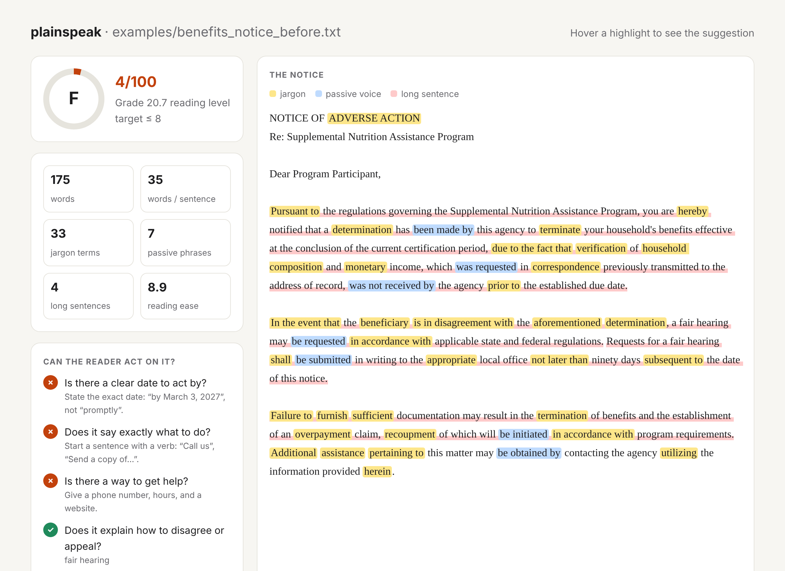
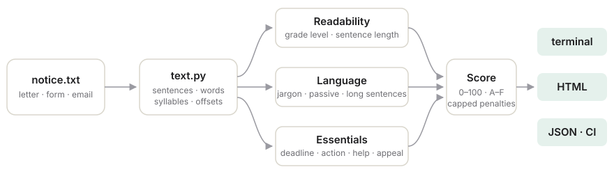
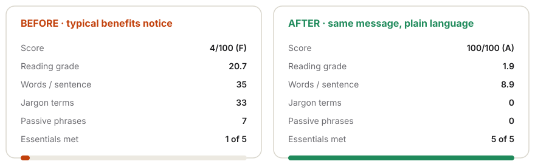

# plainspeak

**Check that an official notice can be understood and acted on by the person who receives it.**

People lose food aid, health coverage, and housing because they can't decode a letter, not because they stopped qualifying. plainspeak reads a notice the way a stressed, busy reader would. It tells the writer exactly what to fix: which words, which sentences, and which missing facts.

```bash
python -m plainspeak notice.txt --html report.html
```

Zero dependencies · pure Python ≥ 3.9 · ~650 lines · runs offline · deterministic and explainable

<p align="center"></p>

---

## Why this matters

| | |
|---|---|
| **The reading gap** | More than half of U.S. adults read below a 6th-grade level (Gallup analysis of the PIAAC literacy survey). Benefit notices are often written at college level. |
| **The cost of confusion** | During the 2023–24 Medicaid "unwinding", most people who lost coverage were cut for *procedural* reasons, such as missing paperwork or unanswered letters, not because they were found ineligible (KFF tracking). |
| **The law already asks for it** | The U.S. Plain Writing Act of 2010 requires federal agencies to write clearly. Many state Medicaid and SNAP programs set reading-level targets for notices. Few teams have a tool to check them. |
| **AI makes it urgent** | Agencies are starting to draft letters with LLMs. plainspeak is a transparent, rule-based gate any team can run on drafts in CI, whether a person or a model wrote them. |

plainspeak doesn't replace testing with real readers. It catches the obvious failures before a notice ever reaches one.

## What it checks

<p align="center"></p>

| Check | What it looks for | Why |
|---|---|---|
| **Reading level** | Flesch–Kincaid grade, against a target (default 8) | The single best predictor of whether a notice gets read |
| **Jargon** | ~160 bureaucratic phrases, each with a plain swap (`pursuant to` → `under`) | Every unfamiliar word is a place a reader gives up |
| **Passive voice** | `was not received`, `may be requested` | Hides *who* must act, often the most important fact in the letter |
| **Long sentences** | More than 25 words | Working memory runs out; lists work better |
| **Essentials** | A **deadline** date · a concrete **action** · a way to get **help** · how to **appeal** · speaks to "**you**" | Can the reader actually *do* something after reading? |

### The score

Starts at 100. Each problem costs points, up to a cap, so no single issue can sink a notice on its own and the score stays explainable:

| Penalty | Rule | Cap |
|---|---|---|
| Reading level | 5 per grade above target | 35 |
| Jargon | 4 per jargon term per 100 words | 20 |
| Long sentences | share of sentences over 25 words × 50 | 15 |
| Passive voice | passive phrases per sentence × 30 | 10 |
| Missing essentials | 4 each | 20 |

`A ≥ 90 · B ≥ 80 · C ≥ 70 · D ≥ 60 · F`. Every report shows where the points went.

## Before and after

The two files in [`examples/`](examples) carry the **same message**. The first is written the way many real notices are; the second is a plain-language rewrite.

<p align="center"></p>

> **Before:** *"Pursuant to the regulations governing the Supplemental Nutrition Assistance Program, you are hereby notified that a determination has been made by this agency to terminate your household's benefits…"* (73 words, one sentence)
>
> **After:** *"We have not received the papers we asked you for. … If you do not send them, your food benefits will stop on March 31, 2027."*

## Quick start

```bash
git clone https://github.com/kareemrt/EthicalAI && cd EthicalAI/plainspeak

python -m plainspeak examples/benefits_notice_before.txt          # terminal report
python -m plainspeak examples/*.txt --json                        # machine-readable
python -m plainspeak notice.txt --html report.html                # shareable report
python -m plainspeak --fix notice.txt > draft.txt                 # jargon-swapped first draft
cat notice.txt | python -m plainspeak -                           # stdin
```

Or install it as a command: `pip install .` then `plainspeak notice.txt`.

<details>
<summary><b>Example terminal output</b></summary>

```text
  examples/benefits_notice_before.txt
  █░░░░░░░░░░░░░░░░░░░░░░░░░░░░░  4/100  grade F

  Reading level   grade 20.7  (target ≤ 8)
  Sentences       5, avg 35 words
  Findings        33 jargon · 7 passive · 4 long

  Can the reader act on it?
  ✗ Is there a clear date to act by?  → State the exact date: “by March 3, 2027”, not “promptly”.
  ✗ Does it say exactly what to do?  → Start a sentence with a verb: “Call us”, “Send a copy of…”.
  ✗ Is there a way to get help?  → Give a phone number, hours, and a website.
  ✓ Does it explain how to disagree or appeal?  “fair hearing”
  ✗ Does it speak to the reader as “you”?  → Write to the person: “You must…” instead of “The applicant shall…”.

  Swap these words
  adverse action             → decision against you
  pursuant to                → under
  hereby                     → (delete)
  determination              → decision
  terminate                  → end
  due to the fact that       → because
  verification               → proof
  household composition      → who lives with you (rephrase)
  … and 23 more

  Longest sentences
  73 words  Pursuant to the regulations governing the Supplemental Nutrition Assistance Program, yo…
  30 words  Failure to furnish sufficient documentation may result in the termination of benefits a…
  27 words  In the event that the beneficiary is in disagreement with the aforementioned determinat…

  Where the points went
  reading level −35 · jargon −20 · missing essentials −16 · long sentences −15 · passive voice −10
```
</details>

### Options

| Flag | Default | Purpose |
|---|---|---|
| `--html PATH` | | Write a self-contained HTML report (light/dark, mobile-friendly, hover for suggestions) |
| `--json` | | Print JSON with score, metrics, essentials, and every finding with character offsets |
| `--fix` | | Print a draft with safe jargon swaps applied. Names like "Nutrition Assistance Program" are left alone |
| `--target-grade N` | `8` | Reading-level target. Many health and benefits programs aim for 6 |
| `--fail-under SCORE` | | Exit with status 1 if any file scores below `SCORE` |

### Use it in CI

Keep your notice templates in a repo and stop unreadable letters before they ship:

```yaml
# .github/workflows/notices.yml
on: [pull_request]
jobs:
  plain-language:
    runs-on: ubuntu-latest
    steps:
      - uses: actions/checkout@v4
      - uses: actions/setup-python@v5
        with: { python-version: "3.12" }
      - run: pip install ./plainspeak
      - run: plainspeak templates/*.txt --fail-under 80 --target-grade 6
```

### Use it as a library

```python
from plainspeak import analyze

report = analyze(open("notice.txt").read(), target_grade=6)
report.score, report.grade            # e.g. 72, "C"
report.readability.grade              # e.g. 9.4
[e.key for e in report.essentials if not e.ok]   # e.g. ["contact"]
for f in report.of("jargon"):
    print(f.text, "→", f.suggestion, f"@{f.start}")
```

## Codebase structure

```text
plainspeak/
├── plainspeak/
│   ├── __init__.py      Public API: analyze(), fix(), Report
│   ├── __main__.py      Enables `python -m plainspeak`
│   ├── cli.py           Argument parsing, file/stdin input, exit codes for CI
│   ├── text.py          Sentence splitting (abbreviation- and line-wrap-aware),
│   │                    word and syllable counting; all with character offsets
│   ├── checks.py        One small pure function per check:
│   │                    readability · find_jargon · find_passive · find_long · essentials
│   ├── analyze.py       Runs the checks, computes capped penalties → Report;
│   │                    fix() for the jargon-swapped draft
│   ├── report.py        Renderers: to_text (ANSI terminal), to_json, to_html
│   └── data/
│       └── jargon.tsv   The jargon dictionary: one "phrase<TAB>plain" per line
├── examples/            A bureaucratic notice and its plain-language rewrite
├── tests/               Standard-library unittest suite
├── docs/                README visuals and a sample HTML report
└── pyproject.toml       Packaging; installs the `plainspeak` command
```

**Data flow:** `cli` → `analyze(text)` → `text.sentences()` → `checks.*` → `Report` (findings + essentials + penalties) → `report.to_*`.

**Design choices**

- **Offsets everywhere.** Every finding carries `start`/`end` positions in the original text, so any front end (the HTML report, an editor plugin, a web form) can highlight it exactly.
- **Rules, not a black box.** Every deduction can be traced to a line of code or a row in `jargon.tsv`. Someone who gets a low score can see why and argue with it.
- **Data, not code, for language.** To extend the jargon list, edit a TSV file. A suggestion with a `(note)` is shown as advice only and never auto-applied by `--fix`, which keeps rewrites grammatical.
- **Nothing leaves your machine.** No network, no model downloads, no telemetry. Notices often contain personal data.

## Run the tests

```bash
python -m unittest discover tests
```

## Limits and next steps

- **English only.** Syllable counting and jargon are tuned for English. Spanish is the most-needed next language.
- **Readability formulas are blunt.** Short words can still be confusing. Pair the score with testing by real readers.
- **Essentials are heuristic.** A phone number in a footer counts as "help", even if it's the wrong office.
- Ideas: a browser extension for caseworkers, a `.docx`/PDF reader, and an optional LLM-assisted rewrite whose output must pass plainspeak before it's accepted.

## License

MIT
