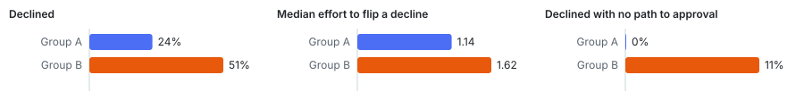
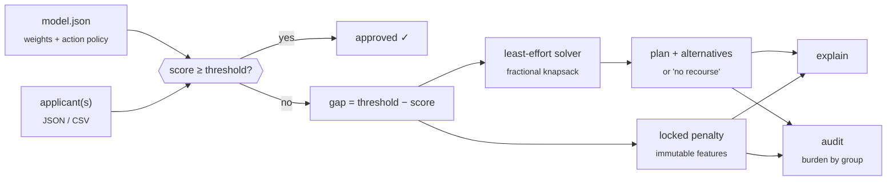
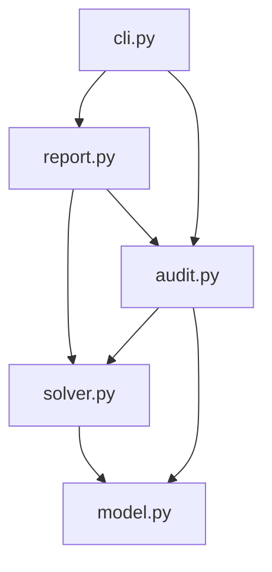

<div align="center">

# recourse

**Tell people what they can change after an automated “no”, and check whether that burden falls evenly across groups.**


</div>

---

## The problem

Automated scoring models now decide who gets loans, apartments, insurance, benefits and job interviews. When one says **no**, the person usually gets one of these:

- nothing at all,
- a vague list of “reason codes” (*“insufficient credit history”*), or
- a reason they can’t act on (*“residential area”*).

The law expects more. The US Equal Credit Opportunity Act requires specific reasons for a decline. GDPR Article 22 and the EU AI Act (Article 86) give people a right to a meaningful explanation of significant automated decisions. Still, a reason is not the same as a route. Knowing that your *utilisation is high* doesn’t tell you **how much lower it needs to be**, or whether that alone would be enough.

There is also a fairness gap that approval-rate audits miss. Two groups can be declined at similar rates while one of them **needs far more effort to recover**, or has **no realistic path at all**, because the model leans on things they cannot change.

## What `recourse` does

| | Command | Who it’s for | Answers |
|---|---|---|---|
| 🧭 | `explain` | the person declined, or the caseworker helping them | *Why was I declined, and what is the **least-effort** change that would flip it?* |
| ⚖️ | `audit`   | model owners, auditors, regulators | *Is the **burden of recourse** shared evenly, and who is **locked out**?* |
| 🔍 | `inspect` | anyone reviewing a model | *What does this model reward, and what can people actually change?* |

It is one small Python package with **zero dependencies** (about 550 lines of code). It works offline, reads plain JSON and CSV, and audits about 100,000 records per second on a laptop.

---

## Quick start

```bash
git clone <this repo> && cd EthicalAI/recourse
python -m recourse explain examples/credit/model.json examples/credit/applicant.json
python -m recourse audit   examples/credit/model.json examples/credit/applicants.csv --svg audit.svg --md audit.md
python -m recourse inspect examples/credit/model.json
python -m unittest discover -s tests          # 13 tests, < 0.1 s
```

To get a `recourse` command on your PATH, run `pip install .` (optional).

### 🧭 Explain one decision

```text
$ python -m recourse explain examples/credit/model.json examples/credit/applicant.json

Example credit scorecard — A-1042
Decision: DECLINED   (score -0.39, needs ≥ +0.00)

Main reasons
  1. Area risk index     0.52  typical 0.3   -0.44
  2. Annual income       $46k  typical $55k  -0.32
  3. Credit utilisation   40%  typical 35%   -0.15
  4. Outstanding debt    $18k  typical $15k  -0.12

What would change the outcome
  Least-effort plan  (effort 0.78)
    • Credit utilisation  40% → 27%
  Or any one of these on its own
    • Annual income     $46k → $58k  (effort 1.80)
    • Outstanding debt  $18k → $8k  (effort 2.00)

Outside your control: Area risk index (set by home postcode; a likely geographic proxy
for race and income), Credit history (only grows with time).
  These cost 0.56 points — without them you would already be approved.
```

The output gives three kinds of help:

- **Reasons:** what pulled the score down, compared with a typical applicant.
- **A plan:** specific target numbers, with the cheapest combination first, then single-step alternatives so the person can pick what fits their life.
- **Honesty about locks:** what the person *cannot* change, and how much it cost them.

Pass `--json` for a structured payload you can drop into a decision letter or app. You can also explain a row straight from a CSV: `explain model.json data.csv --id P-0353`.

### ⚖️ Audit a population

```text
$ python -m recourse audit examples/credit/model.json examples/credit/applicants.csv

Recourse audit — Example credit scorecard  (grouped by 'group', 600 records)

group      n   declined  median effort  no recourse  locked penalty
───────  ───  ─────────  ─────────────  ───────────  ──────────────
Group A  300   72 (24%)           1.14       0 (0%)           -0.49
Group B  300  153 (51%)           1.62     17 (11%)           -0.75

Findings
  ⚠ 17 of 225 declined people (8%) have no achievable path to approval.
  ⚠ Recourse burden ratio 1.42: 'Group B' needs a median 1.62 effort points vs 1.14 for 'Group A'.
  ⚠ No-recourse ratio ∞: 11% of declined 'Group B' are stuck vs 0% of 'Group A'.
  · Fixed feature 'Area risk index' carries weight -2 — set by home postcode; a likely geographic proxy …
```

`--svg` writes a chart, and `--md` writes a [Markdown report](docs/sample-audit.md) you can paste into a model card or an audit filing:

<p align="center"></p>

In this synthetic example, Group B is declined more often **and** has to work about 42% harder to recover. One in nine declined Group B applicants cannot get approved by any realistic change. The cause is visible in the *locked penalty* column: the area risk index costs Group B far more, and nobody can change it. A plain approval-rate audit would show the first bar and miss the other two.

Add `--strict` to exit with code 1 when anything is flagged, so you can **gate a model release in CI**.

---

## How it works



### The solver in one paragraph

A linear scorecard is `score = b + Σ wᵢ·xᵢ`. To flip a decline we must close the gap `g = t − score` using only features the person can change, while keeping total effort `Σ costᵢ·|Δxᵢ|` as low as possible. Each feature can move only so far (its direction, its `min`/`max`, and a realistic `max_change`). That makes this a **fractional knapsack**. You rank levers by *score gained per unit of effort*, `|wᵢ| / costᵢ`, and use each one up to its limit until the gap closes. Greedy is **exactly optimal** for continuous features. With `step` rounding (whole dollars, whole percentage points) it is optimal up to one step per feature, and a brute-force test checks this. If every lever is exhausted and a gap remains, the person has **no recourse** under the policy, and the leftover `shortfall` says by how much.

### Audit metrics

| Metric | Meaning | Flag when |
|---|---|---|
| **Median effort** | Least effort needed to flip a decline, among declined people who *can* flip it | — |
| **Recourse burden ratio** | Highest group median effort ÷ lowest | ≥ 1.25 (the inverse of the four-fifths rule) |
| **No-recourse rate** | Share of declined people with no achievable path | ≥ 5 % overall |
| **No-recourse ratio** | Highest group no-recourse rate ÷ lowest | ≥ 1.25 and at least 3 people stuck |
| **Locked penalty** | Average score lost to immutable features among the declined | shown for context |

These thresholds are **prompts for human review, not legal tests**. Change them in `recourse/audit.py`.

---

## Describing a model

A model file has two layers: the **scorecard**, which comes from whoever built the model, and the **action policy**, which is a human judgement about what is fair to ask of people. Keeping both in one readable file means that judgement can be reviewed too.

```jsonc
{
  "name": "Example credit scorecard",
  "intercept": 0.6, "threshold": 0,
  "outcome": { "positive": "approved", "negative": "declined" },
  "features": {
    "income_k": {
      "label": "Annual income", "unit": "$k",
      "weight": 0.035,        // scorecard
      "reference": 55,        // "typical" value, used for reasons
      "mutable": true,        // ── action policy ──
      "direction": "increase",
      "max_change": 15,       // realistic within the horizon
      "step": 1,              // smallest meaningful change
      "cost": 0.15            // effort points per unit
    },
    "area_risk_index": {
      "label": "Area risk index", "weight": -2.0, "reference": 0.3,
      "note": "set by home postcode; a likely geographic proxy"   // immutable by default
    }
  }
}
```

| Key | Default | Purpose |
|---|---|---|
| `weight` | *required* | Coefficient in the linear score |
| `label`, `unit` | name, — | Human-readable display (`$k`, `%`, `yrs`, …) |
| `reference` | `0` | Baseline used to rank reasons |
| `mutable` | `false` | Whether the person can change it at all. **Immutable is the safe default** |
| `direction` | `both` | `increase`, `decrease` or `both` |
| `min`, `max` | ±∞ | Hard bounds on the value |
| `max_change` | ∞ | Largest realistic change within the decision horizon |
| `step` | `0` | Rounding unit for changes (`0` = continuous) |
| `cost` | `1` | Effort points per unit of change. This is where you encode that a $1k raise is harder than a 1 pp utilisation drop |
| `note` | — | Why the feature is fixed or sensitive. Shown in every output |

Logistic-regression models and points-based scorecards both fit this format: use the log-odds coefficients, and set `threshold` to the logit of the approval cut-off.

### Using it from Python

```python
from recourse import Model, best_plan, audit

model = Model.load("examples/credit/model.json")
x = model.vector({"income_k": 46, "utilization_pct": 40, "debt_k": 18,
                  "missed_payments_24m": 0, "history_years": 6, "area_risk_index": 0.52})

plan = best_plan(model, x)
for c in plan.changes:
    print(c.feature.title, c.before, "→", c.after)      # Credit utilisation 40.0 → 27.0
```

---

## Codebase structure

```text
recourse/
├── README.md                 ← you are here
├── pyproject.toml            ← packaging; zero runtime dependencies
├── recourse/
│   ├── __init__.py           ← public API: Model, Feature, best_plan, single_changes, audit
│   ├── __main__.py           ← enables `python -m recourse`
│   ├── model.py              ← Feature (scorecard + action policy) and Model (load, score, reasons)
│   ├── solver.py             ← least-effort plan, single-change alternatives, locked penalty
│   ├── audit.py              ← population audit: per-group burden, no-recourse rates, findings
│   ├── report.py             ← renderers: terminal text, Markdown, JSON, SVG chart
│   └── cli.py                ← argparse front-end for inspect / explain / audit
├── examples/credit/
│   ├── model.json            ← illustrative scorecard + action policy
│   ├── applicant.json        ← one declined applicant (used above)
│   ├── applicants.csv        ← 600 synthetic applicants in two groups
│   └── generate.py           ← seeded generator for applicants.csv
├── docs/
│   ├── audit.svg             ← chart produced by `audit --svg`
│   └── sample-audit.md       ← report produced by `audit --md`
└── tests/
    └── test_recourse.py      ← solver optimality (vs brute force), audit, CLI
```



Dependencies only point **downward**. `model.py` knows nothing about solving, and `solver.py` knows nothing about groups or output formats. Each layer can be read, tested and replaced on its own.

---

## Design choices

- **Immutable by default.** A feature counts as changeable only when someone writes down that it is. Forgetting to fill in the policy makes recourse look *worse*, never falsely better.
- **Effort is explicit.** Every `cost` sits in plain sight, so whoever builds the model has to state what they are asking of people, and that statement can be challenged.
- **Optimal and explainable.** The solver is a dozen lines a non-specialist can follow, with a proof of optimality that fits in a paragraph. There is no black box explaining a black box.
- **No-recourse is a first-class outcome.** Telling someone *“there is no realistic path”* is more honest than inventing an impossible one. It is also the most important signal for an auditor.
- **Synthetic data only.** The example is generated (`generate.py`, seeded). It shows how segregation can leak into “neutral” features. It does not describe any real lender.

## Limitations

- **Linear models only (for now).** The exact solver depends on linearity. Many real credit and eligibility scorecards *are* linear or points-based. For tree ensembles or neural networks, see the roadmap.
- **Features change independently.** The solver assumes changing one feature doesn’t change another (paying down debt doesn’t also lower utilisation). Causal recourse is an open research area.
- **Costs are judgements.** Different people face different costs. A $15k raise is not the same effort for everyone. Use the audit to compare policies, and don’t treat a single effort number as the truth about someone’s life.
- **A plan is not a promise.** Models get retrained. Pair recourse with a commitment to honour it for a set period.

## Roadmap

- [ ] Per-person cost overrides (for example, caregivers can’t increase hours)
- [ ] Monotone tree ensembles via a mixed-integer formulation
- [ ] Plain-language letter templates (pairs well with a readability checker)
- [ ] Simple causal links between features (debt → utilisation)

## Background reading

- Ustun, Spangher & Liu, *Actionable Recourse in Linear Classification*, FAT\* 2019
- Wachter, Mittelstadt & Russell, *Counterfactual Explanations without Opening the Black Box*, Harvard JOLT 2018
- Karimi et al., *A Survey of Algorithmic Recourse*, ACM Computing Surveys 2022
- US CFPB Circular 2022-03, *Adverse action notification requirements and complex algorithms*

## License

MIT. Use it, fork it, and put it in front of the people your models decide about.
