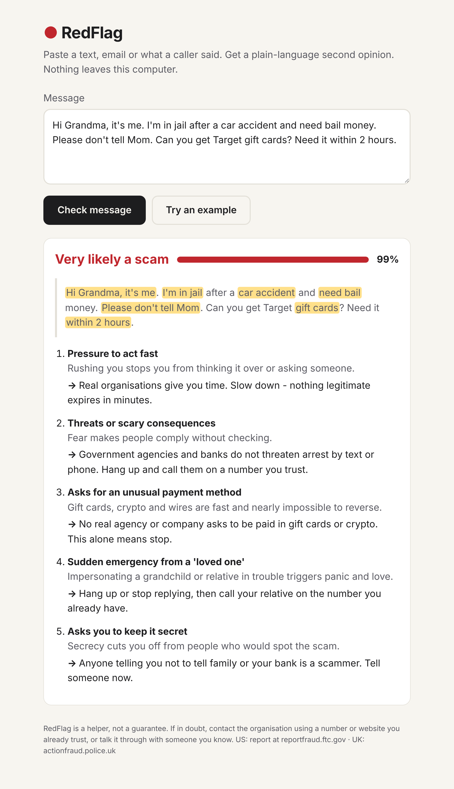
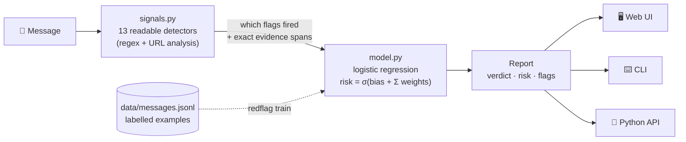
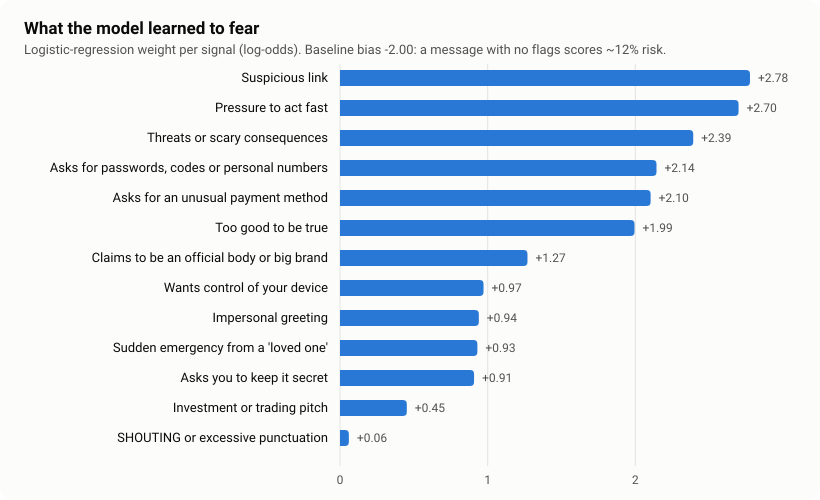
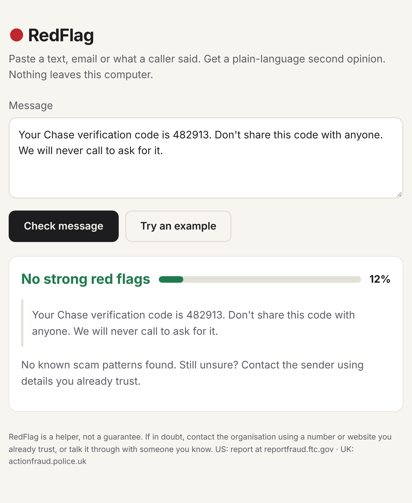

<div align="center">

# 🚩 RedFlag

**An offline scam-message checker that explains its verdict in plain language and tells you what to do next.**

Paste a text, email or what a caller said. RedFlag highlights the warning signs, says why scammers use them, and gives one clear next step.

    



</div>

---

## Contents

- [Why this exists](#why-this-exists)
- [What it does](#what-it-does)
- [Quick start](#quick-start)
- [How it works](#how-it-works)
- [Results](#results)
- [Ethics by design](#ethics-by-design)
- [Codebase structure](#codebase-structure)
- [Extending RedFlag](#extending-redflag)
- [Limitations](#limitations)
- [Roadmap](#roadmap)

---

## Why this exists

Fraud by text, email and phone is one of the fastest-growing crimes, and it hits hardest the people least able to absorb the loss.

| | |
|---|---|
| **$12.5 billion** | lost to fraud in 2024, reported by US consumers to the FTC ([FTC, 2025](https://www.ftc.gov/news-events/news/press-releases/2025/03/new-ftc-data-show-big-jump-reported-losses-fraud-125-billion-2024)). |
| **$4.8+ billion** | lost by people over 60 in 2024, according to the FBI's Internet Crime Complaint Center ([IC3 Elder Fraud Report](https://www.ic3.gov/)). |
| **Most go unreported** | Shame and confusion keep many victims silent, so the real totals are higher. |

Most scams use the same few psychological levers: **urgency, fear, authority, secrecy and payment methods that can't be reversed**. Spotting those levers is a skill people can learn. RedFlag is a patient second opinion that spots them for you, explains each one, and builds that skill over time.

**Who it's for:** older adults and their families, caregivers, library and senior-centre volunteers, community helplines, and anyone who has ever thought *"is this real?"*

---

## What it does

- **Flags 13 warning signs**: urgency, threats, impersonation of officials, gift-card or crypto payments, requests for codes or passwords, too-good-to-be-true prizes, secrecy, remote-access apps, "Hi Mum, it's me" emergencies, look-alike links, and more.
- **Shows the evidence**: the exact words that triggered each flag are highlighted.
- **Explains why**: every flag says *why* scammers do this and *what to do instead*.
- **Gives a calibrated verdict**: `No strong red flags` · `Be careful` · `Very likely a scam`.
- **Keeps everything on the device**: no network calls, no accounts, no telemetry, and the server never logs messages.
- **Has three interfaces**: a large-type web UI, a command-line tool, and a one-line Python API.

---

## Quick start

No dependencies, just Python 3.10+.

```bash
git clone https://github.com/kareemrt/EthicalAI.git
cd EthicalAI/redflag

python -m redflag serve          # web UI  ->  http://127.0.0.1:8765
```

### Command line

```bash
python -m redflag check "Dear Customer, your PayPal account is locked. Confirm your card number at paypal-secure-login.com within 24 hours."
```

```text
  VERY LIKELY A SCAM   ████████████████████  99% risk

  1. Suspicious link  "paypal-secure-login.com"
     Why: Shortened, look-alike or odd-domain links hide where they really go.
     Do:  Don't tap the link. Type the company's address into your browser yourself.

  2. Pressure to act fast  "within 24 hours"
     Why: Rushing you stops you from thinking it over or asking someone.
     Do:  Real organisations give you time. Slow down - nothing legitimate expires in minutes.

  3. Threats or scary consequences  "account is locked"
  4. Asks for passwords, codes or personal numbers  "Confirm your card number ..."
  5. Impersonal greeting  "Dear Customer"
```

Text can also be piped in (`pbpaste | python -m redflag check`). Add `--json` for machine-readable output. The exit code is `0` (ok), `1` (be careful) or `2` (likely scam), so RedFlag slots into scripts and mail filters.

### Python

```python
import redflag

report = redflag.check("IRS final notice: pay today with Google Play cards or face arrest")
report.verdict      # 'Very likely a scam'
report.risk         # 0.998
[f.signal.label for f in report.flags]
# ['Pressure to act fast', 'Threats or scary consequences', 'Asks for an unusual payment method',
#  'Claims to be an official body or big brand']
```

`pip install -e .` also gives you a `redflag` command.

---

## How it works

RedFlag is a **glass-box model**: human-readable detectors feed a logistic regression whose every weight you can read and question.



**1. Signals: what a careful friend would notice.** Each signal in [`signals.py`](redflag/signals.py) is a small detector with a label, a *why* and a *do*. Some are phrase patterns (e.g. `gift card`, `within 24 hours`). Some are structural: the link analyser catches URL shorteners, raw-IP links, punycode, risky top-level domains, and **brand look-alikes** (`paypal-secure-login.com` contains "paypal" but isn't `paypal.com`). Patterns that are negated ("we will **never** ask for your PIN") are ignored on purpose, because real banks say exactly that.

**2. Model: how much each sign matters.** Weights aren't hand-picked. They're **learned** from labelled examples by L2-regularised logistic regression, written in about 30 lines of plain Python. The final score is simply:

```
risk = sigmoid(bias + sum of the weights of the flags that fired)
```

So any verdict can be checked by hand. A test asserts exactly that.

<p align="center"></p>

The model's lessons line up with consumer-protection guidance: links, pressure, threats, credential requests and untraceable payments carry the most weight. It also learned that **SHOUTING!!!** on its own says almost nothing, since excited grandchildren use it too.

**3. Verdict tiers.**

| Risk | Verdict | Meaning |
|---|---|---|
| ≥ 80% | 🔴 **Very likely a scam** | Stop. Don't reply, pay or click. |
| 45–80% | 🟠 **Be careful** | Check with the organisation using details you already trust. |
| < 45% | 🟢 **No strong red flags** | Not a guarantee. Stay alert. |

The displayed risk is capped at 99%. The tool never claims certainty.

---

## Results

```bash
python -m redflag eval
```

| Evaluation | Accuracy | Precision | Recall | False-alarm rate |
|---|---|---|---|---|
| 5-fold cross-validation (100 training messages) | 94% | 100% | 88% | 0% |
| **Held-out set** (20 messages written *after* tuning, never used to adjust anything) | **85%** | **100%** | **70%** | **0%** |

The held-out row is the honest number. On it, RedFlag raised **no false alarms** on real bank codes, delivery notices or family chat, and **missed 3 of 10 scams**:

- *"send us the 6-digit code we texted you"*: "6-digit code" isn't yet in the credentials vocabulary.
- *"Hi Mom, I dropped my phone in the toilet, this is my temporary number"*: a new wording of the "new number" scam.
- *"give us remote access"*: the signal fired, but on its own the learned weight was too small to cross the threshold.

These misses are kept in the record on purpose. Each one points to a specific improvement in [Roadmap](#roadmap).

> ⚠️ The dataset is small and **synthetic**: hand-written paraphrases of patterns described in public FTC, FBI IC3 and Action Fraud alerts. It contains no real people's messages. Treat these numbers as a sanity check, not a benchmark.

<details>
<summary>Second screenshot: a real one-time-code text correctly left alone</summary>
<p align="center"></p>
</details>

---

## Ethics by design

| Principle | How RedFlag implements it |
|---|---|
| **Privacy** | Runs fully offline. The web server binds to `127.0.0.1`, never logs request bodies, and caps input size. No analytics, no accounts. |
| **Transparency** | Every flag shows the evidence, the reasoning and the weight. The model is a few numbers in a [JSON file](redflag/weights.json). |
| **Empowerment, not dependence** | Each explanation teaches the underlying trick, so people get better at spotting scams themselves. |
| **Humility** | Never shows 100%. A "no red flags" result still tells users to verify through trusted channels. |
| **Low false alarms** | Legitimate messages that look scary (OTP codes, bank alerts, "Hi Mum" texts) are in the training data deliberately, so the tool doesn't teach people to distrust everything. |
| **Accessibility** | 19 px base text, high contrast, light and dark themes, keyboard friendly (`Ctrl/⌘ + Enter`), `aria-live` results, and plain language at roughly a reading age of 12. |
| **Auditability** | Deterministic training and zero dependencies, so anyone can reproduce the exact weights with `python -m redflag train`. |

---

## Codebase structure

```text
redflag/
├── redflag/                  # the package (≈ 480 lines of Python)
│   ├── signals.py            # 13 red-flag detectors: label, why, advice, detect()
│   ├── model.py              # logistic regression: train, save/load, score -> Report
│   ├── weights.json          # learned weights (human-readable, version-controlled)
│   ├── cli.py                # `check`, `train`, `eval`, `serve` commands + terminal renderer
│   ├── server.py             # stdlib HTTP server: GET / and POST /api/check, localhost-only
│   ├── static/index.html     # single-file web UI (no build step, no external requests)
│   ├── __init__.py           # public API: redflag.check(text)
│   └── __main__.py           # enables `python -m redflag`
├── data/
│   ├── messages.jsonl        # 100 labelled training messages (50 scam / 50 legitimate)
│   └── holdout.jsonl         # 20 held-out messages, never used for tuning
├── tests/test_redflag.py     # 21 tests: signals, negation, explainability, CLI, server
├── scripts/plot_weights.py   # regenerates docs/weights.svg (pure Python)
├── docs/                     # README images + ARCHITECTURE.md
└── pyproject.toml            # packaging, `redflag` console script, pytest config
```

See **[docs/ARCHITECTURE.md](docs/ARCHITECTURE.md)** for the data flow, module contracts and design decisions.

---

## Extending RedFlag

**Add a signal.** Append one entry to `SIGNALS` in `signals.py`:

```python
Signal("job_scam", "Too-easy job offer",
       "Fake jobs harvest your ID or launder money through your account.",
       "Real employers never ask you to deposit a cheque and send money back.",
       _rx(r"\bwork from home\b", r"\bdeposit (the|a) che(ck|que)\b")),
```

**Add examples.** Append lines to `data/messages.jsonl` (`{"text": "...", "label": 1}`).

**Retrain and check.**

```bash
python -m redflag train && python -m redflag eval && pytest -q
python scripts/plot_weights.py   # refresh the chart
```

---

## Limitations

- **English only**, and tuned to US and UK scam patterns.
- **Pattern-based.** A brand-new script with none of the known levers can slip through. RedFlag lowers risk; it doesn't remove it.
- **Small, synthetic training set.** Weights for rare signals (remote access, investment) are under-confident.
- **Text only.** It doesn't inspect attachments, images, voice calls, or sender metadata such as email headers.
- **Not a substitute** for calling your bank, a trusted person, or the authorities.

---

## Roadmap

- [ ] Broaden vocabularies using the held-out misses ("N-digit code", "temporary number"), then write a *new* held-out set.
- [ ] Safety floor: any of `payment`, `remote_access` or `credentials` alone triggers at least **Be careful**, since a missed scam costs far more than a false alarm.
- [ ] Larger, consented and anonymised real-world dataset via partnerships with fraud helplines.
- [ ] Spanish, French and Hindi signal packs.
- [ ] Browser extension and an Android share-sheet target ("Share → Check with RedFlag").
- [ ] Optional "tell a trusted person" button that drafts a message to a family member.

---

<div align="center">
<sub>MIT licensed · Built as part of <a href="../README.md">EthicalAI</a> · If you've been scammed, it's not your fault. Report it: <a href="https://reportfraud.ftc.gov">reportfraud.ftc.gov</a> (US) · <a href="https://www.actionfraud.police.uk">actionfraud.police.uk</a> (UK)</sub>
</div>
