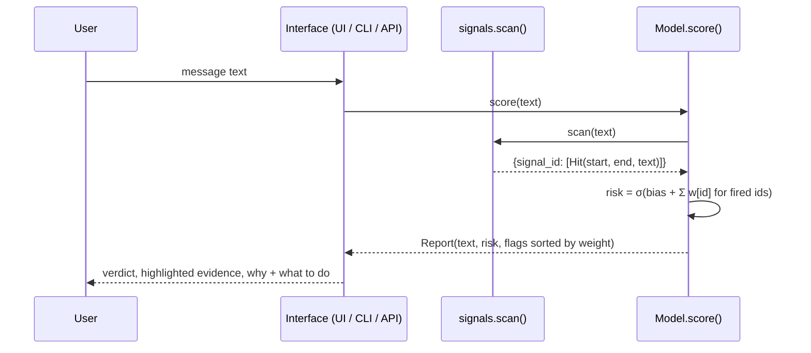

# RedFlag architecture

RedFlag fits in your head: about 480 lines of standard-library Python, one HTML file and one JSON file of weights.

## Data flow



## Modules and their contracts

| Module | Responsibility | Key objects | Depends on |
|---|---|---|---|
| `signals.py` | Find warning signs and record **where** they occur | `Signal(id, label, why, advice, detect)`, `Hit(start, end, text)`, `scan(text)`, `SIGNALS`, `BY_ID` | stdlib only |
| `model.py` | Turn fired signals into a calibrated risk; learn weights | `Model.train/save/load/score`, `Report`, `Flag`, `VERDICTS` | `signals` |
| `weights.json` | The entire trained model: `{bias, weights: {signal_id: float}}` | – | – |
| `cli.py` | User commands, terminal rendering, evaluation | `main`, `render`, `cross_validate`, `holdout`, `metrics` | `model` |
| `server.py` | Local HTTP API and static UI | `make_handler(model)`, `serve(port)` | `model` |
| `static/index.html` | Accessible single-page UI; escapes all text before highlighting | – | `POST /api/check` |

**Invariants (enforced by tests):**

1. `text[hit.start:hit.end] == hit.text` for every hit, so highlighting is always exact.
2. `report.risk == sigmoid(bias + Σ flag.weight)`, so every verdict is explainable by arithmetic.
3. Training is deterministic (seeded), so weights are reproducible.
4. Negated phrases ("never share your PIN") don't fire `credentials` or `payment`.

## HTTP API

`POST /api/check` with body `{"text": "..."}` (max 20 kB) returns:

```json
{
  "risk": 0.998, "level": "danger", "verdict": "Very likely a scam",
  "flags": [{
    "id": "payment", "label": "Asks for an unusual payment method", "weight": 2.1,
    "why": "Gift cards, crypto and wires are fast and nearly impossible to reverse.",
    "advice": "No real agency or company asks to be paid in gift cards or crypto. This alone means stop.",
    "evidence": [{"start": 33, "end": 50, "text": "Google Play cards"}]
  }]
}
```

`level` is one of `ok | warn | danger`. The server binds to `127.0.0.1` and overrides `log_message` so message contents are never written to logs.

## Design decisions

| Decision | Why | Trade-off |
|---|---|---|
| **Binary hand-written features plus learned weights** rather than an end-to-end text model | Every output is traceable to a named, human-understandable reason, which the advice text requires. It also trains in under a second on tiny data. | Lower ceiling than a large language model on novel wording. |
| **Logistic regression in pure Python** | Zero dependencies makes it trivial to audit, install and run on old hardware. | Slower than NumPy, which doesn't matter at 13 features. |
| **Weights in JSON** | Diffable in code review: a change in what the model "fears" shows up in a pull request. | – |
| **Regex with negation guard** | Real institutions use the same words *defensively* ("we'll never ask for your code"). | The negation window (30 chars) is a heuristic. |
| **Brand look-alike check on the registrable domain** | Catches `paypal-secure-login.com` and `chase.com-secure.support` while allowing `paypal.com`. | Needs the brand list to be maintained. |
| **Held-out set kept separate from tuning** | Detectors were refined on the training set, so cross-validation is optimistic. The holdout gives an honest estimate. | Small (n = 20), so wide error bars. |
| **Verdict thresholds 0.45 / 0.80** | The middle "Be careful" band leans towards caution, because a missed scam costs more than a moment of doubt. | Some legitimate but urgent messages will land in "Be careful". |

## Reproducing everything

```bash
python -m redflag train          # rewrites redflag/weights.json
python -m redflag eval           # cross-validation + held-out metrics
python scripts/plot_weights.py   # rewrites docs/weights.svg
pytest -q                        # 21 tests
```
