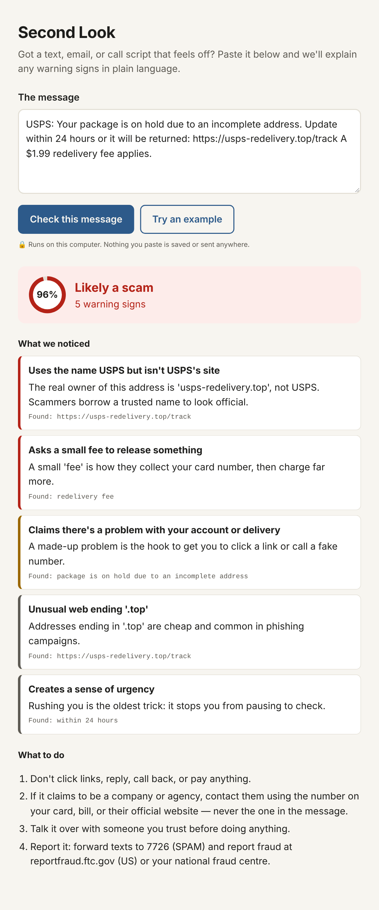
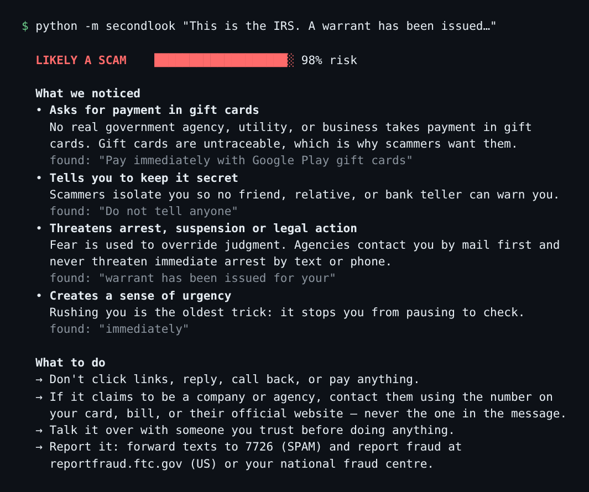
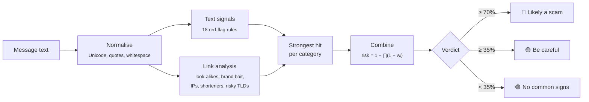

<div align="center">

# 🔍 Second Look

**Paste a suspicious text, email, or phone script and get a plain-language explanation of every warning sign it contains.**

Explainable · Runs offline · Zero dependencies · Built for the people scammers target most



</div>

---

## The problem

Scams are no longer rare. In 2024 Americans reported losing **$12.5 billion** to fraud
([FTC](https://www.ftc.gov/news-events/news/press-releases/2025/03/new-ftc-data-show-big-jump-reported-losses-fraud-125-billion-2024)),
and people over 60 reported **$4.9 billion** in losses to the FBI alone
([IC3 Elder Fraud Report](https://www.ic3.gov/AnnualReport/Reports/2024_IC3ElderFraudReport.pdf)).
Reported numbers are only a fraction of real losses, because many victims feel too ashamed to report.

Today's tools mostly fail the people who need them:

| Today's tools | The problem |
|---|---|
| Carrier and inbox spam filters | Black boxes. If a scam gets through, nothing explains *why* it's dangerous. |
| "Is this a scam?" AI chatbots | Your private message goes to a third-party server, and the answer can change from one try to the next. |
| Awareness posters and leaflets | Good advice, but they aren't there when the message arrives. |

**Second Look** is the second opinion you'd get from a careful, informed friend. It points to the
exact words that are red flags, explains each tactic in one sentence, and says what to do next.
It never sends the message anywhere.

## Design principles

| | Principle | In practice |
|---|---|---|
| 🧾 | **Explain, don't just judge** | Every flag shows the matched words and a one-sentence reason. The score is simple enough to work out by hand. |
| 🔒 | **Private by default** | No network calls, no logging, no storage. The web server binds to `127.0.0.1` only. |
| 🪶 | **Lightweight** | Pure Python standard library, about 600 lines of logic. It runs on an old laptop, a Raspberry Pi, or a library kiosk. |
| 👵 | **Accessible** | Large type, high contrast, dark mode, screen-reader-friendly results, and no jargon. |
| ✍️ | **Auditable rules** | Red flags are plain data in [`signals.py`](secondlook/signals.py) that a fraud specialist can review without reading the engine. |
| 🙅 | **Never overconfident** | Even a "low" result says no tool catches everything, and always points to independent verification. |

## Quick start

```bash
git clone https://github.com/kareemrt/EthicalAI && cd EthicalAI/secondlook

# Check a message directly
python -m secondlook "Your package is on hold. Pay \$1.99 at usps-redelivery.top"

# ...or from a file / clipboard
python -m secondlook suspicious.txt
pbpaste | python -m secondlook

# Friendly web page for non-technical users
python -m secondlook --serve        # → http://127.0.0.1:8765
```

Requires Python 3.9+, and nothing else. `pip install .` adds a `secondlook` command.



### Use it from code

```python
from secondlook import check

report = check("Grandma, I'm in jail. Don't tell mom. A courier will pick up the bail cash.")
report.level      # 'high'
report.risk       # 0.965
[f.title for f in report.flags]
# ['Wants cash picked up or mailed', 'Tells you to keep it secret', "A 'family member' in trouble"]
```

`--json` gives the same report in machine-readable form. Exit codes are `0` low, `1` caution,
`3` high, so you can use it in scripts and mail filters.

## How it works



**1. Text signals.** These are the tactics fraud investigators teach people to spot, grouped by category:

| Category | What it catches | Example trigger |
|---|---|---|
| `payment` | Gift cards, crypto, wires, payment apps, cash couriers | *"pay with Google Play gift cards"* |
| `pressure` | Manufactured urgency | *"within 24 hours"*, *"final notice"* |
| `isolation` | Being told to keep it secret | *"don't tell your family"* |
| `threat` | Arrest, suspension, disconnection | *"a warrant has been issued"* |
| `credentials` | Passwords, SSNs, one-time codes, remote access | *"read us the code we sent"*, *"install AnyDesk"* |
| `bait` | Prizes, and small fees to release something | *"you've won"*, *"customs fee"* |
| `story` | Family emergencies, overpayments, fake checks, investment promises | *"Hi mum, new number"* |

**2. Link analysis.** This checks web addresses without visiting them:

| Check | Catches |
|---|---|
| Look-alike spelling | `paypa1.com`, `amaz0n-support.com`, `rnicrosoft.com`, `gooogle.com` |
| Brand bait | `usps-redelivery.top`, `paypal.com.secure-id.net` |
| Brand mismatch | A message that says "Netflix" but links to `renew-now.com` |
| Hidden destination | `bit.ly/...`, raw IP addresses, `user@host` tricks, punycode |
| Risky endings | `.top`, `.xyz`, `.click`, `.live` and others common in phishing campaigns |

Official domains such as `tools.usps.com` and `www.paypal.com` are recognised and never flagged.

**3. Scoring.** Within a category, only the strongest hit counts, so saying "URGENT" five times
isn't five times as suspicious. Categories then combine like independent warnings:

```
risk = 1 − (1 − w₁)(1 − w₂)…
```

Example: a gift-card request (0.85) plus secrecy (0.65) gives 1 − 0.15 × 0.35 = **95%**.
Urgency on its own (0.30) stays "low", because plenty of honest sales say "last chance".

## Evaluation

```bash
python -m secondlook.evaluate                          # tuning corpus
python -m secondlook.evaluate examples/holdout.jsonl   # held-out corpus
```

| Corpus | Messages | Precision | Recall | Notes |
|---|---|---|---|---|
| [`corpus.jsonl`](examples/corpus.jsonl) | 25 scam / 15 legit | 100% | 100% | Rules were tuned on this set, so it's a regression check, not proof. |
| [`holdout.jsonl`](examples/holdout.jsonl) | 12 scam / 8 legit | **100%** | **83%** | Written after tuning. No rules were changed in response to it. |

The two held-out misses show the tool's limits honestly:

- *"Citi Fraud Dept: did you attempt a $2,400 Zelle payment? Reply NO and an agent will call you."*
  This **bank-impersonation callback** scam contains no link, payment request or threat. The harm happens later, on the phone.
- *"Geek Squad: your annual subscription of $399.99 has been renewed. Call us within 24 hours."*
  This **fake renewal** only triggers the urgency rule.

Both corpora are small and hand-written to cover common, publicly documented scam types. They are
not a benchmark. Contributions of real, anonymised examples are the most valuable thing you can add.

## Project structure

```
secondlook/
├── secondlook/              # the package: standard library only
│   ├── signals.py           # red-flag rules as plain data (edit here to add tactics)
│   ├── links.py             # URL extraction + look-alike / brand-bait / IP / TLD checks
│   ├── engine.py            # normalise → match → combine → Report (pure, no I/O)
│   ├── cli.py               # terminal output, --json, exit codes, --serve
│   ├── web.py               # localhost-only HTTP server (no logging, no storage)
│   ├── evaluate.py          # precision / recall against a labelled JSONL corpus
│   ├── static/index.html    # accessible single-page UI (vanilla JS, no CDN)
│   ├── __init__.py          # public API: check(), Report
│   └── __main__.py          # `python -m secondlook`
├── examples/
│   ├── corpus.jsonl         # 40 labelled messages used while writing rules
│   └── holdout.jsonl        # 20 labelled messages never used for tuning
├── tests/test_secondlook.py # 22 unit + integration tests (CLI, API, corpora)
├── docs/                    # README screenshots
└── pyproject.toml           # optional install; zero dependencies
```

**Data flow:** `cli.py` / `web.py` → `engine.check()` → (`signals.match_signals`, `links.analyze_url`, `links.brand_mismatch`) → `Report`.
Only `cli.py` and `web.py` do any I/O, so the engine is easy to embed in a browser extension, a mail
filter, or an SMS bot.

## Extending

**Add a red flag.** Append one entry to `SIGNALS` in [`signals.py`](secondlook/signals.py):

```python
_s("fake_renewal", "story", 0.5,
   r"\b(subscription|membership)\b.{0,40}\b(renewed|auto.?renew)\b.{0,80}\b(call|cancel|refund)\b",
   "Claims a subscription renewed and asks you to call",
   "Fake renewal notices push you to call a 'refund line' run by the scammer."),
```

**Add a brand.** Add its official domains to `BRANDS` and a name pattern to `BRAND_MENTIONS` in
[`links.py`](secondlook/links.py).

**Then run** `python -m unittest` and both evaluation commands. Check that held-out precision hasn't dropped.

## Limitations

- **English, text only.** It can't hear a cloned voice or read a screenshot. Paste the words in, or transcribe a voicemail first.
- **Rules can be evaded.** A careful scammer can avoid every keyword. Second Look adds to human judgment and doesn't replace it.
- **No reputation lookups.** Staying offline means it can't tell that a domain was registered yesterday.
- **US-centric advice.** Reporting links point to US services. The rules themselves apply to most countries.

## Roadmap

- [ ] Rules for callback-style bank impersonation and fake renewals (the two held-out misses)
- [ ] Spanish, Hindi, and Tagalog rule packs
- [ ] Browser extension and Android share-sheet wrapper around `engine.check()`
- [ ] Locale-aware reporting advice (Action Fraud UK, Canadian Anti-Fraud Centre, Scamwatch AU)
- [ ] Optional "trusted contact" button that drafts a "does this look right to you?" text to a family member

## Ethics

Second Look is meant to protect people, not to label them. It doesn't store messages, build
profiles, or phone home. It explains its reasoning so people learn the patterns themselves, and it
always sends people back to a trusted human or an official channel instead of asking them to trust a
score.

---

<sub>Part of <a href="../README.md">EthicalAI</a>.</sub>
