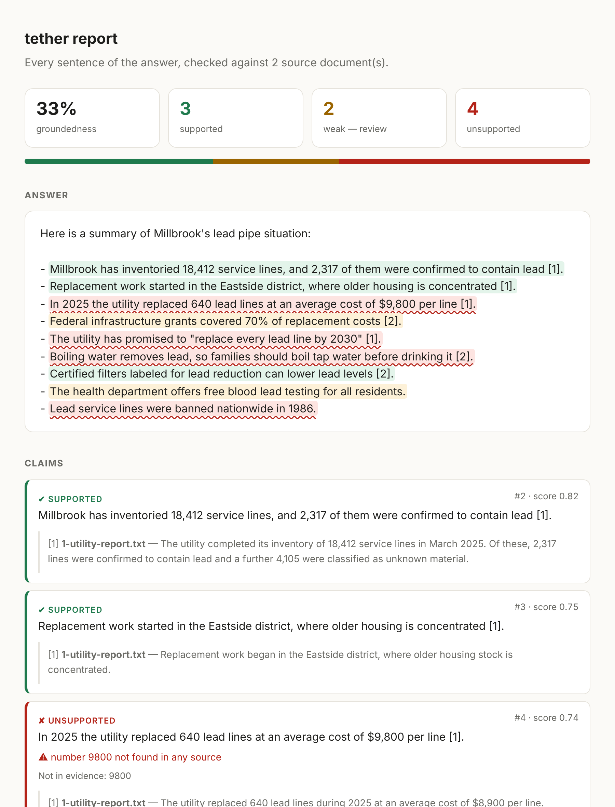
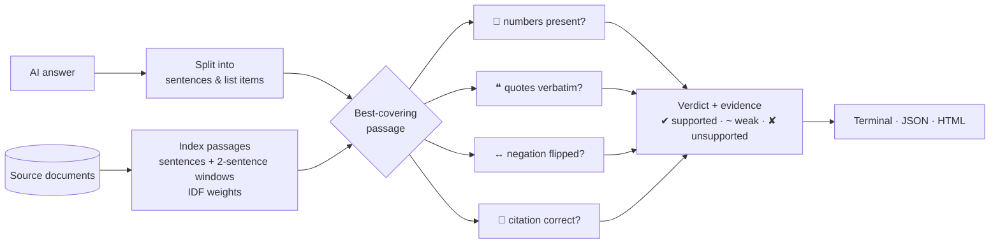

<div align="center">

# 🪢 tether

**Keep AI answers tied to their sources.**

tether checks each sentence of an AI-written answer against the documents it was supposed to come from.
It flags **invented numbers, made-up quotes, contradictions and wrong citations** before anyone acts on them.

`zero dependencies` · `~550 lines of Python` · `runs offline` · `explains every verdict`



</div>

---

## Why this exists

Organisations now hand AI tools their own documents and ask for summaries: council reports, medical leaflets, case files, policy manuals.
This setup is called *retrieval-augmented generation* (RAG), and the summaries read well. But they still **hallucinate**. The model adds a figure, rounds a date,
puts a quote in someone's mouth, or flips "does **not**" into "does". The mistakes look just like the correct sentences around them.

The harm is real and falls unevenly:

- **Public health.** A chatbot that says *"boiling water removes lead"* turns a correct advisory into a dangerous one.
- **Law.** Courts have sanctioned lawyers for filing briefs with fabricated citations produced by AI tools.
- **Public services.** Residents who can't easily check the source document are the ones who most often trust the summary.

Fact-checking the whole world is hard. Checking that an answer **stays within the documents it was given** is easier, and it's the check that matters for RAG.
tether does that check. It is cheap, transparent and deterministic, so it fits in a review workflow, a CI pipeline or a newsroom desk.

## What it catches

| Check | Example from the demo | Verdict |
|---|---|---|
| 🔢 **Invented numbers** | "$9,800 per line" when the source says $8,900 | ✘ unsupported |
| ❝ **Fabricated quotes** | `"replace every lead line by 2030"` appears nowhere | ✘ unsupported |
| ↔️ **Contradictions** | "Boiling water removes lead" vs. *"Boiling water does not remove lead."* | ✘ unsupported |
| 🔗 **Miscitations** | fact cited as `[2]` but found only in `[1]` | ~ weak |
| 🌫️ **Unsupported claims** | "banned nationwide in 1986" has no matching passage | ✘ unsupported |
| 🔍 **Over-generalisation** | "testing for *all residents*" vs. "children under six" | ~ weak |

Every verdict comes with the **closest evidence passage**, the **words not found in it**, and the specific **flag** that fired, so a reviewer can confirm or overrule it in seconds.

## Quick start

```bash
cd tether
python -m tether examples/answer.txt examples/sources --html report.html
```

No install is needed. To get a `tether` command, run `pip install .` instead.

```text
✔ SUPPORTED   ████████░░ 0.82  #2 Millbrook has inventoried 18,412 service lines, and 2,317 of them were confirmed to conta…
✔ SUPPORTED   ████████░░ 0.75  #3 Replacement work started in the Eastside district, where older housing is concentrated [1…
✘ UNSUPPORTED ███████░░░ 0.74  #4 In 2025 the utility replaced 640 lead lines at an average cost of $9,800 per line [1].
    ! number 9800 not found in any source
    ↳ [1] 1-utility-report.txt: “The utility replaced 640 lead lines during 2025 at an average cost of $8,900 per line.”
~ WEAK        ██████████ 1.00  #5 Federal infrastructure grants covered 70% of replacement costs [2].
    ! miscited: evidence is in [1], not [2]
✘ UNSUPPORTED ██░░░░░░░░ 0.22  #6 The utility has promised to "replace every lead line by 2030" [1].
    ! quote not found in any source: "replace every lead line by 2030"
✘ UNSUPPORTED █████░░░░░ 0.50  #7 Boiling water removes lead, so families should boil tap water before drinking it [2].
    ! contradicts [2]: "Boiling water does not remove lead."
...
Groundedness 33%  —  3 supported · 2 weak · 4 unsupported  (9 claims checked against 2 sources)
```

The full interactive report for this run is in [`docs/example-report.html`](docs/example-report.html). In the report, click a highlighted sentence to jump to its evidence.

### Command-line options

```text
tether ANSWER SOURCE [SOURCE ...] [options]

  ANSWER             answer file, or - to read from stdin
  SOURCE             files or folders (.txt/.md); citation [n] = n-th source in this order
  --html FILE        also write a self-contained HTML report (no JavaScript, works offline)
  --json             machine-readable output
  --fail-under X     exit 1 if groundedness < X, for CI and pipelines
  --supported 0.7    score threshold for "supported"
  --weak 0.4         score threshold for "weak"
  -v, --verbose      show evidence for supported claims too
```

### As a library

```python
from tether import check, Source

report = check(llm_answer, [Source("policy.md", policy_text), Source("faq.md", faq_text)])

if report.groundedness < 0.8:
    for claim in report.claims:
        if claim.verdict == "unsupported":
            print(claim.text, claim.flags, claim.evidence and claim.evidence.text)
```

A common pattern is to run this **before** showing a RAG answer to a user. Hold back or annotate anything that comes back unsupported.

## How it works



1. **Claims.** The answer is split into sentences and list items. Character offsets are kept so the HTML report can highlight in place. Headers ("Here's a summary:"), questions and fragments are skipped.
2. **Evidence search.** Each source is cut into single sentences and two-sentence windows, which lets a claim draw on adjacent sentences. For every claim, tether finds the passage covering the largest **IDF-weighted share** of the claim's content words, plus a small bonus for matching word pairs.
   Rare words count more than common ones. Words that appear nowhere in the sources get the **highest** weight, so an invented detail costs the claim the most.
3. **Targeted checks** on top of the score:
   - every **number** in the claim must appear in the matched passage (`9,800` ≠ `8,900`; `18,412` = `18412`);
   - every **quoted string** must appear verbatim (ignoring case and punctuation) somewhere in the sources;
   - if the claim restates ≥80% of a source sentence but with the **opposite negation**, that's a contradiction;
   - **citations** `[n]` must point to an existing source that actually holds the evidence.
4. **Verdict.** `supported` ≥ 0.7 > `weak` ≥ 0.4 > `unsupported`, then capped by any flag that fired. *Groundedness* is the share of checked claims that are fully supported.

## Honest limitations

tether is a **lexical** checker. That's what keeps it small, fast, private and explainable, but it has limits:

- **Heavy paraphrase** ("the city" vs. "the municipality") can land a true claim in *weak*. Weak means a person should look, not that the claim is false.
- **Subtle contradictions** without negation words ("rose" vs. "fell") are not caught. Neither are spelled-out numbers ("seventy percent").
- It checks **faithfulness to the sources, not truth**. If the source is wrong, tether will happily confirm the error.
- English-centric stop-words and stemming.

For high-stakes uses, treat tether as the **fast first pass** that tells a reviewer where to look. You can also pair it with a model-based entailment checker: tether's evidence passages make that second pass much cheaper.

## Codebase structure

```text
tether/
├── README.md               ← you are here
├── pyproject.toml          ← packaging; installs the `tether` command (no dependencies)
├── tether/
│   ├── __init__.py         ← public API: check(), Source, Report, Claim, verdict constants
│   ├── __main__.py         ← enables `python -m tether`
│   ├── text.py             ← pure text helpers: sentence spans, tokens, stemming,
│   │                         numbers, quotes, citations, negation detection
│   ├── core.py             ← the checker: passage Index (IDF + inverted index),
│   │                         evidence search, the four targeted checks, Report
│   ├── report.py           ← renderers: coloured terminal, JSON, self-contained HTML
│   └── cli.py              ← argument parsing, file/folder loading, exit codes
├── tests/
│   └── test_tether.py      ← unit tests for every check + end-to-end example (stdlib unittest)
├── examples/
│   ├── answer.txt          ← an AI summary with six planted errors of different kinds
│   └── sources/            ← two fictional source documents (utility report, health advisory)
└── docs/
    ├── report.png          ← screenshot used above
    └── example-report.html ← generated HTML report for the example
```

**Data flow:** `cli.py` loads files into `Source` objects, then calls `core.check()`. That function uses `text.py` to split and tokenise, builds an `Index`, and runs `_judge()` on each claim. It returns a `Report`, which `report.py` renders.
Each module depends only on the ones before it in that list, and nothing imports anything outside the Python standard library.

## Development

```bash
python -m unittest discover -s tests     # 16 tests, ~30 ms
```

Ideas for contributions: language packs (stop-words and negations), number words, an optional entailment-model plug-in, and a GitHub Action wrapper.

<sub>The example documents describe a fictional town. tether is a review aid, not a substitute for human judgement on decisions that affect people.</sub>
